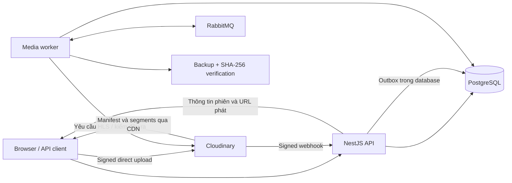

# pj-Flim

Backend cho nền tảng xem phim theo yêu cầu (VOD), sử dụng Node.js/NestJS, PostgreSQL, Cloudinary và RabbitMQ.

Repository: [dinhtung2722005/project_flim](https://github.com/dinhtung2722005/project_flim). Cập nhật ngày **11/11/2026**.

> Hiện có backend API và media worker. Frontend, trang quản trị và player trình duyệt chưa được triển khai. Các script vận hành local đang được dùng trên Windows tại `E:\pj-Flim`.

## Mục lục

- [Tính năng đã có](#tính-năng-đã-có)
- [Công nghệ](#công-nghệ)
- [Kiến trúc](#kiến-trúc)
- [Cấu trúc source](#cấu-trúc-source)
- [Yêu cầu môi trường](#yêu-cầu-môi-trường)
- [Cài đặt lần đầu](#cài-đặt-lần-đầu)
- [Chạy dự án](#chạy-dự-án)
- [Swagger và xác thực](#swagger-và-xác-thực)
- [Database](#database)
- [Luồng upload và phát video](#luồng-upload-và-phát-video)
- [Quy ước API và lỗi](#quy-ước-api-và-lỗi)
- [Kiểm thử](#kiểm-thử)
- [Lệnh thường dùng](#lệnh-thường-dùng)
- [Khắc phục lỗi local](#khắc-phục-lỗi-local)
- [Giới hạn và việc tiếp theo](#giới-hạn-và-việc-tiếp-theo)
- [Tài liệu chi tiết](#tài-liệu-chi-tiết)

## Tính năng đã có

| Nhóm               | Chức năng                                                                                                              |
| ------------------ | ---------------------------------------------------------------------------------------------------------------------- |
| Tài khoản          | Đăng ký MEMBER, đăng nhập, JWT access, refresh rotation, phiên phía server, logout, xác minh email và đặt lại mật khẩu |
| Bảo mật            | Argon2id, TOTP/recovery codes, step-up, kiểm quyền hiện hành và thu hồi phiên khi tài khoản/quyền thay đổi             |
| Phân quyền         | 5 role: MEMBER, EDITOR, ADMIN, SUPER_ADMIN, AUDITOR; 18 permission và kiểm quyền theo tài nguyên                       |
| Quản trị nội dung  | Phim, mùa, tập, thể loại, diễn viên/đạo diễn, banner, settings và điều kiện xuất bản                                   |
| Quản trị tài khoản | Danh sách user, trạng thái, gán role và bảo vệ SUPER_ADMIN khả dụng cuối cùng                                          |
| Audit              | Ghi cùng transaction với mutation; đọc/lọc log; không có API sửa/xóa audit                                             |
| Danh mục công khai | Danh sách, tìm kiếm/lọc, chi tiết phim/mùa/tập và phim liên quan cùng thể loại; ẩn nội dung draft                      |
| Media              | Upload intent có chữ ký, trình duyệt upload trực tiếp Cloudinary, xác minh file/owner/tập, retry processing            |
| Xử lý nền          | RabbitMQ, outbox/inbox, HLS bất đồng bộ, webhook có chữ ký, retry/backoff, DLQ và đối soát                             |
| Backup             | Sao lưu nguồn dạng stream, SHA-256, manifest và đọc lại để xác minh trước VERIFIED                                     |
| Playback           | Phiên khách/tài khoản, tạo/đọc/gia hạn/đóng, giới hạn đồng thời, idempotency và pin phiên bản asset                    |
| Cá nhân            | Yêu thích, lịch sử, xem tiếp, progress chống ghi đè và báo lỗi có kiểm ownership                                       |
| Telemetry          | Nhận batch sự kiện, chống trùng và ghi outbox bền; chưa có consumer tổng hợp analytics                                 |
| Hợp đồng API       | DTO validation toàn cục, Swagger/OpenAPI, global exception handler, requestId và 73 mã lỗi                             |

Quy mô hợp đồng hiện tại: **87 operation trên 67 path OpenAPI**, gồm **49 operation admin**. Số liệu mô tả API hiện có, không có nghĩa toàn bộ kế hoạch sản phẩm đã hoàn tất.

## Công nghệ

| Thành phần | Công nghệ                                                          |
| ---------- | ------------------------------------------------------------------ |
| Runtime    | Node.js, yêu cầu tối thiểu 22.12; môi trường local đã dùng Node 24 |
| API        | NestJS 11, TypeScript 5.9, Express                                 |
| Validation | class-validator, class-transformer, DTO riêng theo nghiệp vụ       |
| Database   | PostgreSQL 17 local, Prisma 7 với adapter pg                       |
| Media/CDN  | Cloudinary signed upload, HLS và CDN                               |
| Hàng đợi   | RabbitMQ 4, amqplib, durable/quorum queue                          |
| Xác thực   | JWT, Argon2id, TOTP, recovery codes và token một lần               |
| Backup     | Filesystem cho local; adapter S3 qua AWS SDK                       |
| Tài liệu   | @nestjs/swagger và OpenAPI sinh từ controller/DTO                  |
| Kiểm thử   | Integration HTTP bằng Supertest, PostgreSQL tạm và RabbitMQ        |

Redis và Next.js nằm trong thiết kế tiếp theo, chưa có dịch vụ cache hoặc ứng dụng frontend đang chạy trong repository.

## Kiến trúc



API xử lý xác thực, quyền và trạng thái nghiệp vụ. Video truyền trực tiếp từ Cloudinary CDN đến client; Node.js không proxy toàn bộ segment. RabbitMQ chỉ chuyển thông điệp công việc, không chứa video.

Asset chỉ đủ điều kiện READY khi HLS và backup đã xác minh. Worker không tự xuất bản phim; publication vẫn do admin quyết định.

## Cấu trúc source

```text
apps/
  api/src/
    controllers/     Route HTTP, DTO binding và Swagger
    services/        Nghiệp vụ, transaction và kiểm quyền tài nguyên
    dto/             DTO validation theo nhóm nghiệp vụ
    filters/         GlobalExceptionFilter
    exceptions/      Ánh xạ lỗi HTTP, parser, Prisma/PostgreSQL
    application.ts   Bootstrap HTTP, middleware và Swagger
    auth.guard.ts    Bearer, session, permission và step-up
  worker/src/        Broker, outbox, HLS, backup, webhook relay
packages/
  database/          Prisma schema và database adapter
  media/             Cloudinary, HLS verifier, upload helper và backup
  backend-core/      ApiError và helper dùng chung
  contracts/         Registry mã lỗi
  config/            Nạp cấu hình môi trường
database/            Bootstrap PostgreSQL, grants và kiểm tra SQL
scripts/             Cấu hình, khởi động local và smoke tools
tests/               Integration API, auth, viewer, worker và Swagger
docs/
  api/               Runbook và OpenAPI
  design/            Thiết kế backend/database, SQL baseline
  plans/             Kế hoạch hiện hành
```

## Yêu cầu môi trường

- Windows PowerShell và Git để dùng các script local có sẵn.
- Node.js >= 22.12 và npm; trên PowerShell dùng `npm.cmd` nếu `npm.ps1` bị chặn.
- PostgreSQL 17 đang chạy; script mặc định tìm binaries tại `C:\Program Files\PostgreSQL\17\bin`.
- Docker Desktop đang chạy để dùng RabbitMQ local.
- Tài khoản Cloudinary riêng để cấu hình và thử upload/HLS.
- Kết nối Internet cho Cloudinary; script webhook local có thể tải `cloudflared` khi chưa có binary.

Các script `Start-LocalProcess.ps1` và cấu hình backup được thiết kế cho `E:\pj-Flim`. Hướng dẫn dưới dùng đúng vị trí này. Nếu clone nơi khác, cần điều chỉnh các đường dẫn cố định trong script/config trước khi dùng chúng.

## Cài đặt lần đầu

### 1. Lấy source và cài dependency

Trên máy mới, khi thư mục đích chưa tồn tại:

```powershell
git clone https://github.com/dinhtung2722005/project_flim.git E:\pj-Flim
Set-Location E:\pj-Flim
npm.cmd ci
```

Nếu đã có source ở `E:\pj-Flim`, không clone chồng lên thư mục đó.

### 2. Khởi tạo PostgreSQL

Đảm bảo PostgreSQL đang chạy rồi thực hiện:

```powershell
powershell.exe -NoProfile -ExecutionPolicy Bypass -File .\database\Initialize-Database.ps1
```

Script hỏi mật khẩu quản trị bằng prompt ẩn, tạo database `pj_flim`, schema `movie`, tài khoản owner/API/worker và sinh `.env.database.local`. Mật khẩu runtime được sinh ngẫu nhiên; repository không chứa mật khẩu PostgreSQL mặc định.

Nếu PostgreSQL ở vị trí khác, truyền `-PostgresBin`; có thể cấu hình `-DatabaseHost`, `-DatabasePort`, `-AdminUser`. Script từ chối ghi đè database/role trùng tên không có hồ sơ local của dự án. Xem [database runbook](database/README.md).

### 3. Sinh khóa API và Prisma Client

```powershell
npm.cmd run api:configure
npm.cmd run db:generate
npm.cmd run worker:configure
```

`api:configure` sinh `.env.api.local` với các khóa ngẫu nhiên; không ghi đè file đã tồn tại. `worker:configure` sinh `.env.worker.local` và credential RabbitMQ trong `.local/rabbitmq/bootstrap.env`.

Đối chiếu với `.env.api.example`, `.env.database.example`, `.env.worker.example`. Đây là file mẫu, không phải credential để dùng trực tiếp.

### 4. Cấu hình Cloudinary

Điền các biến sau trong `.env.api.local` bằng thông tin tài khoản của bạn:

```dotenv
CLOUDINARY_CLOUD_NAME=YOUR_CLOUD_NAME
CLOUDINARY_API_KEY=YOUR_API_KEY
CLOUDINARY_API_SECRET=YOUR_API_SECRET
CLOUDINARY_UPLOAD_PRESET=pj_flim_video_signed
CLOUDINARY_STREAMING_PROFILE=hd
CLOUDINARY_MAX_VIDEO_BYTES=104857600
```

Kiểm tra kết nối/preset/profile:

```powershell
npm.cmd run cloudinary:configure
```

Lệnh có thể tạo signed upload preset riêng nếu chưa có; không ghi đè preset hiện có. Giới hạn file và khả năng HLS còn phụ thuộc tài khoản Cloudinary thực tế.

### 5. Chọn chính sách đăng nhập API local

Để dùng email/mật khẩu mà không nhập MFA trên môi trường local:

```dotenv
AUTH_MFA_REQUIRED=false
```

Đặt trong `.env.api.local`. Mặc định cấu hình mới là `true`; production luôn yêu cầu MFA. Swagger local mở trực tiếp và không phụ thuộc cờ này.

### 6. Tạo tài khoản quản trị

```powershell
npm.cmd run admin:bootstrap
```

Email mặc định là `admin@pj-flim.local`; mật khẩu, thông tin thiết lập MFA và recovery codes được sinh riêng trên mỗi máy, lưu tại `.local/api/bootstrap-admin.json`. File này không được commit. Chạy lại bootstrap không tự đổi mật khẩu/MFA của tài khoản đã tồn tại.

## Chạy dự án

### Chỉ chạy API

```powershell
Set-Location E:\pj-Flim
npm.cmd run dev
```

Hoặc chạy bản build:

```powershell
npm.cmd run build
npm.cmd start
```

Chỉ chạy một process API trên cổng 3000. Cách này chưa khởi động worker, broker hoặc tunnel.

### Chạy đầy đủ media local

Mở Docker Desktop trước, đợi Engine sẵn sàng, sau đó:

```powershell
Set-Location E:\pj-Flim
powershell.exe -NoProfile -ExecutionPolicy Bypass -File .\scripts\Start-MediaLocal.ps1
```

Script cấu hình worker, bật container RabbitMQ của dự án, build, chạy webhook relay/tunnel, API và worker dưới cửa sổ ẩn. URL webhook tạm được ghi vào `.env.worker.local`; API/worker được khởi động sau khi cập nhật URL.

| Dịch vụ             | Địa chỉ local                          |
| ------------------- | -------------------------------------- |
| Swagger UI          | http://localhost:3000/api/docs         |
| OpenAPI JSON        | http://localhost:3000/api/openapi.json |
| Health/database     | http://localhost:3000/api/v1/health    |
| Danh mục phim       | http://localhost:3000/api/v1/titles    |
| RabbitMQ AMQP       | 127.0.0.1:5672                         |
| RabbitMQ Management | http://127.0.0.1:15672                 |
| Webhook relay       | 127.0.0.1:3001                         |

RabbitMQ dùng user/vhost riêng do cấu hình local sinh; không có mật khẩu broker cố định trong README. Relay chỉ chuyển tiếp POST `/api/v1/webhooks/cloudinary`, không mở API admin ra tunnel.

## Swagger và xác thực

Swagger local **không yêu cầu đăng nhập**. GET `/api/docs-login` cũ chỉ chuyển hướng sang `/api/docs`; form login và endpoint `/api/docs-session` đã được bỏ.

Đọc tài liệu không cấp quyền gọi API. Để thử endpoint được bảo vệ:

1. Mở POST `/api/v1/auth/sessions` trong Swagger và gửi email/mật khẩu admin của máy bạn.
2. Local có `AUTH_MFA_REQUIRED=false`: lấy `accessToken` trong phản hồi ACTIVE. Nếu bật MFA, hoàn tất challenge để nhận token.
3. Nhấn **Authorize**, dán access token rồi dùng **Try it out**.
4. API vẫn kiểm Bearer, phiên còn hiệu lực, permission và ownership. Token hết hạn cần refresh hoặc đăng nhập lại.

`persistAuthorization=false`: Swagger không lưu token qua reload. `SWAGGER_ENABLED=false` hoặc `NODE_ENV=production` sẽ không mount UI, spec, assets và redirect cũ.

## Database

| Thành phần      | Mặc định                              |
| --------------- | ------------------------------------- |
| Database/schema | `pj_flim` / `movie`                   |
| Số bảng         | 47                                    |
| Owner           | `pj_flim_owner`                       |
| API runtime     | `pj_flim_api`, nhóm `movie_api`       |
| Worker runtime  | `pj_flim_worker`, nhóm `movie_worker` |
| RBAC ứng dụng   | 5 role, 18 permission, 44 liên kết    |

SQL baseline, constraints và grants là nguồn khởi tạo hiện tại; Prisma dùng để truy cập/introspect/generate client. **Chưa có Prisma Migrate baseline**. Không dùng `prisma db push` hoặc chạy lại CREATE TABLE trên database có dữ liệu để đồng bộ tùy ý.

```powershell
powershell.exe -NoProfile -ExecutionPolicy Bypass -File .\database\Test-Database.ps1
```

Các nhóm bảng gồm tài khoản/phiên/MFA, catalog/phim/mùa/tập, media/upload/attempt/backup, playback/progress/events, thư viện cá nhân, reports, audit, operations và outbox/inbox. Xem [thiết kế database và ERD](docs/design/movie-database-design.md).

## Luồng upload và phát video

1. Admin tạo phim/mùa/tập và yêu cầu upload intent có chữ ký.
2. Client upload trực tiếp lên Cloudinary; API xác minh nguồn đúng intent, file, owner và episode.
3. API ghi operation/outbox trong PostgreSQL; publisher đưa thông điệp sang RabbitMQ.
4. Worker yêu cầu tạo HLS bất đồng bộ và nhận/đối soát webhook đã kiểm chữ ký.
5. Worker xác minh manifest/rendition/segment, backup nguồn dạng stream và kiểm SHA-256/read-back.
6. Chỉ đánh dấu asset READY khi HLS và backup đủ điều kiện; admin chọn asset/xuất bản theo quyền.
7. Người xem tạo playback session; API kiểm publication/quyền và cấp thông tin phát.
8. Player tương lai tải HLS trực tiếp Cloudinary CDN và gửi progress/telemetry về API.

Queue có durable/quorum, publisher confirms, manual ACK, retry/backoff, DLQ và lease/fencing. Outbox/inbox giúp khôi phục sau gián đoạn và xử lý webhook lặp an toàn.

Signed CDN URL hiện **không tự hết hạn theo phiên API**. `PLAYBACK_ALLOW_NON_EXPIRING_URLS=true` chỉ chấp nhận giới hạn này, không tạo TTL hoặc thu hồi URL CDN. Production mặc định giữ guard khi chưa chấp nhận rõ chính sách.

## Quy ước API và lỗi

- Tiền tố REST: `/api/v1`; UUID cho path identifier.
- DTO input tách khỏi controller/service; validation toàn cục và từ chối field ngoài DTO.
- JSON camelCase; bigint trả chuỗi; collection dùng `data/page` và cursor có ràng buộc scope/query.
- Mutation admin dùng audit, ETag/If-Match hoặc Idempotency-Key theo hợp đồng từng operation.
- GlobalExceptionFilter trả `application/problem+json`; không gửi raw SQL, stack hoặc credential.

Ví dụ lỗi:

```json
{
  "type": "urn:pj-flim:problem:validation-failed",
  "title": "VALIDATION FAILED",
  "status": 422,
  "code": "VALIDATION_FAILED",
  "detail": "Request validation failed.",
  "instance": "/api/v1/users",
  "requestId": "00000000-0000-4000-8000-000000000000",
  "retryable": false,
  "errors": [
    {
      "location": "body",
      "pointer": "/email",
      "code": "FIELD_INVALID_FORMAT",
      "message": "email must be an email"
    }
  ]
}
```

Registry có 73 mã lỗi; xem [exception handling](docs/api/exception-handling.md) và [OpenAPI](docs/api/openapi.json). `retryable` không đồng nghĩa được retry POST tùy ý.

## Kiểm thử

```powershell
npm.cmd run typecheck
npm.cmd run build
npm.cmd run openapi:export
```

Integration cần quyền tạo database tạm. Cung cấp mật khẩu quản trị PostgreSQL qua biến môi trường tiến trình `PJ_FLIM_TEST_ADMIN_PASSWORD`, không lưu trong source hoặc README. Ví dụ nhập bằng prompt ẩn trên PowerShell:

```powershell
$testCredential = Get-Credential -UserName postgres -Message 'PostgreSQL test administrator'
$env:PJ_FLIM_TEST_ADMIN_USER = $testCredential.UserName
$env:PJ_FLIM_TEST_ADMIN_PASSWORD = $testCredential.GetNetworkCredential().Password
$env:PJ_FLIM_TEST_WORKER = 'true'
try {
    npm.cmd run test:integration
} finally {
    Remove-Item Env:\PJ_FLIM_TEST_ADMIN_USER -ErrorAction SilentlyContinue
    Remove-Item Env:\PJ_FLIM_TEST_ADMIN_PASSWORD -ErrorAction SilentlyContinue
    Remove-Item Env:\PJ_FLIM_TEST_WORKER -ErrorAction SilentlyContinue
    Remove-Variable testCredential -ErrorAction SilentlyContinue
}
```

Muốn bao gồm worker, RabbitMQ phải hoạt động và cấu hình worker đã sinh. Nếu không bật `PJ_FLIM_TEST_WORKER=true`, báo cáo không bao gồm kiểm thử worker.

Bộ integration tạo `pj_flim_test_<random>` riêng và topology broker thử riêng, không dùng `pj_flim` hoặc phim thật làm fixture. Database tạm do test tạo được dọn sau khi chạy. Báo cáo nằm tại `.local/api/integration-result.json`.

Kết quả gần nhất ngày 11/11/2026: **1.142 assertion đạt**, có RabbitMQ; gồm 509 exception, 194 viewer, 41 MFA/local và 40 Swagger. Các nhóm này nằm trong tổng số, không phải toàn bộ danh sách test. Chrome headless cũng đã render 87 operation Swagger không có form login. Đây là bằng chứng local, chưa thay cho kiểm thử player/thiết bị/tải production.

## Lệnh thường dùng

| Lệnh                                      | Mục đích                                 |
| ----------------------------------------- | ---------------------------------------- |
| `npm.cmd run dev`                         | API bằng ts-node                         |
| `npm.cmd run build` / `npm.cmd start`     | Build và chạy API đã biên dịch           |
| `npm.cmd run typecheck`                   | Kiểm TypeScript, không emit              |
| `npm.cmd run db:generate`                 | Sinh Prisma Client                       |
| `npm.cmd run db:introspect`               | Introspect database hiện có              |
| `npm.cmd run api:configure`               | Sinh cấu hình/khóa API local             |
| `npm.cmd run admin:bootstrap`             | Tạo SUPER_ADMIN local nếu chưa có        |
| `npm.cmd run worker:configure`            | Sinh cấu hình worker/broker local        |
| `npm.cmd run worker:dev` / `worker:start` | Chạy worker riêng, cần broker/config     |
| `npm.cmd run cloudinary:configure`        | Kiểm tài khoản/preset/profile Cloudinary |
| `npm.cmd run openapi:export`              | Xuất spec từ controller/DTO              |
| `npm.cmd run test:integration`            | Kiểm thử trên PostgreSQL tạm             |
| `npm.cmd run format`                      | Định dạng source bằng Prettier           |

`cloudinary:smoke`, `worker:smoke`, `playback:smoke` dùng để nghiệm thu media với cấu hình/dữ liệu phù hợp. Đọc runbook trước khi chạy: chúng có thể dùng tài khoản Cloudinary, dung lượng và asset thử thật, không phải unit test thuần.

## Khắc phục lỗi local

| Triệu chứng                            | Kiểm tra/cách xử lý                                                                                              |
| -------------------------------------- | ---------------------------------------------------------------------------------------------------------------- |
| Không vào được cổng 3000               | Kiểm PostgreSQL, chạy API và đọc `.local/api/server.stderr.log`; chỉ khởi động một API trên cổng này             |
| Swagger vẫn hiện form cũ               | Mở trực tiếp `/api/docs`; bản hiện hành không có form login. GET `/api/docs-login` chỉ redirect                  |
| Try it out trả 401                     | Lấy access token từ API login và nhập Authorize; xem tài liệu không tự cấp token                                 |
| API admin trả 403                      | Kiểm role/permission, tài nguyên, MFA policy và step-up; không chỉ nhìn JWT còn hạn                              |
| RabbitMQ không kết nối                 | Mở Docker Desktop, đợi Engine sẵn sàng rồi chạy script; không xóa volume để sửa credential                       |
| Script dừng ở docker info              | Trên một số phiên PowerShell, stderr của Docker khi Engine chưa mở làm script dừng; mở Docker trước rồi chạy lại |
| Upload thành công nhưng chưa phát được | Kiểm attempt HLS, webhook, backup VERIFIED và publication; không tự gán READY                                    |
| File vượt giới hạn                     | Đối chiếu giới hạn ứng dụng và giới hạn tài khoản Cloudinary; preset không nâng quota tài khoản                  |
| Email không đến hộp thư thật           | Local mặc định lưu riêng trong `.local/mail`; SMTP adapter chưa nghiệm thu gửi thật                              |
| Prisma/database lệch baseline          | Đọc runbook và tạo migration phù hợp; không xóa dữ liệu hoặc dùng db push để ép khớp                             |

Log/process record ở `.local/api` và `.local/worker`; backup/email local không được phục vụ như static files.

## Giới hạn và việc tiếp theo

| Ticket | Việc còn mở                                                                        |
| ------ | ---------------------------------------------------------------------------------- |
| ST01   | Quyền phát CDN có TTL/thu hồi thực tế; URL ký hiện chưa hết hạn theo phiên API     |
| ST02   | Quota playback theo user/guest/IP, proxy tin cậy và store chung khi nhiều instance |
| ST03   | Chống spam telemetry trước xác thực, tránh tăng quota/log bền theo token giả       |
| ST04   | Analytics consumer, tổng hợp QoE/lượt xem và cleanup/retention                     |
| ST05   | Frontend/admin/player, browser/device/network matrix và load test                  |
| ST06   | Backup độc lập, restore thật và webhook cố định cho production                     |

Production worker yêu cầu S3 backup, webhook HTTPS cố định và AMQPS. Local filesystem backup/tunnel tạm chỉ phục vụ phát triển. S3/restore và SMTP chưa nghiệm thu với tài khoản thật. Admin preview, subtitle delivery, audit export và quy trình migration/CI đầy đủ còn thiếu.

Không có frontend Netflix, thanh toán/VIP/DRM hoặc gợi ý hành vi hoàn chỉnh trong source hiện tại.

## Tài liệu chi tiết

| Tài liệu                                                                                        | Nội dung                                    |
| ----------------------------------------------------------------------------------------------- | ------------------------------------------- |
| [API runbook](docs/api/README.md)                                                               | Khởi động, cấu hình và hợp đồng API         |
| [API người xem](docs/api/viewer-api.md)                                                         | Catalog, accounts, playback và thư viện     |
| [Endpoint](docs/api/endpoints.md) / [OpenAPI](docs/api/openapi.json)                            | Route và schema hiện hành                   |
| [Cloudinary upload](docs/api/cloudinary-upload.md)                                              | Upload intent, xác minh nguồn và nghiệm thu |
| [Media worker](docs/api/media-worker.md)                                                        | RabbitMQ, webhook, HLS, backup và vận hành  |
| [Exception handling](docs/api/exception-handling.md)                                            | Problem Details, log và registry lỗi        |
| [Database runbook](database/README.md)                                                          | Bootstrap, kết nối, grants và kiểm SQL      |
| [Thiết kế database](docs/design/movie-database-design.md)                                       | 47 bảng, ERD, ràng buộc                     |
| [Thiết kế backend](docs/design/movie-backend-design.md)                                         | Kiến trúc và thuật toán mục tiêu            |
| [Plan hiện hành](docs/plans/movie-streaming-platform-plan.md)                                   | Tính năng, công đoạn và backlog             |
| [DTO](apps/api/src/dto/README.md)                                                               | Tổ chức và validation                       |
| [Controllers](apps/api/src/controllers/README.md) / [Services](apps/api/src/services/README.md) | Phân lớp HTTP và nghiệp vụ                  |
| [AGENTS.md](AGENTS.md), [agent.md](agent.md), [memory.md](memory.md)                            | Hướng dẫn làm việc, ngữ cảnh và tiến trình  |

File kế hoạch trùng tên ở gốc là bản cũ; dùng bản trong `docs/plans`. Thiết kế và plan có thể mô tả phần chưa code; đối chiếu trạng thái hiện hành trong README/memory và source.

## Dữ liệu riêng tư và Git

Chỉ commit source, SQL, cấu hình mẫu và tài liệu. Các file `.env*.local`, `.local/`, `.tmp/`, `node_modules/`, `dist/`, log, backup và video local không thuộc source được đẩy lên GitHub. Credential được sinh trên từng máy, không dùng lại mật khẩu đã trao đổi trong chat.

Repository không chứa dữ liệu phim, backup, hộp thư local hoặc tài khoản Cloudinary/PostgreSQL đang sử dụng. Muốn chạy trên máy khác, thực hiện bootstrap và cấu hình lại bằng thông tin của môi trường đó.
