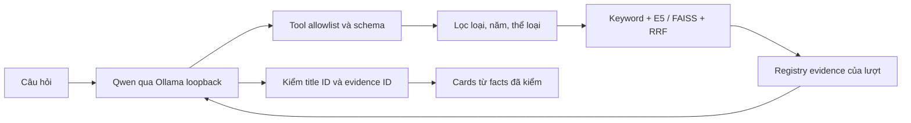

# Agent phim trên Google Colab

PoC độc lập cho pj-Flim: **Qwen2.5:7b qua Ollama + LangChain + multilingual E5 + FAISS CPU**. Mã nguồn nằm trong thư mục này; [notebook](../../notebooks/movie-agent-colab.ipynb) nhúng source đã kiểm hash, không cần clone repository hoặc cài Ollama trên Windows.

Đã có code và contract tests; **chưa nghiệm thu GPU Colab, inference Qwen/E5 hoặc nguồn ngoài thật**. Xem [báo cáo kiểm thử](../../docs/testing/colab-agent-2026-11-13.md) và [kế hoạch 1.6](../../docs/plans/movie-ai-agent-plan.md).

Tích hợp vào website: xem [12 bước chatbot đọc dữ liệu pj-Flim](../../docs/plans/website-chatbot-implementation-plan.md). Notebook hiện thử bằng snapshot; gateway live/run API/Chat UI vẫn là kế hoạch.

## 1. Chạy demo trước

1. Tải file [movie-agent-colab.ipynb](../../notebooks/movie-agent-colab.ipynb) từ dự án về máy.
2. Mở [Google Colab](https://colab.research.google.com/), chọn **File → Upload notebook** rồi chọn file đó.
3. Chọn **Runtime → Change runtime type → GPU**. GPU/quota phụ thuộc tài khoản và thời điểm, không bảo đảm T4.
4. Giữ cấu hình mặc định ở cell 1; chạy lần lượt cell 1–9. Cell 4 cài Ollama trong runtime Google và tải model nhiều GB; cell 7 tải embedding. Không tải model vào PC.
5. Dừng tại cell báo lỗi. Cell 5 phải qua kiểm tool calling và JSON schema trước khi thử agent.
6. Ở cell 8, sửa `QUESTION` rồi chạy lại cell đó để hỏi tiếp. Mỗi câu hỏi là một lượt độc lập.

Ví dụ:

```python
QUESTION = "Tìm phim khoa học viễn tưởng nhẹ nhàng."
MODE = "CATALOG"
```

Demo gồm 4 phim giả, có nhãn `demo: true`, không có điểm IMDb/Metacritic hoặc liên kết xem thật. Kết quả là JSON cards và evidence, chưa có giao diện chatbot trên website.

## 2. Dùng catalog thật của pj-Flim

API local phải đang chạy. Trên PowerShell:

```powershell
Set-Location -LiteralPath 'E:\pj-Flim'
npm.cmd run agent:export-catalog
```

Exporter đọc API public loopback, không dùng tài khoản hoặc kết nối DB trực tiếp. File tạo tại **`.local/agent/catalog.snapshot.json`**; không commit file này. Trong notebook:

1. Đặt `USE_DEMO = False` ở cell 1 rồi chạy các cell theo thứ tự.
2. Tại cell 6, chọn đúng một file snapshot JSON từ PC.
3. Cell 7 tạo vector/index; cell 8 tìm kiếm trên catalog vừa nạp.

Chỉ upload metadata mà bạn có quyền chuyển sang Google Colab và tạo embedding. Trường `rights` trong exporter là khai báo của người vận hành, **không phải bằng chứng cấp phép** và không tự kiểm được hợp đồng nguồn. Nếu chưa được phép, dùng demo.

Snapshot tối đa 1.000 phim, 5 MB, hạn 24 giờ. Chỉ có ID/tên/loại/năm/nội dung/thể loại/credits/quốc gia/ngôn ngữ; loại bỏ tài khoản, lịch sử xem, credential, asset và URL phát. Hash SHA-256 giúp phát hiện thay đổi dữ liệu; **không phải chữ ký xác thực nguồn**. Chỉ nhập file do bạn kiểm soát.

Catalog phản ánh thời điểm xuất. Agent không kết nối ngược PC từ Colab, không xác nhận phim còn xuất bản hoặc phát được; `live_eligibility_checked: false`. Khi đưa vào web phải kiểm eligibility lại tại backend. Snapshot hết hạn phải xuất lại; không sửa ngày để kéo dài.

## 3. Cơ chế tìm kiếm và trả lời



- Embedding `intfloat/multilingual-e5-small`, prefix `query:` và `passage:`, vector 384 chiều, chuẩn hóa L2.
- FAISS exact inner product trên tập **đã lọc**; hợp thứ hạng semantic/keyword bằng RRF, k = 60; ưu tiên tên khớp chính xác.
- Model chọn tool và phim. Validator chặn ID ngoài snapshot, evidence không tồn tại hoặc thuộc phim khác. Nội dung công cụ được coi là dữ liệu không tin cậy.
- Câu trả lời dựng từ facts, không cho model xuất đoạn văn tự do. `free_text_generation: false`; chưa có tóm tắt review, giải thích suy luận dài hoặc hội thoại nhiều lượt.
- Tool search tối đa 5 phim/lần; tối đa 4 lần gọi model, tổng 6 tool calls/lượt, 1 lần sửa lỗi schema. Cache chỉ trong lượt.
- Context thử nghiệm 8.192 token, output 600 token; chưa có bộ đếm/prompt truncation chính xác theo tokenizer. Nếu thiếu VRAM thử 4.096 rồi kiểm lại chất lượng/tool smoke.
- Deadline 120 giây kiểm giữa các bước; model HTTP timeout 90 giây. Đây là giới hạn best effort, không có hard cancellation giữa một request đang chạy. Chưa có benchmark latency/recall hoặc load test model thật.

Kết quả ngữ nghĩa luôn cần đánh giá với bộ câu hỏi gán nhãn; contract tests không chứng minh retrieval hoặc tiếng Việt đạt chất lượng sản phẩm.

## 4. OMDb, TMDB và tìm link review

Demo không gọi nguồn ngoài. Với catalog thật, OMDb được chọn mặc định cho điểm; cần API key và mapping đã xác minh. Chỉ dùng nguồn có quyền phù hợp.

**OMDb (nguồn điểm được chọn):**

1. Đăng ký key tại [OMDb Free](https://www.omdbapi.com/apikey.aspx), kích hoạt theo email.
2. Trong Colab Secrets (biểu tượng chìa khóa), thêm `OMDB_API_KEY` và cấp quyền cho notebook. Không gửi key qua chat hoặc viết trong cell.
3. Dùng catalog thật: `USE_DEMO=False`, giữ `ENABLE_OMDB=True`; upload snapshot JSON ở cell6. Cell8 mặc định HYBRID cho catalog thật. Demo vẫn CATALOG và chặn gọi ngoài.
4. Đối chiếu IMDb ID của phim theo tên gốc/năm/loại rồi cấu hình tại cell1:

```python
OMDB_MAPPINGS = {
    "UUID-phim-trong-snapshot": {"imdb_id": "tt1375666", "verified": True}
}
```

Thay cả UUID và IMDb ID bằng dữ liệu đã kiểm; ví dụ không phải mapping của phim bất kỳ trong kho. Movie/series khác scope; chưa hỗ trợ episode/season rating.

Nếu chưa có IMDb ID, sau khi cell8 tạo client, chạy một cell riêng:

```python
TITLE_UUID = "UUID-phim-trong-snapshot"
_omdb_client.reset()
display(_omdb_client.search(catalog, TITLE_UUID))
```

Candidate có `mapping_verified=False`, không tự duyệt. Đối chiếu kết quả, cập nhật OMDB_MAPPINGS ở cell1, chạy lại cell1 và cell8. Đổi câu hỏi tại cell8:

```python
QUESTION = "Cho tôi điểm IMDb và Metascore của phim TÊN_PHIM."
MODE = "HYBRID"
```

Đầu ra `cards[].external_ratings` có nguồn OMDB, IMDb ID, score type, value/scale/votes và thời điểm. IMDb thang10, Metascore critic thang100; không lấy Metacritic User Score hoặc review text. Direct fields thiếu/N/A→null; định dạng/range bất thường bị từ chối. Chưa gọi API thật bằng key nên coverage/schema thực tế vẫn cần nghiệm thu.

Cache chỉ RAM trong client Colab, mặc định1giờ, tối đa200 entries. Cell8 giữ client qua các lần hỏi; cache không chứa raw payload/key, không vào ZIP checkpoint. Mỗi lượt tối đa2 requests OMDb; tối đa900 requests trên một client để chừa ngân sách so gói free1000/ngày. Đây **không phải bộ đếm quota tài khoản theo ngày**: runtime/client khác hoặc thao tác trực tiếp cũng dùng quota provider. Cache hit vẫn kiểm mapping và TTL snapshot, không phục vụ stale khi nguồn lỗi.

Request cố định HTTPS, timeout8s, không redirect, response≤256KB. OMDb yêu cầu key query; filter che `apikey` trong log httpx/httpcore thông thường, output/error/evidence không trả request URL hoặc raw error. Không bật HTTP tracing tùy chỉnh chứa query/body. Missing key, auth/quota/mapping lỗi được trả bằng mã an toàn.

Tài liệu OMDb hiện công bố1000 request/ngày và CC BY-NC4.0; lookup PoC không tự cấp quyền lưu/hiển thị thương mại hoặc chuyển dữ liệu cho LLM. [OMDb docs](https://www.omdbapi.com/), [Terms](https://www.omdbapi.com/legal.htm).


**TMDB:** thêm API Read Access Token vào Colab Secrets, tên `TMDB_API_READ_TOKEN`, cấp quyền notebook. Không viết token trong cell, output hoặc chat. Đặt `ENABLE_TMDB = True` ở cell 1 và `MODE = "HYBRID"` ở cell 8.

Tool metadata tìm candidate bằng tên/năm/loại, không tự xác nhận mapping. Muốn lấy điểm, đối chiếu thủ công phim/mùa/loại rồi thêm mapping tại cell 1:

```python
TMDB_MAPPINGS = {
    "UUID-phim-trong-snapshot": {"kind": "movie", "id": 123, "verified": True}
}
```

Đây là cú pháp minh họa; thay UUID và ID bằng dữ liệu đã kiểm, không chạy nguyên ví dụ. Series dùng `kind: "tv"`. Adapter kiểm ID/tên/năm, ghi nguồn TMDB/thang 10/số phiếu/thời điểm. Không suy điểm TMDB thành IMDb hoặc Metacritic. Tối đa 2 HTTP calls/lượt; lỗi quota/auth/mapping được trả bằng mã an toàn, không tự bịa điểm.

**Review discovery:** đặt `ENABLE_WEB_DISCOVERY = True` và dùng HYBRID. DDGS chỉ tìm URL từ tên/năm phim public, mặc định giới hạn `theguardian.com`, `moveek.com`, `vnexpress.net`. Trả link HTTPS và publisher với `read_verified: false`; không fetch toàn bài, lưu snippet, tóm tắt hoặc embedding review. Allowlist chỉ giới hạn đường dẫn, không cấp phép nội dung. Chưa có registry quyền theo nguồn, safe article fetcher hoặc UI research.

PoC hiện chỉ nhận **CATALOG/HYBRID**. WEB/AUTO trong plan là phần sau. Đã có adapter OMDb cho IMDb rating/Metascore; chưa licensed IMDb/Metacritic direct API, Metacritic User Score, Rotten Tomatoes hoặc bulk importer.

## 5. Checkpoint, reset và kết thúc

Cell 10 tạo ZIP trong runtime; đặt `DOWNLOAD_CHECKPOINT = True` để tải về PC. Đặt `STOP_OLLAMA = True` khi kết thúc để dừng đúng process notebook sở hữu.

Checkpoint chỉ gồm snapshot, vector NumPy, index manifest, model manifest và runtime report khi có. Không có API key, prompt, chain-of-thought hoặc model weights. Không tự mount Drive. Notebook bạn tự lưu có thể vẫn chứa output; xóa output trước khi chia sẻ, nhất là catalog thật.

Sau reset: mở lại notebook, chạy từ cell 1; đặt USE_DEMO=False rồi nạp ZIP tại cell 6. Phải còn TTL và cùng model digest/embedding revision/catalog hash. Vector được kiểm hash/shape/normalization trước khi dựng lại FAISS; không load pickle hoặc FAISS binary tùy ý. Model vẫn phải tải lại nếu runtime mất cache. Model tag đổi digest thì dừng; kiểm lại phiên bản và tạo snapshot/index mới thay vì bỏ validator.

Không public cổng Ollama, tạo tunnel API hoặc chạy RabbitMQ consumer thường trực bằng Colab free. Google xử lý dữ liệu trong runtime cloud dù model suy luận local trong VM đó.

## 6. Lỗi thường gặp

| Mã/hiện tượng | Cách xử lý |
| --- | --- |
| GPU_REQUIRED / runtime không có GPU | Chọn GPU rồi reconnect; nếu không được cấp, chờ hoặc chọn runtime khác. Không khẳng định CPU sẽ chạy tốt 7B. |
| RESTART_KERNEL_REQUIRED | Restart session/kernel theo thông báo rồi chạy lại notebook từ đầu. |
| MODEL_DOWNLOAD_FAILED | Kiểm network/disk/quota của runtime, chạy lại cell tải model; không in log có credential. |
| MODEL_TOOL_SMOKE_FAILED / MODEL_JSON_SMOKE_FAILED | Chưa qua nghiệm thu model; kiểm version/digest/context, chạy lại smoke và lưu báo cáo. Không bỏ kiểm tra để coi thành công. |
| MODEL_UNAVAILABLE / OOM | Kiểm runtime còn sống, giảm CONTEXT_TOKENS xuống 4096, restart nếu cần, chạy smoke lại. |
| SNAPSHOT_EXPIRED / SNAPSHOT_HASH_INVALID | Xuất snapshot mới từ API; không sửa hash/ngày cho qua kiểm tra. |
| MODEL_DIGEST_CHANGED / INDEX_* | Model hoặc index khác checkpoint; xác minh phiên bản, dùng snapshot còn hạn và dựng index mới. |
| OMDB_NOT_CONFIGURED / TMDB_NOT_CONFIGURED / EXTERNAL_MAPPING_NOT_VERIFIED | Thêm Colab Secret và mapping đã đối chiếu hoặc dùng CATALOG. |
| SOURCE_RATE_LIMITED / OMDB_SESSION_QUOTA_EXCEEDED / nguồn không trả kết quả | Chờ theo quota, thử catalog; agent không đảm bảo DDGS/TMDB luôn khả dụng. |
| AGENT_*_BUDGET_EXCEEDED / ANSWER_EVIDENCE_INVALID | Lượt dừng có giới hạn; thử câu hỏi rõ hơn, lưu mã lỗi/report. Đây là lỗi cần theo dõi, không phải kết quả đúng. |

## 7. Phát triển và kiểm thử

Các dependency trực tiếp được pin trong [requirements](requirements-colab.txt); **chưa có transitive lock hoặc kiểm tương thích toàn bộ Torch/Sentence-Transformers trên Colab**. Phiên bản Ollama/model/E5 nằm trong [model-versions.json](model-versions.json). Digest model ghi sau lần pull thực đầu tiên, không giả định mutable tag bất biến.

Từ gốc dự án:

```powershell
npm.cmd run agent:notebook
npm.cmd run test:agent:export
```

Sau khi sửa module/test/requirements hoặc source cell phải build lại notebook. Builder nhúng source và hash; file bàn giao không chứa output/execution count.

Trong môi trường Python Linux cô lập:

```bash
python -m pip install -r apps/agent/requirements-test.txt
PYTHONPATH=apps/agent python -m unittest discover -s apps/agent/tests -p test_agent.py -v
python apps/agent/tools/validate_notebook.py notebooks/movie-agent-colab.ipynb
```

Không chạy installer Ollama của notebook trên Windows. Bản kiểm thử hiện dùng Docker Python Linux, FAISS thật và fixture encoder/model/HTTP. Cell 5/7/8/9 mới là nơi thu bằng chứng Qwen/E5 trong Colab.

Cấu trúc: `catalog.py` validation, `retrieval.py` search, `providers.py` nguồn ngoài, `agent.py` tool loop/evidence, `runtime.py` Ollama, `checkpoint.py` artifact. NestJS auth/schema/queue/UI hiện giữ nguyên; trước khi tích hợp website cần AG03/06/09/11 và các gate tương ứng trong plan.

## 8. Sửa bước cài Ollama — 14/11/2026

Notebook mới kiểm và cài curl/zstd còn thiếu trong Colab bằng apt-get khi runtime có quyền root. Installer giữ OLLAMA_VERSION đã pin; timeout cài binary là 15 phút. Lỗi được tách OLLAMA_DEPENDENCY_INSTALL_FAILED/TIMEOUT, OLLAMA_INSTALL_DOWNLOAD_FAILED/TIMEOUT/INVALID, OLLAMA_INSTALL_SCRIPT_FAILED/TIMEOUT và OLLAMA_NOT_INSTALLED.

Cell4 hiện code/hint và tên công cụ thiếu, không tự in log hoặc environment. Log riêng: install-dependencies.log cho apt, install.log cho installer. Ảnh OLLAMA_INSTALL_FAILED của notebook cũ chưa đủ xác nhận thiếu zstd; cần log hoặc mã lỗi bản mới.

Khi đổi sang notebook mới trong cùng runtime: Restart session rồi chạy từ cell1 để tránh Python giữ module cũ. RESTART_KERNEL_REQUIRED ở cell3 là kiểm NumPy trong bộ nhớ khác phiên bản đã cài; restart session giữ môi trường đã cài, sau đó chạy lại từ đầu.

Ngày14/11:52 Python contract tests đạt, gồm8 tests installer với mock package manager/download/subprocess; chưa chứng minh installer/model chạy được trên Colab. Kiểm GPU Docker thực đã được khởi động nhưng phiên bị ngắt trong bước cài dependency, chưa qua inference. Xem báo cáo ngày14.
