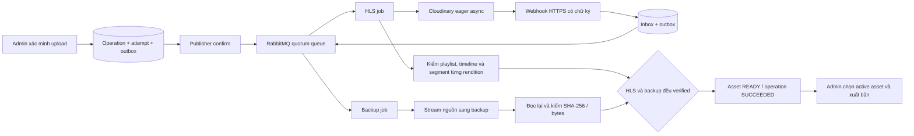

# RabbitMQ worker, HLS, webhook và backup

Triển khai và nghiệm thu local ngày 10/11/2026 trong E:\pj-Flim. Source worker ở [apps/worker/src](../../apps/worker/src/main.ts); API upload ở [hướng dẫn Cloudinary](cloudinary-upload.md).

## Luồng đã chạy thật



Video thử 1211,803 giây, 1280x720, 101394973 bytes đã được worker nhận từ outbox, kiểm 5 rendition 180p/270p/360p/540p/720p, nhận webhook Cloudinary thật qua HTTPS và tạo backup thật. Asset READY, attempt/operation SUCCEEDED, backup VERIFIED. Phim giữ DRAFT để admin quyết định xuất bản. Báo cáo nghiệm thu ở `.local/worker/pipeline-smoke-result.json`. Chạy lại `npm.cmd run worker:smoke` để kiểm tra asset gần nhất; hoặc thêm UUID asset sau dấu --. Lệnh đọc lại backup, kiểm CDN HLS và chờ callback có chữ ký đã được lưu, gồm callback hợp lệ đến muộn.

Backup local hiện nằm dưới `.local/backups/assets/{assetId}/{providerVersion}/`; có file nguồn và manifest ghi sha256, bytes, provider version, object reference. Không có URL phát hoặc credential trong manifest. Bộ kiểm thử dùng DB PostgreSQL tạm, broker RabbitMQ thật với prefix riêng, provider/CDN mock tại biên mạng; nghiệm thu ở trên dùng Cloudinary/video thật.

## Khởi động local

Đã có Docker Desktop và PostgreSQL local. Các biến Cloudinary ở `.env.api.local`, DB runtime/worker ở `.env.database.local`.

```powershell
Set-Location E:\pj-Flim
npm.cmd install
npm.cmd run worker:configure
powershell -ExecutionPolicy Bypass -File scripts/Start-MediaLocal.ps1
npm.cmd run worker:smoke
```

Script cấu hình không ghi đè secret đã tồn tại; tạo tài khoản/vhost RabbitMQ riêng và callback key ngẫu nhiên. Script khởi động Docker nếu cần, chạy container có label của dự án, build, chạy relay/tunnel webhook, API và worker dưới cửa sổ ẩn. Không dừng container/tiến trình ngoài dự án.

RabbitMQ chỉ bind localhost:5672 và localhost:15672. User/password nằm trong `.local/rabbitmq/bootstrap.env` và URL kết nối ở `.env.worker.local`; không dùng guest. Volume `pj-flim-rabbitmq-data` lưu dữ liệu bền; image được pin digest trong [script khởi động](../../scripts/Start-RabbitMQ.ps1). Không xóa volume để sửa lỗi mật khẩu; khôi phục credential đang dùng hoặc đổi qua quản trị broker.

Các lệnh riêng:

```powershell
npm.cmd run worker:configure
powershell -ExecutionPolicy Bypass -File scripts/Start-RabbitMQ.ps1
npm.cmd run build
npm.cmd run worker:dev
# hoặc chạy build:
npm.cmd run worker:start
```

`Start-LocalProcess.ps1 -Service api|worker|relay` chỉ dừng đúng PID/entry point đã lưu của dịch vụ rồi chạy lại. File tiến trình và log:

| Dịch vụ | File cục bộ                                                          |
| ------- | -------------------------------------------------------------------- |
| API     | .local/api/server-process.json, server.stdout.log, server.stderr.log |
| Worker  | .local/worker/process.json, worker.stdout.log, worker.stderr.log     |
| Relay   | .local/worker/relay-process.json, relay.stdout.log, relay.stderr.log |
| Tunnel  | .local/worker/tunnel-process.json, tunnel.stderr.log                 |

## Biến môi trường

Xem [.env.worker.example](../../.env.worker.example); credential thật chỉ ở `.env.worker.local`.

| Biến                                            | Mặc định local / mục đích                                                |
| ----------------------------------------------- | ------------------------------------------------------------------------ |
| RABBITMQ_URL                                    | amqp://...@127.0.0.1:5672/pj_flim                                        |
| RABBITMQ_PREFIX                                 | pjflim.media; vhost/queue của dự án                                      |
| WORKER_PREFETCH                                 | 2; chạy HLS và backup độc lập                                            |
| WORKER_LEASE_SECONDS                            | 120; heartbeat gia hạn mỗi 40 giây                                       |
| WORKER_POLL_MS                                  | 1000; dispatch outbox và job đến hạn                                     |
| MEDIA_RECONCILE_SECONDS                         | 20; đối soát HLS khi chưa có webhook/output                              |
| MEDIA_MAX_WAIT_SECONDS                          | 7200; giới hạn thời gian chờ HLS                                         |
| MEDIA_MAX_FAILURES                              | 8; số lỗi tạm thời trước khi kết thúc attempt                            |
| MEDIA_CALLBACK_SECRET                           | 64 hex, chỉ server/worker; ràng buộc callback với attempt/version/config |
| CLOUDINARY_WEBHOOK_URL                          | HTTPS, kết thúc /api/v1/webhooks/cloudinary                              |
| BACKUP_DRIVER                                   | filesystem cho dev, s3 cho production                                    |
| BACKUP_LOCAL_ROOT                               | E:/pj-Flim/.local/backups; không được phục vụ như static files           |
| BACKUP_BUCKET / BACKUP_REGION                   | Bucket backup riêng và region                                            |
| BACKUP_S3_ENDPOINT                              | Tùy chọn endpoint S3 tương thích                                         |
| BACKUP_ACCESS_KEY_ID / BACKUP_SECRET_ACCESS_KEY | Credential backup riêng; không dùng tự động credential của dự án khác    |

API và worker phải khởi động lại khi đổi env. Không dùng tài khoản owner/migration cho worker: worker dùng `WORKER_DATABASE_URL`, login `pj_flim_worker`, không đọc password hash hoặc sửa/xóa audit.

## RabbitMQ và phục hồi

Publisher dùng persistent messages, mandatory routing và publisher confirms; chỉ đánh dấu outbox published sau confirm. Mỗi claim outbox có lease token, retry với backoff. Publisher chỉ tiêu thụ `media.processing.requested` và `media.webhook.received`; catalog.changed vẫn chờ consumer cache ở giai đoạn khác.

Queue `pjflim.media.jobs` và DLQ `pjflim.media.dlq` dùng quorum, exchange riêng. Consumer ACK sau khi trạng thái đã được ghi bền. Message chỉ chứa version/envelope và eventId hoặc jobId; không có video, JWT hoặc credential. Message sai schema được chuyển DLQ. Khi DB/broker mất kết nối, worker reconnect; outbox và job state giữ trong PostgreSQL.

Job `media.hls` và `media.backup` unique theo attempt. Scheduler dùng lease dispatch ngắn; consumer claim lease thực thi, tăng fencing token và heartbeat. Result chỉ commit nếu job lease, current attempt và lifecycle còn hợp lệ. Callback/tác vụ cũ không được đổi active pointer hoặc hồi sinh attempt thất bại.

HLS chưa xong được chuyển WAITING rồi ACK để nhường consumer; không giữ message chờ chuyển mã hàng giờ. Webhook đánh thức job sớm, poll/reconciler phục hồi khi webhook mất. Outbox đã confirm nhưng chưa tạo được job/inbox chưa xử lý được đưa lại vào dispatch sau một phút; job bị treo được lấy lại khi lease hết hạn.

Lỗi tạm thời dùng backoff 2, 4, 8... tối đa 300 giây. HLS pending không tiêu thụ ngân sách lỗi, nhưng có deadline tổng. Sau khi đã lưu marker PREPARED trước lời gọi eager, timeout/crash được đối soát thay vì tự gửi lại transformation chưa rõ kết quả. Nếu request chưa thực sự tới provider thì job có thể hết deadline và cần retry attempt mới; đây là giới hạn của thao tác giữa hai hệ thống không có transaction chung.

Worker kiểm tra user còn ACTIVE và còn quyền media.upload (attempt đầu) hoặc media.retry (attempt retry) ở mỗi tác vụ và trước commit. Thu hồi quyền trước khi tác vụ xử lý khiến operation FAILED; API xuất bản vẫn kiểm quyền hiện hành độc lập.

Tham khảo: [publisher confirms](https://www.rabbitmq.com/docs/confirms), [mandatory routing](https://www.rabbitmq.com/docs/publishers), [quorum queues và dead lettering](https://www.rabbitmq.com/docs/quorum-queues).

## Webhook Cloudinary

```http
POST /api/v1/webhooks/cloudinary?attemptId={uuid}&context={server-generated-proof}
Content-Type: application/json
X-Cld-Timestamp: {unix-seconds}
X-Cld-Signature: {provider-signature}
```

Endpoint không dùng JWT/cookie và được loại khỏi Swagger admin. Raw body tối đa 256 KiB được giữ nguyên; kiểm timestamp trong 5 phút và chữ ký SHA-1/SHA-256 theo header trước parse JSON. Chuỗi ký là raw body + timestamp + API secret, không serialize lại JSON trước kiểm chữ ký. [Tài liệu chữ ký Cloudinary](https://cloudinary.com/documentation/signatures).

Callback proof ràng buộc attempt, asset, source version và config hash; DB chỉ giữ hash của proof. Backend đối chiếu public ID, asset ID/version/type nếu có, batch nếu provider đã cấp batch ID, current attempt và lifecycle. Unknown fields được bỏ qua để tương thích provider; chỉ payload allowlist được lưu inbox, không lưu signed URLs/signature/raw payload.

ACK 200 sau transaction inbox/outbox commit. Payload trùng được dedup; callback cũ hợp lệ được ACK và ghi ignored/rejected để không đánh thức attempt mới. Callback không thể tự đặt READY: worker vẫn đọc provider và kiểm mọi rendition. [Cloudinary eager notifications](https://cloudinary.com/documentation/notifications).

| HTTP    | Code                                                            |
| ------- | --------------------------------------------------------------- |
| 401     | WEBHOOK_SIGNATURE_INVALID, WEBHOOK_TIMESTAMP_INVALID            |
| 400/413 | REQUEST_MALFORMED_JSON, REQUEST_TOO_LARGE                       |
| 422     | WEBHOOK_PAYLOAD_INVALID                                         |
| 503     | DB/provider configuration không sẵn sàng; provider có thể retry |

Relay dev chỉ chuyển POST đúng endpoint này tới API; mọi path khác, gồm admin/Swagger, nhận 404. Tunnel URL tạm ở env và có thể thay đổi khi process được tạo lại. Với domain production, trỏ trực tiếp webhook cố định/reverse proxy đến API; không chạy quick tunnel.

## Backup và điều kiện xuất bản

Worker lấy URL nguồn có chữ ký từ adapter server, khóa account/public ID/version từ DB và kiểm lại metadata nguồn trước/sau copy. Chỉ chấp nhận CDN host/path đã cấu hình, không follow redirect tới host tùy ý. Copy theo stream, giới hạn bytes theo nguồn; không đọc cả phim vào RAM.

Filesystem dev: ghi file tạm có tên duy nhất, kiểm đủ byte, giữ object nguồn theo asset/version, đọc lại toàn bộ và so SHA-256 trước VERIFIED. File hiện có phải cùng checksum; không tự ghi đè một backup hỏng. S3 adapter dùng multipart stream, SSE-S3, object version, full read-back và manifest. Bucket phải có versioning; production kiểm Block Public Access. Credential backup là biến riêng, không rút từ Cloudinary hoặc credential chain mặc định. [S3 versioning](https://docs.aws.amazon.com/AmazonS3/latest/userguide/Versioning.html), [SSE-S3](https://docs.aws.amazon.com/AmazonS3/latest/userguide/UsingServerSideEncryption.html).

**Backup local đã được nghiệm thu thật; S3 chưa được nghiệm thu với tài khoản/bucket thật.** Trước production cần cấu hình bucket độc lập, kiểm IAM/retention và chạy thử copy/restore. Backup cùng máy không thay backup offsite/khôi phục thảm họa.

Asset chỉ READY khi current attempt có HLS đúng profile/config, playlist/segment/timeline hợp lệ, và backup đúng số byte nguồn + checksum + manifest đã verified. Attempt/operation mới SUCCEEDED sau cả hai nhánh; audit SYSTEM ghi cùng transaction. Nguồn hợp lệ nhưng HLS/backup còn thiếu không được xuất bản. Production guard chỉ chấp nhận backup S3 có object version.

Worker không tự publish hay đổi episode.activeAssetId. Admin dùng PATCH episode với If-Match để chọn asset đã READY, rồi PUT publication. API kiểm lại các điều kiện ở trên tại thời điểm xuất bản.

## Retry và theo dõi admin

```http
POST /api/v1/admin/media-assets/{assetId}/processing-attempts
Authorization: Bearer <access-token>
Idempotency-Key: <uuid>
Content-Type: application/json

{"reason":"Đã khắc phục cấu hình provider, xử lý lại"}
```

Quyền media.retry: ADMIN/SUPER_ADMIN sau MFA. Trả 202, Location tới operation và Retry-After: 3. Chỉ tạo attempt mới khi attempt cũ đã kết thúc; đang chạy trả MEDIA_PROCESSING_ALREADY_ACTIVE/409, asset READY hoặc không còn ACTIVE trả MEDIA_ASSET_IN_USE/409. Cùng key/body trả cùng operation; đổi body/key sai trả lỗi idempotency. Backup đã VERIFIED được đọc lại để xác minh rồi dùng lại; chưa có sẽ được tạo mới.

Theo dõi qua GET /admin/operations/{id}, /admin/processing-attempts/{id}, /admin/media-assets/{id} và audit logs. Operation FAILED vẫn trả HTTP 200 khi GET; đọc errorCode/errorMessage/errorRetryable. READY/SUCCEEDED không tự làm phim xuất hiện công khai.

## Kiểm thử và giới hạn vận hành

```powershell
# Truyền password PostgreSQL quản trị qua biến môi trường tiến trình.
$env:PJ_FLIM_TEST_WORKER = "true"
npm.cmd run test:integration
```

Cần RabbitMQ đang chạy; suite tạo/drop database tên pj_flim_test_<random>, queue/exchange prefix riêng, không dùng pj_flim làm fixture. Test HTTP cơ bản có thể chạy không bật PJ_FLIM_TEST_WORKER. Báo cáo có workerIncluded để phân biệt phạm vi.

Các mục còn lại: S3/restore thực tế, HA broker tối thiểu 3 node, bảo vệ network/IAM production, cảnh báo DLQ/quota, retention nguồn/chunk dở, API xóa media, playback/preview/player và frontend. Không tự redrive toàn bộ DLQ; kiểm nguyên nhân và tạo processing attempt mới qua API khi phù hợp.
