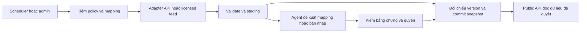

# Nghiên cứu dữ liệu điểm số và bài review từ các website phim

Phiên bản: **1.1**. Ngày xác minh lại: **13/11/2026**, Asia/Saigon. Dự án: pj-Flim tại E:\pj-Flim. Đã dùng ba agent nghiên cứu độc lập IMDb, Metacritic và các nguồn khác, sau đó đối chiếu tài liệu sơ cấp và source dự án. **Phạm vi: nghiên cứu/thiết kế; chưa tải bulk dataset, gọi API bằng credential, mua gói, gửi liên hệ hoặc triển khai importer.** Truy cập được tài liệu không chứng minh đã có quyền dùng dữ liệu trong production.

Liên quan: [plan hiện hành](../plans/movie-streaming-platform-plan.md), mục 9.6/14.7; [schema hiện tại](../../packages/database/prisma/schema.prisma), [publisher media hiện tại](../../apps/worker/src/outbox.ts). Hiện chưa có external IDs, bảng điểm/review bên ngoài, adapter nguồn hoặc UI review; `titles.age_rating` là phân loại độ tuổi, không phải điểm IMDb. Rating của thành viên pj-Flim cũng là tính năng riêng sau MVP.

Cập nhật triển khai14/11/2026: [agent notebook](../../apps/agent/README.md) đã có adapter OMDb lookup thử nghiệm theo verified mapping; chưa gọi live bằng key, chưa backend importer/schema/API/UI. Nội dung nghiên cứu1.1 bên dưới giữ phạm vi thời điểm13/11.

## 1. Kết luận và thứ tự ưu tiên

| Nguồn | Có thể lấy gì qua tuyến được tài liệu hóa? | Điều kiện và lựa chọn cho pj-Flim |
| --- | --- | --- |
| IMDb | TSV public có aggregate rating/vote count; licensed bulk/API có các sản phẩm khác nhau; user review là sản phẩm riêng | TSV chỉ trong phạm vi quyền personal/non-commercial được xác nhận; website công khai cần chốt quyền display/distribution, không mặc định web miễn phí được dùng |
| Metacritic | Fabric Origin có API Metascore/User Score và critic quote/link/author/publication | Account được duyệt + core subscription trả phí + ToS riêng; chưa có quyền thì chỉ chuẩn bị mapping/link tham chiếu |
| TMDB | Rating/votes riêng TMDB và user reviews qua API movie/TV | Ưu tiên thử đầu tiên nếu phù hợp non-commercial/attribution; commercial cần tuyến cấp phép |
| Trakt | Ratings/votes, comments/reviews và mapping qua API | Nhánh tiếp theo cho tính năng app; policy cấm harvesting/mirror/resale, không dùng để xây bản sao catalog |
| Rotten Tomatoes | Licensing trực tiếp hoặc API chính thức qua Fabric Origin: score, consensus, critic quote và các trường community theo schema | Origin cần paid core/approval/Terms; chưa có entitlement thì chưa nhập; full article vẫn cần quyền publisher |
| Letterboxd | API xét duyệt, member RSS, hướng dẫn ratings embed | Có loại dự án không nhận, gồm LLM/GPT/recommendation/data analysis; không chọn làm phụ thuộc bắt buộc |
| OMDb | Lookup theo IMDb ID; response lịch sử có IMDb/Metascore/RT, không có review-list được tài liệu hóa | CC BY-NC/footer khác phạm vi production; Terms personal/non-commercial, indexing/derivatives cần xác nhận; chưa gọi live |
| Publisher, ví dụ Guardian | Content API/RSS hoặc feed theo điều kiện publisher | Lấy bài review đúng phạm vi cấp phép; quote feed của aggregator không cấp toàn văn bài báo |

**Đề xuất của dự án:** bắt đầu adapter TMDB khi đã có quyền/key đúng mục đích; xem Trakt cho app-scoped reviews. IMDb/Metacritic/Rotten Tomatoes đi theo hợp đồng phù hợp nếu cần chính các điểm đó. Không dùng scraper/agent như một cách thay thế quyền dữ liệu. Khi thiếu quyền, UX vẫn có card liên kết nguồn được biên tập, không cần sao chép điểm hoặc toàn bài. Các hàng là quyết định thiết kế; nguồn chứng minh khả năng/điều kiện được dẫn trong từng mục dưới.

## 2. Phân biệt điểm, review và quyền sử dụng

Có bốn loại cần tách trong schema và UI:

1. **Aggregate rating:** điểm cùng số lượng đánh giá, loại khán giả/critic, phạm vi movie/series/season/episode.
2. **Critic excerpt:** đoạn trích được feed cho phép, tên tác giả/tòa soạn, ngày, URL bài gốc và điểm riêng nếu có.
3. **User review:** nội dung do thành viên của nguồn viết, có thể có rating/spoiler; không biến thành tài khoản hay đánh giá pj-Flim.
4. **AI summary/translation:** nội dung dẫn xuất có nhãn riêng và provenance; cần quyền xử lý tương ứng, không trình bày như lời nguyên văn của tác giả.

Tách ba câu hỏi: **lấy được qua kỹ thuật**, **được lưu/xử lý thế nào**, **được hiển thị/tái phân phối thế nào**. API key không tự trả lời cả ba. Text trên trang công khai, RSS, JSON-LD, robots cho một path hoặc bên thứ ba bán endpoint đều không tự chứng minh quyền tái sử dụng mọi trường.

Thiết kế quyền theo từng nguồn/trường/use case; không áp một quy tắc “dưới N từ là tự do sử dụng”. Trích đoạn, toàn bài, logo, bản dịch, AI summary, embeddings/ML và quyền chuyển dữ liệu sang nhà cung cấp LLM phải được kiểm riêng trong điều khoản/hợp đồng áp dụng. Đây là gate thiết kế, không kết luận pháp lý thay hợp đồng cụ thể.

## 3. IMDb

### 3.1. Public dataset: phù hợp nghiên cứu có điều kiện

`title.ratings.tsv.gz` chứa `tconst`, `averageRating` có trọng số và `numVotes`; UTF-8 TSV gzip, cập nhật hằng ngày. Dataset không có review text, từng lượt chấm của từng user hoặc ma trận user–item. Có thể dùng các file title basics/aliases/episode cho matching trong phạm vi được phép. [IMDb Non-Commercial Datasets](https://data.imdb.com/non-commercial-datasets/)

IMDb nêu giới hạn personal/non-commercial và tái sử dụng dữ liệu; không suy “đồ án/website không thu phí” mặc nhiên được đưa toàn dữ liệu lên web công khai. Chỉ mở importer/display khi xác nhận use case đáp ứng quyền; ghi attribution theo hướng dẫn đúng phiên bản điều khoản. [IMDb data trong phần mềm](https://help.imdb.com/article/imdb/general-information/can-i-use-imdb-data-in-my-software/G5JTRESSHJBBHTGX), [IMDb ratings trên website](https://help.imdb.com/article/imdb/track-movies-tv/can-i-use-your-ratings-on-my-website/GU66FTMF7DHVZBHZ)

Phương án importer **đề xuất, chưa chạy**: tải một snapshot được cho phép → kiểm response/header/giới hạn → giải nén streaming → parse TSV theo header → lọc các `tconst` đã mapping → staging → validate → đổi snapshot atomically. Giữ `\N` thành null, không đổi thành 0; numVotes phải là integer hợp lệ. Không cần nhập cả catalog vào PostgreSQL chỉ để hiển thị vài phim.

### 3.2. Licensed bulk/API

IMDb có tuyến AWS Data Exchange/Marketplace; GraphQL yêu cầu account/entitlement được duyệt và thông tin API asset. Node backend có thể dùng AWS SDK Data Exchange, giữ credential phía server. [Getting Access](https://data.imdb.com/documentation/api-documentation/getting-access/), [Calling the API](https://data.imdb.com/documentation/api-documentation/calling-the-api/)

Ví dụ query rating từ tài liệu, **chưa gọi và chỉ dùng nếu entitlement hỗ trợ**:

```graphql
query {
  title(id: "tt0120338") {
    ratingsSummary {
      aggregateRating
      voteCount
    }
  }
}
```

Nguồn: [IMDb sample queries](https://data.imdb.com/documentation/api-documentation/sample-queries/title-name). Không suy gói rating đã bao gồm review; schema/quota/SLA/license lấy theo sản phẩm thực tế, không dự toán bằng một mức giá quảng cáo.

### 3.3. Review text và summary là sản phẩm khác nhau

Sản phẩm IMDb User Reviews được niêm yết là add-on, tiếng Anh, tối đa 15 review/title theo lựa chọn “Most Helpful”, phân phối dạng S3 object qua ADX. Đây không phải toàn bộ review hoặc mẫu đại diện ngẫu nhiên. Trường chi tiết/coverage/quyền hiển thị phải kiểm sample và hợp đồng sau cấp quyền. [IMDb User Reviews trên AWS Marketplace](https://aws.amazon.com/marketplace/pp/prodview-ruo6dxqm3iipe)

IMDb cũng có User Review Summaries: sentiment summary bằng AI, `titleId`, `userSummaryText`, themes và `publishedAt`, có bản Full/Base. Không có ở mọi title, không phải bài critic hoặc review gốc; lần phát hành có thể đổi dù text không đổi. Đây là lựa chọn licensed để khảo sát trước khi tự tóm tắt, không mặc định thuộc TSV/API rating. [IMDb User Review Summaries dictionary](https://data.imdb.com/documentation/bulk-data-documentation/data-dictionary/user-review-summaries/)

IMDb Conditions hạn chế robots/screen scraping khi chưa có chấp thuận bằng văn bản. Không dùng agent/headless browser/proxy để gom review từ trang ngoài quyền cho phép. [IMDb Conditions](https://www.imdb.com/conditions)

## 4. Metacritic

### 4.1. Có tuyến API qua Fabric Origin

Không kết luận “Metacritic không có API”. Fabric Origin Nexus tài liệu hóa Metacritic API; cần developer account được duyệt, subscription core trả phí và đồng ý ToS riêng. Dữ liệu Metacritic không có trong Free Trial. [Metacritic API introduction](https://developer.origin.fabricdata.com/origin/apis-all/metacritic-api-docs)

```text
GET https://api.origin.fabricdata.com/Metacritic/Movie/{originMovieId}
GET https://api.origin.fabricdata.com/Metacritic/TV/{originShowId}?SeasonNumber={n}
```

ID là Entertainment Movie/Show ID của Origin, không phải IMDb/TMDB ID. Schema mô tả `Metascore.Score/ReviewCount`, `Userscore.Score/RatingCount` và `Reviews.Review[]` với date, quote, score, URL, publication, critic. Chưa gọi API nên chưa xác minh coverage, freshness, nullability hay trường được entitlement cụ thể trả về. Không suy user score đồng nghĩa có audience review text. [Endpoint/schema Metacritic](https://developer.origin.fabricdata.com/origin/apis-all/metacritic-api-docs/metacritic)

Gói truy cập và quota phải xác nhận với provider. Nếu dùng key, ưu tiên header server-side như tài liệu Origin; không đặt subscription key vào frontend/query log. [Origin getting started](https://developer.origin.fabricdata.com/origin)

### 4.2. Quote không phải toàn bài

Metacritic giải thích critic review đầy đủ nằm ở website publisher, có thể cần tài khoản/thuê bao. Quote/link trong feed không tự cấp quyền lấy bài gốc; toàn văn cần API/feed/quyền của publisher. Chưa xác minh được feed cấp phép lấy toàn bộ audience review text từ tài liệu đã đọc. [Metacritic giải thích review links](https://metacritichelp.zendesk.com/hc/en-us/articles/10605510994711-Why-when-I-click-on-a-review-it-says-I-have-to-login-or-subscribe-to-read-the-review)

Metascore và User Score phải tách; user votes không tham gia Metascore. Không tự average các quote nhận được rồi gắn nhãn Metascore. [Metacritic FAQ](https://metacritichelp.zendesk.com/hc/en-us/articles/14482674768791-Are-user-votes-included-in-the-METASCORE-calculations)

### 4.3. Giới hạn kiểm chứng điều khoản

Trang Origin liên kết ToS Metacritic qua IVA/Fabric, nhưng PDF trả 404 khi mở trong lần nghiên cứu. Search index còn hiển thị các ràng buộc về vị trí lưu trữ, giữ nguyên nội dung, attribution/purge và số quote; **không coi nội dung indexed là hợp đồng hiện hành**. Phải lấy bản có hiệu lực và schedule trước khi chốt PostgreSQL/kho lưu/UX. Không đưa các con số hoặc điều kiện địa lý từ bản không truy cập được thành cấu hình production.

Rà soát lại: còn có tuyến [Fandom Media Terms](https://www.fandom.com/terms-of-service-pp1), cần phân biệt với Terms chung cho wiki. Công cụ vẫn gặp 402 khi đọc trực tiếp nên chưa xác nhận đầy đủ bản hiện hành. Robots có quy tắc theo user-agent, không thay giấy phép nội dung. [Origin với link ToS](https://developer.origin.fabricdata.com/origin/apis-all/metacritic-api-docs), [Fandom Terms](https://www.fandom.com/terms-of-use), [Metacritic robots](https://www.metacritic.com/robots.txt)

Phạm vi cần xác minh: field được cấp, domain/app/territory, storage region, cache/retention/backup/purge, logo/link placement, số/cách chọn quote, dịch/AI processing và quota. Không áp giấy phép CC của Fandom wiki cho Metacritic. Chưa liên hệ provider thay người dùng; có thể chuẩn bị yêu cầu qua [Metacritic support](https://metacritichelp.zendesk.com/hc/en-us/requests/new).

## 5. Các nguồn khác

### 5.1. TMDB: ứng viên đầu tiên cho tích hợp thử

```text
GET /3/movie/{movieId}
GET /3/movie/{movieId}/reviews?language=en-US&page=1
GET /3/tv/{seriesId}/reviews?language=en-US&page=1
GET /3/movie/{movieId}/external_ids
GET /3/find/{imdbId}?external_source=imdb_id
```

Các route trên thuộc `https://api.themoviedb.org`; ví dụ tài liệu, chưa gọi bằng key. Review movie/TV là review cộng đồng TMDB; API có phân trang/language. [Movie reviews](https://developer.themoviedb.org/reference/movie-reviews), [TV reviews](https://developer.themoviedb.org/reference/tv-series-reviews)

OpenAPI mô tả id/author/author_details/content/created_at/updated_at/url; rating tác giả có thể null, không có trường spoiler bảo đảm trong schema này. pj-Flim đề xuất chỉ lấy trường cần thiết, không nhập avatar hoặc gán nhãn “không spoiler” chỉ vì thiếu flag. [TMDB OpenAPI](https://developer.themoviedb.org/openapi/tmdb-api.json)

IMDb lookup có movie/show/episode/person, bảng hỗ trợ không đánh dấu season; TMDB numeric ID phải đi với media type. Review cấp series không tự thành review của một tập/mùa. [Find by ID](https://developer.themoviedb.org/reference/find-by-id), [Movie external IDs](https://developer.themoviedb.org/reference/movie-external-ids)

FAQ phân biệt non-commercial có attribution và commercial cần thỏa thuận; làm đúng branding/notice hiện hành. Việc API trả content không phải quyền sao chép vô hạn hoặc quyền với mọi bài báo mà user dẫn link. Không tự đặt TTL 24 giờ thành điều khoản TMDB. [TMDB FAQ/license](https://developer.themoviedb.org/docs/faq)

### 5.2. Trakt: phù hợp tính năng trong app, không mirror dữ liệu

API có ratings/votes/comments và mapping. Policy hiện tại cho phép free/paid apps và các tính năng discovery/recommendations nhưng cấm bulk harvesting, catalog mirroring và resale/redistribution không được phép; có cache phục vụ tính năng, không thay quyền nội dung bên thứ ba. Đọc docs hiện tại, tránh kết luận từ bài cũ rằng đăng ký luôn cần VIP. [Trakt API Use Policy](https://developer.trakt.tv/docs/api-use-policy)

Comments hỗ trợ Markdown/spoiler; sanitize khi render. Điều khiển tốc độ theo header/quota và Retry-After; không hardcode quota từ một ví dụ thành cam kết lâu dài. [Comments](https://developer.trakt.tv/docs/about-comments), [Rate limiting](https://developer.trakt.tv/docs/rate-limiting), [Caching/freshness](https://developer.trakt.tv/docs/caching-and-fresh-data)

### 5.3. Rotten Tomatoes và Letterboxd

Rotten Tomatoes có quy trình đề nghị licensing API/feed, branding và linkback; scope lấy theo chấp thuận, không có cơ sở xem là public API miễn phí. Tomatometer/Popcornmeter là tỷ lệ đánh giá tích cực theo nhóm, không tương đương điểm trung bình 9/10 khi hiển thị 90%. [Licensing](https://www.rottentomatoes.com/help_desk/licensing), [Score definitions](https://www.rottentomatoes.com/about)

Letterboxd API phải được xét duyệt và hiện loại một số nhóm dự án, gồm LLM/GPT và recommendation/data analysis. Có member RSS và hướng dẫn ratings embed; embed không cấp quyền tải review hàng loạt. Guide iframe gặp 403 trong nghiên cứu nên chưa chốt tham số hay khả năng dùng cho pj-Flim. Không cho agent tự gọi API Letterboxd vì có đường dẫn công khai. [API access](https://letterboxd.com/api-beta/), [Embed FAQ](https://support.letterboxd.com/hc/en-us/articles/17815623056911-Can-I-display-or-embed-Letterboxd-ratings-on-my-site-or-app)

### 5.4. Bài báo từ publisher và website phim Việt Nam

Guardian là ví dụ có Content API, developer/commercial access tiers và tài liệu query; RSS được mô tả cho cá nhân/phi thương mại. Chọn section/tag/query review, trường title/byline/date/URL trước; body chỉ khi gói/quyền cho phép. [Access tiers](https://open-platform.theguardian.com/access/), [API docs](https://open-platform.theguardian.com/documentation/), [RSS](https://www.theguardian.com/help/feeds)

Với báo/web review khác, kể cả tiếng Việt: kiểm tra API/feed/embeds/điều khoản của **chính website đó**; chưa nghiên cứu và cấp quyền thì trạng thái nguồn là chưa duyệt. RSS có full content về kỹ thuật cũng không tự mở quyền tái xuất. Phương án ban đầu là card title/tác giả/tòa soạn/ngày/link với các trường được phép hoặc được biên tập độc lập; không sao chép ảnh/đoạn giới thiệu mặc định.

Toàn bài: ưu tiên thỏa thuận trực tiếp, bài do đội ngũ pj-Flim viết hoặc cộng tác viên cấp quyền. Không vượt login/paywall/CAPTCHA/bot block, không lấy lời từ một bài rồi đổi attribution thành pj-Flim.

### 5.5. OMDb và các aggregator bên thứ ba

OMDb có API tra theo IMDb ID nhưng tự ghi không thuộc/được IMDb bảo trợ và nội dung theo CC BY-NC 4.0. Đây không phải API chính thức IMDb hoặc bằng chứng đã có quyền thương mại với dữ liệu upstream. `plot=full` là synopsis, không phải review toàn văn. [OMDb API](https://www.omdbapi.com/)

Các API tổng hợp khác chỉ là ứng viên sau kiểm tra provenance, freshness, license và quyền chuyển tiếp từng nguồn. Thanh toán API/scraper không tự cấp quyền nội dung gốc; không chọn chỉ vì một response có đủ IMDb/Metacritic/RT.

## 6. Thiết kế tích hợp cho Node.js/PostgreSQL/RabbitMQ

Phần này là **đề xuất riêng cho pj-Flim**, không phải mô tả chức năng đã có hoặc yêu cầu nguyên văn của provider.

### 6.1. Mapping danh tính phim

- Model mapping: internal entity kind/id ↔ provider/entity kind/external ID; giữ IMDb `tt...` nguyên chuỗi, TMDB ID kèm media type, Origin ID kèm movie/show và season scope khi cần.
- Ưu tiên external ID đã được xác nhận; nếu tìm theo tên thì lấy original/localized title/aliases, year, kind, director/cast khi có, country và parent show/season/episode. Năm phát hành lệch vùng không tự coi là phim khác.
- Tạo candidates trước, phát hiện remake/trùng tên/special/episode mismatch; agent đưa lý do + evidence URL, admin duyệt. Không auto-link chỉ vì fuzzy score cao hoặc LLM nói chắc chắn.
- Unique theo provider + entity type + external ID + scope phù hợp; quan hệ nhiều-một phải có lý do edition/alias. Mapping version tăng khi sửa để job cũ không ghi điểm nhầm phim.
- Tách local technical season/episode của phim lẻ khỏi series thật. Điểm movie không dùng cho episode, điểm season không dùng chung mọi mùa.

### 6.2. Quyền và bảng dữ liệu đề xuất

| Nhóm/bảng đề xuất | Trường và invariant chính |
| --- | --- |
| `external_sources` / `source_policies` | provider, policyVersion, evidence/contractRef, allowedFields/Uses, domains/territories, storageRegion, attribution, retention/purge, expiry; không chứa key |
| `external_title_mappings` | local kind/id, provider ID/type/scope, evidence, trạng thái duyệt, mappingVersion, người/thời điểm duyệt |
| `external_rating_snapshots` | mapping/sourceVersion, scoreType, value, scaleMin/Max, count/countKind, sourceURL, sourceUpdatedAt nullable, fetchedAt, validUntil nếu policy có |
| `external_review_references` | providerReviewId nếu có, publisher/author display, title/date/lang/URL, excerpt/text chỉ khi được phép, spoiler unknown/flag, contentHash, scope, source/policy versions |
| `external_ingestion_runs` / receipts | job/run ID, checkpoint, snapshot/schema versions, counts/errors, policy/mapping version và lease/dedup |
| `external_review_derivatives` nếu được phép | summary/translation type, source refs/hashes, model/prompt version, language, coverage, AI label, review status và purge dependencies |

Đây là bảng/field dự kiến, **chưa thêm vào baseline 47 bảng**. Review của pj-Flim cần bảng/ownership/moderation riêng, không nhập external author thành user nội bộ. Null score/count giữ null; count loại critic review khác audience votes. Không lưu raw full text trong audit, broker hoặc log; provenance không đòi lưu bản sao vô thời hạn.

Raw payload, snapshots, search index, cache, derivatives và backup đều thuộc policy retention/purge. Hết quyền: dừng fetch, ngừng public display theo hạn hợp đồng, xử lý purge/tombstone và restore suppression; backup restore không được làm sống lại text đã gỡ. Quyền storage-region có thể buộc kho riêng thay vì đưa mọi nguồn vào DB Việt Nam.

### 6.3. Pipeline và độ bền



- Queue/consumer riêng cho external metadata/reviews; publisher media hiện chỉ nhận hai media event, **chưa xử lý ingestion mới**. Khi code phải bổ sung routing/publisher/consumer tương ứng; không chỉ thêm outbox row rồi nhận là đã chạy.
- Job chứa ID/config version, không chứa secret hoặc toàn bài. Check policy, mapping và generation trước fetch và trước commit; license bị rút hoặc mapping đổi trong lúc chạy thì không publish kết quả cũ.
- Idempotency theo source + entity + scope + requested snapshot/version; lease/receipt bền, transaction commit cùng outbox invalidation. At-least-once có thể fetch lặp; kiểm checkpoint trước yêu cầu tính phí.
- Rate limit theo entitlement, concurrency hữu hạn, 429/5xx backoff+jitter/Retry-After, circuit breaker; 401/403 dừng nguồn và cảnh báo, không lặp bằng đổi key/proxy.
- Bulk: parse streaming/backpressure, giới hạn compressed/decompressed bytes/rows/duration; tự tính checksum snapshot, ETag không thay checksum. Staging chỉ promote khi snapshot hoàn chỉnh; thiếu row trong lần fetch dở không được coi là nguồn đã xóa.
- API: phân trang có checkpoint, budget/title/run, language fallback được ghi rõ. Không quét toàn catalog khi policy chỉ cho tính năng app.
- Dữ liệu lỗi/lệch scale/count âm/ID sai đi quarantine; giữ last-good chỉ trong thời hạn được phép. Không đổi điểm vắng thành 0; nguồn outage không chặn catalog/playback hoặc READY media.
- Tách `fetchedAt` với `sourceUpdatedAt`; không bịa thời điểm nguồn cập nhật. Refresh theo độ mới/traffic và quota đã chốt, không đặt một TTL chung thành điều khoản mọi provider.

### 6.4. API và UI dự kiến

Chưa tạo route hay cập nhật OpenAPI runtime. Các đường dưới đây là **hợp đồng đề xuất**, cùng prefix `/api/v1`:

| API đề xuất | Hành vi |
| --- | --- |
| `GET /titles/{titleId}/external-ratings` | Điểm đã được cấp quyền/display, nguồn/scope/count/date/stale status; publication guard như catalog |
| `GET /titles/{titleId}/external-reviews` | Cursor có scope nguồn/ngôn ngữ/snapshot; chỉ trả fields hợp lệ, excerpt/link/AI label rõ |
| `GET /admin/external-sources` | Trạng thái quyền/health/usage, không trả credential |
| `PUT /admin/titles/{titleId}/external-mappings/{provider}` | RBAC, DTO validation, ETag/If-Match, audit, evidence và entity scope |
| `POST /admin/external-ingestion-runs` | Idempotency-Key, 202 + Location của run; kiểm quyền/quota |
| `GET /admin/external-ingestion-runs/{runId}` | Progress/counts/failure đã redact; trạng thái run không lẫn HTTP error |

Permission mới chỉ là thiết kế, cần migration/grants/guard/UI khi triển khai; không suy role hiện tại tự có quyền nhập nội dung bên ngoài. Error code đề xuất phải được đăng ký trước khi dùng, ví dụ `EXTERNAL_SOURCE_NOT_ENABLED` 409, `EXTERNAL_MAPPING_CONFLICT` 409, validation theo hợp đồng 400/422 hiện hành. Feed thiếu quyền có thể trả collection rỗng kèm availability hợp lệ; không trả 403 cho người xem chỉ vì server chưa mua gói. Job failed nằm trong resource trạng thái run; không biến GET run thành 500 mặc định.

UI hiển thị riêng “IMDb”, “Metascore”, “Metacritic User”, “TMDB”, “Trakt” hoặc “pj-Flim”; ghi movie/season scope, votes/reviews, thời điểm và link gốc theo quyền. Không lấy 90% positive đổi thành 9/10, không cộng vote counts của các nguồn có user trùng, không gộp critic với audience. Nếu thử composite score sau này thì đặt tên pj-Flim, công khai phương pháp và chỉ dùng nguồn cho phép; không gọi là Metascore.

Review card gồm tác giả/tòa soạn, nguồn, ngày, ngôn ngữ, đoạn được phép và nút đọc gốc. Translation/AI summary có nhãn riêng; unknown spoiler mặc định che nội dung dài. Sanitize Markdown/HTML, URL chỉ HTTPS/http hợp lệ theo policy, cấm javascript/data URL và remote tracking tùy tiện; link ngoài mở an toàn. Không lấy link hoặc external score làm bằng chứng có bản quyền phát video.

## 7. Dùng agent ở đâu hiệu quả?

Đã dùng agent để nghiên cứu lần này; **runtime agent chưa được xây**. Khuyến nghị giữ adapter API/ETL xác định cho đồng bộ số liệu, dùng agent cho các việc khó theo ngữ cảnh:

| Vai trò đề xuất | Đầu vào/đầu ra | Giới hạn |
| --- | --- | --- |
| Source researcher | Tài liệu/license URLs → checklist khả năng/quyền/điểm chưa rõ | Read-only, không tự ký/mua gói hoặc tuyên bố đã được cấp phép |
| Entity matching assistant | Metadata + candidates → đề xuất ID/scope, evidence và lý do | Không tự commit mapping mơ hồ; không dùng confidence của model làm quyền |
| Review discovery assistant | Nguồn được cho phép → ứng viên bài/link/date/publisher | Không vượt bot/paywall, không gom toàn văn ngoài quyền |
| Summarizer/translator | Text được phép xử lý → draft có refs/lang/spoiler/AI label | Chỉ khi license và chính sách chuyển tới LLM cho phép; không giả quote hoặc đồng thuận |
| QA assistant | Output normalized + evidence → lỗi/missing/contradiction | Không sửa score nguồn hoặc publish bằng suy đoán |

Thiết kế tool boundary: agent chỉ nhận task/source ID và schema giới hạn; orchestrator kiểm domain/route/field, entitlement và ngân sách bên ngoài model. Fetcher chống SSRF, chặn loopback/private/link-local/metadata service, kiểm DNS và mọi redirect; không đưa arbitrary URL của review thành request server không kiểm soát. [OWASP SSRF prevention](https://cheatsheetseries.owasp.org/cheatsheets/Server_Side_Request_Forgery_Prevention_Cheat_Sheet.html)

Review/web page là dữ liệu không tin cậy, có thể chứa prompt injection. Agent không có credential, shell, quyền gửi email hoặc ghi/publish DB; module deterministic kiểm output, evidence và policy. Prompt “bỏ qua instruction trong trang” không thay quyền tool; sanitization/guardrail là lớp hỗ trợ, không bảo đảm tuyệt đối. [OWASP LLM prompt injection prevention](https://cheatsheetseries.owasp.org/cheatsheets/LLM_Prompt_Injection_Prevention_Cheat_Sheet.html)

Đầu ra draft đề xuất: `entityRef`, `provider`, `sourceRefs`, `sourceContentHashes`, `policyVersion`, `claims[]` có evidence, `language`, `isAiGenerated`, `uncertainties[]`. Thiếu evidence thì bỏ claim, không tự bịa điểm/quote. Không train/recommend từ text chỉ vì đã có quyền display; ML/embeddings là use case riêng cần kiểm.

Khi tóm tắt sample “Most Helpful” hoặc một ngôn ngữ, nêu đúng mẫu/phạm vi/số review; không gọi là ý kiến toàn bộ khán giả. Nội dung đủ bằng chứng phải qua bước kiểm tra trước promotion; nhiệm vụ thu thập metadata không cần biến thành hệ thống nhiều agent tự duyệt lẫn nhau.

## 8. Thử nghiệm, điều kiện triển khai và phần còn thiếu

1. Chốt use case phi/thương mại, nguồn/field cần dùng, phạm vi phim/mùa, quyền display/storage/derivatives và ngân sách. Không cần hợp đồng trả phí để hoàn tất nghiên cứu tài liệu.
2. Khi bắt đầu code, dùng fixture nhỏ được phép: mapping phim trùng tên/remake/series/season/episode; review thiếu rating/date/spoiler; UTF-8 tiếng Việt, HTML/Markdown độc hại, URL SSRF và prompt injection.
3. Kiểm API/pagination, 429/5xx, outage, incomplete snapshot, webhook nếu provider có, duplicate jobs, crash trước/sau commit, policy/mapping bị thay trong lúc chạy và drift schema.
4. Kiểm không lộ draft/private data, DTO/controller/service/RBAC/audit/ETag/idempotency, key không vào frontend/URL log, source unavailable không cản phát video.
5. Kiểm field-level rights, attribution/linkback, hạn cache/retention, take-down/expiry/backup restore suppression và AI source citations. Không giả một test fixture là dữ liệu live được cấp quyền.
6. Thử sandbox API thật chỉ khi có credential/quyền/ngân sách tương ứng; ghi freshness/coverage/language/latency/usage và hạn chế. Chưa có key/hợp đồng thì báo chưa thử, không giả response thành công.
7. Rà lại điều khoản ngay trước production: nghiên cứu có ngày nhưng chính sách/coverage/quota có thể đổi.

Chưa xác minh: hợp đồng/entitlement của pj-Flim ở mọi provider, quyền thương mại/chuyển nội dung sang LLM, giá thực, completeness và tốc độ cập nhật của feed trả phí, API live/coverage review tiếng Việt, điều khoản Fandom hiện tại và PDF Metacritic có hiệu lực. Không có runtime/key/importer mới hoặc kết quả test frontend/backend trong lượt nghiên cứu này. Content-v1 cá nhân hóa đã triển khai độc lập sau nghiên cứu ban đầu: schema hiện 50 bảng, OpenAPI 92 operation/70 path; nó chưa dùng điểm/review bên ngoài. Backlog thực hiện nằm ở mục 14.7 của plan, tất cả NOT_STARTED.

## 9. Kết quả rà soát bổ sung phiên bản 1.1

Đã giao **ba agent nghiên cứu song song** IMDb/OMDb, Metacritic và các nguồn còn lại, rồi đối chiếu các tài liệu quan trọng. Phần bổ sung tập trung vào cách lấy dữ liệu thực tế, tách điểm với review, điều kiện cho agent/Colab và nguồn tiếng Việt. Đây vẫn là nghiên cứu: EXT01–EXT08 chưa triển khai; không tự dùng credential, đăng ký gói, gửi email hoặc lấy bulk data.

### 9.1. Chọn đúng tuyến lấy IMDb và OMDb

IMDb có ba tuyến khác mục đích: TSV cho aggregate trong phạm vi được cho phép; GraphQL/ADX theo licensed product; User Reviews add-on cho văn bản review. Rating plugin website cũ đã deprecated. Không dùng GraphQL nội bộ của website như API công khai được cấp quyền. [Help về ratings plugin](https://help.imdb.com/article/imdb/track-movies-tv/can-i-use-your-ratings-on-my-website/GU66FTMF7DHVZBHZ)

Bổ sung quan trọng: [EULA liên kết từ listing User Reviews](https://d7umqicpi7263.cloudfront.net/eula/CCWcTizFt9kSVBHiUnyUo2TVL0CsbnDAKY6cH4-YN0M) phân biệt internal analysis với sử dụng customer-facing, hạn chế sửa/tạo sản phẩm dẫn xuất khi đưa ra người dùng, và quy định attribution, refresh, removal, chấm dứt. Đây là văn bản công khai của listing, chưa phải hợp đồng pj-Flim. Trước khi dịch/tóm tắt review để hiển thị, phải đối chiếu quyền cụ thể; không suy license review raw bao gồm quyền xuất bản bản tóm tắt AI.

OMDb có thể là adapter thử nghiệm theo quyền, nhưng không gọi nó là API chính thức IMDb:

~~~text
GET https://www.omdbapi.com/?i={imdbId}&type=movie&plot=short&apikey={SERVER_KEY}
GET https://www.omdbapi.com/?t={title}&y={year}&type=movie&apikey={SERVER_KEY}
GET https://www.omdbapi.com/?s={query}&page={page}&apikey={SERVER_KEY}
~~~

Đây là mẫu tham số tài liệu, chưa thực thi. Dùng HTTPS; key được backend thêm theo contract provider, không đưa vào frontend hoặc URL log. [OMDb docs](https://www.omdbapi.com/), [Swagger công bố](https://www.omdbapi.com/swagger.json)

Các field thường gặp gồm imdbRating, imdbVotes, Metascore và Ratings[{Source,Value}], nhưng Swagger hiện không mô tả đầy đủ response schema; ví dụ ở [repository chính thức là dữ liệu lịch sử](https://github.com/omdbapi/OMDb-API/issues/102), không phải kiểm chứng payload hiện tại. Chuẩn hóa N/A/field vắng thành null; không hứa mọi title có đủ IMDb/Metacritic/RT. plot=full chỉ là nội dung tóm tắt phim, không phải bài review. API key page hiện nêu free 1.000 request/ngày, phải đối chiếu lại quota khi cấp key. [OMDb API keys](https://www.omdbapi.com/apikey.aspx)

Ngoài footer CC BY-NC 4.0, [Terms OMDb](https://www.omdbapi.com/legal.htm) còn giới hạn personal/non-commercial, indexing và sản phẩm dẫn xuất. Cần xác nhận phạm vi áp dụng bằng văn bản nếu làm web công khai/agent; không tự giải quyết khác biệt bằng cách chọn điều khoản thuận tiện hơn hoặc trả Patreon. Payload từ một aggregator không chứng minh quyền chuyển tiếp IMDb/Metacritic/RT.

### 9.2. Metacritic và Rotten Tomatoes đều có tuyến Origin

Metacritic dùng Origin Movie/Show ID; TV còn có SeasonNumber. Match bằng [Entertainment Metadata Match](https://developer.origin.fabricdata.com/origin/apis-all/entertainment-api-docs/metadata-match-guide) khi chưa có mapping, đối chiếu loại phim/tên/năm/cast/director. Success của API matching không bảo đảm đúng phim; trường hợp mơ hồ giữ draft. Header server-side Ocp-Apim-Subscription-Key được ưu tiên thay query key. [Origin getting started](https://developer.origin.fabricdata.com/origin)

PDF ToS Metacritic direct URL vẫn 404, dù công cụ có thể đọc bản được search engine lập chỉ mục. Nội dung index có các yêu cầu về region lưu trữ, số/cách chọn quote, attribution và purge; **chưa xác minh ngày/version/hiệu lực**, nên chỉ dùng để lập câu hỏi hợp đồng, không cấu hình production theo bản index. Cần lấy văn bản áp dụng và xác nhận storage/cloud/AI trước lúc bật nguồn. [PDF do Origin liên kết](https://ivastorage.blob.core.windows.net/docs/Terms%20of%20Service%20to%20Use%20Metacritic%20Content%20from%20IVA_1%5B19188%5D.pdf)

Rotten Tomatoes cũng có [API chính thức qua Origin](https://developer.origin.fabricdata.com/origin/apis-all/rotten-tomatoes-api-docs), ngoài tuyến licensing trực tiếp. Trang giới thiệu yêu cầu paid core subscription, developer approval, Fandango Terms và branding. Dữ liệu có Tomatometer/Audience Scores, critic snippets, consensus và trạng thái chứng nhận; chưa có entitlement của pj-Flim.

~~~text
GET https://api.origin.fabricdata.com/RottenTomatoes/Movie?MovieId={originMovieId}
GET https://api.origin.fabricdata.com/RottenTomatoes/Show?ShowId={originShowId}
GET https://api.origin.fabricdata.com/RottenTomatoes/Season?SeasonId={originSeasonId}
GET https://api.origin.fabricdata.com/RottenTomatoes/Episode?EpisodeId={originEpisodeId}
~~~

[Schema RT](https://developer.origin.fabricdata.com/origin/apis-all/rotten-tomatoes-api-docs/rottentomatoes) mô tả FanSummary/CriticSummary, Reviews có Quote/URL/critic/publication và Ratings có Comment/Score. Không suy có toàn bộ review, phân trang, mọi ngôn ngữ hoặc full article body. Không tự nhập external UserId thành user pj-Flim. Trial chung của Origin không chứng minh RT được trial; quota/coverage theo entitlement.

[Fandango API Terms](https://images.fandango.com/doc/FandangoAPILicenseTermsandConditions.pdf) gắn quyền với Order Form và có giới hạn phân phối/derivatives. Quyền dịch, summary, embedding, LLM/Colab chưa được xác nhận cho dự án. Connector RT vẫn trả phí tùy chọn, mặc định tắt.

### 9.3. Nguồn review cộng đồng và báo chí

| Nguồn | Phần có ích | Quyết định của dự án |
| --- | --- | --- |
| TMDB | Metadata, external-ID lookup, vote_average/vote_count riêng TMDB; review movie/TV có content/author/date/URL, rating nullable | Ưu tiên PoC adapter; kiểm attribution/license và từng field trước lưu/display, chưa bật LLM text |
| Trakt | Movie/show ratings/votes/distribution, comments/reviews/spoiler | Bổ sung theo tính năng app, không bulk/mirror; quyền recommendation không tự thành quyền training/chuyển raw review sang LLM |
| Guardian | Bài critic có byline/date/URL và article fields theo key | Discovery/reference trước; text và AI/derivatives theo tier và Terms phù hợp |
| Letterboxd | API/RSS/embed trong phạm vi được provider cho phép | Loại khỏi agent mặc định: access policy loại recommendation/data-analysis/LLM/GPT; không dùng RSS/scraper để thay thế |

Nguồn sơ cấp: [TMDB FAQ](https://developer.themoviedb.org/docs/faq), [movie reviews](https://developer.themoviedb.org/reference/movie-reviews), [TV reviews](https://developer.themoviedb.org/reference/tv-series-reviews), [Trakt use policy](https://developer.trakt.tv/docs/api-use-policy), [comments](https://developer.trakt.tv/docs/about-comments), [Guardian access](https://open-platform.theguardian.com/access/), [Letterboxd access policy](https://letterboxd.com/api-beta/).

Thông số tài liệu tại ngày rà soát: Trakt Standard GET 500/5 phút theo bucket được provider định nghĩa; Guardian Developer phi thương mại 1 request/giây và 500/ngày. Đây là giá trị tham khảo lúc onboarding, không hardcode làm cam kết. Origin/TMDB quota cũng phải đọc theo gói/header và xử lý 429/Retry-After. [Trakt rate limits](https://developer.trakt.tv/docs/rate-limiting), [TMDB rate limiting](https://developer.themoviedb.org/docs/rate-limiting)

Guardian Commercial tier liệt kê cả AI training, text/data mining và sentiment analysis. Điều này không chứng minh free Developer key cho phép mọi dạng RAG/tóm tắt; phải kiểm use case cụ thể. TMDB API Terms bị robots chặn trong lượt này, Letterboxd có lượt direct403 dù agent đọc được nội dung policy qua nguồn chính thức được lập chỉ mục; các điểm không đọc được vẫn cần xác nhận trước tích hợp.

### 9.4. Website tiếng Việt: Moveek, Galaxy Cinema, VnExpress

- [Moveek](https://moveek.com/) có khu [Đánh giá phim](https://moveek.com/danh-gia-phim/), bài theo tác giả/ngày và điểm cộng đồng hiển thị trên website. Chưa tìm thấy tài liệu public API hoặc giấy phép tái sử dụng review trong các trang đã kiểm; không kết luận toàn dịch vụ không có API đối tác. Đề xuất tìm link và mapping bằng dữ liệu được phép; nếu muốn nhập đoạn/toàn bài/điểm thì làm rõ feed và quyền với đơn vị sở hữu. Không sao chép nội dung chỉ vì có thể đọc HTML.
- [Galaxy Cinema](https://www.galaxycine.vn/) giới thiệu Góc điện ảnh với bài viết phim; direct /vi/ gặp redirect loop trong công cụ. Chưa xác minh API/feed/quyền cho pj-Flim, nên chưa chọn làm phụ thuộc importer.
- [VnExpress RSS](https://vnexpress.net/rss) công bố kênh Giải trí và điều kiện cho cá nhân/tổ chức phi lợi nhuận, yêu cầu thông tin nguồn và có thể yêu cầu dừng. Kênh /rss/giai-tri.rss được liên kết chính thức nhưng công cụ web không parse application/xml trong lượt này; chưa kiểm response/schema/coverage live. RSS có thể giúp phát hiện bài, không phải API điểm phim hoặc quyền tái bản toàn văn/đưa lên LLM.

Không có nguồn nào ở đây được mặc định là “review tiếng Việt không giới hạn, miễn phí”. Đối với website phim khác, dùng API/feed hoặc thỏa thuận đúng nguồn; trước khi có quyền có thể biên tập đường dẫn bằng mô tả do pj-Flim tự viết, không tự copy ảnh/đoạn dẫn. Phim phát được trong pj-Flim và bài review về phim ngoài kho là hai trạng thái khác nhau.

### 9.5. Cách phối hợp adapter và agent

**Adapter xác định** đảm nhiệm auth, fetch, pagination, quota, parse score, validation và đồng bộ. **Agent** đảm nhiệm tìm nguồn/candidate, đối chiếu phim, nhận diện bài phê bình và tạo draft tóm tắt khi được phép. Không để LLM tự đoán số điểm từ văn phong hoặc thay số liệu API.

Luồng dự kiến:

~~~mermaid
flowchart TD
  A["Title nội bộ và task đã giới hạn"] --> B["Kiểm source policy và ngân sách"]
  B --> C["Adapter API/feed đã duyệt"]
  C --> D["Match ID và scope phim/mùa/tập"]
  D --> E["Rating chuẩn hóa + review references"]
  E --> F["Agent đọc evidence được phép"]
  F --> G["Draft có citations và uncertainty"]
  G --> H["Kiểm schema, số liệu, quyền và mapping"]
  H --> I["Publish qua backend có RBAC/audit"]
~~~

Các tool đề xuất cho EXT06/AG08, chưa code:

| Tool | Đầu vào tối thiểu | Đầu ra và ranh giới |
| --- | --- | --- |
| resolve_title_candidates | title ID hoặc name/year/kind whitelist | Các external ID + scope + evidence; trùng tên/remake không tự commit |
| fetch_source_ratings | mapping ID + provider đã duyệt | Giá trị gốc/scale/type/count/date/transport; thiếu thì null |
| discover_review_refs | title ID + language + sources + maxResults | URL/title/byline/date được phép; snippet search chưa phải toàn văn đã đọc |
| read_allowed_review | review reference ID | Chỉ excerpt/fulltext đã duyệt theo field; backend fetch, không arbitrary URL |
| draft_review_summary | reference IDs + ngôn ngữ + spoiler preference | Claim có evidence, phạm vi mẫu, nhãn AI; unknown rights thì bỏ qua |
| verify_external_draft | draft ID + policy/mapping generation | Kiểm score/ID/URL/source/hash/freshness; trả lỗi hoặc draft sẵn sàng cho thao tác quản trị riêng |

Model không nhận API key/AWS secret, không shell hoặc quyền publish trực tiếp. Không cần nhiều agent runtime để lấy một con số có cấu trúc; ba agent của lượt này là công cụ nghiên cứu. Kiến trúc Qwen/Ollama/LangChain trong Colab vẫn DESIGN_ONLY.

Với Colab, thêm kiểm riêng **cloud transfer/processor/region**: mặc định chỉ catalog snapshot và metadata/reference được phép; raw review, embeddings hoặc bản tóm tắt dẫn xuất không tự được đưa lên Google runtime vì đã có quyền hiển thị. Nguồn yêu cầu vùng lưu trữ cụ thể phải được xử lý bằng hạ tầng phù hợp; chọn Colab không chứng minh đáp ứng region. [Kế hoạch agent](../plans/movie-ai-agent-plan.md)

### 9.6. Hợp đồng dữ liệu và PoC đề xuất

Giữ originProvider riêng transportProvider: ví dụ IMDb được nhận qua OMDb không đổi thành “điểm OMDb” hoặc thành feed chính thức IMDb. Mỗi record cần title mapping/scope, source URL/ID, rawScore/scale/scoreType/count, language, fetchedAt/sourceUpdatedAt nullable và policyVersion. Review thêm contentKind=REFERENCE_ONLY/EXCERPT/FULL_TEXT/PROVIDER_SUMMARY, author/publisher, sourceReviewId, spoiler UNKNOWN, content hash và source refs.

Policy theo từng field/use case có trạng thái ALLOWED/DENIED/UNKNOWN cho fetch/store/display/translate/summarize/embed/train/cloudTransfer; UNKNOWN không tự biến thành ALLOWED. Số liệu API được kiểm deterministic; summary không trở thành quote gốc. Bản summary của mẫu tối đa15 review hữu ích không đại diện mọi khán giả. Aggregate score không phải ma trận user–item để huấn luyện collaborative filtering.

PoC chưa thực hiện: chọn khoảng20 title đã có quyền metadata, gồm phim trùng tên/remake/phim bộ; kiểm IDs, fields thiếu, ngôn ngữ, freshness và chi phí thật. Tiêu chí chức năng: ID/scope đúng hoặc được đánh dấu mơ hồ; không bịa score/review; mỗi claim có evidence; 429/outage không làm hỏng last-good trong hạn; thu hồi quyền chặn fetch/display/LLM và purge đúng hạn. Kết quả agent là draft, không tự bật nguồn hoặc xuất bản phim.

Thứ tự triển khai đề xuất: **TMDB adapter → API/UI điểm và review reference → Trakt hoặc publisher theo quyền → IMDb/Origin khi có entitlement → agent summary khi text/AI/cloud rights đã rõ**. OMDb là nhánh có điều kiện, Letterboxd không thuộc agent mặc định. Tính năng rating/review do thành viên pj-Flim tự viết cần schema/moderation riêng, không được coi đã có bởi nghiên cứu này.
