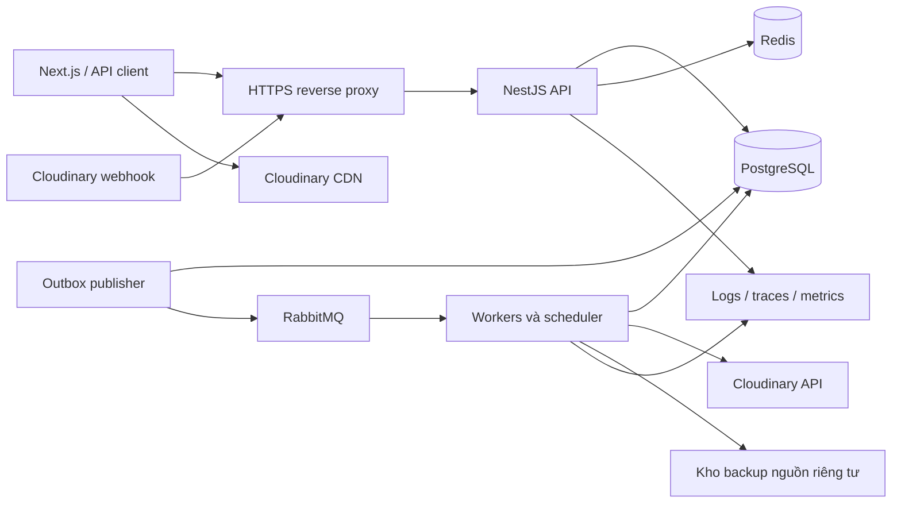
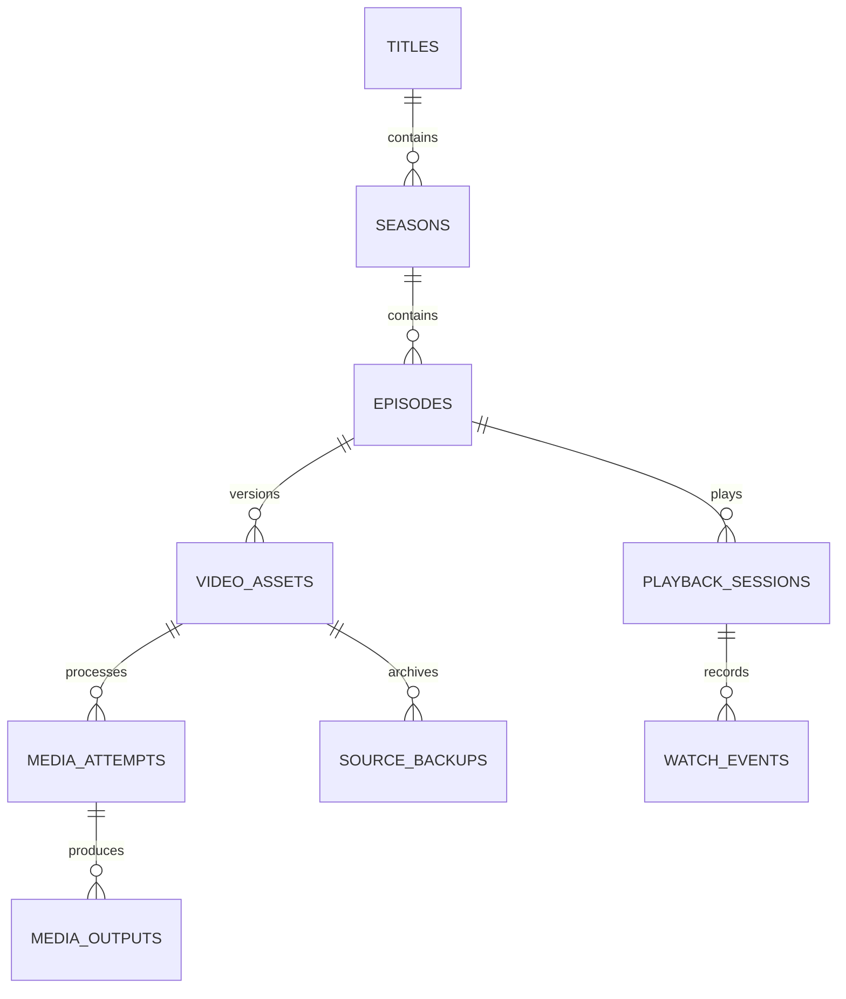
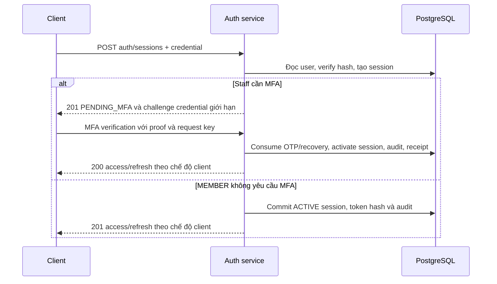

# Thiết kế backend web xem phim

Phiên bản thiết kế: 1.6. Cập nhật: 10/11/2026, Asia/Saigon.

Đã triển khai [API admin và Swagger](../api/README.md): 49 endpoint admin, tổng 87 operation/67 path, Prisma trên DB hiện có, MFA/RBAC/audit và 1.142 kiểm tra HTTP/client/worker. Đã có [global exception handler](../api/exception-handling.md) riêng trong filters/, APP_FILTER dùng chung với parser/Express/Swagger, 73 mã lỗi và log JSON an toàn. Đã có [API người xem](../api/viewer-api.md): public catalog, playback/session/telemetry, đăng ký/email local, thư viện cá nhân và báo lỗi. Phần còn lại là thiết kế mục tiêu, không phải toàn bộ backend đã hoàn tất.

Phiên bản 1.1 liên kết [thiết kế database chi tiết](movie-database-design.md): 47 bảng PostgreSQL, ERD, DDL, seed RBAC, grants và kiểm tra SQL cô lập. DDL là baseline khởi tạo; Prisma client và API admin đã chạy, worker HLS/webhook/backup đã chạy local; playback API đã triển khai local, frontend/player chưa triển khai.

Tài liệu này cụ thể hóa [kế hoạch sản phẩm](../plans/movie-streaming-platform-plan.md) để triển khai backend Node.js trong `pj-Flim`. Các module/luồng bên dưới là thiết kế tổng thể; source admin đã có theo phạm vi trong hướng dẫn API, chưa phải toàn bộ module hoặc migration đều triển khai. Danh sách REST endpoint, permission matrix và error registry chuẩn nằm ở mục 7/10 của plan; thiết kế này bổ sung cách thực hiện, không tạo một hợp đồng API cạnh tranh.

## 1. Quyết định kiến trúc

- NestJS/TypeScript modular monolith cho API và một ứng dụng worker riêng cùng repository. Tăng số API/worker độc lập khi cần; chưa tách mỗi module thành microservice.
- PostgreSQL là nguồn dữ liệu chính; Prisma quản lý truy cập và migration. Dùng SQL migration cho constraint/index/lock cần thiết thay vì giả định mọi tính năng đều biểu diễn được bằng schema ORM của phiên bản được chọn.
- RabbitMQ chuyển thông điệp tác vụ, không chuyển video. Outbox/inbox và job state được lưu PostgreSQL; broker mất kết nối không làm mất yêu cầu đã được commit.
- Redis dùng cache/rate limit, không giữ lịch sử, audit, quyền hoặc job quan trọng làm nguồn duy nhất.
- Cloudinary là media provider chính cho upload, HLS và CDN. Backend không proxy các segment video qua Node.js và không chuyển mã đồng bộ trong request Play.
- JWT access + refresh opaque xoay vòng, server session, MFA và RBAC/permission như plan. Cookie browser, token API và credential Cloudinary là các loại khác nhau.
- Controller mỏng, service/use case quản lý nghiệp vụ/transaction; repository/query layer cho truy vấn phức tạp; adapter cô lập Cloudinary, broker, email và backup.



## 2. Module và quyền sở hữu dữ liệu

| Module          | Chịu trách nhiệm                                           | Dữ liệu sở hữu                                                                               | Phụ thuộc chính                             |
| --------------- | ---------------------------------------------------------- | -------------------------------------------------------------------------------------------- | ------------------------------------------- |
| Auth            | Login, session, refresh, reset, MFA, step-up               | auth_sessions, refresh_tokens, auth_replay_receipts, token/challenge/factor tables           | Users, Authorization, Audit, email adapter  |
| Users           | Profile, trạng thái tài khoản, authVersion                 | users                                                                                        | Auth/Authorization phối hợp qua use case    |
| Authorization   | Role/permission, policy, thay role và bảo vệ quản trị cuối | roles, permissions, role_permissions, user_roles, policy_locks                               | Users, Audit                                |
| Catalog         | Phim, mùa/tập, thể loại, credits, publication              | titles, seasons, episodes và bảng metadata                                                   | Media readiness, Audit, cache events        |
| Media           | Intent, asset, processing/backup, provider result          | upload_intents, video_assets, media_outputs, media_attempts, source_backups, subtitle_tracks | Operations, Jobs, Cloudinary adapter, Audit |
| Playback        | Quyền xem, phiên, credential generation, renewal           | playback_sessions                                                                            | Catalog, Media, Auth, delivery adapter      |
| Telemetry       | Ingestion và tổng hợp chất lượng/lượt xem                  | playback_event_batches, watch_events                                                         | Playback, Jobs                              |
| Library         | Watchlist, lịch sử và resume                               | watchlist, resume_heads, watch_progress                                                      | Auth, Playback, Catalog                     |
| Search          | Chuẩn hóa tên, truy vấn/filter/cursor                      | Read model từ Catalog, không giữ bản phim độc lập                                            | Catalog, Redis                              |
| Reports         | Báo lỗi nội dung và đọc báo cáo theo quyền                 | content_reports                                                                              | Playback, Authorization                     |
| Audit           | Atomic audit, redaction, security events, export           | audit_logs, security_events, audit_exports                                                   | Transaction, archive adapter, Jobs          |
| Operations/Jobs | Receipt, outbox/inbox, retry, job lease, DLQ               | operations, idempotency_records, outbox_events, inbox_events, job_runs, scheduled_jobs       | PostgreSQL, RabbitMQ                        |

Module gọi public service/query của module khác; controller không sửa bảng thuộc module khác. Một transaction nghiệp vụ có thể đi qua các service với cùng transaction client, không tạo transaction lồng độc lập làm mất tính atomic.

Không tạo generic repository cho mọi bảng chỉ để bọc lại Prisma. Dùng use case cho các thao tác có guard/transaction và query service cho danh sách/đọc dữ liệu. Không trả Prisma entity trực tiếp thành API DTO chứa trường bí mật.

## 3. Cấu trúc source dự kiến

```text
movie-web/
  apps/api/src/
    main.ts
    app.module.ts
    config/                    # env, Swagger, CORS, cookies
    common/
      guards/                  # auth, permission, MFA, step-up
      decorators/              # Public, RequirePermissions
      filters/                 # Problem Details
      middleware/              # request ID, request context
      interceptors/            # response envelope, observability
    modules/
      auth/ users/ authorization/ audit/
      catalog/ episodes/ media/ playback/ telemetry/
      library/ search/ reports/ operations/ health/
  apps/worker/src/
    main.ts
    worker.module.ts
    outbox-publisher.ts
    consumers/                 # media, analytics, notifications, exports
    handlers/                  # verify, process, apply result, backup, delete
    schedules/                 # retry, reconcile, retention
  packages/contracts/src/
    error-codes.ts
    problem-details.ts
    jobs.ts
    generated/api-types.ts
  packages/database/
    prisma/schema.prisma
    prisma/migrations/
    prisma/seed.ts
    src/                       # Prisma client, DB role config
  packages/media/src/           # Node-only provider adapter
  packages/backend-core/src/    # shared audit/job/media policies/use cases
  tests/                       # contract, integration, E2E
  infra/                       # local services, Docker, runtime config
```

`backend-core` chỉ chứa logic thực sự cần dùng ở cả API/worker: state transitions, apply-provider-result, audit writer và job helpers. Không import `apps/api` từ worker hoặc frontend. DTO HTTP và guards phụ thuộc request ở API; business policies dùng chung không phụ thuộc Express/Fastify. API/worker bind provider implementations tại composition root; frontend chỉ import contracts an toàn, không import database/media/backend-core.

## 4. Vòng đời request và principal

```text
HTTPS/proxy limits
→ request ID và context
→ parse body / giữ raw bytes ở webhook
→ authentication theo loại credential của route
→ MFA / step-up / permission guard
→ DTO validation và controller
→ use case kiểm resource, version và invariant
→ transaction: domain + audit + outbox/idempotency khi cần
→ DTO mapping / success response
→ Problem Details nếu có lỗi
```

Đây là pipeline logic của ứng dụng; khi gắn vào NestJS phải tuân lifecycle thực tế. Guard không được dựa vào body đã coi là validated vì pipe validation thường chạy sau guard. Resource/body-dependent policy kiểm lại trong use case với DTO đã validate. Request ID phải có trước guard để lỗi xác thực cũng được trace. [NestJS request lifecycle](https://docs.nestjs.com/faq/request-lifecycle)

Các principal được tách rõ:

| Principal           | Được phép làm gì                                                                                                      |
| ------------------- | --------------------------------------------------------------------------------------------------------------------- |
| Anonymous           | Đọc catalog công khai; tạo guest playback khi chính sách cho phép                                                     |
| UserPrincipal       | Identity từ JWT + auth_sessions/users hiện hành, subject/sid/authVersion                                              |
| MfaContextPrincipal | Chỉ challenge/enrollment được cấp, không dùng làm phiên admin đầy đủ                                                  |
| PlaybackPrincipal   | Purpose MANAGEMENT hoặc TELEMETRY gắn session; token events không được đọc credential/gia hạn/đóng phiên hoặc gọi /me |
| ProviderPrincipal   | Webhook đã verify chữ ký/raw body, không có quyền admin                                                               |
| WorkerContext       | Service identity nội bộ, job/operation/initiating actor; không dùng JWT admin trong queue                             |

Public route, webhook và telemetry không được xử lý bằng một cờ bỏ auth chung. Metadata route xác định scheme được chấp nhận; credential sai loại bị từ chối. Nếu cookie access và bearer cùng xuất hiện không khớp, không fallback sang credential còn lại.

## 5. Database logic và dữ liệu cần lưu

Quy ước: PK UUID, timestamp `timestamptz` UTC, tên cột snake_case, API camelCase. Bản ghi mutable có timestamp/version theo use case; tên cột optimistic lock chính thức là `version`, user dùng `auth_version`; append-only event có occurred_at/received_at. Byte count dùng bigint; API truyền dưới dạng chuỗi nếu có thể vượt số nguyên an toàn JavaScript. Vị trí/thời lượng lưu số giây có độ chính xác mili giây, validate finite/non-negative và serialize theo DTO rõ ràng.

Từ điển cột/kiểu dữ liệu/NULL/default và toàn bộ constraint nằm trong [database design](movie-database-design.md) và [DDL](sql/movie-database-schema.sql). Ngoài bảng tóm tắt dưới đây có `homepage_banners`, `system_settings`, `title_daily_stats` cho trang chủ/cấu hình/thống kê; `episodes.title_id` được FK ghép với season để giữ quan hệ đúng. Tổng baseline 47 bảng, không có bảng lưu byte video hoặc từng HLS segment.

Quan hệ lõi của catalog/media/playback:



Pointer active_asset_id của mỗi tập là quan hệ lựa chọn riêng, được ràng buộc bằng composite FK ở mục 6; có nhiều version không có nghĩa nhiều asset active cùng lúc.

### 5.1. Identity và quyền

| Bảng                                              | Trường nghiệp vụ chính                                                                               | Ràng buộc                                                               |
| ------------------------------------------------- | ---------------------------------------------------------------------------------------------------- | ----------------------------------------------------------------------- |
| users                                             | email_normalized, password_hash, status, email_verified_at, auth_version                             | Unique email; status ACTIVE/SUSPENDED/DELETED; không trả password_hash  |
| auth_sessions                                     | user_id, state, auth_version, mfa_verified_at, step_up_at, idle/absolute_expires_at, revoked_at      | PENDING_MFA/ACTIVE/REVOKED/EXPIRED; FK user                             |
| refresh_tokens                                    | session_id, family_id, generation, token_hash, consumed_at, replaced_by_id, expires_at               | Unique token_hash và family/generation; chỉ lưu hash                    |
| auth_replay_receipts                              | session/family/challenge reference, request_key_hash, proof references, encrypted_result, expires_at | Unique context/key; encrypted result TTL ngắn; không trả cho proof khác |
| password_reset_tokens / email_verification_tokens | user_id, token_hash, purpose, expires_at, used_at                                                    | Unique hash; consume atomic một lần                                     |
| mfa_factors                                       | user_id, kind, encrypted_secret, verified_at, last_accepted_step, disabled_at                        | Một factor TOTP hoạt động theo policy; secret mã hóa                    |
| mfa_challenges                                    | user/session/factor, purpose, proof_hash, attempts, expires_at, consumed_at                          | Scope LOGIN/STEP_UP/ENROLLMENT; không dùng chéo purpose                 |
| mfa_recovery_codes                                | factor_id, code_hash, used_at                                                                        | Unique factor/hash; một lần sử dụng                                     |
| roles / permissions                               | code, description                                                                                    | Code unique, seed cố định MVP                                           |
| user_roles / role_permissions                     | user_id/role_id hoặc role_id/permission_id                                                           | Composite PK/unique, FK; không gán quyền bằng body profile              |
| policy_locks                                      | key                                                                                                  | Một hàng `super_admin_roster` phục vụ lock cho invariant quản trị cuối  |

Auth secret/challenge không đặt trong audit snapshot hoặc event payload. Session/account status là nguồn kiểm tra thu hồi; JWT không phải kho quyền cuối cùng.

### 5.2. Catalog

| Bảng                  | Trường nghiệp vụ chính                                                                                                             | Ràng buộc                                                 |
| --------------------- | ---------------------------------------------------------------------------------------------------------------------------------- | --------------------------------------------------------- |
| titles                | kind, slug, localized/original_title, normalized_title, synopsis, release_year, publication_status, published_at, poster_asset_ref | Unique slug; MOVIE/SERIES; publication tách media status  |
| title_aliases         | title_id, text, normalized_text, locale                                                                                            | Unique title/normalized_text khi phù hợp                  |
| seasons               | title_id, season_number, is_technical, name                                                                                        | Unique title/season_number; mùa kỹ thuật phim lẻ ẩn UI    |
| episodes              | season_id, episode_number, title, publication_status, published_at, active_asset_id, intro/credits markers                         | Unique season/episode_number; active asset phải thuộc tập |
| genres / title_genres | code/slug/name và title_id/genre_id                                                                                                | Unique code/slug; composite PK bảng nối                   |
| people / credits      | person name và title_id/person_id/role/character/order                                                                             | Index theo title/person, kiểm dữ liệu metadata            |

Phim lẻ có một mùa/tập kỹ thuật; client vẫn nhận UX phim lẻ. Catalog công khai lọc title PUBLISHED và có tập đủ điều kiện; từng tập tiếp tục lọc publication/active asset. Không đưa URL nguồn hoặc credential vào metadata phim.

### 5.3. Media và provider state

| Bảng            | Trường nghiệp vụ chính                                                                                                                                                  | Ràng buộc                                                                 |
| --------------- | ----------------------------------------------------------------------------------------------------------------------------------------------------------------------- | ------------------------------------------------------------------------- |
| upload_intents  | episode_id, owner_id, target_public_id, status, expires_at, expected_policy, verified_asset_id                                                                          | Public ID server chọn, unique; kiểm actor/intent khi complete             |
| video_assets    | episode_id, provider, provider_asset_id/public_id/version, internal_version, processing_status, lifecycle, backup_status, duration/dimensions/bytes, current_attempt_id | Identity provider unique; immutable internal_version                      |
| media_attempts  | asset_id, profile_version/config_hash, status, provider_batch_ref, callback_context_hash, operation_id, attempt_no                                                      | Một active processing attempt trên asset/profile; kết quả cũ không ghi đè |
| media_outputs   | attempt_id, format, profile/config_hash, status, manifest_reference, verified_at                                                                                        | Output bắt buộc đủ trước READY; không tạo bảng cho từng segment           |
| source_backups  | asset_id, storage_provider/object_key, checksum, bytes, status, verified_at, retention_until                                                                            | Chỉ reference riêng tư, không URL có credential; backup tách READY        |
| subtitle_tracks | asset_id, language, label, storage_ref, format, status, offset_seconds                                                                                                  | Phụ đề gắn đúng phiên bản nội dung; chỉ track hợp lệ công khai            |

processing_status: PENDING_UPLOAD/UPLOADED/PROCESSING/READY/FAILED. Lifecycle: ACTIVE/DELETING/DELETED. Backup: PENDING/RUNNING/VERIFIED/FAILED. Media attempt có thể QUEUED/RUNNING/WAITING_PROVIDER/VERIFYING_OUTPUT/RECONCILING/SUCCEEDED/FAILED/CANCELLED; WAITING_PROVIDER không phải thất bại hoặc đã hoàn tất.

### 5.4. Playback, telemetry và thư viện

| Bảng                   | Trường nghiệp vụ chính                                                                                                                              | Ràng buộc                                                        |
| ---------------------- | --------------------------------------------------------------------------------------------------------------------------------------------------- | ---------------------------------------------------------------- |
| playback_sessions      | user_id hoặc guest_id, mode, episode_id, asset_id/version, management_token_hash, telemetry_token_hash, delivery_generation, expires_at, revoked_at | XOR user/guest; token management/events tách biệt, preview riêng |
| playback_event_batches | session_id, batch_id, received_at, status, event_count                                                                                              | Unique session/batch; ghi bền trước 202                          |
| watch_events           | session_id, event_id, sequence, type, elapsed_ms, position_seconds, schema_version, payload                                                         | Unique session/event_id; payload allowlist và giới hạn           |
| resume_heads           | user_id, episode_id, generation, active_session_id                                                                                                  | PK user/episode; khóa cả khi chưa có progress                    |
| watch_progress         | user_id, episode_id, asset_version, resume_generation, session_id, last_sequence, position_seconds, watched_intervals, completed_at                 | Unique user/episode; không dùng MAX(position)                    |
| watchlist              | user_id, title_id, created_at                                                                                                                       | Composite PK; thêm/xóa idempotent                                |
| content_reports        | owner_user/session, title/episode, category, sanitized_message, status                                                                              | Owner/scope đọc rõ, không lưu URL có token                       |

resume_heads cấp generation khi bắt đầu xem, không tăng khi renewal. Một lần tạo phiên retry cùng idempotency key không được tăng generation lần nữa. Khách lưu resume ở client; telemetry vẫn có viewer session để tổng hợp.

### 5.5. Reliability và audit

| Bảng                | Trường nghiệp vụ chính                                                                                                              | Ràng buộc                                                                           |
| ------------------- | ----------------------------------------------------------------------------------------------------------------------------------- | ----------------------------------------------------------------------------------- |
| operations          | owner/principal_scope, type, resource_ref, status, progress, result_ref, error_code/message, completed_at                           | QUEUED/RUNNING/SUCCEEDED/FAILED; DTO không lộ secret; hủy nội bộ có failure code rõ |
| idempotency_records | actor_scope, method, normalized_route, key_hash, request_fingerprint, resource/operation_ref, state, receipt_ref, expires_at        | Unique scope/method/route/key; quyền kiểm trước replay                              |
| outbox_events       | event_id, type/schema_version, aggregate_ref/version, operation_id, payload, next_attempt_at, lease_owner/until/token, published_at | Unique event_id; lease claim an toàn nhiều publisher                                |
| inbox_events        | source, event/dedup key, verified_payload, status, attempt_ref, received_at                                                         | Unique source/dedup; raw signature được verify trước khi lưu payload đã lọc         |
| job_runs            | handler, logical_key, operation_ref, state, attempt, lease_token/until, error                                                       | Unique handler/logical_key; worker cũ không commit bằng lease hết hạn               |
| scheduled_jobs      | logical_key, kind, due_at, payload_ref, state                                                                                       | Unique logical_key; schedule retry/cleanup không chỉ nằm trong RAM                  |
| audit_logs          | actor/initiator, action, resource, outcome, diff_allowlist, reason, error_code, request/trace IDs, occurred_at                      | Append-only với DB role ứng dụng; retention riêng                                   |
| security_events     | category, outcome, identity_ref_minimized, request/trace IDs, received_at                                                           | Log thất bại/denied không chung transaction đã rollback                             |
| audit_exports       | requester_id, scope/filter, status, private_object_ref, expires_at, operation_id                                                    | Chỉ audit.export/step-up, tải kiểm lại quyền                                        |

Nếu dùng cùng inbox cho webhook và consumer thì source/dedup schema phải phân biệt rõ; không lấy timestamp khác nhau làm lý do xử lý cùng kết quả nghiệp vụ hai lần.

## 6. Constraint, index và concurrency bắt buộc

- `episodes(active_asset_id, id)` tham chiếu cặp unique `video_assets(id, episode_id)` để không gắn asset của tập khác; tạo episode với active_asset_id null rồi mới gắn asset. Không dựa duy nhất vào kiểm tra application.
- Có partial unique index cho processing attempt đang hoạt động trên `(asset_id, config_hash)`; các trạng thái chờ provider/reconcile vẫn tính là active. Các loại backup/verify có logical key riêng, không bị khóa nhầm như processing.
- Index publication/published_at/id cho catalog, season_id/episode_number, user_id/updated_at cho progress, expires_at cho token, status/next_attempt_at cho outbox, due_at cho schedule và thời gian/actor/resource cho audit.
- Tên chuẩn hóa có trigram index phù hợp query; query public vẫn phải filter publication, không lấy top kết quả rồi bỏ trạng thái sau cùng khiến cursor/count sai.
- Partial unique/index/constraint dùng SQL migration nếu ORM đã chọn chưa biểu diễn được; kiểm migration và query plan thực tế. [PostgreSQL indexes](https://www.postgresql.org/docs/current/sql-createindex.html)
- Default transaction ngắn; không giữ DB lock trong khi gọi Cloudinary, gửi email hoặc chờ publisher confirm. Claim và persist state trước, gọi mạng ngoài transaction rồi commit kết quả bằng lease/version guard.
- Với invariant nhiều hàng dùng lock theo thứ tự thống nhất: policy mutex nếu cần → actor/target user theo ID → title → episode → asset/attempt. Không viết SELECT COUNT và cập nhật tách rời để bảo vệ SUPER_ADMIN cuối.
- Outbox/scheduler claim bằng row lock/lease, có thể dùng SKIP LOCKED cho hàng đợi nội bộ; không dùng SKIP LOCKED để bỏ qua kiểm quyền hoặc trả catalog thiếu dữ liệu. [PostgreSQL locking](https://www.postgresql.org/docs/18/explicit-locking.html)
- ETag/If-Match kiểm atomic với UPDATE row_version và authorization. Thiếu precondition 428, stale 412; business conflict 409. Deadlock/serialization retry phải hữu hạn và chỉ lặp transaction không chứa network side effect.

## 7. Xác thực và refresh race

### 7.1. Đăng nhập và MFA



- Ngoại lệ local theo yêu cầu ngày 11/11/2026: AUTH_MFA_REQUIRED=false bỏ challenge và kiểm MFA/step-up; vẫn kiểm mật khẩu, trạng thái phiên, permission, ownership, audit và bảo vệ SUPER_ADMIN cuối. Không ghi mfa_verified_at/step_up_at giả. Production luôn yêu cầu MFA; cờ mặc định true. Session local staff giữ idle timeout 30 phút và absolute timeout 8 giờ.
- Staff theo role matrix bắt buộc MFA khi policy yêu cầu. Chưa enrollment chỉ có context giới hạn để setup, không full admin token. OTP factor/recovery code consume atomic; challenge purpose/owner không được đổi từ body.
- Mẫu cookie production cùng origin qua reverse proxy: access `__Host-movie_access` (Path=/, Secure, HttpOnly, SameSite=Lax); refresh `__Secure-movie_refresh` (Domain không đặt, Path=/api/v1/auth, Secure, HttpOnly, SameSite=Strict). Điều chỉnh nếu topology khác và kiểm CORS/CSRF lại.
- Browser không lưu token localStorage. Non-browser/API tooling nhận bearer access qua luồng được cấu hình; không đưa refresh token vào Swagger Authorize. Access JWT TTL thử 15 phút, refresh MEMBER tối đa 7 ngày/staff 8 giờ và idle staff 30 phút theo plan.
- JWT dùng algorithm allowlist và issuer/audience/key ID đã cấu hình; ví dụ chốt RS256 cho deployment đầu sau kiểm thư viện. Session/authVersion/status kiểm từ server trên request được xác thực; quyền staff không lấy duy nhất từ JWT.
- CSRF bootstrap gắn context cookie/challenge/session hiện hành; yêu cầu mutation cookie có CSRF + Origin policy, gồm login/refresh/logout. Provider webhook dùng signature, không bị ép dùng CSRF user.
- Password/role/status/MFA change tăng authVersion và thu hồi session theo policy. Logout với refresh proof hợp lệ có thể thu hồi khi access token đã hết hạn; luôn xóa cookie và không cấp credential mới từ endpoint logout.

### 7.2. Refresh rotation và retry có kết quả chưa rõ

Auth renewal có request key riêng theo token family/ý định, dùng Idempotency-Key; lookup/verify proof thực hiện trước khi trả receipt, không áp retry POST chung. Cần tránh việc hai tab refresh cùng lúc làm logout cả tài khoản dù không có tấn công.

1. Khóa session/family, kiểm user/session/current token; lookup receipt theo family/request key và proof đã gắn với receipt.
2. Lần đầu consume refresh token, tạo successor hash/generation và encrypted replay receipt trong cùng transaction; commit trước khi trả cookie/token.
3. Cùng request key/proof hợp lệ trong cửa sổ thử 30 giây được trả cùng kết quả, không xoay thêm. Receipt chứa credential được mã hóa bằng key server, TTL ngắn; metadata có thể giữ lâu hơn để chống chạy lại, plaintext không ghi log/DB.
4. Token cũ với key khác trong cửa sổ race trả `AUTH_REFRESH_RETRY_CONFLICT`/409 và Retry-After thử 2 giây, không lộ successor và không thu hồi family ngay. Client đợi cookie mới/cross-tab coordination, chỉ retry hữu hạn; nếu response đầu mất thì retry ý định đầu bằng key cũ.
5. Ngoài cửa sổ, dùng lại token cũ bằng ý định khác trả AUTH_REFRESH_REUSED/401, thu hồi family và security event. Cùng key nhưng receipt hết hạn trả IDEMPOTENCY_RESULT_EXPIRED/409 để đăng nhập lại nếu không có successor hợp lệ, không xoay token cũ lần nữa.
6. Nếu browser đã nhận cookie mới nhưng chưa nhận body, retry cùng key được đối chiếu successor đã gắn receipt trước khi rotate; tránh coi cookie đã đổi là ý định mới.

Frontend single-flight/cross-tab coordination giúp giảm race, nhưng backend vẫn phải an toàn khi hai request đến đồng thời. Các cửa sổ này là policy sản phẩm cần test, không phải cam kết của JWT framework. MFA verification trả credential cũng cần consume một lần + receipt có proof/request key riêng để retry không dùng lại OTP/recovery code như một lần xác thực mới.

## 8. Authorization và atomic audit

AuthorizationGuard kiểm permission matrix; use case tiếp tục kiểm scope/resource và quyền hiện hành trước mutation. Staff mutation nhạy cảm khóa/đối chiếu actor và dữ liệu phụ thuộc trong transaction, tránh quyền bị gỡ giữa guard và commit mà thao tác vẫn vượt policy.

```text
BEGIN
  khóa policy_locks khi thay roster quản trị
  khóa actor/target theo thứ tự và đọc quyền/version hiện tại
  kiểm MFA/step-up/resource scope và If-Match
  kiểm SUPER_ADMIN cuối / media readiness / invariant tương ứng
  ghi thay đổi nghiệp vụ
  append audit đã redaction
  ghi outbox/operation/idempotency nếu có
COMMIT
```

- AuditService nhận transaction client; interceptor chỉ cung cấp request context, không thay audit bằng logger chạy sau response.
- Append audit lỗi thì transaction mutation rollback, map AUDIT_WRITE_UNAVAILABLE. FAILED/DENIED được ghi pipeline riêng sau rollback, không giả mạo một dòng SUCCESS.
- Actor/role snapshot và initiatingActorId/operationId nối audit từ request đến worker. Worker không tin role snapshot như quyền còn hiệu lực để bắt đầu một side effect nhạy cảm mới.
- Role/status/MFA và bootstrap đều đi qua cùng invariant. SUPER_ADMIN cuối không được vô hiệu qua endpoint khác hoặc hai request chạy song song.
- DB credentials của ứng dụng không UPDATE/DELETE audit; migration/archive role khác. Export scope có thời hạn, ghi audit yêu cầu/tải và kiểm lại permission/step-up trước stream.

## 9. Pipeline upload → READY

Đã triển khai [signed upload và xác minh nguồn](../api/cloudinary-upload.md). Metadata verification hiện chạy đồng bộ với timeout 10 giây, ngoài transaction DB, và trả 200 sau khi nguồn VERIFIED cùng processing operation/outbox được commit. [Worker RabbitMQ, webhook và backup](../api/media-worker.md) đã chạy tự động và nghiệm thu local với video 20 phút 11 giây; production S3/restore và HA còn cần nghiệm thu.

```mermaid
sequenceDiagram
    participant UI as Admin UI
    participant API as Media API
    participant DB as PostgreSQL
    participant W as Worker
    participant CL as Cloudinary
    UI->>API: Tạo upload intent
    API->>DB: Intent + asset dự kiến + audit/idempotency
    API-->>UI: Signed upload parameters
    UI->>CL: Direct/chunked upload
    UI->>API: POST intent/verifications
    API->>CL: Đọc và xác minh metadata nguồn (timeout 10 giây)
    API->>DB: VERIFIED/UPLOADED + operation/attempt/outbox + audit
    API-->>UI: 200 và processing operation URL
    W->>CL: Đối chiếu nguồn, yêu cầu eager HLS
    W->>DB: WAITING_PROVIDER, không chờ ACK hàng giờ
    CL->>API: Webhook kết quả có chữ ký
    API->>DB: Inbox đã xác minh, payload đã lọc
    API-->>CL: 200 sau commit
    W->>CL: Đối chiếu output/asset/profile
    W->>DB: Output verified, READY; backup job riêng
    W->>DB: Backup VERIFIED khi checksum đạt
```

- Intent chọn public ID/preset/profile phía server và không overwrite bản active. API tra provider xác minh actual resource type, version, ownership, bytes và duration; worker kiểm tra lại khi xử lý output.
- Cloudinary eager processing hỗ trợ chạy nền và notification; cấu hình `eager_async`/`eager_notification_url` theo SDK được chọn. Upload thành công không đồng nghĩa eager đã xong. [Cloudinary eager transformations](https://cloudinary.com/documentation/eager_and_incoming_transformations)
- Webhook verify raw bytes/timestamp trước parse và normalize; dedup theo provider identity/event khi có, hoặc verified payload hash và business invariant. Không lưu raw token/signature hoặc tin callback query attemptId mà không đối chiếu asset/profile/version/batch.
- Output URL chỉ chấp nhận origin/path của provider đã cấu hình; kiểm manifest và segment mẫu với giới hạn byte/timeout, kiểm redirect/host từng bước để không biến verification thành SSRF.
- READY đòi tất cả output bắt buộc đúng config, truy cập theo policy phát được và duration/timeline hợp lệ. Backup VERIFIED chỉ có sau copy/checksum; không tạo thêm rendition khi người xem bấm Play.
- Timeout sau khi gọi provider là RECONCILING/unknown result, không tự tạo cùng transformation một lần nữa. Late result của attempt cũ không đổi active pointer hoặc hồi sinh asset DELETED.
- Backup lấy nguồn qua server adapter cho worker, streaming sang kho riêng tư, kiểm byte/checksum và lưu manifest phụ đề. Không đặt backup chung quyền xóa với Cloudinary hoặc lưu access URL lâu dài.

## 10. Xuất bản và thay video

`canPlayEpisode` kiểm: title PUBLISHED, episode PUBLISHED, active asset READY/lifecycle ACTIVE, quyền người xem và session policy. Publication admin còn kiểm backup VERIFIED; hai guard khác mục đích nhưng dùng chung predicate media readiness.

### 10.1. PUT publication

1. Xác thực/permission catalog.publish, DTO chỉ status/reason được phép.
2. Transaction khóa title/episode/active asset theo thứ tự, kiểm ETag và quyền actor hiện hành.
3. Title publish yêu cầu ít nhất một tập đã công khai và có thể phát; episode publish kiểm video/backup của chính tập, không chặn bởi tập tương lai đang upload.
4. Cập nhật publication/row_version, audit diff và catalog.changed outbox; commit, trả representation/ETag mới.
5. Consumer invalidation Redis/Next.js retry khi lỗi; API tạo/gia hạn phiên luôn kiểm nguồn chính nên UI stale không cấp thêm quyền phát.

### 10.2. Thay active asset

- Tạo asset/version mới, xử lý và backup độc lập, preview rồi mới đổi pointer. Dùng PATCH episode với `activeAssetId` có quyền/If-Match và use case chuyên trách, không mass-assign arbitrary field.
- Transaction xác minh asset thuộc episode và đạt điều kiện, khóa pointer rồi đổi, tăng row_version, audit và invalidate. Không cập nhật public ID cũ tại provider rồi mong mọi edge cache đổi ngay.
- Phiên đã mở pin asset/version ban đầu, không đổi timeline giữa chừng. Phiên mới lấy bản mới. Resume chỉ chuyển sang phiên bản mới theo policy kiểm timeline; không tự áp vị trí cũ nếu nội dung đã thay.
- Giữ nguồn/bản cũ theo retention rollback, dọn sau khi hết thời gian phục vụ phiên và policy; xóa gấp có quy trình riêng. Gỡ publication chặn session mới, không hứa thu hồi ngay byte đã cache/buffer.

## 11. Playback, telemetry và resume

### 11.1. Tạo/gia hạn phiên phát

- API kiểm idempotency + authoritative title/episode/asset; ghi session gắn user/guest và asset version. Tạo resume generation đúng một lần nếu là user xem thật, không tăng cho preview/renewal/retry cùng ý định.
- Delivery adapter ký URL/credential dựa trên metadata đã verified, không gọi Admin API Cloudinary trên mỗi Play. Chỉ trả manifest/expiration/capabilities cần thiết, không trả source URL hay API secret.
- Credential telemetry là opaque token riêng lưu hash, chỉ gọi events của session. Guest đọc/gia hạn/đóng phiên cần management proof riêng; user có thể dùng auth session và ownership theo security scheme đã khai. Token events không được dùng lấy delivery credential hoặc quản lý phiên. Preview không tính vào lượt xem và không ghi đè resume người dùng.
- Renewal kiểm lại quyền/session và generation, single-flight/idempotency theo từng đợt; không biến mọi CDN 403 thành renewal. HttpOnly API cookies không bị gửi sang domain Cloudinary; delivery token/cookie có topology riêng đã thử ở G0.

### 11.2. Event ingestion

- Validate tối đa 50 event/64 KB theo plan, session proof, schema/type, timestamp/finite values và quota. Batch lỗi trả 422 atomic; batch hợp lệ ghi receipt/events hoặc inbox bền và outbox rồi mới 202.
- Unique event IDs xử lý event lặp giữa batch; fingerprint cùng eventId nhưng payload khác phải bị từ chối bằng lỗi batch, không âm thầm sửa lịch sử. Client sequence và server received time là hai trường khác nhau.
- Analytics consumer riêng tổng hợp startup/rebuffer/quality/view; không ghép pause/seek/tab bị treo thành rebuffer. Thiếu cặp sự kiện đánh dấu incomplete, quality không quan sát được ghi unknown.
- Session/batch/event receipts cho phép retry có giới hạn mà không tăng view. Không cần tạo operation poll cho từng heartbeat. Retention 30 ngày raw/90 ngày tổng hợp theo plan; archive/DB capacity được đo trước khi thêm partition.

### 11.3. Resume nhiều thiết bị

- Tạo/lock resume_heads(user,episode), tăng generation khi bắt đầu một session xem mới; watch_progress unique user/episode. Lúc chưa có progress cũng không cấp cùng generation cho hai request cạnh tranh.
- Progress request kiểm session owner, episode/version và active generation; sequence mới hơn thì cập nhật position và hợp khoảng đã xem trong cùng transaction.
- Phiên cũ có thể lưu event chẩn đoán nhưng không ghi đè resume mới. Trong phiên hiện tại vị trí có thể giảm vì tua về; không lấy max position hoặc latest arrival làm quy tắc thắng.
- completed_at tách position; muốn đánh dấu hoàn tất cần coverage thực xem và ended hợp lệ theo policy. Logout/đóng tab không được coi là đã gửi progress cuối chắc chắn; periodic save là cơ chế chính.

## 12. RabbitMQ, job lease và operation

| Queue logic           | Thực hiện                       | Giới hạn                                                                |
| --------------------- | ------------------------------- | ----------------------------------------------------------------------- |
| media.commands.v1     | Verify/process/backup/delete    | Concurrency theo provider/quota, không theo số CPU đơn thuần            |
| media.results.v1      | Apply webhook/reconcile result  | Kiểm asset/profile/attempt/version                                      |
| playback.analytics.v1 | Tổng hợp batch events           | Không làm nghẽn media queue                                             |
| notifications.v1      | Email xác minh/reset, thông báo | Token raw không nằm trong log; payload tối thiểu, secret handling riêng |
| audit.exports.v1      | Export theo scope đã duyệt      | Hạn thời gian/record/bytes và private storage                           |

Envelope tối thiểu có eventId/type/schemaVersion, aggregateRef/version, operationId, correlationId, initiatingActorId và payload đã allowlist. Không gắn JWT, refresh token hoặc video vào queue. Email token nếu cần gửi được truyền qua reference job/secret được bảo vệ, không copy bừa vào outbox/log có quyền đọc rộng.

- Publisher claim outbox bằng lease trong transaction ngắn, publish persistent message với mandatory routing/confirms ngoài transaction; chỉ mark published bằng lease token còn hợp lệ. Confirm mất có thể gửi lại cùng eventId.
- Consumer tạo/lock job_runs theo logical key, ACK delivery lặp đã hoàn tất; công việc được claim nhận lease token/fencing version. Worker cũ không commit sau khi lease đã được worker mới nhận.
- Không bảo đảm exactly-once ở network. Side effect provider cần stable identity, attempt state và reconcile; idempotent database write không tự làm API Cloudinary idempotent.
- Request Cloudinary đã được provider chấp nhận thì consumer lưu WAITING_PROVIDER và ACK, không đợi chuyển mã hoàn tất. Webhook/reconciler tạo công việc áp dụng kết quả riêng.
- Retry lưu next_attempt_at/scheduled_jobs và publish lại từ scheduler; tránh hot requeue. DLQ giữ lý do và operation reference, retry có permission/reason/audit.
- Operation GET trả 200 với trạng thái; FAILED chứa JobFailure code/message/retryable, không đặt `application/problem+json` cho một lần GET resource đã thành công. Endpoint không đọc được operation mới trả Problem Details.

RabbitMQ confirms và consumer ACK là hai cơ chế độc lập, redelivery có thể xảy ra. [RabbitMQ confirms](https://www.rabbitmq.com/docs/confirms)

## 13. Hợp đồng REST, lỗi và Swagger

- Thực hiện nguyên danh sách endpoint/permission/error registry mục 10 của plan; UUID path và camelCase JSON, search qua GET /titles?q=..., publication qua PUT singleton, retry tạo processing attempt.
- 201 có Location; 202 chỉ sau durable receipt/outbox và status URL với admin operation; 204/304 không body. Lỗi API dùng RFC 9457 Problem Details; CDN/network/player lỗi có adapter riêng.
- Chỉ service/use case phát domain error code; exception filter map code/status/headers. Không biến lỗi validation thành 500 hoặc leak Prisma/provider exception. Frontend dùng code, không parse message.
- Swagger config nằm ở API bootstrap. Theo yêu cầu ngày 11/11/2026, local mở trực tiếp /api/docs và /api/openapi.json, không login/cookie docs/CSRF; không cấp credential tự động. API nghiệp vụ vẫn kiểm Bearer/session/permission. Production hoặc SWAGGER_ENABLED=false không mount UI/spec/assets/redirect/alias.
- OpenAPI khai bearer/cookie/CSRF/telemetry/MFA proof đúng scheme và AND/OR, permission metadata, examples và status/header. Sinh API types/Postman từ cùng hợp đồng; không tạo API spec riêng cho worker.
- Admin ETag có representation/version đủ phân biệt các thay đổi liên quan; auth/permission kiểm trước trả 304/412 cho tài nguyên nhạy cảm. If-Match wildcard không được dùng để bypass điều kiện version cụ thể của hợp đồng.
- Thay active asset được thiết kế rõ trong PATCH episode ở mục 10.2: chỉ field được phép, asset phải cùng episode và READY/backup verified, permission media activation tương đương catalog.publish cùng audit. Metadata catalog.write đơn thuần không được dùng để đổi video đang phát.

## 14. Cache, bảo vệ tài nguyên và suy giảm dịch vụ

- Cache key public gồm catalog version, locale, normalized filters/sort và cursor. Không cache chung /me, playback credential, admin DTO, Problem Details hoặc audit.
- Redis cache lỗi có thể fallback query DB với giới hạn; rate limit auth/OTP không được tự bỏ qua khi Redis lỗi. Dùng fallback bền đã thử hoặc 503 cho endpoint nhạy cảm, cảnh báo rõ.
- RabbitMQ ngừng: API có thể nhận tác vụ bằng outbox khi DB còn khỏe và backlog trong ngưỡng; vượt ngưỡng trả 503 trước khi nhận thêm. Không trả 202 nếu không ghi bền được.
- Cloudinary ngừng: catalog/cá nhân vẫn dùng DB, phiên có thể tận dụng segment CDN đã cache/buffer nhưng không hứa failover nguồn chưa có. Tác vụ timeout chuyển reconcile, không spam provider.
- Timeout/body limit/rate limit khác nhau cho auth, metadata, telemetry, webhook và export. Không có endpoint nhận file phim nhiều GB qua JSON API.
- Database pool dành riêng theo API/worker, giới hạn tổng kết nối; telemetry batch/bulk insert và index theo workload. Không dùng Promise.all vô hạn cho export hoặc provider verification.
- Liveness chỉ phản ánh tiến trình; readiness cần DB và cấu hình bắt buộc. Broker/provider/Redis có degraded health riêng tùy tính năng; metrics/docs/internal health được route/network policy bảo vệ.
- Log JSON/tracing gắn requestId/operationId/playbackSessionId nhưng không lấy user/resource IDs làm nhãn metric vô hạn. Độ bao phủ telemetry đi kèm SLO, không xem thiếu event là thành công.

## 15. Hợp đồng nội bộ quan trọng

Các interface dưới đây là phác thảo TypeScript cho thiết kế, không phải file đã được tạo. API mapper không trả nguyên object provider ra ngoài.

```typescript
interface RequestContext {
  requestId: string;
  traceId?: string;
  actorId?: string;
  authSessionId?: string;
  principalKind: "ANONYMOUS" | "USER" | "MFA_CONTEXT" | "PLAYBACK" | "PROVIDER";
}

interface MediaProviderPort {
  signUpload(input: UploadPolicy): Promise<SignedUploadParameters>;
  getAsset(identity: ProviderAssetIdentity): Promise<ProviderAssetMetadata>;
  requestStreaming(input: StreamingRequest): Promise<ProviderRequestReceipt>;
  verifyWebhook(
    rawBody: Uint8Array,
    headers: WebhookHeaders,
  ): VerifiedProviderEvent;
  createDelivery(input: DeliveryRequest): Promise<DeliveryGrant>;
}

interface AuditWriter {
  append(tx: TransactionContext, event: SanitizedAuditEvent): Promise<void>;
}

interface JobHandler {
  handle(message: JobEnvelope, lease: JobLease): Promise<JobOutcome>;
}
```

Ports có input/output schema/secret classification cụ thể khi code; không tạo `any` cho webhook/provider result. API/worker inject Clock để test expiry/retry; transaction helper truyền explicit tx vào audit/outbox, không ngầm mở transaction mới.

## 16. Thứ tự backend code và kiểm thử

| Thứ tự | Phần backend                                 | Chứng minh hoàn tất                                                              |
| ------ | -------------------------------------------- | -------------------------------------------------------------------------------- |
| B01    | Bootstrap/config/DB migrations/health        | API/worker khởi động, migrate/seed sạch                                          |
| B02    | REST/errors/OpenAPI/request context          | Contract status/header/schema đúng, DTO không lộ secret                          |
| B03    | Auth/session/MFA/refresh receipt             | Login/MFA/refresh race/replay/revoke đúng, không logout giả do race trong cửa sổ |
| B04    | RBAC/audit transaction                       | EDITOR/ADMIN/AUDITOR đúng matrix, last SUPER_ADMIN và rollback audit             |
| B05    | Catalog/publication/If-Match                 | Không lộ draft, 428/412/409 đúng, không bypass active asset qua PATCH            |
| B06    | Upload intent/provider adapter/webhook inbox | Upload thật, chữ ký giả và owner mismatch bị chặn                                |
| B07    | Outbox/worker/processing/backup/reconcile    | Crash/redelivery/late webhook không làm sai state, READY/backup thật             |
| B08    | Playback/grants/event batches/resume         | Phiên pin version, quyền đúng, generation và dedup đúng                          |
| B09    | Search/library/reports/admin audit/export    | Cursor/filter/ownership/redaction/export expiry đạt                              |
| B10    | Load/degraded mode/retention/restore/CI      | Đo điều kiện mục 12 plan và F01–F34 theo phạm vi                                 |

B01–B10 là lát cắt backend trong C01–C12, không phải một lịch phát triển sản phẩm thứ hai. Unit/integration chạy cùng module; không chờ B10 mới kiểm thử.

Các bài concurrency/failure bắt buộc dùng PostgreSQL/RabbitMQ thật ở môi trường test:

- Hai publisher claim cùng outbox; confirm mất; consumer crash sau DB commit trước ACK; lease hết hạn và worker cũ quay lại.
- Hai request cùng Idempotency-Key, cùng key khác body, đổi actor, credential receipt hết hạn, operation FAILED được GET đúng DTO.
- Hai admin cập nhật publication bằng cùng ETag; thay/xóa asset cạnh tranh với publish; role bị gỡ khi request nhạy cảm đang tiến hành.
- Hai giao dịch đồng thời gỡ/khóa SUPER_ADMIN; audit append bị lỗi; log payload cố chứa token/HTML/formula.
- Hai tab refresh: cùng key, khác key trong grace, cookie successor đã nhận nhưng body mất, dùng token cũ sau grace và phiên bị thu hồi.
- Hai thiết bị bắt đầu xem cùng lúc khi chưa có progress; event trùng/sai payload; client tua về; attempt/webhook cũ sau khi active version đổi.
- Swagger UI/raw spec/alias không có quyền, MFA chưa hoàn tất, CSRF sai và request direct bypass frontend.

## 17. Điều kiện chốt trước khi triển khai

- Từ G0: gói Cloudinary, output/profile/video dài, access control xuyên manifest/segment, native HLS, nơi backup và usage thực tế.
- Khóa phiên bản Node/Nest/Prisma/Cloudinary client sau thử tương thích; chưa giả định tính năng ORM preview hoặc mặc định SDK sẽ đáp ứng migration/streaming.
- Chốt same-origin routing/cookie names, auth signing/encryption keys, email provider và chính sách recovery; secrets được cấp qua môi trường, không tài liệu/source.
- Refresh race window, staff session/step-up TTL, telemetry retention và rate limits là cấu hình thử cần đo, không hard-code như thông số chuẩn quốc tế.
- Backend design không thay việc chạy migration, xuất OpenAPI, tạo tài nguyên Cloudinary, triển khai hay kiểm thử. Bàn giao code sau này phải có bằng chứng theo plan.
