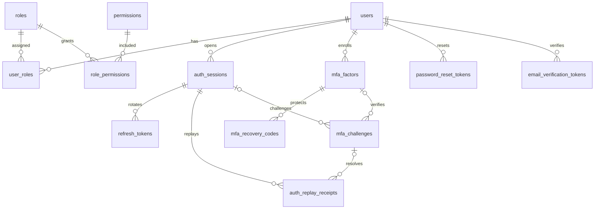
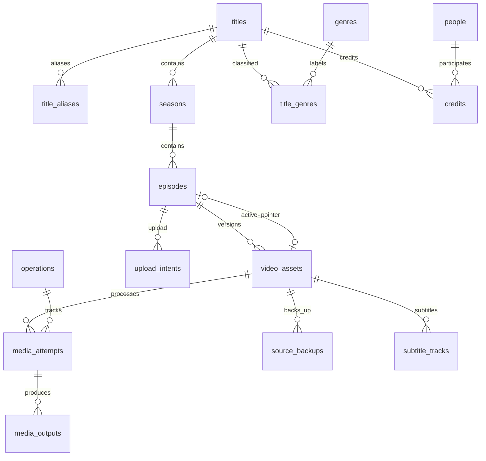
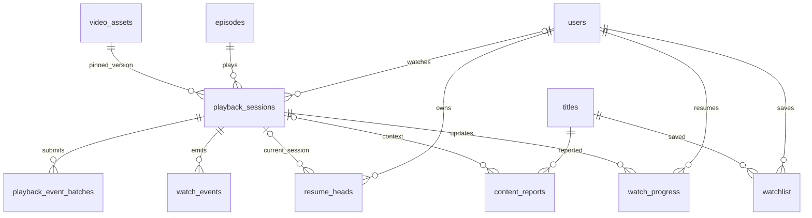
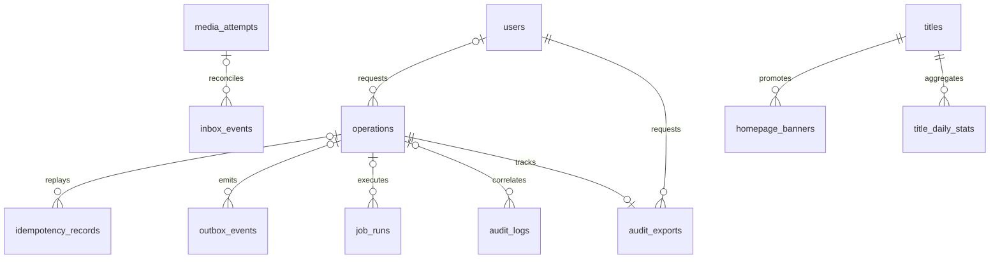

# Thiết kế database web xem phim

Phiên bản: 1.1. Ngày: 10/11/2026, Asia/Saigon. PostgreSQL 18; Node.js/NestJS và Prisma theo [thiết kế backend](movie-backend-design.md) và [plan sản phẩm](../plans/movie-streaming-platform-plan.md).

Thiết kế gồm **47 bảng**, chia thành 7 nhóm. Database lưu metadata, tài khoản, quyền, lịch sử và trạng thái công việc. File video, poster, phụ đề và backup nằm ở Cloudinary/kho object riêng tư; PostgreSQL chỉ lưu định danh ổn định. Redis và RabbitMQ không thay thế dữ liệu chính trong PostgreSQL.

Các file đi kèm:

| File                                          | Nội dung                                                                                          |
| --------------------------------------------- | ------------------------------------------------------------------------------------------------- |
| [Schema DDL](sql/movie-database-schema.sql)   | Toàn bộ cột, kiểu dữ liệu, NULL/default, PK/FK/CHECK, unique và index                             |
| [Seed RBAC](sql/movie-database-rbac-seed.sql) | 5 role, 18 permission, 44 liên kết đúng ma trận trong plan; không tạo tài khoản/mật khẩu mặc định |
| [Mẫu grants](sql/movie-database-grants.sql)   | Quyền API, worker, auditor và retention; tài khoản runtime không sở hữu bảng                      |
| [Kiểm tra SQL](sql/verify-movie-database.mjs) | Bootstrap vào PostgreSQL nhúng trong bộ nhớ, kiểm tra ràng buộc và grants                         |

Database local `pj_flim` đã được tạo ngày 10/11/2026 trên PostgreSQL 17.11 tại `127.0.0.1:5432`, schema `movie`, theo DDL này; xem [hướng dẫn kết nối và script](../../database/README.md). Đã có Prisma client và [API admin](../api/README.md); đã có worker RabbitMQ/HLS/webhook/backup local; chưa có Prisma Migrate hoặc frontend. DDL dùng schema `movie`, không có `DROP` và không tự tạo các role toàn cụm PostgreSQL.

## 1. Quy ước dữ liệu

| Quy ước            | Thiết kế                                                                                                                      |
| ------------------ | ----------------------------------------------------------------------------------------------------------------------------- |
| Primary key        | UUID ngẫu nhiên bằng `gen_random_uuid()`; riêng log/event dung lượng lớn dùng bigint identity; bảng liên kết dùng PK ghép     |
| Định danh public   | API dùng UUID; `titles.slug` phục vụ đường dẫn và có unique riêng                                                             |
| Tên                | Database `snake_case`; JSON API `camelCase`                                                                                   |
| Thời gian          | `timestamptz`, giao tiếp ISO 8601 UTC; hiển thị Asia/Saigon ở client                                                          |
| Thời lượng/vị trí  | `numeric(12,3)` theo giây; số hữu hạn, không âm, thời lượng video lớn hơn 0; giới hạn trên loại cả NaN/Infinity               |
| Kích thước/số đếm  | `bigint`; serialize chuỗi khi vượt giới hạn số nguyên an toàn JavaScript                                                      |
| Trạng thái         | `text` + CHECK danh sách cố định; thêm trạng thái qua migration, không nhận chuỗi tùy ý từ client                             |
| Optimistic locking | `version bigint`, hoặc `auth_version` cho thay đổi quyền/trạng thái user; UPDATE có điều kiện version và tăng version         |
| `updated_at`       | Service cập nhật cùng mutation; DDL không có trigger tự cập nhật timestamp/version                                            |
| Bí mật             | Password dùng hash chậm phù hợp; refresh/reset/recovery token chỉ hash; TOTP/credential receipt mã hóa có `encryption_key_id` |
| Media reference    | Provider asset/public ID, version, bucket/object key; không lưu signed delivery URL hoặc Cloudinary API secret                |
| Xóa                | User tombstone, title ARCHIVED, asset DELETING/DELETED; mặc định FK RESTRICT, không cascade xóa lịch sử/audit                 |
| JSONB              | Dùng cho diff đã lọc, policy có schema, payload sự kiện và checkpoint; quan hệ/khóa/trạng thái vẫn là cột riêng               |

Kiểu `varchar` là giới hạn lưu trữ, không thay thế validation API. Email normalize theo chính sách sản phẩm và unique; không tự loại dấu chấm/đuôi `+` theo từng nhà cung cấp. Email đã tombstone vẫn giữ uniqueness mặc định; chính sách tái sử dụng email phải được quyết định riêng khi triển khai xóa dữ liệu cá nhân.

## 2. ERD tài khoản và quyền

Sơ đồ giữ các quan hệ chính để dễ đọc; toàn bộ FK nằm trong DDL.



### 2.1. Từ điển bảng identity — 9 bảng

| Bảng                        | Cột và khóa đáng chú ý                                                                                                                                                           | Mục đích/quy tắc                                                                                                                                |
| --------------------------- | -------------------------------------------------------------------------------------------------------------------------------------------------------------------------------- | ----------------------------------------------------------------------------------------------------------------------------------------------- |
| `users`                     | `id`, `email_normalized UNIQUE`, `password_hash`, `display_name`, `status`, `email_verified_at`, `auth_version`, `deleted_at`, timestamps                                        | ACTIVE/SUSPENDED/DELETED. Đổi password/quyền/MFA/trạng thái tăng auth_version; không trả password_hash qua DTO                                  |
| `auth_sessions`             | `id`, `user_id FK`, `state`, `auth_version`, `mfa_verified_at`, `step_up_at`, `last_seen_at`, `idle_expires_at`, `absolute_expires_at`, `revoked_at/reason`, device/IP/UA đã lọc | PENDING_MFA/ACTIVE/REVOKED/EXPIRED. Hết hạn xét bằng thời gian hiện tại, không chờ cron đổi state                                               |
| `refresh_tokens`            | `id`, `session_id FK`, `family_id`, `generation`, `token_hash UNIQUE`, `consumed_at`, `replaced_by_id`, `expires_at`                                                             | UNIQUE family/generation và một token chưa consumed mỗi family. Self-FK bảo đảm successor cùng family/session; giữ token cũ để phát hiện replay |
| `auth_replay_receipts`      | `session_id`, `family_id/challenge_id`, `context_key`, `request_key_hash`, `proof_fingerprint`, input/output refresh IDs, `encrypted_result/key_id`, hai TTL                     | UNIQUE context/request key. Credential mã hóa TTL ngắn khoảng 30 giây; metadata sống lâu hơn để retry không tạo thêm credential                 |
| `password_reset_tokens`     | `user_id FK`, `token_hash UNIQUE`, `created_at`, `expires_at`, `consumed_at`                                                                                                     | Tiêu thụ một lần bằng conditional UPDATE; đổi password và revoke session trong cùng transaction                                                 |
| `email_verification_tokens` | `user_id FK`, `email_normalized`, `token_hash UNIQUE`, TTL/consumed                                                                                                              | Chỉ xác minh nếu email mục tiêu vẫn trùng email hiện hành; token không được xác minh email đã đổi                                               |
| `mfa_factors`               | `user_id FK`, `kind=TOTP`, `encrypted_secret/key_id`, `verified_at`, `last_accepted_step`, `disabled_at`                                                                         | Partial unique một factor chưa disable/user/kind, kể cả đang enroll. Secret mã hóa, không hash vì cần tính OTP                                  |
| `mfa_challenges`            | `user_id`, `session_id`, `factor_id`, `purpose`, `challenge_hash UNIQUE`, `attempt_count/max_attempts`, TTL/consumed                                                             | LOGIN/STEP_UP/ENROLLMENT. FK ghép ngăn tham chiếu factor/session của user khác; giới hạn thử và chống replay bằng transaction                   |
| `mfa_recovery_codes`        | `factor_id FK`, `code_hash UNIQUE`, `consumed_at`                                                                                                                                | Một code dùng một lần, thay bộ mã khi rotate factor; không có API đọc lại plaintext                                                             |

`auth_replay_receipts.context_key` là khóa server tạo như `refresh:<session>:<family>` hoặc `mfa:<session>:<challenge>`. Không nhận context tùy ý từ browser. Input/output token FK ghép giữ đúng family/session; service kiểm thêm challenge, purpose, proof và kết quả đã trả thuộc đúng context. Không lưu raw OTP để nhận diện retry.

### 2.2. Từ điển bảng quyền — 5 bảng

| Bảng               | Khóa/cột                                            | Quy tắc                                                                                 |
| ------------------ | --------------------------------------------------- | --------------------------------------------------------------------------------------- |
| `roles`            | `id PK`, `code UNIQUE`, description                 | MEMBER, EDITOR, ADMIN, SUPER_ADMIN, AUDITOR; chỉ migration cập nhật tập role            |
| `permissions`      | `id PK`, `code UNIQUE`, description                 | 18 mã chuẩn từ plan; runtime không tự thêm permission                                   |
| `user_roles`       | PK `(user_id, role_id)`, `granted_by`, `granted_at` | Nhiều role/user; audit người gán; DTO đăng ký/profile không ghi bảng này                |
| `role_permissions` | PK `(role_id, permission_id)`                       | Ma trận seed cố định MVP; kiểm quyền bằng permission code, không so độ lớn role         |
| `policy_locks`     | `key PK`, description                               | Có sẵn `super_admin_roster`; khóa dòng này trước thay đổi tập SUPER_ADMIN hoạt động/MFA |

MEMBER không có permission quản trị trong seed; endpoint tài khoản, watchlist và progress vẫn hoạt động qua xác thực + ownership. Có permission không tự cấp step-up, quyền đọc dữ liệu mọi user hay quyền tác động mọi đối tượng. ADMIN khóa MEMBER, SUPER_ADMIN có điều kiện, AUDITOR nhận DTO lọc theo ma trận plan.

## 3. ERD danh mục và media



### 3.1. Từ điển bảng catalog — 8 bảng

| Bảng            | Cột/khóa chính                                                                                                                                                                                                      | Quy tắc                                                                                                           |
| --------------- | ------------------------------------------------------------------------------------------------------------------------------------------------------------------------------------------------------------------- | ----------------------------------------------------------------------------------------------------------------- |
| `titles`        | `id`, `kind`, `slug UNIQUE`, localized/original/normalized title, synopsis, year, country_codes, language, age_rating, publication_status/published_at, poster/backdrop/trailer ref, version, created_by/updated_by | Một bộ phim hoặc series. Country array chỉ chứa mã đã validate; ảnh/trailer là stable reference, không signed URL |
| `title_aliases` | `id`, `title_id`, alias, normalized_alias, language; UNIQUE title/normalized_alias                                                                                                                                  | Tìm theo tên Việt, tên gốc, tên khác; không nhét alias vào một chuỗi khó quản lý                                  |
| `seasons`       | `id`, `title_id`, number, name, is_technical, version                                                                                                                                                               | UNIQUE title/number. Phim lẻ có season kỹ thuật số 0; season thật bắt đầu 1                                       |
| `episodes`      | `id`, `title_id`, `season_id`, number, name, synopsis, publication_status, active_asset_id, intro/credits markers, version                                                                                          | UNIQUE season/number; FK `(season_id,title_id)` giữ title đúng mùa; tập là đơn vị phát và lưu progress            |
| `genres`        | `id`, `slug UNIQUE`, name                                                                                                                                                                                           | Danh mục thể loại; không dùng thể loại dưới dạng chuỗi tự do trong title                                          |
| `title_genres`  | PK title/genre, cả hai FK                                                                                                                                                                                           | Quan hệ nhiều-nhiều; có index chiều ngược genre/title                                                             |
| `people`        | `id`, name, normalized_name, biography, photo_asset_ref                                                                                                                                                             | Tên người không unique vì có thể trùng tên                                                                        |
| `credits`       | `id`, title_id, person_id, role, character_name, sort_order                                                                                                                                                         | ACTOR/DIRECTOR/WRITER/PRODUCER; một người có thể có nhiều vai/nhân vật                                            |

`episodes.title_id` là denormalization có ràng buộc FK ghép, phục vụ filter và kiểm report đúng title. Nó không được cập nhật độc lập với season. DDL cho phép khởi tạo bản nháp; quy tắc MOVIE chỉ có một season kỹ thuật và một episode số 1 được kiểm trong use case với title lock. Không coi CHECK trong một bảng là công cụ đếm số bản ghi ở bảng khác.

### 3.2. Từ điển bảng media — 6 bảng

| Bảng              | Cột/khóa chính                                                                                                                                                                             | Quy tắc                                                                                                                       |
| ----------------- | ------------------------------------------------------------------------------------------------------------------------------------------------------------------------------------------ | ----------------------------------------------------------------------------------------------------------------------------- |
| `upload_intents`  | episode_id, owner_user_id, target_public_id UNIQUE, status, expected_policy JSONB, verified_asset_id, expires_at/verified_at                                                               | Server cấp public ID/policy và TTL; kết quả upload phải được xác minh từ provider, không tin duration/bytes do client gửi     |
| `video_assets`    | episode_id, provider/asset_id/public_id/version, resource_type/delivery_type, internal_version, processing/lifecycle/backup status, duration/dimensions/bytes, current_attempt_id, version | UNIQUE episode/internal_version và provider/public_id, provider/asset_id. Mỗi lần thay video tạo asset mới                    |
| `media_attempts`  | asset_id, operation_id, profile_version, config_hash, status, attempt_no, provider_batch_ref, callback_context_hash UNIQUE, error_code, timestamps                                         | UNIQUE asset/config/attempt_no; partial unique asset/config cho mọi trạng thái đang xử lý, kể cả WAITING_PROVIDER/RECONCILING |
| `media_outputs`   | attempt_id, format, profile_version/config_hash, status, manifest_ref, rendition_summary, verified_at                                                                                      | Một output theo attempt/format/config; READY yêu cầu ref và verified_at. Không tạo row cho từng segment                       |
| `source_backups`  | asset_id, storage_provider, bucket/object_key/object_version, source_manifest_ref, sha256, bytes, status, verified_at, retain_until                                                        | VERIFIED yêu cầu checksum/bytes/thời điểm xác minh. Backup độc lập Cloudinary; không tính một URL nguồn là backup             |
| `subtitle_tracks` | asset_id, language/label/kind, format=WEBVTT, storage_ref, status, offset_seconds, version                                                                                                 | UNIQUE asset/language/kind; phụ đề gắn phiên bản video để tránh dùng sai timeline                                             |

FK `(episodes.active_asset_id, episodes.id) → video_assets(id,episode_id)` chặn dùng video của tập khác. Tương tự, upload intent chỉ nhận asset đúng tập và `current_attempt_id` chỉ nhận attempt đúng asset. Tạo episode trước với active_asset_id NULL, tạo asset, sau đó chọn asset trong transaction; không có vòng bắt buộc INSERT hai bảng cùng lúc.

`resource_type=video`; `delivery_type` lưu đúng loại tài nguyên provider đã xác minh và không có mặc định mở. Việc có tên authenticated/private trong schema không chứng minh gói Cloudinary đã hỗ trợ toàn bộ HLS/token access theo yêu cầu: vẫn cần PoC của plan và adapter kiểm URL/signature/access mode thực tế. Không coi một URL có chữ ký transformation là bằng chứng đủ kiểm soát người xem.

Ba nhóm trạng thái của asset có ý nghĩa riêng:

| Nhóm       | Trạng thái                                                 |
| ---------- | ---------------------------------------------------------- |
| Processing | PENDING_UPLOAD → UPLOADED → PROCESSING → READY hoặc FAILED |
| Lifecycle  | ACTIVE → DELETING → DELETED                                |
| Backup     | PENDING → RUNNING → VERIFIED hoặc FAILED                   |

`backup_status` trên asset là summary được worker cập nhật cùng transaction với backup row. Publish kiểm cả backup VERIFIED thật, output READY của current attempt và asset ACTIVE/READY; không chỉ tin một cờ summary. Callback cũ không được promote asset nếu attempt/config hiện hành đã đổi. Cloudinary public ID, source/version và episode ownership được coi là bất biến sau xác minh; service tạo bản ghi mới khi thay nguồn. DDL chưa có trigger cấm mọi cập nhật identity, nên quy tắc này phải nằm trong repository/use case được kiểm thử.

## 4. ERD playback và thư viện cá nhân



### 4.1. Từ điển bảng playback — 7 bảng

| Bảng                     | Cột/khóa chính                                                                                                                                                                               | Quy tắc                                                                                                                                 |
| ------------------------ | -------------------------------------------------------------------------------------------------------------------------------------------------------------------------------------------- | --------------------------------------------------------------------------------------------------------------------------------------- |
| `playback_sessions`      | user_id XOR guest_id_hash, episode_id/asset_id/asset_version, mode, management_token_hash, telemetry_token_hash, delivery_generation, resume_generation, expires/max_expires, closed/revoked | FK ghép pin đúng asset/episode/version. PUBLIC user có resume_generation; guest và PREVIEW không có. PREVIEW chỉ cho user đủ quyền      |
| `playback_event_batches` | session_id/client_batch_id UNIQUE, payload_fingerprint, event_count, payload_bytes, status, received/processed                                                                               | Header durable; tối đa 50 sự kiện và 65.536 byte/batch, kích thước tính server. Duplicate batch so fingerprint trước khi trả kết quả cũ |
| `watch_events`           | bigint id, session/client_event_id UNIQUE, sequence, type, elapsed_ms, position_seconds, schema_version, payload/fingerprint, received_at                                                    | Event dedup theo ID, không theo sequence; type/payload allowlist theo schema tại API. Không tin tuyệt đối đồng hồ/telemetry client      |
| `resume_heads`           | PK user/episode, generation, active_session_id, updated_at                                                                                                                                   | Dòng khóa cho một timeline xem tiếp/user/tập. FK ghép giữ đúng user, episode và generation của phiên đang được ghi progress             |
| `watch_progress`         | PK user/episode, session_id, asset/version, resume_generation, last_sequence, position_seconds, watched_intervals/watched_seconds, completed_at                                              | Snapshot xem tiếp; FK ghép giữ snapshot thuộc đúng session. Kiểm head hiện hành và sequence trong conditional write                     |
| `watchlist`              | PK user/title, created_at                                                                                                                                                                    | Lưu yêu thích idempotent; không duplicate khi người dùng bấm hai lần                                                                    |
| `content_reports`        | reporter_user_id hoặc playback_session_id, title/episode, category/message/status, handled_by/resolution, version                                                                            | FK ghép bảo đảm episode thuộc title. Service kiểm session report đúng đối tượng và user/guest có quyền gửi                              |

Hai token playback dùng hai giá trị khác nhau và chỉ lưu hash. Telemetry token chỉ gửi events, không được dùng đọc/gia hạn/đóng phiên hay lấy delivery credential. User quản lý phiên bằng JWT + ownership; guest dùng management proof riêng. Preview không làm thay đổi tiến độ hoặc thống kê xem công khai.

Header batch và các event hợp lệ được INSERT cùng transaction trước HTTP 202. Khi event ID đã tồn tại, so fingerprint; cùng ID khác payload phải từ chối toàn batch. Một event có thể được retry trong batch khác nên không gắn ownership event duy nhất vào batch_id. Nếu cần điều tra batch, đối chiếu fingerprint/correlation đã lọc; không lưu bản sao raw payload vô hạn.

`watched_intervals` là mảng các khoảng `[start,end]` đã hợp nhất, có giới hạn số phần tử do worker áp dụng. Tính completion từ độ dài hợp các khoảng xem hợp lệ theo policy, không dùng vị trí seek cao nhất. Chuyển sang asset mới không tự chuyển timeline cũ: lưu snapshot/version cũ cho lịch sử; lần ghi hợp lệ của asset mới reset/ánh xạ khoảng xem theo chính sách đã chốt. Không dùng giá trị cũ trên timeline mới một cách ngầm định.

## 5. Tác vụ bền vững, audit và dữ liệu vận hành



### 5.1. Từ điển reliability/audit — 9 bảng

| Bảng                  | Cột/khóa chính                                                                                                                                            | Quy tắc                                                                                                                                                  |
| --------------------- | --------------------------------------------------------------------------------------------------------------------------------------------------------- | -------------------------------------------------------------------------------------------------------------------------------------------------------- |
| `operations`          | owner_user_id/principal_scope, type, resource_type/id, status/progress, result_ref, error_code/message/retryable, timestamps                              | QUEUED/RUNNING/SUCCEEDED/FAILED; terminal cần completed_at. Hủy nội bộ biểu diễn FAILED + code theo API đã chốt                                          |
| `idempotency_records` | actor_scope/method/route_key/request_key_hash UNIQUE, request_fingerprint, state, resource/operation/receipt refs, response_status/body, expires_at       | Scope gồm actor và đường dẫn đã chuẩn hóa có resource ID. Không replay trước khi kiểm quyền hiện tại; không lưu credential plaintext trong response_body |
| `outbox_events`       | UUID event ID, type/schema_version, aggregate/type/version, operation/initiating_actor/correlation, payload, next_attempt/lease/lease_token, published_at | Commit cùng domain mutation; chỉ đánh dấu published khi broker confirm. Publish lặp có thể xảy ra                                                        |
| `inbox_events`        | source/dedup_key UNIQUE, verified_payload/fingerprint, status, attempt_id, received/processed/error                                                       | Webhook xác minh chữ ký trước khi nhận; dedup đúng source và event. Payload trùng ID nhưng khác fingerprint phải cảnh báo/từ chối                        |
| `job_runs`            | handler/logical_key UNIQUE, operation_id, state, attempts, next_attempt_at, lease_owner/until/token, checkpoint/error                                     | Logical job idempotent; lease_token tăng đơn điệu khi claim lại; mọi commit có điều kiện fencing                                                         |
| `scheduled_jobs`      | logical_key UNIQUE, kind, due_at, payload_ref, state/dispatched_at                                                                                        | Retry/reconcile tồn tại qua restart, không chỉ setTimeout hoặc Redis TTL                                                                                 |
| `audit_logs`          | bigint ID, actor/initiator, actor_kind/role snapshot, operation_id, action/resource/outcome, safe_diff, reason/error, request/trace/time                  | SUCCESS/FAILED/DENIED. Domain mutation nhạy cảm + audit + outbox cùng transaction. Runtime chỉ INSERT/SELECT                                             |
| `security_events`     | bigint ID, category/outcome, user_id/subject_hash/ip_hash, safe_metadata, request/trace/time                                                              | Ghi sự kiện bị từ chối/thất bại ngoài transaction đã rollback; hash có keyed salt/retention, không log email/token thô                                   |
| `audit_exports`       | requester, operation_id UNIQUE, scope_filter, status, private_object_ref/checksum, created/ready/expires                                                  | Export riêng tư TTL khoảng 24 giờ sau ready; download kiểm lại owner/scope/permission/step-up                                                            |

`operations.resource_*`, `idempotency_records.resource_*` và `outbox_events.aggregate_*` là reference đa hình để mô tả các loại tài nguyên; không có FK giả tới nhiều bảng. Service phải kiểm type và resource tồn tại/đúng scope. Audit resource_id dùng text để mô tả cả khóa cấu hình hoặc đối tượng đã tombstone; giữ log khi tài nguyên ngừng hoạt động.

### 5.2. Trang chủ/cấu hình/thống kê — 3 bảng

| Bảng                | Cột/khóa chính                                                                                         | Quy tắc                                                                                                                                     |
| ------------------- | ------------------------------------------------------------------------------------------------------ | ------------------------------------------------------------------------------------------------------------------------------------------- |
| `homepage_banners`  | title_id, image_asset_ref, headline, sort_order, enabled, starts_at/ends_at, version/updated_by        | Khi trả banner phải JOIN title PUBLISHED và khoảng thời gian hiện hành; enabled không bỏ qua publication                                    |
| `system_settings`   | key PK, value JSONB, version/updated_by/updated_at                                                     | Chỉ các key có JSON schema/allowlist. Không lưu API secret, khóa mã hóa, connection string; không biến cấu hình thành đường tắt bỏ auth/MFA |
| `title_daily_stats` | PK title/day/definition_version, qualified_views, playback_starts/failures, watched_seconds, finalized | Ngày theo UTC; không chứa PII. Worker là bên ghi; cơ sở cho danh sách phổ biến và báo cáo                                                   |

Định nghĩa số liệu v1: PUBLIC session bắt đầu hợp lệ tính playback_start một lần; qualified_view đạt ít nhất 30 giây xem hợp lệ, hoặc 80% thời lượng với clip ngắn hơn 30 giây, tối đa một lần/session/title. Đây là số phiên đủ điều kiện, không khẳng định số người xem duy nhất. Preview/test và replay event không tăng đếm. Ưu tiên recompute ngày đang mở từ dữ liệu đã dedup rồi UPSERT giá trị tuyệt đối, hoặc ghi tăng trong cùng transaction job/checkpoint idempotent; không cộng lại counter mỗi lần RabbitMQ redeliver.

`definition_version` ngăn trộn hai cách tính; query chỉ chọn một version. Ngày cũ đã finalized không bị recompute sau khi raw events bị xóa. Thống kê chất lượng cần kèm độ bao phủ telemetry; thiếu sự kiện không mặc định là phát thành công.

## 6. Ràng buộc database và trách nhiệm service

| Điều kiện             | Database bảo đảm                                                                           | Service/transaction phải bảo đảm                                                                               |
| --------------------- | ------------------------------------------------------------------------------------------ | -------------------------------------------------------------------------------------------------------------- |
| Episode/video/version | FK ghép và unique                                                                          | Source identity bất biến sau verify; đúng quyền thay active asset                                              |
| Publication           | Có asset/published_at khi episode PUBLISHED                                                | Asset ACTIVE/READY, current output verified, backup VERIFIED; title có tập playable; đồng bộ khi thu hồi media |
| Phim lẻ               | Mùa kỹ thuật số 0, unique/title                                                            | Chỉ MOVIE dùng mùa kỹ thuật, một episode số 1; SERIES dùng mùa thật                                            |
| Refresh               | Token hash unique, generation unique, một live token/family, successor cùng session/family | Khóa session, family không tái sử dụng qua session, expiry/reuse policy và credential receipt                  |
| MFA                   | Factor/session cùng user, một factor chưa disable, số lần thử hợp lệ                       | Secret encryption, OTP window, last_accepted_step tăng, proof challenge, chỉ activate staff sau MFA            |
| SUPER_ADMIN cuối cùng | Có mutex row để khóa                                                                       | Khóa roster trước mọi thay đổi liên quan, kiểm lại số tài khoản còn usable, chặn nếu không còn                 |
| Playback ownership    | User XOR guest, asset/version đúng tập, head/session đúng user                             | JWT/management proof, publication/preview permission, expiry và rate limit                                     |
| Progress              | Session/version/generation đúng nhau                                                       | Khóa resume_head, kiểm generation/active session/sequence; interval validation và chống sự kiện đến muộn       |
| Media attempt         | Một attempt đang hoạt động/asset/config, current pointer đúng asset                        | Callback đúng attempt/config, fencing, xác minh output thực sự, không chỉ tin callback READY                   |
| Idempotency           | Scope/key unique, receipt có FK                                                            | Canonical fingerprint, quyền hiện tại, kết quả cũ cùng intent, TTL và retry policy                             |
| Audit append-only     | Grants ngăn runtime UPDATE/DELETE/TRUNCATE                                                 | Diff allowlist, cùng transaction mutation, archive trước retention; DBA/owner vẫn có quyền vượt qua            |
| Event batch           | Count/byte bounds, dedup IDs, JSON object                                                  | Tự đo byte/count, schema/size từng field, fingerprint mismatch, toàn batch atomic                              |

Không dùng CHECK gọi truy vấn bảng khác để giả bảo đảm quy tắc liên bảng; dùng FK/unique cho quan hệ và transaction/lock cho state. PostgreSQL cũng không tự tạo index ở phía cột tham chiếu FK; DDL thêm index theo truy vấn và nhu cầu kiểm FK. Tham khảo [PostgreSQL constraints](https://www.postgresql.org/docs/18/ddl-constraints.html).

## 7. Transaction và thứ tự khóa

### 7.1. Gán role, khóa user và reset MFA

1. Xác thực, permission, MFA/step-up và If-Match trước khi mutation.
2. Khóa `policy_locks.super_admin_roster` nếu tác động role/status/MFA của SUPER_ADMIN hoặc có thể tạo/gỡ role này; sau đó khóa các user liên quan theo UUID tăng dần. Quy tắc khóa áp dụng cả công cụ vận hành/worker có quyền tương đương.
3. Đọc lại role/status/MFA hiện hành trong transaction. Đếm user DISTINCT còn ACTIVE và có MFA đã xác minh sau thay đổi dự kiến; không đếm số dòng user_roles.
4. Chặn trường hợp mất SUPER_ADMIN usable cuối cùng; quy trình bootstrap/recovery ngoài API có kiểm soát và audit riêng.
5. Cập nhật user_roles/status/factor, tăng auth_version, revoke session bị ảnh hưởng; append audit/outbox rồi COMMIT.

### 7.2. Refresh rotation và retry

Khóa `auth_sessions` trước khi tra receipt hoặc xoay token. Tra context/request key/proof trước, kể cả browser đã nhận successor cookie của lần trả lời bị mất. Cùng intent trong TTL lấy đúng encrypted receipt; receipt hết credential TTL chỉ còn metadata thì trả lỗi retry hết hiệu lực, không xoay token cũ.

Khi cần rotate thật: kiểm session/user/authVersion/TTL và hash token; UPDATE token cũ consumed trước INSERT successor để không vi phạm partial unique live-family. Liên kết successor, tạo receipt và trả credential sau COMMIT. Self-FK deferred cho phép ghi successor reference trong cùng transaction. Khóa bao trùm toàn lần rotate; không gọi network trong transaction.

Token cũ với request key khác trong grace khoảng 30 giây trả AUTH_REFRESH_RETRY_CONFLICT/409, không lộ successor. Sau grace xử lý AUTH_REFRESH_REUSED/401 và revoke family/session theo chính sách. Same-key retry không được coi là reuse. Cleanup xóa ciphertext sau credential TTL nhưng giữ metadata và token đã consumed đủ cửa sổ phát hiện replay; không xóa ngay token cũ sau rotate.

### 7.3. Publish, thay asset và xóa media

Thứ tự khóa thống nhất: title → season/episode theo ID → asset theo ID → attempt/backup liên quan. Đọc lại If-Match và state sau khóa. Publish/đổi active asset kiểm đủ output/backup và cập nhật pointer/publication/version + audit/outbox trong cùng transaction. Metadata catalog.write không đủ quyền đổi pointer.

Trước DELETING, phải kiểm asset không còn được chọn để phát công khai; dùng cùng thứ tự khóa để tránh publish/delete cùng lúc. Chờ phiên đang pin kết thúc hoặc grace theo policy trước xóa nguồn/output. Worker gọi Cloudinary ngoài transaction rồi lưu kết quả có fencing; sự cố provider có thể làm trạng thái phát thay đổi nên cấp/gia hạn playback luôn kiểm playability hiện hành. DB không đảm bảo một file ngoài Cloudinary sẽ luôn tồn tại.

### 7.4. Mở phiên xem và ghi progress

Với PUBLIC user, trong transaction:

```sql
INSERT INTO movie.resume_heads (user_id, episode_id)
VALUES ($1, $2) ON CONFLICT DO NOTHING;

SELECT generation, active_session_id
FROM movie.resume_heads
WHERE user_id = $1 AND episode_id = $2
FOR UPDATE;
-- generation moi = generation hien tai + 1
-- INSERT playback_sessions pin asset/version va resume_generation moi.
-- UPDATE resume_heads den session moi; COMMIT.
```

Idempotency kiểm trước khi tạo session; retry cùng yêu cầu không tăng generation. Renew delivery tăng delivery_generation theo chính sách, không tăng resume_generation. Guest/preview không tạo resume_head. Hai request đầu tiên cùng user/tập được tuần tự hóa bởi INSERT unique + row lock; không chỉ SELECT trước rồi INSERT.

Worker ghi progress cũng khóa resume_head trước, rồi chỉ chấp nhận session còn là active head/generation. Với session hiện hành, sequence lớn hơn last_sequence mới được ghi; session/generation cũ bị bỏ qua cho resume nhưng có thể vẫn góp telemetry theo policy. Nếu snapshot đang ở generation cũ thì event hợp lệ đầu tiên của generation mới được thay snapshot và reset interval khi timeline khác. Vị trí có thể giảm khi seek, không dùng GREATEST/MAX(position).

Khóa head trong cả thao tác mở phiên và ghi progress ngăn race giữa lúc kiểm head và ghi snapshot. FK ghép giữ đúng session/version nhưng không tự thay thế bước kiểm head; snapshot cũ được giữ cho màn hình xem tiếp cho đến khi có progress mới hợp lệ.

### 7.5. Claim job/outbox và fencing

Trong transaction ngắn, lấy các job/outbox đến hạn bằng `FOR UPDATE SKIP LOCKED`, tăng lease_token và ghi lease_owner/lease_until; COMMIT rồi mới gọi broker/provider. Worker commit checkpoint/kết quả bằng điều kiện `id + lease_token + lease_owner`, và kiểm lease còn hợp lệ theo policy. Worker cũ mất lease không được ghi trạng thái hiện hành; TTL không đủ nếu thiếu fencing.

Job quá lease được claim lại, external side effect có thể đã xảy ra nên phải reconcile theo public ID/config/callback context. ACK RabbitMQ sau khi kết quả bước hiện tại đã durable. Scheduled dispatch tạo outbox và chuyển scheduled_job DISPATCHED trong cùng transaction. Không giữ DB lock trong lúc transcode/upload/email. Locking tham khảo [PostgreSQL explicit locking](https://www.postgresql.org/docs/18/explicit-locking.html).

`READ COMMITTED` + khóa rõ ràng là mặc định. Retry có giới hạn cho deadlock/serialization khi use case an toàn và còn cùng idempotency intent; không retry mù mọi lỗi constraint. Không dùng SKIP LOCKED cho việc kiểm quyền, SUPER_ADMIN roster hoặc đọc tiến độ cần nhất quán.

## 8. Index và truy vấn chính

| Tác vụ             | Index/chiến lược                                                                                                    |
| ------------------ | ------------------------------------------------------------------------------------------------------------------- |
| Đăng nhập          | Unique users.email_normalized; lookup session PK và kiểm user/authVersion từ DB                                     |
| Trang phim mới     | Partial index titles(publication=PUBLISHED, published_at DESC/id DESC); keyset cursor theo cả timestamp/ID          |
| Thể loại/năm/loại  | title_genres(genre_id,title_id), titles(kind,release_year,id) và publication predicate                              |
| Tìm kiếm           | GIN `to_tsvector('simple',normalized_title/alias/name)`; normalize có dấu → không dấu tại application               |
| Danh sách mùa/tập  | Unique title/season_number và season/episode_number; filter publication riêng ở title và episode                    |
| Xem tiếp/yêu thích | watch_progress(user_id,updated_at DESC,episode_id); watchlist(user_id,created_at DESC,title_id)                     |
| Gửi sự kiện        | Unique session/client_event_id và session/client_batch_id; session/elapsed_ms cho xử lý timeline                    |
| Worker             | Partial indexes outbox chưa published, scheduled chưa dispatched, media active attempts; indexes due/lease trên job |
| Audit              | time/id, actor/time, action/time, resource/type/id/time; giới hạn filter/khoảng ngày                                |
| Trang phổ biến     | title_daily_stats(day,qualified_views,title_id) và JOIN title đã published; cache top danh sách trong Redis         |
| Cleanup            | Index expiry/received_at/published_at cho từng nhóm TTL; xóa theo batch nhỏ, không DELETE toàn bảng một lần         |

Normalization xử lý lowercase, dấu tiếng Việt kể cả đ/Đ và khoảng trắng nhất quán khi ghi và truy vấn. Dùng cấu hình `simple` tránh giả định PostgreSQL có stemming tiếng Việt. Không dùng generated column `unaccent()` nếu chưa kiểm volatility của hàm; DDL dùng cột normalized do ứng dụng cập nhật. FTS hiện tại tìm theo token, chưa bảo đảm tìm substring/typo; thêm pg_trgm hoặc search engine khi yêu cầu được xác nhận và benchmark, không đặt index ILIKE giả định đã đủ.

FK có index theo prefix phù hợp, kể cả chiều ngược bảng nhiều-nhiều; không thêm index trùng PK một cách máy móc. Với query thực tế dùng EXPLAIN (ANALYZE, BUFFERS) ở staging, dữ liệu gần thật và thống kê đã cập nhật. Index tăng chi phí ghi/storage; không hứa thời gian truy vấn chỉ từ ERD.

## 9. Bảo mật kết nối và audit

Mẫu grants yêu cầu DBA provision trước bốn group NOLOGIN `movie_api`, `movie_worker`, `movie_auditor`, `movie_retention`; login runtime chỉ nhận đúng group cần thiết. Migration owner riêng giữ ownership schema/table; runtime không là superuser, không có CREATE trên schema, không có TRUNCATE và không kế thừa owner/retention.

| Kết nối    | Quyền chính                                                                                                                                            |
| ---------- | ------------------------------------------------------------------------------------------------------------------------------------------------------ |
| API        | Đọc/ghi dữ liệu nghiệp vụ; role/permission matrix chỉ đọc; khóa policy row; audit/security chỉ INSERT/SELECT                                           |
| Worker     | Đọc catalog/policy cần thiết, ghi media/job/progress/stats/export; users chỉ SELECT các cột tối thiểu phục vụ job; không đọc password_hash/TOTP secret |
| Auditor DB | Chỉ đọc log/export metadata/stats qua kết nối vận hành được kiểm soát; không phát trực tiếp connection này tới browser                                 |
| Retention  | SELECT/DELETE các bảng cho phép sau archive/check; riêng receipt được xóa ciphertext bằng UPDATE cột cụ thể                                            |

Đây là role database theo dịch vụ, khác 5 role tài khoản trong ứng dụng. Request AUDITOR vẫn đi API, áp dụng DTO redaction và permission; không được giao SQL login có quyền đọc mọi log. Worker truy cập audit để export phải có scope check trong use case; DB role worker không thay thế kiểm quyền người yêu cầu export.

Grants cần được rà lại trong mỗi migration tạo bảng mới; chưa dùng default privileges blanket cho bảng chưa biết. DB audit append-only ở mức runtime, không phải chống DBA sửa dữ liệu. Lưu bản archive ở kho tách biệt có kiểm tra checksum/retention khi cần bằng chứng lâu dài. Safe diff/metadata áp dụng allowlist và byte limit tại application, không nhận raw request/response. Không lưu token/password hash/OTP/secret trong audit, outbox hay telemetry.

Kết nối TLS, secret manager cho credentials/encryption keys, pool có giới hạn tổng cho API + worker + migration; transaction ngắn và statement/lock timeout theo loại truy vấn. Read replica chỉ phục vụ truy vấn có thể chấp nhận trễ; auth, refresh, quyền, publication, playback authorization và progress fencing đọc primary.

## 10. Retention, backup và tăng trưởng

| Nhóm                       | Chính sách khởi điểm                                                                                                                     |
| -------------------------- | ---------------------------------------------------------------------------------------------------------------------------------------- |
| watch_events/batch headers | Raw 30 ngày; tổng hợp/finalize trước xóa; xóa cùng cutoff phù hợp và theo batch                                                          |
| title_daily_stats          | 90 ngày theo plan; tăng thời gian nếu nhu cầu báo cáo và ngân sách được chốt                                                             |
| audit/security             | Audit 180 ngày khởi điểm; security retention được cấu hình riêng theo nhu cầu điều tra, giảm PII; archive trước xóa audit                |
| audit_exports              | Private object hết hiệu lực khoảng 24 giờ sau READY; dọn object và metadata theo policy; không chỉ dựa signed URL                        |
| auth receipts              | Xóa ciphertext sau ~30 giây; metadata tối thiểu cửa sổ retry đã chốt, khởi điểm 24 giờ; không cleanup trước idempotency tham chiếu       |
| idempotency                | Tối thiểu 24 giờ; job dài giữ đến terminal + cửa sổ retry; không xóa khi request/operation còn xử lý                                     |
| refresh/session/challenge  | Giữ đủ absolute expiry + reuse/grace/điều tra; xóa receipt/idempotency/challenge phụ thuộc trước; không chỉ DELETE tất cả token consumed |
| job/inbox/outbox           | Giữ dedup/checkpoint tối thiểu đến khi hết retry/replay/reconcile; published/terminal mới đủ điều kiện dọn                               |
| playback_sessions          | Xóa phiên hết hạn khi không còn events/progress/head/report tham chiếu; phiên còn là snapshot/head có thể sống lâu hơn raw telemetry     |
| users/catalog/assets       | Tombstone/archive trước; cleanup PII và media có quy trình riêng, giữ referential integrity và audit                                     |

Retain job/inbox dedup ít nhất bằng giới hạn redelivery/reconcile thực tế; nếu xóa quá sớm sẽ tái chạy side effect cũ. Cần cấu hình giới hạn tuổi message, DLQ replay và dedup cùng nhau. Khi xóa operations, dọn/giữ các tham chiếu audit/media/export trước; nhiều operation theo media phải được giữ lâu dài. Không ép cleanup bằng tắt FK.

V1 dùng bảng thường và cleanup có index. Khi watch_events/audit đủ lớn, đo dung lượng/độ trễ rồi mới chuyển partition tháng. DDL hiện tại **chưa partition**: PostgreSQL yêu cầu unique trên partitioned table bao gồm partition key, nên không chuyển thẳng `UNIQUE(session_id,client_event_id)` sang partition theo received_at mà vẫn tuyên bố dedup toàn cục. Khi cần, tách bảng dedup giữ khóa toàn cục/TTL rồi partition phần payload; migration và retry semantics phải được kiểm thử riêng.

Backup PostgreSQL dùng snapshot/base backup + WAL/PITR theo dịch vụ được chọn, mã hóa và lưu ngoài máy chính. Thử restore sang database cô lập và kiểm quan hệ/count/sampling trước khi coi backup thành công. Backup database chứa reference, **không chứa file video**; cần cả backup nguồn media đã checksum và quy trình reconcile Cloudinary/object storage. RPO/RTO phải được đo qua restore drill trước khi cam kết.

## 11. Ánh xạ Prisma và migration

1. Tạo dự án web phim riêng; chọn/pin PostgreSQL 18, Prisma và driver phù hợp. Không nhập schema này vào DocPrep public schema.
2. Chuyển bảng/cột sang Prisma model bằng `@@map`/`@map`, UUID, Decimal, BigInt, DateTime và schema movie theo cấu hình Prisma đã chọn.
3. Tạo migration có phần SQL thủ công cho CHECK, partial unique, expression GIN index, composite/self-FK deferred và grants. ORM không được âm thầm bỏ các ràng buộc này.
4. Giải quyết rõ hai vòng quan hệ nullable episode→active asset→episode và asset→current attempt→asset; không ép INSERT theo quan hệ bắt buộc hai chiều.
5. Chạy migration SQL + seed trên database trống bằng migration owner. Tạo role/login qua hạ tầng vận hành, áp grants bằng owner, chạy runtime bằng login khác.
6. Kiểm schema drift/introspection trên bản sao; không dùng db push có khả năng xóa index/constraint ngoài model trên production.
7. Các thay đổi sau baseline đi qua migration tăng dần với expand/backfill/validate/contract khi cần; không chạy lại file bootstrap có CREATE SCHEMA vào schema đã có.

Baseline được chia theo công đoạn code: identity/RBAC → catalog → operations/media → playback → reliability/audit → banners/settings/stats → indexes/grants/seed. Thứ tự CREATE trong DDL đã xử lý FK vòng bằng ALTER TABLE sau khi hai bảng tồn tại. Bootstrap staff/MFA đầu tiên là công cụ vận hành riêng, không seed password hoặc SECRET trong Git.

## 12. Kiểm tra và trạng thái bàn giao

Đã chạy schema, seed và mẫu grants trên **PGlite 0.5.16, PostgreSQL 18.6 nhúng trong bộ nhớ**, một kết nối. Script hoàn thành **41 kiểm tra**, xác nhận 47 bảng, 5 role, 18 permission, 44 liên kết quyền. Các kiểm tra gồm:

- Unique email, email normalized, season/episode không trùng và episode thuộc đúng title.
- Active asset/current attempt đúng chủ sở hữu; READY/backup metadata bắt buộc; loại duration NaN.
- User XOR guest, hai token playback khác nhau và asset version pin chính xác.
- Resume head đúng user/session/generation; conditional write loại session cũ/sequence cũ và cho phép seek lùi.
- Một refresh chưa consumed/family, successor liên kết được sau rotation; idempotency không trùng scope/key.
- Fencing token cũ không commit; token hiện hành commit được theo query mẫu.
- API không sửa/xóa/truncate audit, không sửa permission hoặc tạo bảng; vẫn khóa được policy row. Worker không đọc password/TOTP; auditor chỉ đọc; retention mới xóa audit được.

Để chạy lại, mở terminal tại `pj-Flim`, cài PGlite vào thư mục kiểm tra riêng, không sửa dependencies ứng dụng:

```powershell
npm.cmd install --prefix .tmp/movie-db-validation --cache .tmp/movie-db-validation/npm-cache --ignore-scripts --no-audit --no-fund --package-lock=false @electric-sql/pglite@0.5.16
node docs/design/sql/verify-movie-database.mjs .tmp/movie-db-validation/node_modules/@electric-sql/pglite/dist/index.js
```

Ngày 10/11/2026 đã bootstrap database thật trên PostgreSQL 17.11 và chạy 33 assertion cùng kiểm tra login API/worker, gồm 8 truy vấn bị từ chối đúng SQLSTATE 42501; fixture được rollback. Chạy lại bootstrap xác nhận không đổi credential, không tạo bảng hoặc seed trùng. PGlite trước đó và bộ kiểm tra server này chưa kiểm chứng race nhiều connection, pool, PITR hoặc tải thật. Trước triển khai cần chạy thêm:

| Kiểm tra trên server riêng                           | Kỳ vọng                                                                 |
| ---------------------------------------------------- | ----------------------------------------------------------------------- |
| Hai refresh cùng token/cùng key và khác key          | Một rotation; receipt đúng; conflict grace/reuse theo thời gian         |
| Hai request đầu tiên mở playback + progress đang ghi | Generation tuần tự; session cũ không ghi đè head mới                    |
| Hai admin gỡ/khóa/reset MFA SUPER_ADMIN              | Không làm mất tài khoản usable cuối cùng                                |
| Publish đồng thời delete/replace/backup failure      | Không publish asset đang bị xóa hoặc chưa đủ điều kiện                  |
| Worker hết lease rồi quay lại, broker redeliver      | Commit cũ bị loại, không cộng thống kê/áp callback hai lần              |
| Runtime login thực tế                                | Không ownership/superuser/inherited retention; audit không mutate được  |
| Seed/migration/restore và EXPLAIN dữ liệu lớn        | FK/index/grants còn nguyên, pool không cạn, restore đạt RPO/RTO được đo |

Script kiểm tra conditional SQL thể hiện điều kiện cần dùng, không chứng minh service tương lai đã triển khai đúng transaction/lock. Đã có database local, Prisma client và API admin NestJS trong E:\pj-Flim. Đã chạy 1.070 kiểm tra HTTP/client/worker trên PostgreSQL tạm riêng, gồm concurrency MFA/refresh/ETag, API người xem và media worker. Playback/telemetry/progress dùng các bảng hiện có, không thay schema trong bước này. Chưa có Prisma Migrate hoặc frontend/player; phạm vi hiện hành ở docs/api/README.md.
