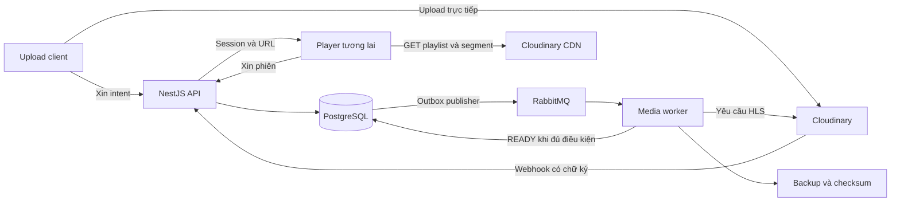
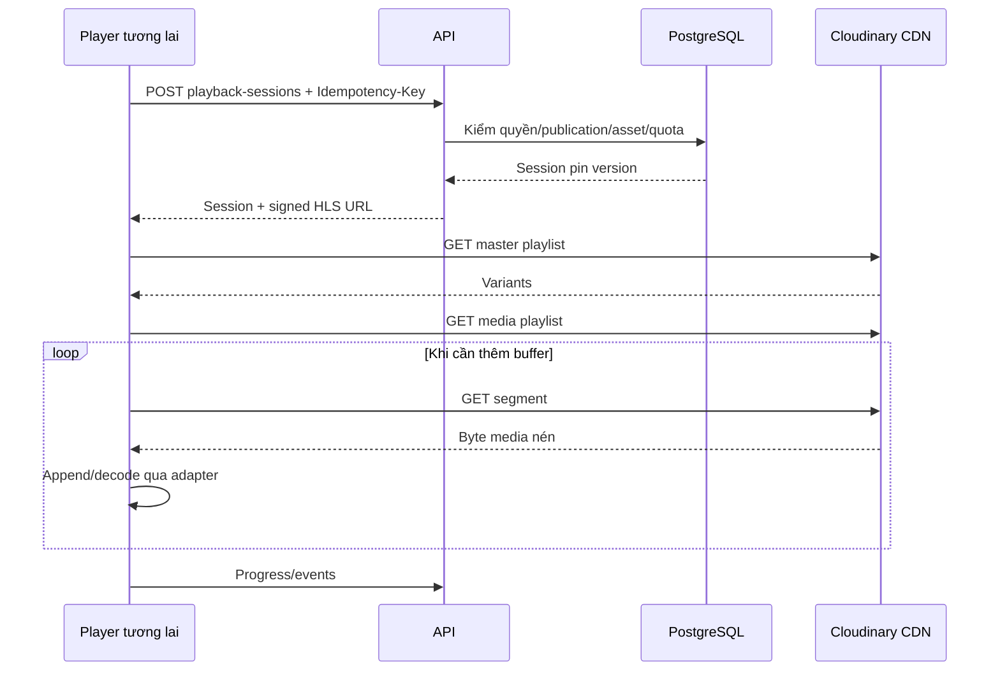

# Thuật toán stream video của pj-Flim

Cập nhật: **11/11/2026**. Phạm vi: VOD, NestJS, Cloudinary HLS/CDN và RabbitMQ.

Tài liệu mô tả thuật toán theo source hiện tại, player cơ bản đã triển khai và các thuật toán minh họa cần nghiệm thu tiếp. Đây là tài liệu kỹ thuật, không bổ sung endpoint hoặc thay đổi hành vi backend.

## 1. Phần nào đã có trong dự án?

| Phần                                   | Trạng thái                       | Source                                                                                                                                |
| -------------------------------------- | -------------------------------- | ------------------------------------------------------------------------------------------------------------------------------------- |
| Upload intent, xác minh nguồn          | Đã code                          | [MediaService](../../apps/api/src/services/media.service.ts)                                                                          |
| Tạo HLS bất đồng bộ                    | Đã code                          | [CloudinaryProvider](../../packages/media/src/cloudinary.provider.ts)                                                                 |
| Xác minh playlist/rendition            | Đã code                          | [HLS verifier](../../packages/media/src/hls-verifier.ts)                                                                              |
| Backup stream, SHA-256, đọc lại        | Đã code                          | [BackupStorage](../../packages/media/src/backup-storage.ts)                                                                           |
| Outbox, RabbitMQ, retry, lease/fencing | Đã code                          | [worker](../../apps/worker/src/media-worker.ts), [broker](../../apps/worker/src/broker.ts), [outbox](../../apps/worker/src/outbox.ts) |
| Phiên phát, token, renewal             | Đã code                          | [PlaybackService](../../apps/api/src/services/playback.service.ts)                                                                    |
| Resume, sequence, coverage             | Đã code                          | [LibraryService](../../apps/api/src/services/library.service.ts)                                                                      |
| Nhận telemetry bền                     | Đã code; chưa tổng hợp analytics | [PlaybackService](../../apps/api/src/services/playback.service.ts)                                                                    |
| Player, ABR, buffer, tua trên browser  | Có player cơ bản; chưa đạt ST05  | [Watch](../../apps/web/src/pages/Watch.tsx), [tracker](../../apps/web/src/features/player/tracker.ts)                                 |
| Quyền CDN có TTL/thu hồi               | Chưa có                          | ST01; signed URL chưa hết hạn theo phiên API                                                                                          |

Không có endpoint Node phục vụ trực tiếp toàn bộ MP4 hoặc proxy từng segment. Backup worker có đọc video dạng stream; đó là đường sao lưu, khác đường phân phối tới người xem.

## 2. Các khái niệm

| Thuật ngữ         | Ý nghĩa                                                         |
| ----------------- | --------------------------------------------------------------- |
| Source/asset      | File nguồn và bản ghi định danh/version/trạng thái của video    |
| Rendition/variant | Đầu ra có độ phân giải và bitrate cụ thể                        |
| Master playlist   | Tài nguyên văn bản giới thiệu các variant                       |
| Media playlist    | Timeline và URI segment của một đầu ra                          |
| Segment           | Đơn vị media tải qua HTTP; thời lượng khác kích thước byte      |
| Buffer            | Media đã tải và sẵn sàng phát ở client                          |
| ABR               | Chọn bitrate theo mạng, buffer và khả năng giải mã              |
| Playback session  | Phiên quyền tại API; không phải TCP connection giữ mở suốt phim |

HLS dùng playlist và tài nguyên media qua HTTP. `#EXT-X-ENDLIST` đánh dấu không bổ sung segment; `EXTINF` biểu diễn thời lượng segment. Định nghĩa giao thức: [RFC 8216, mục 4](https://www.rfc-editor.org/rfc/rfc8216#section-4).

## 3. Kiến trúc: chuẩn bị trước, phân phối khi xem



Chuẩn bị: upload → xác minh → HLS/backup → READY → admin xuất bản.

Khi xem: kiểm quyền → cấp phiên/URL → client tải media trực tiếp CDN → gửi progress/events về API.

Chuyển mã không diễn ra mỗi lần Play. RabbitMQ chuyển thông điệp công việc, không đẩy từng frame đến browser. API không tải toàn bộ phim để chuyển tiếp cho từng người xem.

## 4. Upload và chuẩn bị HLS — đã code

### 4.1. Xác minh file trước xử lý

1. Admin có quyền tạo upload intent cho đúng tập.
2. Backend cố định public ID, asset ID, owner, format, bytes mong đợi và policy.
3. Browser dùng chữ ký upload trực tiếp Cloudinary.
4. Server tra metadata provider thay vì tin client báo thành công.
5. Đối chiếu public ID, resource/delivery type, context intent/episode/asset/owner, bytes, format, version, duration và thời điểm upload.
6. Ghi asset/attempt/operation/outbox trong transaction để worker tiếp tục.

Một URL do client gửi không tự trở thành video hợp lệ của tập; client không được tự gán READY.

### 4.2. Thuật toán yêu cầu tạo HLS

`requestHls()` gọi Cloudinary `uploader.explicit()` với cấu hình:

```text
resource_type = video
type = authenticated
eager = [{ streaming_profile: policy.streamingProfile, format: m3u8 }]
eager_async = true
eager_notification_url = callback thuộc attempt
```

Worker tạo callback context từ attempt ID, asset ID, provider version và config hash; database lưu hash proof. Checkpoint PREPARED được ghi trước khi gọi provider, ACCEPTED sau phản hồi. Khi mất kết nối giữa hai bước, cần đối soát kết quả chưa biết, không mặc định provider chưa nhận request.

Webhook kiểm raw-body signature, timestamp/context và ghi inbox chống trùng. Worker không chỉ tin webhook thành công mà còn kiểm đầu ra CDN.

Cloudinary streaming profile tạo tập đầu ra/manifest; xem [tài liệu ABR của Cloudinary](https://cloudinary.com/documentation/adaptive_bitrate_streaming). Dự án dùng profile mặc định `hd`; repository không tự triển khai encoder hoặc cố định ladder 1080p.

### 4.3. Thuật toán verifyHls()

```text
master = GET manifest
yêu cầu nội dung bắt đầu bằng #EXTM3U
parse STREAM-INF: RESOLUTION, BANDWIDTH, URI
yêu cầu 1 <= số variant <= 16
yêu cầu có một variant cao >= min(720, chiều cao nguồn)

for each variant:
    media = GET playlist của variant
    yêu cầu ENDLIST
    durations = danh sách EXTINF
    yêu cầu không rỗng, mọi duration hữu hạn và > 0
    total = sum(durations)
    yêu cầu abs(total-sourceDuration) <= max(12 giây, 1% sourceDuration)
    lấy URI media đầu tiên
    GET URI với Range: bytes=0-1023
    yêu cầu HTTP 200/206 và đọc được byte
    lưu summary width/height/bandwidth/duration
```

Fetch chỉ chấp nhận HTTPS, hostname `res.cloudinary.com`, path thuộc cloud đã cấu hình, không user/password/port tùy ý và không theo redirect. Playlist giới hạn 512 KiB; timeout mặc định 30 giây, có AbortSignal.

404/420/423 hoặc một số 400 báo đang xử lý trở thành `MediaPending` để chờ đối soát. Đây là quy tắc trong worker kiểm media, không phải cách diễn giải mọi lỗi CDN ở player.

**Phạm vi bằng chứng:** kiểm timeline mọi variant nhưng chỉ thử đọc phần đầu của một media URI mỗi variant. Chưa scan/giải mã toàn bộ segment, kiểm audio/subtitle, init segment fMP4 hoặc chứng minh chuyển mức trên browser liền mạch.

### 4.4. Thuật toán backup stream

```text
expectedBytes = asset.bytes
received = 0; hash = SHA256()
for each chunk từ Cloudinary response.body:
    kiểm AbortSignal
    received += chunk.length
    nếu received > expectedBytes: fail
    hash.update(chunk)
    yield chunk cho destination
nếu received != expectedBytes: fail
sourceDigest = hash.final()
đọc lại toàn bộ destination
nếu bytes/hash khác: fail
ghi manifest không chứa credential
đánh dấu VERIFIED
```

Filesystem dùng pipeline tới file `.part` riêng rồi đưa vào key bất biến. File đã tồn tại phải khớp hash. S3 adapter dùng multipart 8 MiB/part, queueSize=2, lưu object version và SSE-S3.

Backpressure khiến nguồn đọc chậm lại khi nơi ghi chưa nhận kịp, tránh nạp cả phim vào RAM. Bộ nhớ vẫn phụ thuộc buffer nội bộ, multipart và số job đồng thời; không được coi luôn đúng bằng một chunk hoặc 16 MiB.

Checksum chứng minh backup khớp byte đã đọc từ provider; không tự chứng minh trùng checksum file gốc phía client nếu thiếu chuỗi xác minh tương ứng. Backup local cùng máy chưa thay cho kho độc lập/restore production.

### 4.5. Khi nào READY?

```text
ready = currentAttempt vẫn đúng asset/config/profile
    AND HLS output READY + manifest_ref + verified_at
    AND source backup VERIFIED
    AND backup bytes khớp asset bytes
    AND backup hash/manifest tồn tại
```

`finish()` hợp nhất hai nhánh; HLS xong nhưng backup chưa xong vẫn chưa đủ. API public còn yêu cầu asset lifecycle ACTIVE và title/episode PUBLISHED. Predicate production yêu cầu backup S3 có object version. Worker không tự publish.

## 5. Queue, retry và chống chạy trùng — đã code

- Publisher lấy outbox bằng `FOR UPDATE SKIP LOCKED`, có lease; chỉ đánh dấu published sau confirm/routing thành công.
- Message persistent, mandatory, queue durable/quorum; chỉ chứa schema version và job/event ID.
- Worker manual ACK sau xử lý hoặc ghi bền WAITING/retry. Lỗi DB/kết nối chưa commit giữ khả năng redelivery.
- Job có owner, lease token và heartbeat. Mất lease thì abort; worker cũ bị fenced guard chặn ghi kết quả.
- Mặc định prefetch=2, lease=120 giây, heartbeat khoảng lease/3; cấu hình ở [worker config](../../apps/worker/src/config.ts).
- Lỗi tạm: `min(300, 2^min(failures,8))` giây; chưa có jitter trong công thức này.
- MediaPending chờ reconcile mặc định 20 giây và không cộng failure như lỗi thật. Mặc định tối đa 8 failure, ngân sách chờ HLS 7.200 giây; một số lỗi kết thúc sớm.
- Outbox/inbox/DB state giúp khôi phục; DLQ giữ thông điệp không xử lý được. Hệ thống có thể nhận lặp, không bảo đảm exactly-once qua DB/broker/provider.

## 6. Tạo phiên phát — đã code

### 6.1. Các endpoint

| Thao tác  | Endpoint                                       | Credential                              |
| --------- | ---------------------------------------------- | --------------------------------------- |
| Tạo phiên | POST `/api/v1/episodes/{id}/playback-sessions` | Bearer hoặc X-Guest-Id; Idempotency-Key |
| Đọc phiên | GET `/api/v1/playback-sessions/{id}`           | Bearer hoặc X-Playback-Management       |
| Gia hạn   | POST `/api/v1/playback-sessions/{id}/renewals` | Credential quản lý; Idempotency-Key     |
| Đóng      | DELETE `/api/v1/playback-sessions/{id}`        | Credential quản lý                      |
| Events    | POST `/api/v1/playback-sessions/{id}/events`   | X-Playback-Telemetry                    |

Đối chiếu [controller](../../apps/api/src/controllers/viewer.controllers.ts) và [API người xem](../api/viewer-api.md). Public decorator cho phép xử lý khách; service vẫn kiểm credential/ownership.

### 6.2. Nhận diện người xem và token

```text
nếu có Authorization:
    xác minh JWT/server session; scope = user:<userId>
nếu không có Authorization:
    khi create: kiểm ALLOW_GUEST_PLAYBACK
    yêu cầu X-Guest-Id ngẫu nhiên 43–128 ký tự URL-safe
    lưu HMAC của guest ID; scope = guest:<privateHash>
```

Bearer sai không âm thầm hạ thành khách. User sở hữu phiên bằng user ID; khách dùng management token. Chỉ biết session ID/guest ID không đủ quản lý phiên.

Management/telemetry token dẫn xuất HMAC với purpose riêng; DB lưu hash. Telemetry token không thay management token. Bearer API không tự trở thành credential cho GET segment CDN.

### 6.3. Transaction create

```text
validate identity, key; áp quota hiện tại theo IP
BEGIN
    kiểm lại user/session nếu có actor
    khóa receipt theo scope + route + Idempotency-Key
    nếu receipt có sẵn:
        kiểm fingerprint, TTL và COMPLETED
        kiểm ownership, phiên còn sống, publication và asset
        trả response cũ

    advisory lock theo viewer scope
    count phiên chưa đóng/thu hồi và chưa hết hạn
    nếu user >= 3 hoặc guest >= 2: reject
    khóa đọc title/episode; yêu cầu cả hai PUBLISHED
    chọn active asset READY/VERIFIED đúng attempt/profile/config
    nếu user: khóa resume head, tạo generation mới
    INSERT session pin asset/version
    nếu user: cập nhật resume head và baseline coverage
    tạo signed HLS URL theo provider version/profile
    lưu response receipt mã hóa, TTL 24 giờ
COMMIT; trả 201 + Location
```

Cùng key/cùng nội dung cho phép retry; khác fingerprint bị từ chối. Receipt không cho bỏ qua publication hoặc dùng phiên hết hạn. Replay trả kết quả đã lưu, không tự tạo quyền/generation mới.

Quota create hiện là 60 request/600 giây theo IP; renew 120/600 giây. Cơ chế actor/proxy/store chung còn ST02.

### 6.4. Hai thời hạn khác nhau

Response gồm ID, episode/asset/version, expiresAt, maxExpiresAt, deliveryGeneration, resumeGeneration, telemetryToken và managementToken riêng cho khách. Phần delivery hiện là:

```json
{
  "delivery": {
    "url": "SIGNED_CLOUDINARY_HLS_URL",
    "format": "HLS",
    "fallback": {
      "url": "SIGNED_CLOUDINARY_ORIGINAL_MP4_URL",
      "format": "MP4",
      "adaptiveBitrate": false
    },
    "authorization": "SIGNED_URL",
    "expiresAt": null,
    "revocation": "SESSION_ONLY"
  }
}
```

Đây là placeholder, không phải URL thật. Khi nguồn gốc đã xác minh có định dạng MP4, response phiên cấp thêm delivery.fallback={url,format:"MP4",adaptiveBitrate:false}. URL ký trỏ đúng nguồn authenticated và provider version của asset đã pin; không tạo transformation mới hoặc mở URL qua catalog. Nguồn khác trả fallback:null. MP4 tải trực tiếp từ Cloudinary, không proxy qua Node; không có ABR và có thể tốn băng thông hơn HLS. Cùng giới hạn chữ ký không tự hết hạn như HLS. Phiên API mặc định 30 phút, tối đa 6 giờ. URL tạo bằng `sign_url=true`, delivery authenticated, provider version/profile nhưng không có expiry theo phiên.

Đóng/thu hồi phiên không vô hiệu ngay URL đã cấp hoặc xóa byte buffer. `capabilities.adaptiveBitrate/seek` là metadata đầu ra backend, không chứng minh browser cụ thể đã được kiểm. Quyền token/cookie CDN là lớp riêng: [Cloudinary access control](https://cloudinary.com/documentation/control_access_to_media).

### 6.5. Điểm cần rà soát ở policy local

checkViewer trong [viewer-common](../../apps/api/src/viewer-common.ts) hiện tuân AUTH_MFA_REQUIRED=false ở local cho staff, theo yêu cầu của người dùng; production vẫn bắt buộc MFA. MEMBER/khách dùng policy tương ứng. Bỏ đăng nhập Swagger không mở quyền gọi API/phát phim.

## 7. Khi Play, dữ liệu đi như thế nào? — thiết kế player



CDN cache hit giảm chờ origin và tải lên origin; client vẫn nhận lượng byte tương ứng bitrate/thời gian xem. Với MSE, thư viện xử lý container/demux/append SourceBuffer và browser decode. Native HLS giữ nhiều bước bên trong; khả năng ép chất lượng không giống nhau.

Player hiện có thêm phục hồi hữu hạn: giữ 2 lượt retry HLS, lỗi codec/attach chuyển MP4 ngay nếu có fallback; media recovery chờ tối đa 4 giây, startup metadata tối đa 25 giây trước fallback. Khi chuyển nguồn, destroy hls.js, giữ currentTime hiện tại (kể cả đã tua lùi so với mốc xem tiếp) và defaultPlaybackRate, rồi tải MP4 bằng video element. MP4 có timeout metadata 25 giây và chỉ được thử một lần trong phiên; lỗi cuối có nút mở lại. Nút Đổi cách phát cho phép chuyển thủ công; autoplay bị chặn có nút Phát video. Telemetry dùng errorCode từ loại lỗi ổn định, không lấy message/reason/URL của provider. Đây là cơ chế dự phòng, không thay nghiệm thu codec/device hoặc ST01–ST06.

## 8. Ví dụ playlist để hiểu timeline

Ví dụ giả lập 3 mức, media dài 18 giây; không phải cấu hình Cloudinary thực tế:

```m3u8
#EXTM3U
#EXT-X-STREAM-INF:BANDWIDTH=700000,RESOLUTION=640x360
360p/index.m3u8
#EXT-X-STREAM-INF:BANDWIDTH=1400000,RESOLUTION=960x540
540p/index.m3u8
#EXT-X-STREAM-INF:BANDWIDTH=2800000,RESOLUTION=1280x720
720p/index.m3u8
```

```m3u8
#EXTM3U
#EXT-X-VERSION:3
#EXT-X-TARGETDURATION:6
#EXT-X-MEDIA-SEQUENCE:0
#EXT-X-PLAYLIST-TYPE:VOD
#EXTINF:6.0,
segment-000.ts
#EXTINF:6.0,
segment-001.ts
#EXTINF:6.0,
segment-002.ts
#EXT-X-ENDLIST
```

Ví dụ này có segment [0,6), [6,12), [12,18). Segment phải phù hợp container/timeline và điểm giải mã, không chỉ cắt file theo byte. Production cần parser hỗ trợ discontinuity, audio group, init map/byterange; các ví dụ đơn giản không thay parser player.

## 9. Buffer và vòng tải — hiện tại và mô hình minh họa

Bộ chọn Độ phân giải lấy các height hỗ trợ từ manifest HLS, bỏ trùng và sắp giảm dần. Tự động đặt currentLevel=-1; chọn cụ thể đặt index level tương ứng để chuyển ngay, giữ cùng phiên/currentTime/tốc độ. Độ phân giải đang hiển thị lấy từ video.videoHeight, không suy từ giá trị vừa chọn. MP4 chỉ có độ phân giải nguồn; muốn chọn mức khác phải nhấn Thử lại HLS, lưu tiến trình/đóng phiên cũ trước khi tạo phiên mới. Native HLS chưa có API chọn mức thủ công trong bản này.

Player hiện có dùng native trên ManagedMediaSource/không MSE khi có native, ưu tiên lazy-load hls.js trên Chrome/MSE; worker JS cùng phiên bản được cấp workerPath. cấu hình JS maxBufferLength=30, maxMaxBufferLength=60, backBufferLength=30 giây. ABR do thư viện quản lý; không có bộ ABR EWMA tự viết trong ứng dụng. Chưa đo tối ưu trên thiết bị thật. Mô hình và ngưỡng startup 6–10 giây/low buffer 6 giây bên dưới chỉ minh họa, không phải cấu hình đã áp dụng.

```text
tạo adapter/session và cancellation
tải master; lọc codec/device; chọn mức đầu thận trọng
tải media playlist và init segment nếu cần
while chưa destroy:
    bufferAhead = cuối buffered range chứa currentTime - currentTime
    nếu offline: chờ có giới hạn, không retry dồn
    nếu bufferAhead >= target: ngừng tải thêm
    nếu cần dữ liệu:
        chọn variant và segment tiếp theo
        fetch có timeout/retry budget
        kiểm generation của fetch chưa cũ
        append qua hàng đợi của adapter
        cập nhật mẫu throughput
    nếu đủ startup buffer: thử play()
    nếu autoplay bị chặn: hiện nút Play
    dọn buffer cũ theo capability
```

Không gọi appendBuffer chồng khi SourceBuffer đang updating. Đổi tập/unmount cần abort và generation guard, tránh response cũ append sang phim mới. Native adapter không tự sửa SourceBuffer. Buffer không có nghĩa tải hết phim và không làm giảm bitrate cần để phát liên tục.

## 10. ABR — thuật toán đề xuất

### 10.1. Ước lượng mạng

```text
sampleBps = 8 × segmentBytes / downloadSeconds
estimateNew = alpha × sampleBps + (1-alpha) × estimateOld
safeBps = safetyFactor × estimateNew
```

Đây là EWMA minh họa, không phải thuật toán nội bộ chính xác của một phiên bản hls.js. Ví dụ alpha=0.25, safetyFactor=0.75; cần đo trước khi chọn mặc định.

Phải thống nhất phép đo có gồm TTFB không, bỏ mẫu lỗi/hủy, xử lý cache cực nhanh và hạ độ tin cậy sau pause dài/đổi mạng. Tốc độ upload của admin không phản ánh throughput download của người xem.

### 10.2. Chọn variant

```text
candidates = mức giải mã được, không vượt giới hạn người dùng
candidate = mức cao nhất có BANDWIDTH <= safeBps
nếu không có: chọn thấp nhất
estimatedDownload = nextSegmentBytes × 8 / estimateBps
nếu buffer thấp hoặc tải dự kiến không kịp: hạ mức nhanh
nếu buffer ổn và nhiều mẫu đủ tốt: tăng dần có hysteresis
```

Estimate 4 Mbps, safety 0.75 → 3 Mbps; ladder ví dụ 0.7/1.4/2.8 Mbps cho phép 2.8 Mbps nếu buffer/device phù hợp. Estimate còn 1.2 Mbps → safe 0.9 Mbps, chọn 0.7 Mbps.

Segment 6 giây ở 2.8 Mbps khoảng 2.1 MB; mạng 1 Mbps cần khoảng 16.8 giây để tải. Buffer 6 giây không giữ được mức này. Bitrate từng segment có thể vọt cao hơn trung bình, vì vậy độ phân giải đơn thuần chưa đủ để chọn mức.

### 10.3. Chuyển chất lượng

Giữ currentTime và chuyển tại điểm media phù hợp. Nếu thư viện đã quản lý ABR, dùng capability/API của nó thay vì chạy hai bộ chọn mức cạnh tranh. Menu chỉ hiện variant thật; native adapter có thể chỉ hỗ trợ Auto. Chọn chất lượng không được tạo transformation mới mỗi lần.

## 11. Tua video — đề xuất

```text
start[0] = 0
start[i+1] = start[i] + duration[i]
tìm i sao cho start[i] <= targetTime < start[i+1]
```

Dựng prefix sums O(n), binary search O(log n) mỗi seek. Với discontinuity/PTS khác 0/audio riêng phải theo timeline parser, không áp công thức đơn giản cho mọi manifest.

```text
clamp target về timeline
nếu target trong buffer: seek bằng API adapter
nếu ngoài buffer:
    tăng seek generation, hủy fetch không cần
    tìm segment/điểm giải mã trước hoặc chứa target
    bảo đảm init/key tương ứng nếu cần
    tải thêm và resume khi adapter sẵn sàng
```

Seek không cộng đoạn bị nhảy qua vào watched coverage. Sau seek, mở interval xem mới; không nối vị trí trước và sau tua thành một khoảng.

## 12. Progress và xem tiếp — backend đã code

### 12.1. Generation và sequence

Mỗi user/episode có resume head. Tạo phiên mới tăng generation và đổi active_session_id. Ghi progress khóa head, yêu cầu session/generation khớp; phiên cũ nhận PROGRESS_SESSION_STALE.

Sequence trong phiên phải tăng. Receipt session+sequence cho phép retry cùng payload; cùng sequence khác fingerprint hoặc request cũ không có receipt phù hợp bị từ chối.

### 12.2. Hợp khoảng đã xem

```text
sort intervals theo start
merged = []
for [a,b]:
    nếu có last và a <= last.end + 0.001:
        last.end = max(last.end,b)
    ngược lại push [a,b]
watchedSeconds = sum(end-start), làm tròn 3 chữ số
```

[0,20], [15,35], [80,95] → [0,35], [80,95] → coverage 50 giây. Xem lại [10,20] không cộng thêm 10 giây. Sort O(k log k), merge O(k); code từ chối quá 2.000 khoảng phân mảnh.

### 12.3. Ngân sách thời gian và hoàn tất

```text
allowance = max(0, now-lastProgressOrSessionStart) × 2 + 2 giây
intervalEnd-intervalStart <= allowance
totalAllowance = baselineWatched + max(0, now-sessionStart) × 2 + 2 giây
totalCoverage <= totalAllowance
```

Hệ số 2 hỗ trợ chính sách tốc độ tới 2x, 2 giây là dung sai. Đây là rào kiểm dữ liệu quá nhanh, không chứng minh người dùng thật sự nhìn màn hình hoặc chống gian lận tuyệt đối.

Complete cần coverage >=90% duration, vị trí >=duration-2 giây, ended=true và event ended cùng session đã lưu gần cuối. Events/progress là hai API: player cần chờ event ended được nhận trước khi gửi yêu cầu hoàn tất để tránh race.

Khi active asset đổi, progress báo resumeEligible=false và vị trí resume 0 cho bản mới. Session đang xem vẫn pin asset cũ nếu bản đó còn đủ điều kiện; không gắn timeline video cũ sang video mới.

## 13. Telemetry — đã code

Batch UUID chứa 1–50 event, giới hạn 64 KiB; event có ID/sequence/type/elapsedMs và field allowlist. Không gửi URL có token hoặc raw exception trong errorCode.

```text
đọc telemetry token, kiểm hình dạng
tính quota hiện tại theo hash token
BEGIN
    khóa session, xác minh token hash và trạng thái sống
    nếu batch ID đã có: fingerprint phải khớp
    kiểm event trùng, vị trí, elapsed time
    nếu event ID đã có: fingerprint phải khớp
    INSERT batch và event mới
    INSERT outbox playback.events.accepted
COMMIT; trả 202
```

202 nghĩa nhận bền; không tự tăng view, cập nhật resume hay tổng hợp QoE. Worker media chưa tiêu thụ analytics outbox.

ST03 còn mở: quota events hiện 240 request/60 giây theo hash token, được ghi trước xác minh token/session trong DB. Nhiều token giả khác nhau có thể làm tăng quota/security log; chưa có chống flood hoàn thiện.

## 14. Renewal, đóng phiên và CDN

### 14.1. Gia hạn hiện tại

Backend chỉ renew phiên còn sống, khóa session và kiểm ownership/user, publication, readiness của asset pin:

```text
expiresAt = min(maxExpiresAt, now + 30 phút)
deliveryGeneration += 1
lưu receipt theo Idempotency-Key
```

Cùng key không tăng generation lần nữa; replay trả kết quả lần đầu. Không tự chọn active asset mới. Phiên hết hạn cần tạo mới, không được hồi sinh bằng renew.

### 14.2. Scheduler player tương lai

Gia hạn sớm hơn expiry với khoảng đệm/jitter có cấu hình. Dùng single-flight promise cho request đồng thời; retry cùng ý định giữ key, lần renew kế tiếp dùng key mới. Sau pause dài kiểm hạn trước thao tác.

Auth refresh token và playback renewal khác nhau. Lỗi CDN 403 không đồng nghĩa phải refresh cả hai.

### 14.3. TTL thực tại CDN

Quyền có hạn cần bảo vệ manifest và tài nguyên con, kiểm clock skew, renewal/revocation trên thiết bị thật. Chỉ gắn expiry trong JSON hoặc khóa route Node chưa đủ.

Hiện delivery.expiresAt=null, revocation=SESSION_ONLY. Đóng phiên không xóa CDN file/byte buffer. Production giữ guard nếu chưa chấp nhận PLAYBACK_ALLOW_NON_EXPIRING_URLS=true; bật cờ không hoàn tất ST01.

## 15. Retry và xử lý lỗi player — đề xuất

| Lỗi                       | Hành động                                                        |
| ------------------------- | ---------------------------------------------------------------- |
| Offline/timeout           | Retry hữu hạn, backoff/jitter và cho thử lại                     |
| 429/503                   | Tôn trọng Retry-After nếu có, budget theo ý định                 |
| CDN 403                   | Phân biệt quyền/policy/signature; không coi mọi 403 là hết token |
| CDN 404 khi asset READY   | Retry giới hạn, báo thiếu output; không chờ processing vô hạn    |
| API phiên hết hạn/thu hồi | Xử lý theo code; không tự hồi sinh phiên bị thu hồi              |
| Buffer tụt                | Hạ bitrate theo capability, kiểm mạng/fetch treo                 |
| Decode error              | Xử lý codec/device; fallback có kiểm chứng                       |
| Collector lỗi             | Không chặn phát; queue events hữu hạn                            |
| Đổi tập/unmount           | Abort fetch, hủy timer/listener/adapter, vô hiệu callback cũ     |

Backoff player minh họa: random(0, min(cap, base×2^attempt)); đây là đề xuất, khác retry worker đã code. API có Problem Details, CDN có HTTP riêng, lỗi mạng/decoder có thể không có status. Không tự gán 500/403 cho mọi lỗi.

## 16. Giảm dung lượng và tăng tốc HD

```text
segmentBytes ≈ totalBitrateBps × segmentSeconds / 8
GB mỗi giờ ≈ totalBitrateMbps × 0.45
downloadSeconds ≈ segmentBytes × 8 / throughputBps
```

Xấp xỉ GB thập phân, chưa overhead/tải bỏ. 3 Mbps với segment 6 giây → 2.25 MB; một giờ → 1.35 GB.

| Lớp       | Biện pháp                                           | Giới hạn                                      |
| --------- | --------------------------------------------------- | --------------------------------------------- |
| Encode    | Codec/bitrate/resolution theo nguồn, ladder cho ABR | Có đánh đổi chất lượng; cần đo                |
| Player    | ABR, giới hạn prefetch, hủy tải thừa sau seek       | Chưa có frontend                              |
| CDN       | Cache tài nguyên theo version, giảm tải origin      | Byte giao tới từng người xem vẫn phát sinh    |
| API       | Chỉ trả metadata/session thay vì proxy video        | Giảm tải Node, không làm video nhỏ đi         |
| HTTP text | Nén JSON/playlist nếu nền tảng cấu hình phù hợp     | Không phải cơ chế nén video của Nest hiện tại |

Video codec đã nén; gzip không phải cách chính giảm mạnh byte video. HLS chia media để tải thích ứng, không tự giảm byte của cùng nội dung/bitrate. 720p không cố định Mbps; upscale nguồn thấp không tạo thêm chi tiết thật.

## 17. HTTP Range và stream file Node — chỉ minh họa so sánh

Phần này không có endpoint tương ứng trong pj-Flim; đường phát vẫn là Cloudinary HLS/CDN.

Với file N byte, client có thể gửi Range: bytes=start-end; server hỗ trợ trả 206, Content-Range và Content-Length đúng. Range ngoài representation trả 416 với Content-Range: bytes */N. Tham chiếu [RFC 9110, mục 14](https://www.rfc-editor.org/rfc/rfc9110.html#section-14).

```text
resolve resource ID → file bất biến, kiểm quyền trước khi mở
stat N; xử lý HEAD/If-Range theo hợp đồng
parse single range, bao gồm suffix/open-ended
nếu start >= N: 416
end = min(end yêu cầu, N-1)
length = end-start+1
trả 206 + headers đúng
pipeline(createReadStream(file,{start,end}), response)
client ngắt: hủy stream; đã gửi header thì không ghi JSON
```

Ví dụ N=10.000.000, range 0-999999 trả 1.000.000 byte. Triển khai thật cần policy malformed/multi-range, ETag và xử lý file đổi giữa stat/open. Server có thể bỏ qua range không hỗ trợ theo chuẩn; không phải mọi Range lạ đều 416.

HTTP/1.1 Transfer-Encoding: chunked không phải HLS segmentation; HTTP/2/3 có framing khác. highWaterMark chỉ điều khiển I/O buffer, không tạo bitrate ladder/keyframe. Với MP4/VBR, byte offset không tuyến tính với thời gian xem; cần index/container/decoder.

## 18. Tài nguyên và độ phức tạp

| Thuật toán           | Chi phí chính                                         |
| -------------------- | ----------------------------------------------------- |
| Backup/checksum      | O(B) copy + O(B) read-back                            |
| Verify HLS           | Parse các playlist và fetch từng variant/media mẫu    |
| Chọn rendition       | O(r) duyệt ladder                                     |
| Tìm segment          | O(n) prefix sums; O(log n) mỗi seek                   |
| Merge progress       | O(k log k) sort + O(k) merge                          |
| Create/renew session | Query/index/lock DB; không đọc toàn phim mỗi lần Play |

1.000 người xem ở 3 Mbps cần khoảng 3 Gbps ra client. CDN gánh đường này, còn API/DB pool/quota vẫn cần đo riêng. Công thức tính không phải kết quả benchmark; chưa chứng minh mục tiêu startup/API p95 trong plan đã đạt.

## 19. Tiêu chí nghiệm thu

| Nhóm              | Điều cần chứng minh                                  | Trạng thái                              |
| ----------------- | ---------------------------------------------------- | --------------------------------------- |
| Media             | Upload → HLS/backup → READY, webhook/restart/lặp     | Có backend và nghiệm thu local trước đó |
| Session           | Ownership, concurrency, idempotency, version, expiry | Có backend checks; ST02 còn mở          |
| Progress          | Generation/sequence, overlap, seek, ended            | Có backend checks                       |
| HLS verifier      | Variant/timeline/media mẫu                           | Có; chưa giải mã hết phim               |
| Player            | Play/HD/ABR/seek/subtitle/network/teardown           | Có bản cơ bản; ST05 chưa VERIFIED       |
| CDN TTL           | Manifest/segment expiry, renewal, revoke             | ST01 chưa đạt                           |
| Analytics         | Dedup view, QoE, lag và retention                    | ST04 chưa triển khai                    |
| Production backup | Kho độc lập, restore và webhook cố định              | ST06 chưa nghiệm thu                    |

Player cần thử Chrome/Android và Safari/iPhone thật theo capability: time-to-first-frame, rebuffer ratio, seek latency, dropped frames, switch và byte tải bỏ. CORS API/CDN, codec, autoplay, audio/subtitle là điều kiện nghiệm thu, không chỉ kiểm manifest 200.

Lượt viết tài liệu ban đầu không chạy lại test. Lượt bổ sung frontend sau đó có 51 kiểm tra Chrome/API trên DB tạm, kiểm upload/publication/auth/library/player controls và đóng phiên; Cloudinary/CDN được giả lập tại boundary. Xem [frontend](../frontend.md) để phân biệt bằng chứng này với nghiệm thu HD/ABR/thiết bị/tải còn thiếu.

Nghiệm thu UI/provider/CDN thật và phạm vi giới hạn được ghi riêng tại [live streaming](../testing/live-streaming.md); không suy rộng một lần chạy thành benchmark hoặc nghiệm thu thiết bị/tải.

## 20. Source và tài liệu đọc tiếp

- [PlaybackService](../../apps/api/src/services/playback.service.ts), [viewer-common](../../apps/api/src/viewer-common.ts), [LibraryService](../../apps/api/src/services/library.service.ts).
- [CloudinaryProvider](../../packages/media/src/cloudinary.provider.ts), [HLS verifier](../../packages/media/src/hls-verifier.ts), [BackupStorage](../../packages/media/src/backup-storage.ts).
- [Media worker](../../apps/worker/src/media-worker.ts), [broker](../../apps/worker/src/broker.ts), [outbox](../../apps/worker/src/outbox.ts).
- [Worker runbook](../api/media-worker.md), [API người xem](../api/viewer-api.md), [plan hiện hành](../plans/movie-streaming-platform-plan.md).
- [RFC 8216](https://www.rfc-editor.org/rfc/rfc8216), [RFC 9110](https://www.rfc-editor.org/rfc/rfc9110.html).
- [Cloudinary ABR](https://cloudinary.com/documentation/adaptive_bitrate_streaming), [Cloudinary access control](https://cloudinary.com/documentation/control_access_to_media).
