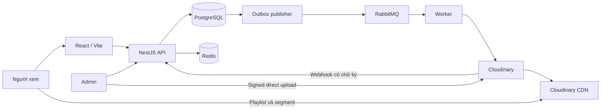

# Kế hoạch hoàn chỉnh: Web xem phim với Node.js và Cloudinary

Ngày lập: 08/11/2026. Cập nhật: 13/11/2026, múi giờ Asia/Saigon. Phiên bản: 2.20.

Tài liệu giải thích triển khai: [Thuật toán stream video](../design/streaming-algorithms.md). Đã có UI/player cơ bản tại apps/web; phân biệt cấu hình hiện tại với các thuật toán minh họa và ma trận nghiệm thu còn thiếu. Tài liệu không hoàn tất ST01–ST06.

Phiên bản 2.20 (13/11/2026): triển khai live search trên thanh tìm phim: từ 2 ký tự, debounce 300 ms, tối đa 6 gợi ý theo bộ lọc, loading/empty/error/retry, abort/chặn response cũ, IME và combobox bàn phím. Frontend-only 202 kiểm tra đạt (54 live search), 4 mẫu responsive và 6 probe runtime read-only. Không đổi API/schema/backend/media; search ranking/cache vẫn như trước, ST/REC/ENC/EXT giữ trạng thái. [Báo cáo](../testing/live-search-2026-11-13.md).

Phiên bản 2.19 (13/11/2026): dùng ba agent nghiên cứu dữ liệu điểm/review IMDb, Metacritic và nguồn khác; bổ sung mục 9.6, báo cáo nguồn/thiết kế riêng và EXT01–EXT08 ở 14.7. Phân biệt aggregate score, critic quote, user review, AI summary và quyền từng use case; ưu tiên thử TMDB theo quyền, IMDb/Metacritic theo entitlement. Thiết kế mapping, worker, source policy, agent có giới hạn, API/UI và purge; chưa import data, cấp credential, mua gói hoặc thay source/schema/runtime. ST/REC/ENC giữ trạng thái.

Phiên bản 2.18 (13/11/2026): nghiên cứu mã hóa/nén đa độ phân giải tại mục 6.7 và ENC01–ENC09 tại mục 14.6. Đối chiếu encoder/profile HLS Cloudinary hiện có, bổ sung codec/giao thức, rate control, ladder/per-title, GOP/segment, màu/audio, VMAF/review, chi phí và rollout/rollback. Baseline thực đã thử 180–720p; 1080p/HDR/HEVC/AV1/per-title chưa nghiệm thu. Các ticket đều NOT_STARTED; chỉ cập nhật tài liệu, không thay source/schema/profile hoặc hoàn tất ST01–ST06.

Phiên bản 2.17 (13/11/2026): nghiên cứu thuật toán gợi ý/cá nhân hóa tại mục 9.2 và backlog REC01–REC09 tại mục 14.5. Đối chiếu nguồn gốc về content-based, item-to-item, ALS/BPR/LightFM, retrieval/ranking, MMR và Netflix MAPS 2026. Chốt lộ trình ưu tiên Node.js/PostgreSQL, instrumentation/analytics riêng, snapshot/ownership/opt-out, đánh giá timeline/full-catalog/A-B và gate dữ liệu. Hệ số/ngưỡng là giả thuyết cần đo; cá nhân hóa, bảng/API/model mới đều chưa triển khai, không đổi source/schema hoặc trạng thái ST01–ST06.

Phiên bản 2.16 (13/11/2026): [mở rộng admin](../testing/admin-ui-2026-11-13.md) với people/banner/settings/đọc report, menu và lối tắt theo quyền, form ETag/If-Match, step-up settings và redaction AUDITOR. Frontend đạt 148 kiểm tra, 24 mẫu responsive; hồi quy API riêng đạt 1.998, gồm 64 kiểm tra phân trang. Sửa mất microsecond trong cursor gây bỏ sót hồ sơ cùng timestamp; giữ timestamp gốc trong cursor, bỏ trường nội bộ khỏi JSON. Build/restart đúng API local và 15 probe runtime đạt. Không đổi API/schema hoặc upload/xuất bản; banner/site settings chưa được trang người xem sử dụng, gán credits/moderation vẫn còn thiếu. ST01–ST06 chưa hoàn tất.

Phiên bản 2.15 (13/11/2026): [kiểm tra xác thực/phân quyền](../testing/auth-authorization-2026-11-13.md): 840 assertion mới cho 49 operation admin/5 role, hợp đồng endpoint-permission độc lập, JWT/IDOR/trạng thái phiên; tổng 1.934 kiểm tra hồi quy API đạt, không bật frontend/worker lần này. Sửa cấu hình chấp nhận CURSOR_SECRET quá ngắn: yêu cầu ít nhất 64 ký tự, không đổi khóa local. Đọc quyền DB xác nhận API/worker không dùng superuser hoặc sở hữu bảng; worker không đọc password hash/refresh token. Local MFA=false/Swagger mở giữ nguyên; CDN TTL/thu hồi và rủi ro sessionStorage/XSS còn mở. Không đổi API/schema hoặc hoàn tất ST01–ST06.

Phiên bản 2.14 (13/11/2026): [kiểm thử Redis/RabbitMQ](../testing/redis-rabbitmq-2026-11-13.md): RabbitMQ local thật đạt 9 nhóm/42 assertion, gồm ACK/prefetch/DLQ/mandatory routing/redelivery/delivery limit; thêm lệnh rabbitmq:smoke dùng topology riêng và tự dọn. Redis chưa tích hợp, không có cấu hình/client/container và cổng 6379 không lắng nghe; không ghi nhận Redis đã đạt. Broker hiện một node, worker xử lý phim không có consumer tại thời điểm đo; chưa nghiệm thu HA/restart/load. Không đổi API/schema hoặc ST01–ST06.

Phiên bản 2.13 (13/11/2026): [kiểm thử full-stack](../testing/full-stack-2026-11-13.md) đạt1.227kiểm tra với frontend76/API/PostgreSQL/RabbitMQ thật, thêm17bước playbackCloudinary và kiểm2asset/HLS/backupchecksum/biênnhậnwebhook đã có. Sửa logout thu hồi auth trước khi dọn phiên: registry giữ Promise dispose, chờ tối đa5giây; hồi quy trì hoãn telemetry/đóng phiên trước auth và kết thúc0phiên thử còn hoạt động. Sửa probe Docker lạnh trên Windows PowerShell và chờ metadata trong smoke. Không upload mới hoặc testtải/device; ST05 vẫn IN_PROGRESS.

Phiên bản 2.12 (13/11/2026): cải thiện UX/UI người xem/admin với typography dễ đọc, nút chính44px, tìm kiếm/xóa từ khóa và điều hướng focus, thẻ phim hai dòng/placeholder, video cạnh danh sách tập có nhãn Đang xem/nút tập tiếp; bảng/form admin lớn hơn, menu mobile mở/đóng, lối tắt editor và Escape/outside-click cho tài khoản. Web build/73browser checks đạt trên PostgreSQL tạm, 28trường hợp responsive320/390/768/1440px không tràn toàn trang; có giải mã hình ảnh video thật trên Chrome muted. Không đổi API/schema hoặc worker; ST05 vẫn IN_PROGRESS, chưa auditWCAG/device matrix.

Phiên bản 2.11: cải thiện chọn độ phân giải khi xem: mức HLS thực sắp giảm dần, Tự động, báo videoHeight và trạng thái chuyển; giữ timeline/tốc độ/cùng phiên. MP4 hiển thị mức gốc, khóa chọn và có nút thử HLS sau khi lưu/đóng phiên cũ; native HLS vẫn tự động. Web build và 61 kiểm tra browser/DB tạm đạt; Cloudinary thật đã kiểm 720p/360p/180p/Auto, viewport390px, chuyển MP4 rồi xem tiếp HLS từ30giây. CDN master đôi lúc400 vẫn là giới hạn provider; không đánh dấu ST05 VERIFIED. Không đổi API/schema/provider hoặc upload thêm.

Phiên bản 2.10: sửa player đứng sau fatal HLS trước khi có nguồn: recovery/timeout hữu hạn, mã lỗi chi tiết an toàn, nút phát khi autoplay bị chặn. Cấp URL nguồn MP4 đã verified theo asset/version của phiên làm fallback; tự chuyển hoặc nút Đổi cách phát, giữ vị trí/tốc độ. MP4 không ABR; quyền và giới hạn chữ ký CDN không thay đổi. Không thêm endpoint/schema, không reupload hoặc tự xuất bản. Hồi quy đạt 1.207 kiểm tra (56 browser/200 viewer), Chrome giải mã cả HLS và MP4 dự phòng; ST05 vẫn IN_PROGRESS.

Phiên bản 2.9: [nghiệm thu video thật qua UI/player](../testing/live-streaming.md) đạt trên Chrome Windows: hai tập riêng 20 phút 11 giây/45 giây, upload thật, 5 mức 180p–720p, backup checksum, webhook và xuất bản. Có 3 kiểm tra prepare và 17 playback; kiểm 720p/chuyển mức/tua/tốc độ/mất mạng/đổi tập/server progress sau login/completion. Sửa nhãn form, Chrome native maybe, workerPath ESM, recovery/tốc độ/resume, auth-loading, phân loại CDN pending và tunnel hết hiệu lực. Hồi quy 1.198 checks có RabbitMQ, gồm 53 browser. ST05 vẫn IN_PROGRESS vì Android/Safari/mạng yếu/tải/expiry dài chưa nghiệm thu; không đổi API/schema hoặc khắc phục ST01–ST04/ST06.

Phiên bản 2.8: triển khai [giao diện React/Vite](../frontend.md) cho người xem và admin, thay lựa chọn Next.js ban đầu trong bản local. Có catalog, tìm/lọc, chi tiết/tập, auth, thư viện; admin metadata/mùa/tập, Cloudinary direct upload, polling, chọn asset/publication, user/role/audit; player HLS native/hls.js nối session/renewal/events/progress. API phục vụ dist/web cùng origin; giữ RBAC/ETag/audit và MFA production. Build cả API/web đạt; tổng 1.194 kiểm tra có RabbitMQ, gồm 51 kiểm tra Chrome trên PostgreSQL tạm; Cloudinary boundary/HLS READY fixture chỉ dùng trong test. C09/C10 có phần MVP, ST05 vẫn IN_PROGRESS; chưa nghiệm thu giải mã HD/ABR trên thiết bị thật, subtitle hoặc load test. Không đổi schema/endpoint, không xuất bản phim thật.

Phiên bản 2.7: theo yêu cầu mới, bỏ đăng nhập Swagger local: UI/spec mở trực tiếp, bỏ form/cookie/CSRF/docs-session và tự chèn token. Bookmark docs-login redirect sang docs. API nghiệp vụ vẫn giữ Bearer/session/RBAC; production hoặc SWAGGER_ENABLED=false không mount docs. Build/export và 1.142 kiểm tra đạt, gồm 40 kiểm tra Swagger và 41 MFA/local; Chrome thật chạy headless đã render 87 operation không có form. Không đổi schema hoặc xử lý ST01–ST06.

Phiên bản 2.6: sửa lỗi CSRF khi mở nhiều tab Swagger: giữ token cookie ổn định trong 30 phút, tái hiện form khi cookie hết hạn/thiếu hoặc token không khớp. Trình duyệt nhận HTML 403 có thông báo, client JSON vẫn nhận AUTH_CSRF_INVALID; giữ Origin/Fetch Metadata, CSRF và password/RBAC. Build và 1.167 kiểm tra đạt, gồm 45 kiểm tra mới; API đã restart và 13 kiểm tra runtime đạt. Không đổi schema/endpoint hoặc hoàn tất ST01–ST06.

Phiên bản 2.5: theo yêu cầu bỏ mã MFA khi dùng local, thêm AUTH_MFA_REQUIRED=false cho API/Swagger và thao tác quản trị. Mặc định vẫn yêu cầu MFA; production luôn bật. Giữ mật khẩu, session/revocation, RBAC, audit và SUPER_ADMIN cuối; không giả thời điểm MFA/step-up. Build và 1.122 kiểm tra đạt trên DB tạm riêng, có RabbitMQ; 52 kiểm tra policy MFA/local mới. Không đổi schema hoặc hoàn tất ST01–ST06.

Phiên bản 2.4: đã chuẩn hóa [global exception handler](../api/exception-handling.md) riêng trong filters/, đăng ký APP_FILTER và dùng chung cho lỗi NestJS/Express/parser/Swagger. Có Problem Details với requestId/retryable, lọc field errors, ánh xạ lỗi HTTP/Prisma/PostgreSQL và bảo vệ response đã gửi header. Registry runtime 73 code; build và 1.070 kiểm tra đạt, gồm 509 assertion mới cho handler. Endpoint vẫn 87 operation/67 path; không thay schema hoặc hoàn tất các ticket streaming ST01–ST06.

Phiên bản 2.3: bổ sung backlog streaming ST01–ST06 tại mục 11.1: giới hạn URL CDN tĩnh, quota phiên theo IP/proxy, chống spam telemetry trước xác thực, analytics/retention, kiểm thử player/tải và backup/webhook production. Mỗi mục có ưu tiên, phạm vi code, phụ thuộc và tiêu chí nghiệm thu. Đây là cập nhật kế hoạch, chưa sửa source hoặc ghi nhận các vấn đề đã được khắc phục.

Phiên bản 2.2: [API người xem](../api/viewer-api.md) đã chạy local: thêm 27 operation cho catalog công khai, playback HLS/session/renewal/telemetry, đăng ký/email xác minh/reset, watchlist/history/resume và report. Tổng OpenAPI 87 operation/67 path, gồm 49 admin; 68 error code và 561 kiểm tra HTTP/client/worker đạt. Dùng 47 bảng hiện có, không migration mới. C08 core API và C11 backend đã có; frontend/player, admin preview, subtitle delivery, analytics consumer và production CDN protection còn thiếu. Email local đã kiểm thử, SMTP chưa nghiệm thu thật. Signed CDN URL không tự hết hạn; production mặc định chặn cấp URL nếu chưa chấp nhận rõ giới hạn. Video thật trước đó vẫn DRAFT.

Phiên bản 2.1: [RabbitMQ worker/HLS/webhook/backup](../api/media-worker.md) đã chạy tự động local; video thật 20 phút 11 giây có 5 rendition 180p–720p, backup khớp SHA-256 và đủ điều kiện READY. Phim vẫn DRAFT. Đã có API processing retry, 49 endpoint admin/60 operation tổng, 65 error code và 367 kiểm tra HTTP/client/worker. Backup local/tunnel là cấu hình dev; production yêu cầu S3 versioning/private bucket, webhook cố định, AMQPS và nghiệm thu restore/HA. C06 còn UI admin; C07 core đã nghiệm thu local, chưa coi hoàn tất production.

Phiên bản 2.0: đã có [Cloudinary signed upload và xác minh nguồn](../api/cloudinary-upload.md), 48 endpoint admin/59 operation tổng và 312 kiểm tra HTTP/client. C06 có adapter, cấu hình, intent, direct/chunked upload helper và metadata verification; đã nghiệm thu video thật 20 phút 11 giây, HLS có 5 mức 180p–720p; worker/webhook/backup/playback/frontend còn thiếu. Verification thực tế trả 200 đồng bộ sau kiểm tra provider, rồi ghi operation/outbox xử lý HLS bền; không đánh dấu READY.

Phiên bản 1.9: [API admin/Swagger](../api/README.md) đã chạy local với Prisma, JWT session/MFA, 45 endpoint admin (56 operation tổng), RBAC/publication guards, audit transaction và 212 kiểm tra HTTP trên PostgreSQL tạm riêng. C01/C03/C04/C05 có phần source API; C02 có bootstrap SQL và Prisma client. Chưa đánh dấu công đoạn hoàn tất khi migration, public API, worker hoặc frontend còn thiếu.

Phiên bản 1.8: database local `pj_flim` đã được tạo trên PostgreSQL 17.11 tại `127.0.0.1:5432`, schema `movie`, đủ 47 bảng và seed RBAC. [Hướng dẫn/script database thực tế](../../database/README.md) có kiểm tra constraint, runtime grants và chạy lại bootstrap. C02 hoàn thành một phần (bootstrap SQL); chưa có Prisma migration, API, worker hoặc frontend.

Phiên bản 1.7 bổ sung [thiết kế database PostgreSQL](../design/movie-database-design.md): 47 bảng, 4 ERD, DDL, seed 5 role/18 permission, grants và script kiểm tra SQL. Baseline đã kiểm tra trên PostgreSQL nhúng; chưa có Prisma migration, kiểm thử nhiều connection hoặc database web phim triển khai thực tế.

Phiên bản 1.6 liên kết [thiết kế backend chi tiết](../design/movie-backend-design.md): module, source tree, bảng/constraint, transaction, auth/refresh race, media pipeline, job lease và playback/resume. Mục 7/10 của plan vẫn là nguồn hợp đồng API/quyền/lỗi; phần triển khai được cụ thể hóa trong tài liệu backend, chưa có code web phim chạy thật.

Phiên bản 1.5 bổ sung xác thực JWT/refresh và MFA, ma trận role/permission, audit log admin có kiểm soát, Swagger UI được bảo vệ và các API/mã lỗi/kiểm thử tương ứng. Đây là yêu cầu code ở C02–C05/C09/C12; chưa phải tính năng đã triển khai.

Phiên bản 1.4 thay mục 14.3 bằng thứ tự viết code C01–C12: project, database, REST/error handling, auth, catalog, Cloudinary, worker, playback, UI, player, tính năng cá nhân và hoàn thiện kiểm thử. Mỗi bước chỉ rõ module/file và kết quả chạy được. Mọi bước vẫn NOT_STARTED.

Phiên bản 1.2 chuẩn hóa RESTful API, HTTP status, Problem Details RFC 9457, mã lỗi nghiệp vụ, ETag/If-Match, idempotency và hợp đồng OpenAPI. Danh sách endpoint bên dưới thay thế các tên thao tác cũ; chưa có API web phim đang chạy cần giữ tương thích.

Phiên bản 1.1 bổ sung xuất bản từng tập, API sự kiện cho khách/tài khoản, gia hạn nhiều vòng có kiểm soát, player theo khả năng thiết bị, điều kiện thử Cloudinary, dự toán/backup cụ thể và các mốc bàn giao MVP. Các thay đổi được tích hợp vào nghiệp vụ, dữ liệu, API và nghiệm thu bên dưới.

Đây là kế hoạch triển khai sản phẩm mới, tổng hợp các quyết định và phương án khắc phục đã thống nhất trong trao đổi. Những biện pháp dưới đây là yêu cầu thiết kế và nghiệm thu; chưa phải báo cáo đã sửa hoặc kiểm thử ứng dụng. Tài liệu và các bước triển khai dự án web phim được đặt trong thư mục `pj-Flim`; các đường dẫn dự án lấy thư mục này làm gốc.

## 1. Mục tiêu và phạm vi

Xây web xem phim theo yêu cầu (VOD) có trải nghiệm quen thuộc: trang chủ nền tối, poster, banner, danh mục, tìm kiếm, chi tiết phim, chọn tập, phát HD và xem tiếp. Hỗ trợ phim lẻ và phim bộ, responsive trên điện thoại và máy tính. Nội dung sử dụng nguồn được phép phân phối.

Quyết định sản phẩm:

- MVP cho khách duyệt, tìm kiếm và xem nội dung miễn phí đã xuất bản; tài khoản dùng để đồng bộ lịch sử và yêu thích. Khách lưu vị trí xem trên thiết bị; cả khách và tài khoản có phiên phát để đo chất lượng dịch vụ.
- Khu vực quản trị quản lý phim, mùa/tập, video, phụ đề, banner, publication, tài khoản/quyền theo ma trận; có audit log và Swagger phục vụ phát triển được kiểm soát truy cập.
- Cloudinary lưu video, poster, trailer; xử lý các bản phát và phân phối bằng CDN.
- Backend Node.js/NestJS quản lý nghiệp vụ; RabbitMQ điều phối tác vụ nền; Redis phục vụ cache và giới hạn request.
- Phim chính phát HLS nhiều chất lượng đến tối đa 1080p khi nguồn và gói Cloudinary đáp ứng. Player mặc định Auto; lựa chọn chất lượng thủ công chỉ xuất hiện khi adapter/thiết bị đã được kiểm thử hỗ trợ.
- Bổ sung đánh giá, gợi ý nâng cao, VIP, thanh toán, nhiều hồ sơ và gợi ý hành vi sau MVP. MVP dùng danh sách biên tập và phim cùng thể loại cho các hàng liên quan. Không cần microservices, 4K, live stream hoặc DRM cho phiên bản đầu.
- Giao diện tham khảo cách bố trí quen thuộc của các nền tảng xem phim; thiết kế thương hiệu và tài sản giao diện riêng.

Luồng sản phẩm phải hoàn chỉnh: tạo tập → upload → xử lý → xem thử → xuất bản → tìm phim → xem → tiếp tục xem.

## 2. Công nghệ và trách nhiệm

| Thành phần     | Lựa chọn                                    | Trách nhiệm                                                        |
| -------------- | ------------------------------------------- | ------------------------------------------------------------------ |
| Frontend       | React, Vite, React Router, TypeScript       | SPA cùng origin với API; player/tương tác phía client; SSR chưa có |
| Giao diện      | Tailwind CSS, shadcn/ui                     | Responsive, dark mode, bàn phím và trạng thái loading/error        |
| Dữ liệu client | TanStack Query                              | Cache dữ liệu tương tác, mutation, hủy request cũ                  |
| Backend        | Node.js bản LTS còn hỗ trợ, NestJS          | REST API, quyền truy cập, upload intent, phiên phát                |
| Database       | PostgreSQL, Prisma                          | Nguồn dữ liệu chính, migration, transaction và index               |
| Tìm kiếm       | PostgreSQL pg_trgm, tên chuẩn hóa           | Tìm tên gần đúng và không dấu cho MVP                              |
| Cache          | Redis                                       | Cache danh mục, rate limit, lease phiên phát nếu cần               |
| Hàng đợi       | RabbitMQ, Node client hỗ trợ confirms       | Tác vụ media, tìm kiếm, thông báo và đối soát                      |
| Media          | Cloudinary Node.js SDK và CDN               | Upload, eager processing, HLS, poster, trailer                     |
| Player         | HTML5 video, hls.js; HLS native khi phù hợp | ABR, buffer, tua, phụ đề, sự kiện chất lượng phát                  |
| Gợi ý sau MVP | Node.js worker, PostgreSQL; job training riêng nếu cần | Content/hybrid theo mục 9.2; chưa triển khai, không bắt buộc Redis hoặc ML service |
| Quan sát       | Log JSON, OpenTelemetry, hệ thống thu lỗi   | Theo dõi API, job, webhook và phiên phát                           |
| Kiểm thử       | Jest, Supertest, Playwright, Postman CLI    | Nghiệp vụ, hợp đồng API, hồi quy và end-to-end                     |
| Triển khai     | Docker, reverse proxy, GitHub Actions       | Build, CI, HTTPS, triển khai và rollback                           |

Khóa phiên bản thực tế trong lockfile sau khi thử tương thích. Web build hiện phục vụ cùng API local; khi scale có thể tách static host, API và worker. Redis có thể bị xóa cache mà không làm mất lịch sử, trạng thái xử lý hoặc công việc cần thực hiện.

Trạng thái triển khai Redis (13/11/2026): chưa có client, biến môi trường hoặc container của dự án. Các mục Redis/rate limit phân tán và cạnh nối Redis trong sơ đồ dưới đây là thiết kế dự kiến; catalog hiện trả Cache-Control: no-store. RabbitMQ đã có broker/worker và kiểm thử thật.

Bản hiện tại dùng SPA React/Vite; SSR/SEO public là hạng mục riêng nếu phát triển sau.

## 3. Kiến trúc



Backend chia module: Auth, Users, Authorization, Audit, Catalog, Episodes, Media, Playback, Search, History, Watchlist, Admin, Jobs, Observability; cấu hình Swagger tách riêng. Ratings và gợi ý nâng cao bổ sung sau MVP. Dùng modular monolith cho nghiệp vụ và worker riêng cho công việc nền.

Video đi từ Cloudinary CDN đến trình duyệt. API chỉ trả metadata, kiểm tra quyền và quản lý phiên phát. RabbitMQ nhận thông điệp nhỏ chứa định danh và phiên bản; dữ liệu nhị phân video được lưu ở Cloudinary.

Cloudinary hỗ trợ tạo và phân phối adaptive streaming từ video nguồn. [Tài liệu HLS/DASH](https://cloudinary.com/documentation/adaptive_bitrate_streaming)

## 4. Tính năng và giao diện

| Màn hình      | Yêu cầu MVP                                                              | Nghiệm thu                                                                  |
| ------------- | ------------------------------------------------------------------------ | --------------------------------------------------------------------------- |
| Trang chủ     | Banner, phim mới, nổi bật, thể loại, tiếp tục xem                        | Không lẫn nội dung chưa xuất bản; poster tải theo vùng nhìn                 |
| Danh mục      | Phim lẻ/bộ; lọc thể loại, quốc gia, năm; sắp xếp                         | Bộ lọc nằm trong URL, quay lại giữ trạng thái                               |
| Tìm kiếm      | Tên Việt/Anh/tên khác, không dấu, gần đúng                               | Có loading, không kết quả, hủy kết quả request cũ                           |
| Chi tiết      | Poster, mô tả, trailer, diễn viên, mùa/tập                               | Nút xem trỏ đến tập hợp lệ; trailer chỉ tải khi cần                         |
| Player        | Auto; chất lượng thủ công theo khả năng; phụ đề, fullscreen, tốc độ, tua | Đổi chất lượng giữ vị trí; thiết bị chỉ hỗ trợ Auto không hiện lựa chọn giả |
| Danh sách tập | Tập hiện tại, trước/sau, tự chuyển                                       | Đếm ngược có hủy; bỏ qua tập chưa xuất bản                                  |
| Tài khoản     | Đăng ký, đăng nhập, xác minh/đặt lại mật khẩu                            | Thông báo rõ, token dùng một lần, phiên có thể thu hồi                      |
| Cá nhân       | Yêu thích, lịch sử, tiếp tục xem                                         | Unique theo tài khoản; khách có resume cục bộ; không lẫn dữ liệu người khác |
| Admin         | CRUD phim/tập, upload, tiến độ xử lý, xem thử, xuất bản phim và từng tập | Tập chưa sẵn sàng bị ẩn, các tập đã công khai vẫn xem được; có audit log    |
| Báo lỗi       | Báo video/phụ đề lỗi kèm tập và mã phiên                                 | Người dùng không cần cung cấp URL có token                                  |

Đường dẫn: `/`, `/movies`, `/series`, `/genres/[slug]`, `/search`, `/titles/[slug]`, `/watch/[episodeId]`, `/my-list`, `/history`, `/account`, `/admin`, `/admin/users`, `/admin/roles`, `/admin/audit-logs`. Màn hình quản trị chỉ hiển thị khi có permission tương ứng, API vẫn kiểm tra quyền độc lập.

Ảnh có kích thước đúng bố cục, placeholder và lazy loading; không autoplay hàng loạt trailer. Player có focus rõ, nhãn nút, phím tắt không chiếm phím khi đang nhập và phụ đề đọc được trên màn hình nhỏ.

## 5. Upload và xử lý Cloudinary

### 5.1. Upload intent và ràng buộc tài nguyên

1. Admin gọi API tạo upload intent cho tập, ghi owner, asset ID nội bộ và phiên bản dự kiến. Attempt/operation xử lý được tạo khi nguồn đã xác minh.
2. Backend kiểm tra quyền; tự chọn public ID duy nhất, preset, delivery type và tham số được phép; không cho client tự ký transformation tùy ý.
3. Trình duyệt upload trực tiếp bằng signed upload và cơ chế chunked được Cloudinary hỗ trợ. Hiển thị tiến độ, hủy và thử lại; không hứa khôi phục sau khi tải lại trang nếu SDK chưa hỗ trợ và chưa thử nghiệm.
4. API nhận thông báo hoàn tất nhưng kiểm tra tài nguyên phía provider trước khi gắn vào tập: định danh, resource type, intent, phiên bản, dung lượng và thời lượng thực tế.
5. Kiểm tra dung lượng trước cấp chữ ký, ở client và khi đọc metadata sau upload; cấu hình giới hạn theo gói provider. Cloudinary preset không có giới hạn byte riêng; chunked upload không vượt giới hạn mỗi file của tài khoản. Chữ ký không thay thế kiểm tra dung lượng và sở hữu tài nguyên. [Giới hạn preset](https://cloudinary.com/documentation/upload_presets).
6. Không tin URL hoặc MIME do trình duyệt gửi. Backend không tải tùy ý URL đầu vào. Từ chối tài nguyên không thuộc intent; đưa upload lỗi vào danh sách dọn có thời gian chờ.

Cloudinary hỗ trợ upload trực tiếp có chữ ký và chunked upload cho video lớn. [Tài liệu Node.js upload](https://cloudinary.com/documentation/node_image_and_video_upload)

### 5.2. Trạng thái và chuyển mã

```text
Asset: PENDING_UPLOAD → UPLOADING → UPLOADED → PROCESSING → READY
                              └→ FAILED          └→ FAILED
Lifecycle: ACTIVE → DELETING → DELETED
Title publication:   DRAFT → PUBLISHED → UNPUBLISHED → ARCHIVED
Episode publication: DRAFT → PUBLISHED → UNPUBLISHED → ARCHIVED
```

- Trạng thái upload phía UI mang tính tiến độ; backend xác nhận nguồn dữ liệu đáng tin trước khi chuyển `UPLOADED`.
- Ghi thay đổi asset và sự kiện `media.processing.requested` vào cùng transaction PostgreSQL/outbox.
- Worker yêu cầu profile HLS xác định trước, dùng eager asynchronous processing và URL webhook. Lưu cấu hình, request/attempt và danh tính đầu ra; không tạo lại vì người dùng bấm Play.
- Webhook upload thành công không được coi là webhook chuyển mã thành công. Chỉ đặt `READY` khi các đầu ra bắt buộc đã thành công và được kiểm tra khả năng truy cập theo chính sách phát.
- Đầu ra của attempt cũ hoặc asset đang xóa không được ghi đè attempt hiện tại. Thay trạng thái bằng điều kiện phiên bản trong transaction.
- Không tự công khai khi nhận webhook; admin xem thử rồi xuất bản. Có tác vụ phát hiện video xử lý lâu và kiểm tra lại provider.

Cloudinary hỗ trợ eager transformations chạy bất đồng bộ và thông báo khi đầu ra hoàn tất. [Tài liệu eager processing](https://cloudinary.com/documentation/eager_and_incoming_transformations)

### 5.3. Webhook bền vững

- Endpoint HTTPS giữ raw body để xác minh chữ ký bằng SDK, kiểm tra timestamp theo cửa sổ cấu hình và yêu cầu chống replay.
- Lưu event vào inbox bền vững trước khi trả `200`. Nếu chưa lưu được thì trả lỗi để provider có thể retry.
- Dùng ID sự kiện nếu có; nếu không, tạo khóa dedup từ thông báo đã xác minh, định danh asset/attempt và loại/kết quả sự kiện. Consumer kiểm tra trạng thái nghiệp vụ để chống xử lý trùng cả khi timestamp thay đổi.
- Inbox và outbox cho phép nhận webhook khi RabbitMQ tạm ngừng. Job xử lý inbox chỉ cập nhật đúng attempt hiện hành.
- Mỗi 5 phút quét attempt đang chờ quá lâu, giới hạn tốc độ gọi Admin API và tăng khoảng chờ khi provider báo giới hạn. Quá ngưỡng SLA xử lý đã đo cho kích thước tương ứng thì cảnh báo admin.
- Webhook lỗi nghiệp vụ được giữ để xử lý lại; không yêu cầu provider retry vô hạn cho payload đã lưu.

Cloudinary ký webhook và retry hữu hạn; job đối soát xử lý trường hợp thông báo không được nhận. [Tài liệu notifications](https://cloudinary.com/documentation/notifications)

### 5.4. Xuất bản độc lập ở cấp phim và tập

- `titles.publication_status` và `episodes.publication_status` là hai trường độc lập; `video_assets.processing_status` quản lý khả năng phát. Tài nguyên đang xóa không được dùng để xuất bản.
- Admin có thể chuẩn bị trạng thái tập khi phim còn draft. Xuất bản phim yêu cầu ít nhất một tập đã xuất bản có video `READY` và các điều kiện media/backup bắt buộc đạt. Không yêu cầu toàn bộ các tập dự kiến đều sẵn sàng.
- Xuất bản tập kiểm tra active asset và phiên bản trong transaction, dùng optimistic locking để tránh xung đột với thay/xóa video. Cho phép xuất bản lại từ `UNPUBLISHED` sau khi kiểm tra các điều kiện; tài nguyên `ARCHIVED` cần khôi phục bằng thao tác admin rõ ràng trước.
- Guard `canPlayEpisode` kiểm tra đồng thời: phim `PUBLISHED`, tập `PUBLISHED`, active asset `READY`, lifecycle `ACTIVE`, quyền xem hợp lệ nếu nội dung yêu cầu. Kiểm tra nguồn PostgreSQL khi tạo/gia hạn phiên; cache giao diện không quyết định quyền phát.
- Guard hiển thị tập dùng cùng quy tắc xuất bản và khả năng media. Danh mục chỉ hiển thị phim công khai có tập phát được; không trả tập draft qua danh sách tập, tìm kiếm, số đếm hoặc API tập tiếp theo.
- Ví dụ: tập 1–5 đã công khai vẫn xem được khi tập 6 đang xử lý. Tập 6 không xuất hiện hoặc được tự chuyển tới cho đến khi đủ điều kiện và được admin xuất bản.
- Gỡ tập chặn tạo phiên mới cho tập đó; gỡ phim chặn tất cả phiên mới bên dưới nhưng giữ nguyên trạng thái từng tập để có thể xuất bản lại có chủ đích. Độ trễ thu hồi phiên đã được cấp tuân theo mục 7.1.
- Sự kiện xuất bản/gỡ/thay media được ghi qua outbox, cập nhật catalog version và vô hiệu cache public liên quan khi triển khai cache. Cache public còn sót có thể làm giao diện chậm cập nhật, nhưng API cấp quyền vẫn từ chối ngay theo trạng thái đã commit.

## 6. Phát video, HD và giảm dữ liệu truyền

### 6.1. Luồng phát

1. Player gọi `POST /episodes/{episodeId}/playback-sessions` theo hợp đồng mục 10; các đường dẫn API đều nằm dưới `/api/v1`.
2. Backend dùng guard `canPlayEpisode` ở mục 5.4 và kiểm tra giới hạn phiên nếu được bật; ghi viewer là user hoặc khách ẩn danh. Admin preview có quyền/loại phiên riêng, không đi qua luồng công khai.
3. Trả phiên phát, manifest đúng phiên bản, cách xác thực và thời hạn nếu áp dụng, cùng quyền gửi telemetry chỉ cho phiên đó; response cấp quyền dùng `Cache-Control: no-store`.
4. Player lấy master playlist, media playlist rồi segment trực tiếp từ Cloudinary CDN.
5. Trình duyệt giải mã; player tải trước trong giới hạn buffer, chọn chất lượng theo khả năng adapter và gửi sự kiện qua API ở mục 6.6.
6. Khi tua, tải segment của mốc cần xem; khi đổi tập, hủy request cũ và giải phóng player. Lưu tiến độ riêng qua API.

### 6.2. Cấu hình HD ban đầu

| Mức   | Bitrate video tham khảo cho H.264 | Quy tắc                       |
| ----- | --------------------------------- | ----------------------------- |
| 360p  | 0,6–0,9 Mbps                      | Mạng yếu                      |
| 480p  | 1–1,5 Mbps                        | Mức dự phòng                  |
| 720p  | 2–3 Mbps                          | HD phổ biến                   |
| 1080p | 4–6 Mbps                          | Khi nguồn và thiết bị phù hợp |

Đây là giá trị thử nghiệm cho nguồn SDR khoảng 24–30 FPS, không phải bitrate cố định cho mọi phim hoặc cấu hình mặc định của Cloudinary. Các asset đã kiểm thử với profile hiện hành có 5 mức 180/270/360/540/720; bảng này không khẳng định đã có 480p hoặc 1080p. Xem nghiên cứu và cách chọn ladder theo nội dung tại mục 6.7. Bổ sung audio phù hợp, thường bắt đầu thử AAC stereo 128 kbps. Không nâng FPS hoặc upscale chỉ để có nhãn chất lượng cao.

- Bắt đầu H.264/AAC và profile HLS được tạo trước; kiểm tra manifest thực tế có đúng mức mong muốn.
- Với profile cho phép điều chỉnh, thử segment 4–6 giây và căn keyframe; xác minh khả năng cấu hình của Cloudinary thay vì coi mọi tham số FFmpeg đều có sẵn.
- Auto là mặc định. Ước lượng tốc độ tải có làm mượt; chọn bitrate với dư địa an toàn, hạ nhanh khi buffer thấp và tăng khi ổn định. Dùng ABR sẵn có của player, đo trước khi chỉnh thuật toán.
- Buffer phía trước thử 30 giây, back buffer 30 giây; kiểm soát cả dung lượng và giới hạn thiết bị. Đây là mục tiêu tải trước, không phải thời gian phải đợi để bắt đầu.
- Khi người xem khóa 1080p mà mạng không đủ, hiển thị gợi ý chuyển Auto; không âm thầm báo 1080p trong khi phát mức khác.
- Tua/đổi chất lượng giữ timeline; không tái tạo player cho mọi thay đổi giao diện. Retry có giới hạn, tránh vòng lặp reload toàn bộ video.

HLS có thể dùng native hoặc hls.js theo khả năng trình duyệt. [Tài liệu hls.js](https://github.com/video-dev/hls.js)

### 6.3. Tối ưu dung lượng

Cơ chế nén, khả năng codec/giao thức, thuật toán per-title, phép đo chất lượng và backlog triển khai được nghiên cứu chi tiết tại mục 6.7/14.6. Các dòng dưới đây là định hướng, chưa xác nhận tiết kiệm bitrate trên catalog.

- Tạo bản mã hóa theo độ phức tạp từng phim trong khả năng profile provider; kiểm tra cảnh tối, chuyển động, grain và khuôn mặt. Không hứa giữ nguyên chất lượng ở mọi mức giảm bitrate.
- Dùng bộ mẫu và VMAF khi pipeline đo hỗ trợ; kết hợp xem bằng mắt. Các chỉ số chất lượng cần được so sánh trên cùng nguồn và cấu hình hiển thị.
- AV1/HEVC là bước sau: thử hỗ trợ thực tế của tài khoản Cloudinary, player và hardware decode; có H.264 dự phòng. Không bật codec mới toàn bộ catalog chỉ dựa vào khả năng parse codec của trình duyệt.
- Trailer MP4 có thể dùng `q_auto`/`f_auto` phù hợp. HLS dùng profile đã nghiệm thu; không ghép tham số tối ưu tùy tiện nếu chưa xác nhận provider hỗ trợ.
- Chỉ tải audio được chọn và phụ đề cần dùng; phụ đề WebVTT UTF-8, không tạo video riêng cho mỗi ngôn ngữ khi không cần.
- Tắt tải video ngoài màn hình, hạn chế prefetch tập tiếp theo và hủy tải khi rời trang.
- Brotli/gzip cho JS, CSS, JSON và playlist văn bản khi hệ thống phân phối hỗ trợ; không trông đợi nén HTTP thêm cho segment video đã nén.

`q_auto` và chọn kích thước phù hợp là các công cụ tối ưu Cloudinary cung cấp. [Tài liệu tối ưu video](https://cloudinary.com/documentation/video_optimization)

### 6.4. Chính sách lỗi player

| Loại lỗi                                  | Hành động                                                                                                    |
| ----------------------------------------- | ------------------------------------------------------------------------------------------------------------ |
| Mất mạng/timeout                          | Giữ vị trí, retry backoff có giới hạn; khi mạng trở lại cho tiếp tục                                         |
| 401/403 đã xác định do hết hạn            | Một request gia hạn đang chạy trong mỗi đợt; nhiều vòng được phép khi còn quyền; retry hữu hạn và giữ vị trí |
| 403 do bị thu hồi/sai quyền hoặc cấu hình | Dừng gia hạn; hiển thị lý do phù hợp và gửi chẩn đoán, không thử cấp token vô hạn                            |
| 404 manifest/segment                      | Báo lỗi nội dung, gửi chẩn đoán; không tự chọn asset cũ khác phiên bản                                       |
| Codec/giải mã                             | Thử nguồn tương thích đã cấu hình hoặc thông báo thiết bị chưa hỗ trợ                                        |
| Buffer cạn liên tục                       | Auto hạ chất lượng; chế độ khóa chất lượng hiển thị gợi ý                                                    |
| Autoplay bị chặn                          | Bắt lỗi `play()`, hiện nút Phát/Phát tiếp                                                                    |

Trình duyệt có chính sách chặn autoplay có âm thanh; thao tác tự chuyển tập phải có phương án nút phát. [Tài liệu autoplay](https://developer.mozilla.org/en-US/docs/Web/Media/Guides/Autoplay)

### 6.5. Player adapter và bảng khả năng

Giao diện điều khiển gọi một hợp đồng chung: `load`, `play`, `pause`, `seek`, `setQuality`, `setSubtitle`, `destroy`. Adapter hls.js và native HLS khai báo `canSelectQuality`, `canSelectSubtitle`, `canSetPlaybackRate` theo đường phát thực tế đã kiểm thử, không chỉ theo tên trình duyệt.

| Khả năng đã kiểm chứng         | Hành vi giao diện                                                      |
| ------------------------------ | ---------------------------------------------------------------------- |
| Điều khiển được rendition      | Hiển thị Auto và các mức thực có trong manifest; giữ vị trí khi đổi    |
| Đường phát chỉ hỗ trợ Auto     | Hiển thị Auto; ẩn lựa chọn chất lượng thủ công                         |
| Chọn phụ đề/tốc độ được hỗ trợ | Hiển thị các điều khiển tương ứng; không hiện track không tải được     |
| Không phát được codec/nguồn    | Dùng nguồn tương thích đã chuẩn bị hoặc thông báo thiết bị chưa hỗ trợ |

- Chốt thứ tự chọn adapter sau thử thiết bị ở G0; không mặc định hai adapter có cùng API hoặc tính năng. hls.js có API lựa chọn chất lượng riêng. [API currentLevel](https://hlsjs.video-dev.org/api-docs/hls.js.hls.currentlevel)
- Khi đổi tập/rời trang, hủy fetch, timer, listener và tác vụ gia hạn cũ; `destroy()` gọi lặp phải an toàn. Response về từ adapter/episode cũ không được cập nhật player mới.
- Trạng thái phát đang được báo cáo phải phản ánh nguồn thực tế. Nếu adapter không quan sát được rendition thì ghi `unknown`, không gán nhãn 1080p từ lựa chọn mong muốn.

### 6.6. API sự kiện phiên phát cho khách và tài khoản

Luồng resume và luồng telemetry được tách riêng. `PUT /me/watch-progress/{episodeId}` lưu tiến độ cá nhân; `POST /playback-sessions/{sessionId}/events` nhận dữ liệu đo từ cả khách và tài khoản. Lỗi gửi telemetry không được chặn phát video hoặc lưu resume.

- Tạo phiên cấp credential telemetry chỉ gắn với session/viewer và thời hạn, khác quyền CDN và quyền quản trị. Chỉ biết session ID không đủ để gửi dữ liệu vào phiên người khác; khách có định danh ẩn danh theo chính sách privacy.
- Credential telemetry chỉ dùng gửi events; guest đọc/gia hạn/đóng phiên cần management proof riêng, user có auth session và ownership tương ứng. Không dùng token analytics để lấy lại delivery credential hoặc quản lý phiên.
- Event chứa `eventId`, `sequence`, `type`, `elapsedMs`, `positionSeconds`, `assetVersion` và payload đúng schema. Khóa dedup là `(sessionId, eventId)`; sequence của luồng telemetry độc lập với sequence resume, event đến trễ vẫn có thể được nhận trong cửa sổ cho phép.
- Các loại sự kiện: `play_requested`, `first_frame`, `heartbeat`, `rebuffer_start`, `rebuffer_end`, `seek`, `quality_changed`, `error`, `ended`. Heartbeat mang thời gian thực xem và các khoảng đã phát phục vụ lượt xem cho cả khách; không ghi vào bảng resume cá nhân của khách.
- Batch thử mỗi 10 giây, tối đa 50 event/64 KB mỗi request; flush sớm khi có lỗi/kết thúc. Có buffer client hữu hạn và retry backoff theo ngân sách; drop dữ liệu đo cũ khi đầy thay vì gây tăng RAM hoặc cản player.
- API xác minh credential, session/asset, kiểu dữ liệu hữu hạn, kích thước, tốc độ gửi và thời hạn nhận; ghi bền batch rồi trả `202`. Event trùng trả thành công idempotent. Không nhận email, secret, full manifest URL có token hoặc thông điệp lỗi chưa được làm sạch.
- Batch hợp lệ ghi PostgreSQL/outbox; worker tổng hợp bất đồng bộ. Dùng RabbitMQ với routing/queue riêng cho analytics để không làm nghẽn lệnh xử lý media.
- Startup tính từ yêu cầu play tới khung hình đầu được quan sát; ưu tiên callback frame khi hỗ trợ, nếu dùng sự kiện dự phòng phải gắn nhãn phương pháp đo. Rebuffer tách khỏi pause, seek, startup và tab bị treo; ghép cặp theo session, event bị thiếu phải đánh dấu không đầy đủ thay vì tự điền bằng zero.
- Dashboard ghi tỷ lệ bao phủ telemetry, số phiên/lỗi thiếu dữ liệu và phương pháp đo. Thiết bị không quan sát được quality ghi `unknown`; không suy ra giữ HD chỉ từ độ phân giải màn hình.
- Mặc định raw event giữ 30 ngày, tổng hợp không định danh 90 ngày; đây là cấu hình sản phẩm, cần tính dung lượng và hỗ trợ xóa dữ liệu gắn với tài khoản theo chính sách mục 7.2.

### 6.7. Nghiên cứu mã hóa, nén và tạo nhiều độ phân giải

Ngày nghiên cứu: 13/11/2026. **Trạng thái: thiết kế và backlog; chưa thay profile Cloudinary, chuyển mã lại catalog hoặc chạy benchmark trong lượt này.** Các khoảng bitrate, số mẫu, ngưỡng chất lượng và tỷ lệ rollout dưới đây là cấu hình thử của pj-Flim, không phải kết quả đã đo hoặc mặc định bắt buộc của provider.

#### 6.7.1. Hiện trạng và mục tiêu

| Hạng mục | Đã có trong source/bằng chứng | Phần cần làm |
| --- | --- | --- |
| Chuyển mã | Cloudinary provider gọi `explicit` với eager async, `streaming_profile` từ upload policy và `format=m3u8`; mặc định config là `hd` | Kiểm kê nội dung profile thực tế, lập profile mới có version khi tối ưu |
| Các mức chất lượng | Hai asset trong [báo cáo full-stack](../testing/full-stack-2026-11-13.md) có 5 mức 180/270/360/540/720; đã thử phát 720/360/Auto | Không coi bảng 360/480/720/1080 ở mục 6.2 là output hiện tại; chưa nghiệm thu 1080p, HDR hoặc codec khác |
| Xác minh HLS | Verifier đọc master, resolution/bandwidth, VOD ENDLIST, tổng EXTINF; đọc một phần segment đầu của mỗi variant | Chưa giải mã toàn bộ, đo VMAF, kiểm IDR/căn GOP hoặc đối chiếu bitrate thật; HTTP 200/206 không đủ chứng minh chất lượng |
| Điều kiện sẵn sàng | Attempt/config/profile đúng và HLS đã verify, backup nguồn VERIFIED; admin xuất bản riêng | Giữ gate hiện có khi thêm phiên bản encoding; không tự công khai bằng webhook |
| Phát dự phòng | MP4 fallback là nguồn authenticated đã xác minh, URL ký cùng asset/version | Có thể lớn hoặc codec không phù hợp; chưa có MP4 fallback tối ưu riêng, không có ABR |
| Công cụ | Node điều phối, RabbitMQ xử lý nền, Cloudinary chuyển mã/CDN | Chưa có FFmpeg encoder hoặc bộ đo chất lượng nội bộ; thêm công cụ chỉ khi bắt đầu ticket |

Đối chiếu trực tiếp: [cấu hình](../../packages/media/src/cloudinary.config.ts), [provider](../../packages/media/src/cloudinary.provider.ts), [HLS verifier](../../packages/media/src/hls-verifier.ts), [worker](../../apps/worker/src/media-worker.ts). Mục tiêu là giảm byte truyền **ở chất lượng hình/âm thanh chấp nhận được**, giữ độ ổn định phát và kiểm soát tổng chi phí; giảm bitrate bằng mọi giá không phải tiêu chí hoàn thành.

#### 6.7.2. Cơ chế nén và các khái niệm cần phân biệt

1. **Codec và nén mất dữ liệu:** encoder dự đoán trong khung hình và giữa các khung hình, biến đổi phần sai khác, lượng tử hóa rồi mã hóa entropy. Lượng tử hóa mạnh hơn thường giảm bit và mất chi tiết; decoder tái tạo hình gần nguồn. Tạo bản HD nhỏ hơn không đồng nghĩa giữ nguyên từng pixel.
2. **I/P/B và GOP:** ảnh tham chiếu cùng dự đoán chuyển động giúp tránh gửi lại toàn bộ hình cho mỗi frame. Nhiều tham chiếu/lookahead có thể tăng hiệu quả nhưng cần compute/buffer và phải nằm trong khả năng decoder. Điểm truy cập độc lập giúp bắt đầu, tua và đổi rendition.
3. **Transcode:** giải mã nguồn rồi mã hóa lại; dùng khi đổi codec, bitrate, kích thước hoặc đặc tính hình. Mỗi rendition nên tạo từ nguồn gốc đã bảo toàn, tránh chuỗi 1080 → 720 → 480 làm tích lũy mất chất lượng.
4. **Remux/segment:** đổi container hoặc chia gói mà có thể giữ nguyên bitstream; riêng việc đổi MP4 thành HLS không tự giảm đáng kể bitrate. HLS/DASH là cách mô tả/phân phối luồng, H.264/HEVC/AV1 là codec; MP4, MPEG-TS và fMP4 là container/kiểu đóng gói.
5. **Multirendition và ABR:** chuẩn bị nhiều bản độc lập cùng nội dung/timeline; player chọn một mức video tại mỗi khoảng phát. Server lưu nhiều bản, client không phải tải toàn bộ các bản. ABR chọn mạng/thiết bị phù hợp, còn encoder quyết định số bit và chất lượng của mỗi bản.
6. **Encoding khác encryption:** mã hóa codec ở mục này phục vụ nén; AES/DRM phục vụ bảo vệ nội dung. Nén tốt không sửa quyền truy cập hoặc TTL URL. ST01 về link ký chưa tự hết hạn vẫn còn mở; gzip/Brotli cũng không thay thế codec video.

Đây là mô hình giải thích để thiết kế; thông số triển khai phải đọc từ encoder/provider đang dùng. Các tùy chọn rate control, GOP/profile được mô tả trong [FFmpeg codecs](https://ffmpeg.org/ffmpeg-codecs.html#libx264_002c-libx264rgb); không suy ra Cloudinary cho cấu hình toàn bộ các tùy chọn đó.

#### 6.7.3. Codec, giao thức và khả năng giải mã

| Phương án | Vai trò đề xuất cho pj-Flim | Điều kiện trước khi sử dụng |
| --- | --- | --- |
| H.264 + AAC, HLS | Baseline trước mắt; giữ đường phát tương thích đã có | Xác nhận codec string/profile/level, pixel format và audio thật; thử hls.js/native trên thiết bị mục tiêu |
| HEVC/H.265, HLS | Thử trên một nhóm thiết bị phù hợp, giữ H.264 dự phòng | Cloudinary profile, container và decoder thực tế đều đạt; đo pin, dropped frames và byte ở chất lượng tương đương |
| AV1, DASH | Thử nghiệm về sau nếu lợi ích đủ lớn | Gói tài khoản cho phép, tạo MPD/đầu ra mới và thêm DASH adapter; không đưa MPD vào hls.js |
| VP9, DASH | Phương án đối chứng nếu phù hợp thiết bị/chi phí | Cùng gate DASH và giải mã; không tạo thêm cả HEVC/AV1/VP9 khi chưa có nhu cầu đo được |

Theo bảng profile Cloudinary hiện hành: H.264/HEVC hỗ trợ HLS và DASH; AV1/VP9 là DASH. AV1 còn có điều kiện gói/metric tài khoản. pj-Flim quyết định giữ HLS H.264 trước và chỉ mở nhánh codec sau thử nghiệm. [Cloudinary ABR/profile](https://cloudinary.com/documentation/adaptive_bitrate_streaming#predefined_streaming_profiles)

Thiết kế chọn nguồn tương lai: backend chỉ trả danh sách output đã READY và được cấp quyền; frontend kiểm tra MIME/codec và, khi có, `navigator.mediaCapabilities.decodingInfo()` với width/height/bitrate/FPS của output. Các trường `supported/smooth/powerEfficient` giúp chọn ứng viên; không chứng minh chắc chắn hardware decode hoặc đảm bảo phát mọi nội dung. API thiếu hoặc trả lỗi thì dùng baseline; không thu thập fingerprint thiết bị chi tiết. Chỉ dò một số cấu hình đã cho phép, tránh trì hoãn startup bởi hàng loạt probe. [W3C Media Capabilities, bản dự thảo đang phát triển](https://www.w3.org/TR/media-capabilities/)

Không đổi codec giữa các segment tùy ý trong cùng phiên bản HLS. Khi cần đổi nguồn/adapter, thiết kế chuyển có kiểm soát: lưu vị trí, dọn adapter cũ, mở đúng output/version và phục hồi timeline; kiểm audio/telemetry và tránh vòng lặp fallback. Quyết định codec phải dựa vào **codec + container + giao thức + player + thiết bị**, không chỉ tên Chrome/Safari.

#### 6.7.4. Rate control: chọn chất lượng và ngân sách bitrate

| Cơ chế | Ý nghĩa và đánh đổi | Cách áp dụng đề xuất |
| --- | --- | --- |
| CBR | Cố giữ bitrate quanh mức đặt, dễ dự toán đường truyền nhưng có thể tiêu bit không cần ở cảnh đơn giản | Không chọn mặc định cho VOD chỉ để có con số cố định; dùng khi một hệ thống đích thật sự yêu cầu |
| VBR/target average, có thể 2-pass | Phân bổ bit theo độ khó; hai lượt phân tích/mã hóa hỗ trợ mục tiêu bitrate trung bình, tăng công xử lý | Thử khi cần quản lý kích thước/chi phí; target không phải trần tức thời |
| CRF/constant quality | Encoder cố giữ chất lượng tương đối, bitrate và kích thước tùy cảnh | Dùng cho thí nghiệm offline; CRF cùng số giữa các codec/preset không có nghĩa cùng chất lượng |
| Constrained quality/capped VBR | Chất lượng thích nghi kèm giới hạn tốc độ/VBV theo khả năng encoder | Ứng viên VOD thử nghiệm để hạn chế cảnh bitrate vọt cao; kiểm chất lượng cảnh khó khi chạm giới hạn |

`ABR` ở đây có hai nghĩa thường gây nhầm: average bitrate của encoder khác adaptive bitrate của player. `maxrate/bufsize` mô tả điều khiển bitrate/buffer encoder, không phải buffer xem trước 30 giây ở trình duyệt. Tên preset fast/slow cũng không bảo đảm bitrate hay chất lượng tương đương giữa encoder phần mềm và phần cứng.

Với Cloudinary, kiểm khả năng profile/`bit_rate`/`quality` trước khi thiết kế mapping; `q_auto` không phải một giá trị CRF có thể sao chép sang FFmpeg. Tài liệu chỉ nêu strict CBR cho H.264. pj-Flim sẽ thử trên asset riêng, giữ nguyên transformation giữa eager và delivery, không ghép tham số tùy ý vào URL phát. [Cloudinary video optimization](https://cloudinary.com/documentation/video_optimization#meeting_minimum_bitrate_thresholds)

Ưu tiên VOD xử lý trước khi xuất bản: chấp nhận thời gian encode dài hơn khi tổng chi phí hợp lý; không dùng preset realtime/zero-latency mặc định cho phim dài. Nhánh FFmpeg riêng chỉ là phương án lab/adapter tương lai; cần benchmark, giới hạn CPU/RAM/disk/process timeout và cô lập worker trước khi dùng thật.

#### 6.7.5. Thang độ phân giải và bitrate thử nghiệm

Dùng bảng mục 6.2 làm baseline giả thuyết **video SDR khoảng 24–30 FPS**; đó không phải profile đang chạy. Có thể thử thêm mức 240p khoảng 0,3–0,5 Mbps nếu telemetry cho thấy cần; tránh thêm mức chỉ vì muốn menu dài. Audio AAC stereo thử 96–128 kbps theo nội dung, kiểm thoại/nhạc; các mức này không phải chuẩn chất lượng bắt buộc.

- Giữ tỷ lệ hình/display aspect ratio, rotation và kích thước hợp lệ cho codec. Các nhãn 360p/720p minh họa nguồn ngang thông thường; phim điện ảnh có thanh đen hoặc tỷ lệ rộng cần ghi kích thước thật, không ép mọi nguồn thành 16:9.
- Chỉ có mức không vượt độ phân giải nguồn sau xử lý orientation/crop hợp lệ. Nguồn 720p không tạo 1080p để làm đẹp nhãn; nguồn thấp hơn 360p vẫn cần đường phát phù hợp.
- Giữ cadence/FPS nguồn khi phù hợp; 23,976/29,97 khác 24/30. Nguồn 50/60 FPS có ladder riêng nếu giữ FPS, không tự nhân bitrate theo một hệ số cố định.
- Cho phép một độ phân giải có hơn một bitrate nếu thử nghiệm chứng minh lợi ích; ngược lại có thể bỏ một mức nếu bị mức khác vượt về chất lượng và dung lượng. Khoảng bitrate giữa hai mức thử khoảng 1,4–2 lần chỉ là hướng khảo sát, không ép dataset theo tỷ lệ này.
- Cho profile có version, ví dụ tên nội bộ `h264_sdr_v1`; ánh xạ sang một Cloudinary profile **được tạo/kiểm tra thật**, không coi tên ví dụ là preset đã tồn tại. Lưu cả định nghĩa profile, không chỉ tên.
- Mức hiển thị lấy từ manifest/output đã xác minh; nếu chỉ có 180/270/360/540/720 thì UI hiển thị đúng các mức đó. Không đổi bitrate trên giấy rồi gán lại nhãn output cũ.

Ladder đủ tốt phải có đường phát mạng thấp, HD nguồn đủ và khoảng chuyển hợp lý; chốt số mức bằng phân bố mạng/thiết bị và đo chất lượng/chi phí, không bắt buộc mọi tập có cùng danh sách.

#### 6.7.6. Thuật toán per-title và hướng per-shot

Netflix mô tả per-title bằng thử nhiều cặp độ phân giải/tham số encode, đo rate–quality và chọn các điểm gần biên hiệu quả; độ phân giải cao hơn tại cùng bitrate có thể cho hình tệ hơn. Đây là cơ sở nghiên cứu, không phải tuyên bố pj-Flim đã có công nghệ Netflix. [Netflix Per-Title Encode Optimization, 2015](https://netflixtechblog.com/per-title-encode-optimization-7e99442b62a2)

Thuật toán **đề xuất cho pj-Flim**, chạy offline với ngân sách giới hạn:

1. Lập tập mẫu có timecode: đầu/giữa/cuối và cảnh tối, chuyển động, grain, hoạt hình, mặt người, chữ nhỏ. Kết hợp mẫu phủ thời gian với cảnh khó; không chỉ chọn trailer đẹp. Lưu checksum nguồn và kế hoạch lấy mẫu.
2. Tạo ma trận hữu hạn giữa kích thước không upscale và các cấu hình bitrate/quality được provider hỗ trợ. Thử một codec trước; đặt số ứng viên/giây video xử lý tối đa để không bùng chi phí.
3. Đo mỗi điểm `(R, Q, size, processingTime)`: R là bitrate thực, Q gồm số đo cảm nhận và review cảnh khó, kèm metadata encode. Không so bitrate target của bản này với bitrate thật của bản khác.
4. Loại điểm bị trội: có điểm khác cùng điều kiện hiển thị với `R <= R_i` và `Q >= Q_i`, ít nhất một bất đẳng thức chặt. Khi lập đường rate–distortion dùng cùng định nghĩa distortion; Pareto filtering không tự đồng nghĩa đã xây convex hull.
5. Từ các điểm còn lại, chọn ladder hữu hạn theo ngân sách byte/chất lượng, các mức mạng cần phục vụ, khoảng chuyển và khả năng decode. Không bỏ đường 720p chỉ vì 1080p có chất lượng cao hơn khi một nhóm decoder chỉ hỗ trợ 720p.
6. Encode toàn bộ title bằng ứng viên thắng; đo lại bitrate peak/average và chất lượng các cảnh khó. Kết quả trên clip chỉ là sàng lọc, không phải nghiệm thu toàn phim.
7. Nếu không đạt chất lượng, khả năng phát hoặc ngân sách thì giữ profile baseline. Không tự tăng số lần thử vô hạn để tìm một điểm tối ưu.

Mô tả ngắn của bước chọn, không phải code đã triển khai:

```text
candidates = trialEncode(samples, allowedConfigs, trialBudget)
measured = evaluate(candidates, reference, metricVersion, reviewProtocol)
frontier = removeDominated(measured)
ladder = select(frontier, networkBuckets, decoderLimits, qualityAndCostBudget)
fullOutput = encodeFromOriginal(sourceVersion, ladder)
accept only if full validation + backup + current attempt/config guards pass
otherwise keep baseline; publication remains a separate admin action
```

Per-shot phân đoạn theo cảnh và phân bổ bit theo độ khó từng cảnh là nhánh sau. Netflix Dynamic Optimizer nghiên cứu rate–distortion theo shot và ghép các quyết định toàn video; không chỉ đổi bitrate theo từng đoạn tùy tiện. pj-Flim chưa có shot encoder/provider contract tương ứng, nên chỉ khảo sát sau khi per-title có lợi ích rõ; mọi nhánh phải giữ đồng bộ timeline và các điểm chuyển. [Netflix Dynamic Optimizer, 2018](https://netflixtechblog.com/dynamic-optimizer-a-perceptual-video-encoding-optimization-framework-e19f1e3a277f)

#### 6.7.7. GOP, segment và manifest phục vụ chuyển mức

Đề xuất thử segment 4 và 6 giây **nếu provider cho cấu hình**, dùng cùng lịch điểm truy cập độc lập giữa các mức. GOP dài giúp giảm overhead nhưng có thể tăng độ trễ tua/chuyển; segment rất ngắn tăng số request và chi phí đóng gói. VOD chưa có yêu cầu live latency nên không thêm LL-HLS chỉ để gọi là nhanh hơn.

- Nếu dùng encoder riêng, thử closed GOP và IDR phù hợp ranh giới segment; ví dụ nguồn CFR 24 FPS với chu kỳ 2 giây có khoảng 48 frame, còn FPS phân số/VFR phải dựa timestamp. Không áp dụng máy móc `g=48` cho mọi nguồn.
- Segment/keyframe cần cùng timeline xuyên rendition; audio có ranh giới sample riêng, kiểm lệch A/V theo thời gian và khi chuyển. Không yêu cầu mọi file có cùng số byte hoặc ép số frame âm thanh giống video.
- Kiểm duration đầu/cuối, discontinuity khi có, init segment nếu fMP4, codec string và track references; kiểm cả đầu, cảnh khó, ranh giới chuyển và cuối phim.
- MPEG-TS/fMP4 là lựa chọn đóng gói cần đối chiếu provider/player; đổi container không tự bảo đảm nén tốt hơn. Không gán CMAF cho mọi output hiện tại khi chưa kiểm chứng.
- Khi đóng gói bằng FFmpeg, `hls_time` là mục tiêu cắt và phụ thuộc keyframe; không bảo đảm mọi segment đúng số giây yêu cầu. [FFmpeg HLS muxer](https://ffmpeg.org/ffmpeg-formats.html#hls-2)

RFC 8216 quy định `BANDWIDTH` phản ánh peak segment bitrate của variant, `AVERAGE-BANDWIDTH` là trung bình nếu có; gồm tổ hợp track phát được, không chỉ video target. Nội dung tương ứng giữa variant cần timestamp tương ứng. Metadata sai có thể khiến lựa chọn ABR không phù hợp. [RFC 8216, mục 4.3.4.2 và 6.2.4](https://www.rfc-editor.org/rfc/rfc8216)

Verifier hiện tại chỉ kiểm giá trị bandwidth dương và timeline trong dung sai, không đo peak/average hoặc giải mã độc lập segment. Ticket mới phải bổ sung bằng chứng; chỉ gắn nhãn output đã qua phép kiểm thực tế.

#### 6.7.8. Tiền xử lý hình, âm thanh và phụ đề

Thiết kế ingest mở rộng cần probe nguồn: codec/profile/level, width/height, SAR/DAR, rotation, progressive/interlaced, FPS/timebase, pixel format/bit depth, color primaries/transfer/range, duration, audio channels/sample rate/language và phụ đề. Lưu kết quả đã lọc metadata; không ghi đường dẫn riêng tư hoặc URL ký. Có thể dùng JSON từ `ffprobe` trong lab hoặc worker cô lập, sau khi chốt công cụ. [FFprobe](https://ffmpeg.org/ffprobe.html#Main-options)

- SDR baseline thử H.264 8-bit 4:2:0 khi thiết bị phù hợp; không ép nguồn HDR thành SDR bằng cách chỉ đổi pixel format/tag màu.
- HDR/PQ/HLG hoặc 10-bit cần đường xử lý/metric phù hợp và test màn hình thật. Nếu chưa hỗ trợ thì báo admin nguồn chưa được nghiệm thu, không im lặng làm màu bạc/mất highlight. Tone mapping là bước xử lý màu riêng; FFmpeg cũng mô tả yêu cầu miền ánh sáng/dữ liệu cho filter. [FFmpeg tonemap](https://ffmpeg.org/ffmpeg-filters.html#tonemap)
- Deinterlace/denoise/crop chỉ khi có lý do và review; xóa grain có thể làm nhỏ file nhưng đổi ý đồ hình ảnh. Giữ nguồn gốc để có thể xử lý lại.
- Audio: chọn track mặc định/language rõ, kiểm lệch tiếng ở đầu/giữa/cuối, thoại nhỏ và clipping; downmix stereo có review nếu nguồn đa kênh. Loudness/true-peak target sẽ chốt theo nội dung/đích phát, không áp một con số như chuẩn phổ quát.
- Tách alternate audio khi provider/player đã hỗ trợ và kiểm chứng; không coi UI hiện tại đã có đa audio hoàn chỉnh. Tính bytes theo track thực tải; audio mux trong mỗi rendition sẽ làm tăng storage lặp.
- WebVTT cho phụ đề rời khi được hỗ trợ, UTF-8 tiếng Việt, kiểm timecode/font/diacritics. Tránh burn-in cho mọi ngôn ngữ vì mỗi bản sẽ phải encode lại; burn-in là lựa chọn rõ cho trường hợp cần.

#### 6.7.9. Tích hợp Cloudinary và quản lý phiên bản xử lý

Giữ tuyến `upload trực tiếp → xác minh nguồn → outbox/RabbitMQ → eager async → webhook/inbox + reconcile → verify HLS/backup → READY → admin preview/publish`. API Play chỉ cấp quyền/tham chiếu tới output sẵn có. RabbitMQ chứa ID/cấu hình an toàn, không chứa video hoặc credential; Node không proxy segment.

1. Kiểm kê profile account bằng API quản trị phía server, lưu snapshot định nghĩa/version; khóa allowlist qua cấu hình quản trị phù hợp. Không cho browser tự chọn transformation.
2. Mỗi cấu hình mới có fingerprint bao gồm source version, codec/container, định nghĩa profile, audio/color/GOP khi kiểm soát được, adapter version và các tham số ảnh hưởng output. `config_hash/profile_version` đã có là nền để mở rộng, chưa chứng minh tên profile hiện tại là bất biến phía Cloudinary.
3. Không sửa profile dùng cho asset đang xuất bản tại chỗ; tạo tên/version mới. Eager và URL delivery phải khớp transformation; lưu output reference cùng version để đọc lại, không lưu URL credential như metadata công khai.
4. Reconcile kết quả chưa rõ trước khi retry; at-least-once queue/webhook có thể lặp. Giữ lease/attempt guard, giới hạn concurrency và quota; chặn output cũ đánh dấu attempt mới thành công.
5. Candidate mới chỉ được chọn khi output bắt buộc đã verify và backup nguồn hợp lệ; lỗi nhánh codec tùy chọn không làm mất baseline đang phát. Cần thiết kế rõ output required/optional trước khi mở đa codec.
6. Rollout theo asset/version: phiên đang xem giữ bản đã pin; phiên mới dùng bản được duyệt sau preview. Rollback trỏ lại bản đã nghiệm thu, giữ reference tới khi không còn phiên và hết retention phù hợp; không xóa output còn dùng.
7. Không chuyển sang `sp_auto` hoặc dùng `f_auto/q_auto` cho HLS chỉ để “tự tối ưu” khi chưa thử bảo vệ quyền, first-request processing, đúng version và cách tính quota. Preset hiện tại không được thay trong lượt nghiên cứu. Kiểm tra cả thiết lập Optimize by default của account: tài liệu Cloudinary cảnh báo mặc định tự thêm transformation có thể làm URL delivery không khớp eager, phát sinh bản dẫn xuất mới. Không bật thay đổi này trong rollout encoding khi chưa xác minh ảnh hưởng.

Cloudinary mô tả eager output và yêu cầu delivery khớp transformation. pj-Flim chọn xử lý trước và version hóa để hạn chế request Play làm phát sinh công việc mới. [Cloudinary eager processing](https://cloudinary.com/documentation/eager_and_incoming_transformations)

Dữ liệu đề xuất khi code, **chưa migration/API mới**: mở rộng `media_outputs.rendition_summary` hoặc bảng con khi cần truy vấn, gồm actual dimensions/FPS/codec/profile/level/pixel format/color, container/audio, measured average/peak bitrate, bytes, segment/keyframe audit, metric/model/tool versions, report reference/checksum và trạng thái quality review. Dùng số đo nullable/`unknown` khi chưa đo; không điền target bitrate như số đo. Nếu tạo API admin cho profile/re-encode phải tách DTO/controller/service, RBAC, audit, idempotency, quota và cập nhật Swagger/error registry.

#### 6.7.10. Đánh giá chất lượng và thiết kế thí nghiệm

VMAF là metric full-reference, cần nguồn tham chiếu và bản đã giải mã. Với output giảm độ phân giải, đưa về cùng điều kiện kích thước hiển thị để so; model có phạm vi áp dụng, không coi mọi điểm số như nhau giữa HD/4K/HDR. [Netflix VMAF FAQ](https://github.com/Netflix/vmaf/blob/master/resource/doc/faq.md)

Bộ benchmark **đề xuất**:

- Giai đoạn clip: khoảng 12–20 đoạn dài 30–60 giây, phủ ít nhất cảnh tối/chuyển động/grain/hoạt hình/thoại/chữ; dùng nội dung được phép và nguồn đủ tốt. Sau sàng lọc, thêm nội dung dài 90–120 phút cho pipeline/QoE; không dùng clip để kết luận toàn bộ catalog.
- Nhánh A là output baseline thực tế, B là profile H.264 mới; nhánh codec khác chỉ thêm sau khi gate tương thích/chi phí đạt. Khóa source checksum, encoder/provider profile definition, timestamp lấy mẫu, color pipeline và ngày đo.
- So chất lượng ở cùng điều kiện hiển thị/thiết bị; lưu resize kernel, alignment, timebase, frame count và model hash. Không lấy output tự tạo làm reference; không sửa gamma/màu chỉ để tăng điểm metric.
- Tính mean và phân bố theo frame/scene, xem các đoạn có điểm thấp; bổ sung SSIM/PSNR nếu hữu ích. Không chỉ dùng mean đẹp để che cảnh tối vỡ khối hoặc banding. Log metric có version để tái lập; `libvmaf` có thể xuất JSON theo cấu hình tool. [FFmpeg libvmaf](https://ffmpeg.org/ffmpeg-filters.html#libvmaf)
- Có review bằng mắt trên màn hình nhỏ/lớn: mặt, tóc, vật chuyển động, grain, chữ, chuyển cảnh, shadow/highlight. Audio và phụ đề có tiêu chí riêng; VMAF không xác nhận đúng tiếng/phụ đề.
- Thử quality budget ban đầu, ví dụ B không giảm quá 2 điểm VMAF mean so A trên cùng model/điều kiện và không có cảnh review bị loại; **đây chỉ là giả thuyết cần hiệu chỉnh**, không phải ngưỡng phổ quát. Khi so tại cùng chất lượng thì báo byte giảm; khi so tại cùng bitrate thì báo chất lượng tăng. Báo cả hai nếu làm được.
- Đo encode wall time/CPU/RAM nếu sở hữu encoder; với Cloudinary đo thời gian submit → ready, lỗi/retry và usage tài khoản, không gán compute nội bộ provider thành số đã quan sát.

Không hứa tiết kiệm 30%/50% theo codec marketing. Báo cáo phải có bảng từng mẫu, tổng hợp theo cách trọng số đã định trước, outlier, số mẫu và cấu hình; chưa có báo cáo thì ghi “chưa đo”.

#### 6.7.11. Dung lượng lưu, truyền và điểm hòa vốn

Công thức dự toán riêng của pj-Flim, dùng Mbps thập phân và GB thập phân:

```text
GB của một output ≈ durationHours × (videoAvgMbps + audioAvgMbps) × 0,45
GB toàn ladder ≈ tổng GB các output/tracks + container/playlist overhead
GB delivery ≈ watchHours × tổng bitrate thực được tải trung bình × 0,45
               + byte tải thừa/prefetch/retry và overhead chưa nằm trong phép đo
savingRatio = 1 - candidateDeliveredBytes / baselineDeliveredBytes
```

Với audio mux từng bản, cộng audio vào từng output; nếu track dùng chung thì chỉ tính storage track một lần. Client Auto tải một mức video tại từng khoảng, có thể tải thêm khi switch/seek/retry; delivery không bằng tổng dung lượng mọi rendition. Khi lấy số byte CDN đã gồm container thì không cộng overhead container lần nữa.

Ví dụ **ước tính**, phim 2 giờ, video trung bình 3 Mbps + audio 0,128 Mbps: khoảng 2,8152 GB cho một bản trước overhead. Nếu video còn 2 Mbps thì khoảng 1,9152 GB; giảm 0,9 GB, tương đương khoảng 32% của ví dụ, **chỉ có ý nghĩa nếu chất lượng tương đương được chứng minh**. Không phải kết quả đo trên phim hiện có.

Phương án codec mới cần đạt:
`tiền bandwidth tiết kiệm trong kỳ > encode bổ sung + storage/version giữ lại + vận hành/player/QA bổ sung`.
Dùng usage/bill thực và dự báo lượt xem; phim ít xem có thể không hoàn vốn encode nhiều codec. Storage tăng do nhiều output vẫn có thể đi cùng delivery giảm; hai chỉ số phải báo riêng.

Cloudinary tính transformation khác giữa automatic/manual profile; với manual, nhiều representations góp vào quota. Không suy tiền chỉ từ số file hoặc một lần gọi API. Lưu ngày/gói/đơn vị và đối chiếu Console trước thử catalog lớn. [Cloudinary transformation counts](https://cloudinary.com/documentation/transformation_counts#adaptive_bitrate_streaming)

#### 6.7.12. Nghiệm thu, rollout và điều kiện dừng

| Nhóm kiểm | Bằng chứng bắt buộc trước khi duyệt ứng viên |
| --- | --- |
| Nguồn và encode | Checksum/version đúng; không upscale ngoài chính sách; codec/FPS/color/audio đúng; giải mã kiểm tra output, không chỉ tải được manifest |
| Manifest/segment | Duration/timeline, track/init/codec metadata, byte/bitrate thực, điểm truy cập/căn chuyển mức, đầu/cuối và cảnh khó; missing/corrupt segment bị phát hiện trong phạm vi kiểm đã công bố |
| Chất lượng | Báo cáo baseline/candidate, metric/model và review scene; các ngoại lệ nguồn yếu/HDR/FPS cao ghi rõ |
| Browser/thiết bị | Chrome/Edge desktop, Safari/iPhone native và Android thật thuộc ma trận; ghi phiên bản/hardware/path thực tế, không thay thiết bị thật bằng tên user-agent |
| Mạng/QoE | Thử 2/5/20 Mbps, RTT 50/150 ms, đổi băng thông/mất mạng; TTFP p50/p95, rebuffer, dropped frames, giữ HD, tua/đổi mức và bytes/watch-hour; cold/warm riêng theo mục 12.1 |
| Pipeline/quyền | Webhook lặp/mất, timeout chưa rõ kết quả, worker crash, source/profile đổi giữa chừng, backup lỗi, attempt cũ; chỉ output đủ điều kiện được cấp cho đúng viewer |
| Chi phí và rollout | Bảng usage/chi phí thực, giới hạn xử lý, preview, canary, rollback giữ output cũ và dọn đúng retention; không làm gián đoạn phiên đang xem |

Đề xuất shadow trên asset thử → admin preview → canary khoảng 5% phiên mới đủ khả năng → tăng dần sau đủ mẫu. Không dùng A-B triển khai khi chưa có định nghĩa metric và telemetry đáng tin; ST04 analytics vẫn cần làm riêng. Chặn promotion nếu lỗi giải mã/A-V sync/màu, QoE xấu đi vượt ngưỡng đã chốt hoặc vượt ngân sách; rollback sang output đã nghiệm thu. Nếu chỉ có một lần phát tốt thì chưa đủ kết luận p95 hoặc hiệu quả tiết kiệm.

Các phép kiểm nặng chạy theo lớp: contract/unit không gọi provider; staging encode có dataset/ngân sách; mẫu chất lượng mỗi cấu hình/title theo policy; mở rộng scan hoặc giải mã toàn bộ khi mức rủi ro yêu cầu. Một segment đọc được không thay kiểm toàn phim. Cụm ticket ENC01–ENC09 ở mục 14.6 triển khai nghiên cứu này; ST01–ST06 giữ nguyên trạng thái và các điều kiện MVP hiện hành.

## 7. Quyền xem và bảo mật

### 7.1. Chính sách media

| Loại nội dung              | Chính sách                                                                                                        |
| -------------------------- | ----------------------------------------------------------------------------------------------------------------- |
| Poster/trailer công khai   | Delivery công khai, transformation được kiểm soát                                                                 |
| Video tập chưa xuất bản    | Dùng phương thức hạn chế truy cập đã thử nghiệm; chỉ cấp cho admin                                                |
| Video miễn phí đã xuất bản | API chỉ cấp thông tin phát cho bản đã xuất bản; chấp nhận khả năng chia sẻ link đã được cấp theo mô hình miễn phí |
| VIP sau MVP                | Token/cookie có hạn, phạm vi đúng tài nguyên, bảo vệ original/manifest/segment                                    |

- Thiết kế thử `authenticated` cho video tập từ khi upload và eager outputs tương ứng; kiểm chứng đầy đủ việc phát HLS trên các trình duyệt trước khi chốt cấu hình production.
- Signed upload xác thực thao tác upload; signed delivery URL xác thực URL; token/cookie có thời hạn giải quyết giới hạn thời gian. Không coi ba cơ chế là một.
- `private` có thể để bản biến đổi công khai; signed URL thông thường có thể được chia sẻ. Token/cookie phụ thuộc gói và cấu hình tài khoản Cloudinary. [Tài liệu access control](https://cloudinary.com/documentation/control_access_to_media)
- Khi triển khai quyền có hạn: cấu hình TTL ban đầu 15 phút và gia hạn trước khoảng 2 phút, thêm jitter và xử lý lệch đồng hồ; cho phép nhiều vòng gia hạn khi phiên còn quyền. Đây là tham số cần kiểm thử. Cơ chế token phải đi tới cả segment, không chỉ URL manifest.
- Mỗi session/credential generation chỉ có một request gia hạn đang chạy; timer và lỗi segment cùng chờ kết quả đó. Cập nhật generation tăng dần; response cũ không ghi đè credential mới. Đây là chống gọi trùng mỗi đợt, không phải giới hạn một lần trong cả phiên.
- Backend kiểm tra lại guard xuất bản, quyền, phiên và asset mỗi vòng gia hạn. Khi nhận 401/403, phân loại hết hạn với thu hồi/sai cấu hình trước khi cấp lại. Mỗi đợt thử tối đa 2 lần ở cấu hình đầu; lỗi chưa khôi phục thì hiện nút thử lại hoặc trạng thái hết quyền, không vòng lặp tự động vô hạn.
- Khi quay lại sau pause/tab nền hoặc mất mạng dài, kiểm tra thời hạn trước request mới; nếu cần thì gia hạn và tiếp tục ở vị trí đã lưu. Thử nghiệm phải bao gồm nhiều vòng TTL, pause qua hạn và trường hợp thu hồi trong lúc đang phát.
- Native HLS có hạn chế tùy biến request khác player JS; spike phải chứng minh URL/token/cookie hoạt động trên Safari, CORS và miền phân phối thực tế. Nếu gói chưa đáp ứng, chưa mở VIP.
- Gỡ xuất bản chặn phiên mới ngay; người đã có link/token có thể còn xem đến khi quyền/cache hết hiệu lực. Ghi rõ độ trễ thu hồi; trường hợp cần chặn gấp dùng cơ chế provider phù hợp và kiểm tra lại từ CDN.
- Token hết hạn không xóa dữ liệu đã buffer. Không cam kết ngăn ghi màn hình hoặc sao chép tuyệt đối; DRM là dự án riêng khi có yêu cầu.

### 7.2. Tài khoản và API

- Hash mật khẩu bằng Argon2id; admin bật MFA trước production. Session/refresh token có xoay vòng, thu hồi và phát hiện dùng lại theo thiết kế xác thực.
- Cookie dùng HttpOnly/Secure, SameSite và chống CSRF phù hợp; xác định allowlist CORS cụ thể. Không để API secret, khóa ký token hoặc URL có token trong log client.
- Kiểm tra role và quyền trên tài nguyên ở backend, gồm admin preview, sửa tập, xóa media và đọc lịch sử.
- Rate limit theo loại endpoint và tài khoản/IP; trả `429` rõ ràng. Không rate limit request segment bằng cơ chế API làm cản phát.
- Nội dung bình luận nếu bổ sung phải sanitize, có report/moderation. MVP dùng báo lỗi; đánh giá/bình luận là phạm vi sau MVP.
- Log và analytics dùng định danh tối thiểu, có thời hạn lưu; hỗ trợ xóa tài khoản/lịch sử theo chính sách sản phẩm.

### 7.3. Cơ chế xác thực, session và MFA

Lựa chọn triển khai: access JWT ngắn hạn và refresh token opaque xoay vòng, kết hợp auth_sessions phía server để thu hồi/đối chiếu quyền. Browser dùng cookie HttpOnly/Secure với CSRF phù hợp; bearer access token phục vụ client/API tooling được phép. JWT là thông tin xác thực API, không thay Cloudinary delivery token. NestJS có cơ chế guard/authentication để tích hợp cách này. [Tài liệu NestJS authentication](https://docs.nestjs.com/security/authentication)

- Access JWT có TTL thử 15 phút, sub/sid/jti/iss/aud/exp và authVersion; chỉ chấp nhận thuật toán/issuer/audience đã cấu hình. Không tin payload chỉ được decode hoặc role client gửi lên. Key ký có cách xoay và chỉ nằm ở server.
- Refresh token ngẫu nhiên đủ mạnh lưu trong cookie HttpOnly/Secure; database lưu hash, token family, generation, expiresAt, revokedAt và dấu vết xoay vòng. Thời hạn tối đa thử 7 ngày cho MEMBER, 8 giờ cho vai trò quản trị; admin idle timeout thử 30 phút. Đó là cấu hình khởi đầu cần kiểm tra UX và cập nhật.
- Renewal xoay refresh trong transaction; token cũ chỉ được nhận lại trong đúng luồng retry đã định nghĩa ở mục 10.6, cùng proof/operation context. Reuse ngoài luồng hợp lệ thu hồi token family và phát security event; không tạo cửa sổ cho phép mọi token cũ tùy ý dùng lại.
- API đọc auth_sessions và trạng thái user để kiểm revoked/suspended/authVersion. Thao tác quản trị đối chiếu nguồn PostgreSQL hiện hành, không chờ JWT tự hết hạn khi role bị gỡ. Cache nếu dùng phải có invalidation và không trở thành đường vượt qua thu hồi.
- Browser không lưu access/refresh token trong localStorage. Cookie access token và bearer token dùng cùng logic verify; nếu request gửi cả hai mà không khớp thì từ chối, không lấy cookie hợp lệ để che bearer không hợp lệ. Request cookie thay đổi dữ liệu cần CSRF/Origin checks, gồm login/renewal/logout theo luồng đã chọn.
- Ngoại lệ development hiện hành theo yêu cầu ngày 11/11/2026: AUTH_MFA_REQUIRED=false cho phép đăng nhập và thao tác quản trị bằng mật khẩu, bỏ MFA/step-up. Giao diện web hiển thị email/mật khẩu; Swagger đã mở trực tiếp theo yêu cầu sau đó. API trả ACTIVE. Cờ mặc định true và không tắt được MFA ở production; bật lại MFA chặn phiên staff chưa xác minh và yêu cầu đăng nhập lại. RBAC, audit, quyền tài nguyên và bảo vệ SUPER_ADMIN cuối vẫn áp dụng.
- Khi policy MFA được bật, tất cả vai trò EDITOR/ADMIN/SUPER_ADMIN/AUDITOR phải hoàn tất MFA trước truy cập khu vực quản trị. Đăng nhập cần MFA tạo phiên PENDING_MFA và challenge có hạn, chưa cấp phiên/token đủ quyền admin. Credential tạm chỉ gọi endpoint challenge/enrollment được cho phép.
- MVP dùng TOTP và recovery codes một lần; TOTP secret mã hóa server-side, recovery codes lưu hash, giới hạn thử OTP và chặn dùng lại OTP trong cửa sổ đã tiêu thụ. Enrollment chỉ bật MFA sau kiểm tra mã xác minh; không ghi secret/OTP/recovery codes vào log. [OWASP MFA](https://cheatsheetseries.owasp.org/cheatsheets/Multifactor_Authentication_Cheat_Sheet.html)
- Step-up gần đây, thử tối đa 10 phút, bắt buộc cho đổi role, khóa tài khoản quản trị, reset MFA, xóa media và xuất audit log. Step-up gắn session/actor, không truyền một cờ mfaVerified do client tự khai.
- Khóa tài khoản, đổi mật khẩu, reset MFA hoặc đổi role tăng authVersion, thu hồi phiên cần thiết và ghi audit. Luồng phục hồi MFA phải chứng minh danh tính, có reason/audit; không có endpoint bỏ MFA chỉ vì biết email.
- Public registration luôn cấp MEMBER. SUPER_ADMIN đầu tiên được tạo bằng bootstrap CLI có kiểm soát và audit actor SYSTEM; không seed mật khẩu production cố định và không có public API tự nhận quyền cao.
- Rate limit đăng nhập, OTP, reset/verification theo tài khoản đã băm và IP nguồn hợp lệ; phản hồi chung trước khi xác minh danh tính để hạn chế dò tài khoản. Phiên đăng nhập, refresh, logout và lỗi xác thực đều được quan sát mà không ghi token.

### 7.4. Phân quyền theo role, permission và tài nguyên

Role mặc định cố định cho MVP; permission là đơn vị kiểm tra trong controller/service, không dựa vào thứ tự số role. MEMBER là tài khoản thường; khách không có quyền quản trị. Một tài khoản có thể được gán nhiều role hợp lệ, quyền là hợp đã cấu hình, vẫn chịu điều kiện tài nguyên/MFA/step-up. Chưa mở UI tạo permission tùy ý trong MVP.

| Permission                          | MEMBER       | EDITOR | ADMIN            | SUPER_ADMIN      | AUDITOR        |
| ----------------------------------- | ------------ | ------ | ---------------- | ---------------- | -------------- |
| catalog.read_drafts / media.preview | Không        | Có     | Có               | Có               | Không          |
| catalog.write                       | Không        | Có     | Có               | Có               | Không          |
| catalog.publish                     | Không        | Không  | Có               | Có               | Không          |
| media.upload                        | Không        | Có     | Có               | Có               | Không          |
| media.retry                         | Không        | Không  | Có               | Có               | Không          |
| media.delete                        | Không        | Không  | Có, step-up      | Có, step-up      | Không          |
| reports.read                        | Không        | Có     | Có               | Có               | Có, DTO đã lọc |
| users.read                          | Chỉ bản thân | Không  | Có, DTO giới hạn | Có               | Không          |
| users.suspend                       | Không        | Không  | Chỉ MEMBER       | Có, có điều kiện | Không          |
| rbac.read                           | Không        | Không  | Có               | Có               | Có             |
| rbac.assign                         | Không        | Không  | Không            | Có, step-up      | Không          |
| mfa.reset_others                    | Không        | Không  | Không            | Có, step-up      | Không          |
| audit.read                          | Không        | Không  | Có               | Có               | Có             |
| audit.export                        | Không        | Không  | Không            | Có, step-up      | Có, step-up    |
| metrics.read                        | Không        | Không  | Có               | Có               | Có             |
| docs.read                           | Không        | Có     | Có               | Có               | Có             |
| settings.write                      | Không        | Không  | Không            | Có, step-up      | Không          |

- Dùng decorators `@Public()` cho route thật sự công khai và `@RequirePermissions(...)` cho route được bảo vệ; AuthenticationGuard → MfaGuard/StepUpGuard khi cần → PermissionsGuard → kiểm resource/scope trong service. Bỏ decorator không được mặc định thành route public.
- Quyền trên menu/nút frontend chỉ phục vụ UX. Việc sửa body, gọi URL trực tiếp, Swagger hoặc gửi lại request cũ vẫn phải bị backend kiểm tra.
- EDITOR tạo/sửa catalog và upload nhưng không publish/gỡ hoặc xóa media; ADMIN có quyền vận hành nội dung và khóa MEMBER, không tự gán role. SUPER_ADMIN mới gán role/reset MFA quản trị theo chính sách; AUDITOR chỉ đọc/xuất audit theo quyền, không sửa nội dung.
- Khóa hoặc gỡ role SUPER_ADMIN cuối cùng đang hoạt động bị chặn trong transaction có lock/constraint phù hợp; không chỉ SELECT COUNT rồi cập nhật rời rạc. Không cho tài khoản tự nâng quyền qua profile hoặc DTO đăng ký.
- Reset/disable MFA của SUPER_ADMIN cuối cùng cũng phải giữ đường phục hồi đã xác minh; không dùng API reset người khác để vô hiệu MFA rồi tự mở phiên đủ quyền. Quy trình bootstrap/recovery ngoài API nếu cần phải có audit riêng.
- Role assignment/status endpoint có If-Match, step-up ở trường hợp nhạy cảm, reason bắt buộc, cập nhật authVersion/thu hồi và audit trong cùng transaction. Gán role không tồn tại hoặc ngoài tập được phép bị từ chối.
- Playback, history/watchlist/report và session vẫn kiểm ownership; có docs.read hoặc audit.read không đồng nghĩa được xem dữ liệu cá nhân hay credential của mọi tài khoản.
- Worker không dùng JWT của admin trong queue. Message chỉ giữ actor/permission version/correlation metadata; trước side effect nhạy cảm worker kiểm lại publication, asset version và quyền/trạng thái hiện hành theo chính sách, hoặc hủy công việc đã mất quyền.
- Ma trận là nguồn cấu hình seed/permission constants và test. Role/quyền thay đổi có hiệu lực cho request quản trị tiếp theo dù access JWT còn hạn. Cơ chế guard và kiểm quyền server tham khảo [NestJS authorization](https://docs.nestjs.com/security/authorization).

### 7.5. Audit log admin và security events

Audit log trả lời ai làm gì, lúc nào, trên tài nguyên nào và kết quả; log kỹ thuật trả lời hệ thống lỗi ở đâu. Hai loại có thể liên kết requestId/traceId nhưng khác DTO, quyền đọc và retention. Việc log auth success/failure, từ chối quyền và loại bỏ dữ liệu nhạy cảm phù hợp hướng dẫn [OWASP Logging](https://cheatsheetseries.owasp.org/cheatsheets/Logging_Cheat_Sheet.html).

- Các action tối thiểu: tạo/sửa phim/mùa/tập, đổi publication, intent upload, retry/delete/replace media, thay active asset, gán role, khóa/mở user, MFA/reset/thu hồi phiên, đọc/xuất audit và truy cập docs. Action dùng tên ổn định như `catalog.publication.changed`, `rbac.roles.changed`, `audit.export.requested`, khác error code API.
- `audit_logs` có id/eventId, occurredAt server UTC, actorId/actorType, actorRoleCodesSnapshot, action, resourceType/resourceId, outcome SUCCESS/DENIED/FAILED, requestId/traceId, reason, errorCode nếu có và allowlisted before/after diff. Actor snapshot chỉ mô tả lúc thực hiện, không được dùng để cấp quyền ở tương lai.
- IP/user-agent chỉ ghi khi cần, lấy IP từ cấu hình trusted proxy thay vì tin mọi X-Forwarded-For; mask/hạn chế quyền xem và giới hạn độ dài. Login thất bại dùng định danh tối thiểu đã băm, không lưu email nhập sai vô hạn.
- Diff chỉ nhận trường được duyệt, giới hạn kích thước và escape nội dung. Không lưu toàn bộ request/response, password/hash, bearer/refresh token, cookie, OTP/TOTP secret/recovery code, Cloudinary signature/API secret hoặc URL có credential. Audit UI render dữ liệu như text an toàn, không thực thi HTML từ log.
- Thao tác thay đổi nghiệp vụ ghi domain + audit + outbox cùng transaction; không thể trả thành công rồi đợi logger bất đồng bộ mới quyết định có dấu vết hay không. Audit append thất bại làm rollback mutation nhạy cảm và trả AUDIT_WRITE_UNAVAILABLE/503.
- Sự kiện DENIED/FAILED được ghi qua security_events/log pipeline độc lập với transaction nghiệp vụ đã rollback, có dedup/rate cap để không bị spam. Nếu pipeline log lỗi, cảnh báo và retry có giới hạn; không làm nghẽn luồng xem công khai chỉ vì logger bị chậm.
- Idempotency replay không tạo audit SUCCESS của một mutation lần thứ hai; có thể ghi access/replay event riêng. Worker ghi actorType SYSTEM/WORKER và initiatingActorId + operationId để nối từ yêu cầu admin đến side effect cuối.
- Tài khoản DB ứng dụng chỉ có quyền append/read audit theo nhiệm vụ, không có UPDATE/DELETE audit; cleanup/archive dùng service role chuyên trách. Không mở API sửa/xóa một dòng audit, kể cả SUPER_ADMIN. Quyền DB/backup vẫn cần bảo vệ; không tuyên bố bất biến tuyệt đối trước DBA.
- Mặc định lưu audit/security events 180 ngày, có index theo thời gian/actor/resource/action/outcome; archive/retention được cấu hình và dự toán riêng với telemetry 30 ngày. Không vô tình dùng job dọn watch_events để xóa audit.
- `/admin/audit-logs` có lọc thời gian, actor, action, resource, outcome và requestId, cursor ổn định; chỉ audit.read. Chi tiết hiển thị diff đã lọc và correlation; đọc log cũng có security access event nhưng không tạo vòng lặp log đọc chính nó.
- Export yêu cầu audit.export, step-up, reason và phạm vi thời gian hữu hạn; chạy nền, không export không giới hạn qua request đồng bộ. Artifact riêng tư có TTL thử 24 giờ, tải qua endpoint kiểm lại quyền; không phát link download công khai lâu dài. CSV nếu có phải xử lý formula injection.
- Thay role, khóa user, gỡ phim/xóa media và export yêu cầu reason được giới hạn độ dài. JSON body có trường reason khi phù hợp; DELETE nhạy cảm dùng header X-Change-Reason theo hợp đồng thay vì body DELETE không rõ ngữ nghĩa.

## 8. RabbitMQ, outbox và khôi phục lỗi

- Topic exchange `media.events.v1`; các queue riêng cho lệnh media, xử lý kết quả, cập nhật tìm kiếm và thông báo. Mỗi nhóm subscriber độc lập có queue riêng; worker cùng queue chia nhau công việc.
- Thông điệp gồm `eventId`, `schemaVersion`, `assetId`, `attemptId`, `occurredAt`, `traceId`; không chứa file hoặc secret.
- Dùng durable queue, persistent message, publisher confirms và xử lý unroutable message. Production cần chịu lỗi broker dùng quorum queues trên số node phù hợp, thông thường ba node; một node dev không có khả năng HA.
- Outbox publisher đọc event đã commit, gửi broker và chỉ đánh dấu sau confirm. Crash có thể gửi lặp nên consumer dùng inbox/idempotency key cùng transaction ghi kết quả.
- Consumer ACK sau khi lưu bền kết quả bước hiện tại. Với chuyển mã Cloudinary: ACK khi yêu cầu đã được tiếp nhận và ghi trạng thái, hoàn tất dựa vào webhook/đối soát; không giữ delivery chờ chuyển mã hàng giờ.
- Timeout khi gọi provider có thể là kết quả chưa biết: tra cứu asset/attempt/cấu hình trước khi gửi lại, tránh tạo transformation lặp hoặc gắn sai kết quả.
- Retry hữu hạn theo lớp lỗi: mạng/5xx theo lịch 30 giây, 2 phút, 10 phút; 429 theo hướng dẫn provider; sai file/quyền/cấu hình đưa vào failed/DLQ. Lịch là giá trị ban đầu để đo lại.
- Tránh `nack(requeue=true)` lặp nóng. Đưa tác vụ đến hạn vào outbox bằng lịch lưu trong PostgreSQL, rồi publish lại; trạng thái retry không chỉ nằm trong RAM.
- DLQ có màn hình lý do lỗi, thao tác retry có audit và bảo toàn idempotency. Giới hạn concurrency theo API quota và công việc thực tế.
- Chạy reconciler định kỳ để phục hồi outbox/inbox bị kẹt và processing không có kết quả.
- Telemetry được tổng hợp ở queue riêng, với giới hạn concurrency/batch; việc analytics chậm không được làm chậm cấp phiên phát hoặc xử lý video. Envelope media và envelope analytics có schema/version riêng, không ép event xem phim có trường `assetId` của job chuyển mã khi không phù hợp.

RabbitMQ phân biệt publisher confirms và consumer ACK; mất kết nối có thể làm thông điệp được giao lại. [Tài liệu RabbitMQ](https://www.rabbitmq.com/docs/confirms)

## 9. Thuật toán nghiệp vụ

### 9.1. Tìm kiếm tiếng Việt

Hiện trạng 13/11/2026: [live search](../testing/live-search-2026-11-13.md) đã có ở ô tìm phim công khai, debounce 300 ms/từ 2 ký tự/tối đa 6 gợi ý theo kind/genre/sort, abort và đóng/mở an toàn, IME/keyboard/loading/error/retry. Submit hoặc Xem tất cả kết quả cập nhật URL/danh mục, Back/Forward khôi phục từ khóa. Backend hiện tìm substring trên tên chuẩn hóa/alias/credits và sort published_at/id; các bước ranking exact/prefix/trigram và Redis/cache dưới đây vẫn là thiết kế, chưa triển khai trong lượt này.

- Lưu title gốc, title Việt và aliases; trường chuẩn hóa chữ thường, bỏ dấu, `đ` thành `d`, gom khoảng trắng.
- Ưu tiên exact match → prefix → khớp từ → trigram → diễn viên/mô tả. Không áp ngưỡng fuzzy quá thấp cho từ khóa rất ngắn.
- PostgreSQL pg_trgm với GIN/GiST phù hợp truy vấn; unique slug, index trạng thái và filter phổ biến. Dùng EXPLAIN trên dữ liệu kiểm thử.
- Debounce 300 ms, hủy request cũ và bỏ kết quả cũ; phân trang ổn định. Chỉ trả nội dung được phép hiển thị, gồm facets và số đếm.
- Cache từ khóa phổ biến, có TTL và version catalog. Nâng sang search engine riêng khi số đo cho thấy cần.

pg_trgm hỗ trợ độ tương tự chuỗi và index tìm gần đúng. [Tài liệu PostgreSQL](https://www.postgresql.org/docs/current/pgtrgm.html)

### 9.2. Thuật toán gợi ý phim và cá nhân hóa

Nghiên cứu cập nhật ngày 13/11/2026. **Trạng thái: đã nghiên cứu/thiết kế, chưa triển khai cá nhân hóa.** Hợp đồng API, bảng, cấu hình, hệ số và mục tiêu dưới đây là đề xuất cho các ticket REC01–REC09 tại mục 14.5; không phải tính năng đã có hoặc số đo hiệu quả.

#### 9.2.1. Hiện trạng và phạm vi

- Source hiện tại: PublicCatalogService.recommendations lấy phim có chung thể loại, bỏ phim nguồn, lọc công khai/phát được và sắp published_at/id. Đây là gợi ý theo ngữ cảnh phim, không học sở thích tài khoản.
- Có titles/title_genres/people/credits, watchlist, watch_progress, playback_sessions/watch_events/playback_event_batches và outbox. watch_progress là trạng thái tiến độ hiện hành, không phải nhật ký đầy đủ mọi lần xem hoặc dữ liệu đánh giá sao.
- title_daily_stats có schema, nhưng consumer tổng hợp analytics/trending chưa triển khai. Publisher media hiện chỉ dispatch media.processing.requested và media.webhook.received; playback.events.accepted chưa tự động trở thành feature gợi ý.
- Chưa có impression/click attribution riêng cho gợi ý, sở thích/opt-out, Không quan tâm, model registry hoặc bảng embedding. Redis chưa tích hợp. Ratings, nhiều profile và entitlement/VIP cũng chưa có trong bản hiện hành.
- Giữ gợi ý cùng thể loại làm baseline. MVP hiện có không bị chặn bởi việc chưa triển khai học máy. Nâng cấp theo thứ tự: đo dữ liệu → content-based → hybrid → thử nghiệm → mô hình lớn khi có bằng chứng cần thiết.

Đơn vị xếp hạng là **title**, không phải từng episode. Hiện nhận diện sở thích ở cấp tài khoản; không gọi đó là sở thích riêng từng người trong tài khoản dùng chung. Khi có profiles, phải thiết kế lại scope, ownership và di chuyển dữ liệu rõ ràng.

#### 9.2.2. So sánh phương án và quyết định

| Phương án | Cách hoạt động | Điểm mạnh | Giới hạn và quyết định cho pj-Flim |
| --- | --- | --- | --- |
| Biên tập, phổ biến, mới phát hành | Danh sách biên tập và thống kê xem có khử lặp | Dễ giải thích, làm fallback cho người mới | Chưa cá nhân hóa; dễ thiên về phim vốn nổi tiếng |
| Content-based: TF-IDF/multi-hot + cosine | So metadata phim với phim/ngữ cảnh hoặc vector sở thích | Có thể làm bằng Node.js, dùng được cho phim mới | Phụ thuộc chất lượng metadata; dễ lặp thể loại. Chọn làm bước đầu |
| Item-to-item collaborative filtering | Tìm phim được nhiều tài khoản đủ điều kiện cùng xem | Nhận ra liên hệ ngoài metadata, tính trước láng giềng | Dữ liệu thưa, bot và độ nổi tiếng ảnh hưởng mạnh. Là ứng viên hybrid bước tiếp |
| Implicit ALS | Phân rã ma trận phản hồi ngầm với độ tin cậy | Baseline học máy rõ ràng cho lịch sử xem lớn hơn | Không tự giải quyết cold start; phải thử offline trước |
| BPR | Học thứ tự phim có tín hiệu tích cực so với item lấy mẫu | Phù hợp bài toán top-N thay vì dự đoán sao | Chất lượng lấy mẫu rất quan trọng; phim chưa xem không đồng nghĩa không thích |
| LightFM | Kết hợp embedding ID với metadata | Có phương án cho item/user cold start | Phải quản lý feature vocabulary và dữ liệu huấn luyện; chưa chọn mặc định |
| Two-tower, mô hình tuần tự | Retrieval bằng embedding hoặc học chuỗi tương tác | Hướng mở rộng khi dữ liệu/catalog tăng | Chi phí và yêu cầu dữ liệu cao hơn; không cần để ra mắt bước đầu |
| Contextual bandit cho artwork | Chọn ảnh/preview theo ngữ cảnh với khám phá có kiểm soát | Cá nhân hóa cách trình bày một title | Là bài toán riêng với chọn phim; hoãn sau khi có nhiều asset và attribution đáng tin |

Cơ sở: [Amazon Science về item-to-item](https://www.amazon.science/the-history-of-amazons-recommendation-algorithm), [Hu/Koren/Volinsky về implicit feedback](https://yifanhu.net/PUB/cf.pdf), [BPR, UAI 2009](https://arxiv.org/abs/1205.2618) và [Kula về LightFM, 2015](https://arxiv.org/abs/1507.08439). Các phương pháp là ứng viên để so sánh trên dữ liệu của dự án, không có thuật toán thắng mọi trường hợp.

Tách tạo ứng viên và xếp hạng là cấu trúc được mô tả trong [nghiên cứu YouTube 2016](https://research.google/pubs/deep-neural-networks-for-youtube-recommendations/) và [hướng dẫn retrieval hai tower của TensorFlow](https://www.tensorflow.org/recommenders/examples/basic_retrieval). Dự án áp dụng cách chia trách nhiệm, không sao chép kiến trúc hoặc quy mô của các hệ thống đó.

#### 9.2.3. Mục tiêu sản phẩm và luồng xử lý

Ưu tiên giúp người dùng tìm được phim phù hợp và bắt đầu một lượt xem có chất lượng. Không tối ưu CTR hoặc tổng số giờ xem một cách đơn lẻ; theo dõi cả lỗi phát, thời gian tìm phim, sự đa dạng và phản hồi Không quan tâm.

Các hàng đề xuất:

| Hàng | Logic | Điều kiện |
| --- | --- | --- |
| Tiếp tục xem | Tiến độ hợp lệ hiện có, cùng asset/timeline, chưa hoàn tất | Là tiện ích resume, không phải dự đoán ML |
| Dành cho bạn | Kết hợp sở thích nội dung, cộng tác khi đủ dữ liệu và fallback | Tài khoản bật cá nhân hóa |
| Vì bạn đã xem… | Láng giềng nội dung/cộng tác của seed title phù hợp | Seed thuộc lịch sử chính tài khoản; lý do không tiết lộ dữ liệu người khác |
| Đang được quan tâm | Qualified views có khử lặp và suy giảm thời gian | Chỉ bật số liệu thật sau REC02/ST04 |
| Mới phát hành | Thời điểm công khai thực, không lấy updated_at metadata | Không tự coi nội dung mới là nội dung tốt |
| Khám phá thêm | Một phần nhỏ nội dung khác biệt nhưng còn liên quan | Vẫn qua toàn bộ kiểm quyền và điều kiện phát |

```mermaid
flowchart LR
    R[Request theo tài khoản hoặc ngữ cảnh] --> A[Đọc policy và scope]
    A --> C[Hợp ứng viên content / popular / fresh / CF]
    C --> E[Lọc công khai và phát được]
    E --> S[Chấm điểm theo phiên bản]
    S --> D[Đa dạng hóa và loại trùng]
    D --> V[Kiểm tra lại điều kiện hiện hành]
    V --> F[Snapshot feed và metadata phim]
    F --> U[Hiển thị / click / xem được xác nhận]
    U --> O[Receipt và outbox]
    O --> Q[RabbitMQ analytics riêng]
    Q --> W[Khử lặp và tổng hợp feature]
    W --> P[(PostgreSQL feature / neighbors / model)]
    P --> C
```



Bộ gợi ý không cấp quyền xem và không trả signed video URL. Chọn phim rồi tạo playback session qua luồng hiện có; mọi giới hạn CDN tại ST01 vẫn giữ nguyên.

#### 9.2.4. Tín hiệu, độ tin cậy và chống suy diễn sai

| Tín hiệu | Diễn giải dự kiến | Cách dùng |
| --- | --- | --- |
| Impression nhìn thấy | Thẻ thực sự xuất hiện trên màn hình, không chỉ API đã trả | Mẫu số exposure và đánh giá vị trí |
| Click có attribution | Người dùng chọn một item từ feed đã phát hành | Tín hiệu yếu; không ngang với xem thành công |
| Xem hợp lệ | Tiến độ/interval được server chấp nhận, trong thời gian phiên cho phép | Tín hiệu dương chính, khử lặp ở cấp user/title |
| Hoàn tất | Độ phủ/ended được backend xác nhận | Tín hiệu dương mạnh hơn; một tập không đại diện đã xem hết cả bộ |
| Thêm watchlist | Muốn lưu lại để xem; không chắc là thích sau khi xem | Tín hiệu dương vừa; không tự biến thành rating 5 sao |
| Không quan tâm | Người dùng chủ động ẩn title khỏi gợi ý | Loại title khỏi feed cá nhân; vẫn có thể tìm trực tiếp trong catalog |
| Dừng sớm | Có thể vì không thích, hết thời gian hoặc lỗi phát | Không mặc định là dislike, nhất là khi có buffering/error |
| Bỏ watchlist | Có thể đã xem xong hoặc thay đổi danh sách | Không tự chuyển thành tín hiệu âm |

Định nghĩa thử cho qualified play của một episode dài D giây:

```text
q(D) = min(D, max(10, min(120, 0.20 * D)))
qualified = coveredSeconds >= q(D)
            AND phiên/asset/sequence hợp lệ
            AND không phải preview/test/bot đã đánh dấu
```

D phải hữu hạn và lớn hơn 0, lấy từ asset đã xác minh. coveredSeconds là độ phủ timeline được chấp nhận, không phải chứng cứ người dùng chú ý hay thời gian đồng hồ thực. Không dùng position cuối, số segment tải, autoplay hoặc một event ended do client khai để suy ra đã xem. Ngưỡng này là đề xuất có version, cần kiểm với video ngắn/dài và tốc độ phát thực tế; chưa phải định nghĩa thống kê hiện hành.

Gộp tín hiệu theo user/title/ngày UTC; mỗi title đóng góp tối đa một qualified view cho một tài khoản trong bucket 00:00–24:00 UTC, unique theo user/title/day/definition_version. Gộp interval, chống event/batch trùng, giới hạn đóng góp từ xem lại và nhiều tập; phim bộ không được có lợi thế vô hạn vì nhiều episode.

Trọng số sở thích thử nghiệm:

```text
a(u,i,d) = min(5,
    2 * qualified(u,i,d)
    + 1 * watchlistAdded(u,i,d)
    + 1 * completedEpisode(u,i,d))

r(u,i,T) = min(20, sum_d a(u,i,d) * 2^(-(T-d)/30 ngày))
```

qualified và watchlistAdded nhận 0 hoặc 1; completedEpisode đếm số tập hoàn tất có khử lặp, cap 2/title/ngày UTC. Không cộng lại watchlist mỗi lần quét khi không có thay đổi. Giới hạn 5/20, trọng số và half-life 30 ngày chỉ là cấu hình khởi đầu cần đánh giá; không phải kết quả thực nghiệm từ Netflix hoặc từ dữ liệu pj-Flim.

Tổng hợp dựa trên event/receipt bền và feature watermark. Backfill watch_progress chỉ là ảnh trạng thái hiện tại: không dựng giả lịch sử ngày hoặc impression trong quá khứ. Anonymous playback hiện không có cùng mức xác thực với tài khoản; báo cáo riêng độ tin cậy và không coi đổi IP là đổi người xem.

#### 9.2.5. Bước đầu: content-based chạy với Node.js

1. Lấy metadata hợp lệ: thể loại, mô tả/từ khóa, people/credits, ngôn ngữ, quốc gia và năm. Thiếu metadata phải có fallback; không suy đoán giới tính, sức khỏe hoặc thuộc tính nhạy cảm của người xem.
2. Tạo vector sparse theo nhóm. Thể loại/credits/ngôn ngữ dùng multi-hot; văn bản dùng TF-IDF với chuẩn hóa Unicode, chữ thường và thử unigram/bigram tiếng Việt. Đánh giá tác động bỏ dấu thay vì mặc định nó giữ nguyên nghĩa.
3. Chuẩn hóa L2 từng nhóm, ghép nhóm với hệ số căn bậc hai của trọng số rồi L2 toàn vector; nhóm thiếu để zero. Thử trọng số genre 0.40, text 0.30, credits 0.15, language/country 0.10, year 0.05; không dùng title ID như thông tin ngữ nghĩa.
4. Tính cosine giữa các vector khác zero. Vector sở thích là tổng có trọng số từ title đã có tín hiệu tích cực rồi chuẩn hóa; loại hết title Không quan tâm ở bước lọc.
5. Tính trước top láng giềng khi catalog thay đổi. Dùng inverted index theo tag/term để giới hạn ứng viên; không chạy so sánh mọi cặp phim trong request API.

```text
idf(t) = log((1 + N) / (1 + df(t))) + 1
v_u = normalize(sum_i r(u,i,T) * v_i)
content(u,i) = max(0, cosine(v_u, v_i))
```

TF-IDF/cosine là nền tảng biểu diễn văn bản; tham khảo [tài liệu feature extraction của scikit-learn](https://scikit-learn.org/stable/modules/feature_extraction.html#text-feature-extraction). Các quy tắc nhóm, hệ số và cách chuẩn hóa ở trên là thiết kế thử của dự án, không bắt buộc cài scikit-learn hoặc chuyển API sang Python.

Nếu về sau thử embedding ngữ nghĩa đa ngôn ngữ, phải đo chất lượng tiếng Việt, chi phí, giấy phép và version model. Chỉ dùng metadata được phép; không gửi lịch sử tài khoản hoặc secret cho dịch vụ ngoài theo mặc định. Không có LLM hoặc lời gọi tạo embedding trên mỗi lần người dùng mở trang.

#### 9.2.6. Bước tiếp: item-to-item, ALS, BPR và LightFM

Với item-to-item, tạo tập user đã có tương tác xem hợp lệ trong cửa sổ thử 90 ngày. n_i là số user riêng biệt của title i, n_ij là số user chung:

```text
sim_CF(i,j) = n_ij / sqrt(n_i * n_j) * n_ij / (n_ij + lambda)
CF(u,i) = normalized(sum_j r(u,j,T) * sim_CF(i,j))
```

Thử lambda=20 và chưa tạo cạnh nếu n_ij<5 để giảm nhiễu. Đây không phải bảo đảm ẩn danh. Lưu top 50–100 láng giềng/title; cap số title/user trước khi sinh cặp, bỏ bot/test/preview và không nhân đôi tín hiệu vì nhiều tập của một bộ. Kết quả tham khảo cách tiếp cận item-to-item của [Amazon Science](https://www.amazon.science/the-history-of-amazons-recommendation-algorithm); công thức shrinkage và các ngưỡng là đề xuất riêng.

Khi thử implicit ALS, phân biệt sở thích và độ tin cậy:

```text
p_ui = 1 nếu r_ui > 0, ngược lại 0
c_ui = 1 + alpha * log(1 + r_ui)

min sum_(u,i) c_ui * (p_ui - x_u^T y_i)^2
    + lambda * (||X||^2 + ||Y||^2)
```

Đây là một lựa chọn biến đổi confidence để thử theo mô hình [implicit-feedback factorization](https://yifanhu.net/PUB/cf.pdf). p=0 ở item chưa quan sát không khẳng định người dùng ghét item đó. Không nhét giá trị âm Không quan tâm vào r của công thức này; giữ feedback loại trừ riêng.

BPR là phương án học thứ tự: tối thiểu hóa -log(sigmoid(score(u,i)-score(u,j))) cộng regularization, với i có tín hiệu dương và j được lấy mẫu từ tập đủ điều kiện tại thời điểm đó. Không lấy item chưa xuất bản, tương lai hoặc ngoài quyền truy cập làm negative dễ để thổi phồng chất lượng. Tham khảo [nghiên cứu BPR](https://arxiv.org/abs/1205.2618).

LightFM kết hợp factor ID và metadata, phù hợp để đưa vào benchmark cold start; item mới chỉ tận dụng được những feature mà pipeline/model hiểu, không có phép suy ra sở thích thần kỳ khi metadata trống. Tham khảo [Metadata Embeddings for User and Item Cold-start Recommendations](https://arxiv.org/abs/1507.08439).

Chọn một mô hình thắng baseline trên giao thức chung, không cộng mọi mô hình vào production. Node.js vẫn phục vụ API, kiểm quyền và xếp hạng. Bước đầu worker Node.js tính content/item-to-item; nếu cần ALS/LightFM, có thể dùng job huấn luyện Python riêng và xuất artifact/snapshot có version để Node đọc. Không train trên HTTP thread hoặc trong worker HLS/backup.

#### 9.2.7. Hợp ứng viên, xếp hạng và đa dạng hóa

Ứng viên ban đầu có thể gồm top theo sở thích, láng giềng của 5–20 seed title, phổ biến, mới và CF nếu model đủ điều kiện. Thử tối đa 500 ứng viên sau hợp/khử trùng; chọn 50 ứng viên tốt nhất để rerank top 20. Các con số là budget thử, phải benchmark theo catalog thật.

Lọc trước và ngay trước khi trả: title công khai, có tập/asset phát được, không draft/deleted/test/preview, không trùng seed của hàng tương tự, không thuộc feedback loại trừ. Khi bổ sung entitlement/region/profile-age policy phải gọi cùng policy hiển thị/phát, không dùng điểm gợi ý để vượt quyền. Nếu không đủ 20 phim, trả ít hơn; không chèn phim chưa đủ điều kiện để lấp hàng.

Chuẩn hóa các thành phần về [0,1] bằng thống kê được version hóa; không cộng trực tiếp cosine, số lượt xem và ngày phát hành. CF chưa có thì bỏ thành phần và chuẩn hóa lại trọng số; mọi thành phần không dùng được thì fallback.

```text
Phase content: H = 0.65*content + 0.20*popularity + 0.15*freshness
Phase hybrid:  H = 0.45*content + 0.25*CF + 0.20*popularity + 0.10*freshness
g(u) = max(n(u) / (n(u) + 10), onboardingConfidence(u))
S(u,i) = g(u)*H(u,i) + (1-g(u))*(0.80*popularity + 0.20*freshness)
```

n(u) đếm title có tín hiệu tích cực riêng biệt, có cửa sổ/cap. Onboarding tạo prior vào nhóm thể loại của vector; thử onboardingConfidence=0.30 khi có lựa chọn hợp lệ và 0 khi bỏ qua. Người tắt cá nhân hóa luôn dùng fallback, bất kể n(u). Khi chưa có aggregate popularity hoặc thành phần đều không dùng được, fallback về catalog công khai sắp published_at/id hoặc danh sách biên tập nếu đã triển khai; không dựng lượt xem giả. Score không được quảng cáo là xác suất người dùng thích. Hệ số chỉ là baseline cần tuning; không có cam kết tăng CTR hoặc thời gian xem.

popularity theo công thức suy giảm ở mục 9.3, chỉ sau tổng hợp hợp lệ; dùng log/cap và thống kê tham chiếu để tránh một title lấn át. freshness ưu tiên thời điểm công khai đầu tiên khi có dữ liệu tin cậy; không thưởng lại mỗi lần chỉnh metadata hoặc đăng lại cùng phim.

Rerank theo MMR:

```text
chọn i tối đa:
  0.80*S(u,i) - 0.20*max_(j đã chọn) cosine(v_i,v_j)
```

Tham khảo ý tưởng cân bằng liên quan và không trùng lặp của [CMU: Maximal Marginal Relevance](https://www.cs.cmu.edu/~ref/aaai-ref.html). Giá trị 0.80 là cấu hình thử của dự án. Giới hạn mềm mật độ cùng thể loại và phim lặp giữa các hàng; có thể nới đa dạng khi catalog nhỏ nhưng không nới ownership/quyền xem/Không quan tâm.

Phim lẻ đã hoàn tất có thể giảm tần suất một khoảng thử 30 ngày hoặc chuyển sang hàng Xem lại. Với phim bộ, ưu tiên resume/tập tiếp đã công khai; không ẩn toàn bộ series chỉ vì đã hoàn tất một tập. Phim gỡ hoặc thay asset phải được lọc theo trạng thái hiện hành dù snapshot/model còn cũ.

#### 9.2.8. Cold start, khám phá và cá nhân hóa giao diện

| Tình huống | Hành vi đề xuất |
| --- | --- |
| Khách | Phim phổ biến/mới/biên tập và phim liên quan ngữ cảnh; không có hồ sơ hành vi server chỉ dựa vào X-Guest-Id |
| Tài khoản mới | Cho chọn thể loại tùy ý, có nút Bỏ qua; fallback nếu chưa chọn |
| Có ít lịch sử | Trộn nội dung theo vector với fallback qua g(u), không khóa người xem vào một thể loại |
| Phim mới | Content-based từ metadata và một phần exposure khám phá, chưa dùng điểm CF thiếu dữ liệu |
| Không đủ metadata | Thông báo quản trị cần bổ sung; giữ fallback, không gán vector rỗng thành giống mọi phim |
| Tắt cá nhân hóa | Feed phổ biến/mới theo policy, không dùng taste vector hoặc training data cá nhân mới |
| Catalog rất nhỏ | Hàng ngắn, ít lặp; không dựng dữ liệu giả để tạo cảm giác nhiều gợi ý |

Sau khi logging đủ tin cậy mới thử một phần nhỏ traffic khám phá, ví dụ 5%, tối đa một slot khám phá/hàng từ tập vẫn phù hợp và đủ điều kiện. Ghi đúng xác suất chọn có điều kiện của policy thực, gồm việc loại trùng/chọn không hoàn lại; không bịa propensity từ score xếp hạng. A/B ngẫu nhiên theo tài khoản là đánh giá chính; chỉ dùng IPS/off-policy evaluation khi giả định và log hỗ trợ đã được kiểm.

[Netflix MAPS, 28/08/2026](https://netflixtechblog.com/maps-netflixs-multimodal-asset-personalization-at-scale-32f96320785e) mô tả embedding đa phương thức cho ảnh/preview và exploration với propensity biết tại lúc phục vụ. Đây là bằng chứng cho bài toán cá nhân hóa asset, không phải công thức gợi ý title của pj-Flim hoặc bằng chứng cần xây ngay hệ thống giống Netflix.

UI giai đoạn đầu: thay thứ tự các hàng/phim, giải thích ngắn như Cùng thể loại bạn hay xem, nút Không quan tâm/Hoàn tác, tùy chọn tắt cá nhân hóa. Seed/lý do có nêu tên phim phải còn được phép hiển thị ở thời điểm trả feed; nếu seed đã bị gỡ thì dùng lý do chung. Không nói Người dùng X đã xem…, không lộ raw score/vector. Cá nhân hóa poster/trailer để sau khi quản trị được nhiều asset/title và có số đo; không tạo transformation Cloudinary mới cho từng request.

#### 9.2.9. Dữ liệu và pipeline cần bổ sung

Các tên dưới đây là **bảng/quan hệ đề xuất**, chưa tồn tại trong 47 bảng hiện tại. Phải có thiết kế migration SQL, FK/index/grants, Prisma client và retention trước khi code phụ thuộc.

| Quan hệ dự kiến | Dữ liệu và invariant |
| --- | --- |
| recommendation_preferences | user_id, enabled, lựa chọn onboarding, revision, personalization_epoch, thời điểm hiệu lực; nguồn policy có ownership |
| recommendation_feedback | Unique(user_id,title_id); NOT_INTERESTED và thời gian; xóa record để hoàn tác; không chứa role hoặc quyền xem |
| user_title_features | Tín hiệu tổng hợp user/title/window, source watermark và definition_version; ghi bền, không có token/email |
| item_neighbors | title_id/neighbor_id/source/model_version, score và rank; top-K có giới hạn, không tự quyết định publication |
| recommendation_model_versions | Dataset cutoff, feature/config/code version, checksum artifact, metrics, trạng thái và con trỏ active/previous |
| recommendation_snapshots | Owner, surface, model/feature/catalog version, preference revision/epoch, thứ tự title/row đã chốt và expires_at |
| recommendation_exposures | Snapshot/item/slot, served/viewed/click timestamps, policy/version/propensity nếu có; phân biệt đã trả và đã nhìn thấy |
| recommendation_processed_events | Unique(consumer,event_id,definition_version); receipt để xử lý redelivery không tăng tín hiệu |
| recommendation_experiment_assignments | Dành cho giai đoạn A/B: experiment/version, user scope và bucket ổn định; không lấy phân nhóm từ client |

Nguồn sự kiện còn thiếu cần code rõ: LibraryService hiện ghi watchlist/progress nhưng chưa phát outbox tương ứng. REC02 phải thêm event watchlist.changed và progress.accepted (hoặc tên tương đương được version hóa) trong cùng transaction của thay đổi đã được chấp nhận. Progress event mang reference/version/cumulative coverage để projector đối soát, không cộng watched_seconds cũ như delta mới. Đồng bộ giữa watch_events và progress theo session/sequence/asset; chỉ playback.events.accepted chưa đủ chứng minh xem hợp lệ.

Tận dụng outbox_events/job_runs/scheduled_jobs hiện có với handler/logical_key riêng, nhưng phải thêm publisher/consumer analytics theo allowlist sự kiện. Không tự coi publisher media hiện tại đã xử lý analytics.

Luồng: ghi receipt và outbox trong transaction → publisher confirm/mandatory → queue analytics riêng → kiểm schema/ownership/policy epoch → khử lặp và cập nhật feature cùng transaction → ACK. Crash sau commit trước ACK phải được redelivery mà không nhân đôi số liệu; lỗi độc hại đưa DLQ để đối soát.

Dùng topology riêng, ví dụ pjflim.recommendations.*, prefetch/budget riêng và tiến trình riêng với media worker. Message chỉ chứa ID và version/watermark cần thiết; không mang video, JWT, refresh token, mật khẩu hoặc toàn bộ hồ sơ sở thích.

Thử cập nhật user feature trong vài phút, neighbors khi metadata thay đổi và rebuild batch hằng ngày; đây là mục tiêu freshness cần đo. Thay model bằng con trỏ nguyên tử sau kiểm tra artifact, giữ bản trước để rollback. Job cũ phải kiểm epoch/version để không khôi phục hồ sơ vừa xóa hoặc ghi đè model mới.

Lưu snapshot/top-K trong PostgreSQL trước; cache Redis chỉ là tùy chọn tương lai. Nếu thêm Redis, key phải gồm scope, epoch, model/catalog version, TTL và invalidation; không dùng cache chung cho feed cá nhân và không đưa Redis vào đường truyền video.

#### 9.2.10. REST API dự kiến và phân quyền

Ngoài route GET /titles/:id/recommendations đang có, các route cá nhân hóa còn lại dưới đây chưa được code và chưa nằm trong OpenAPI hiện hành. Phải có DTO/controller/service riêng, error registry và Swagger khi triển khai.

| Route dưới /api/v1 | Ý nghĩa | Xác thực/kết quả |
| --- | --- | --- |
| GET /titles/:id/recommendations | Route cùng thể loại đang có; giữ ngữ cảnh phim, có thể nâng điểm content sau | Công khai, chỉ nội dung đủ điều kiện; không biến thành feed riêng tư âm thầm |
| GET /me/recommendations?surface=home&limit=20&cursor=… | Feed/snapshot cá nhân hoặc fallback khi đã tắt | JWT/session của chính user; 200, data/page và metadata version/mode |
| GET /me/recommendation-preferences | Đọc lựa chọn hiện hành và ETag/revision để sửa | JWT/session, ownership; 200 |
| PATCH /me/recommendation-preferences | Bật/tắt, lựa chọn onboarding được whitelist | Ownership, If-Match/revision; 200 |
| PUT /me/recommendation-feedback/:titleId | Đặt NOT_INTERESTED | Ownership; idempotent, 200 |
| DELETE /me/recommendation-feedback/:titleId | Hoàn tác Không quan tâm | Ownership; idempotent, 204 |
| POST /me/recommendation-events | Batch impression/click có proof gắn snapshot/item/scope | 202 sau receipt/outbox bền; tối đa 50 event/64KB theo hợp đồng chốt |
| POST /me/recommendation-resets | Yêu cầu xóa/reset hồ sơ suy ra theo epoch mới | Ownership, Idempotency-Key; 202 và operation theo owner |
| GET /me/recommendation-resets/:operationId | Đọc trạng thái reset của chính tài khoản | Ownership; 200, không dùng route admin/media để thay thế |

GET riêng tư dùng Cache-Control: private, no-store; user_id lấy từ principal, không nhận từ query/body. Snapshot cursor ký và gắn owner/surface/model/epoch/expiry; không phân trang bằng score thay đổi theo thời gian. Trước mỗi trang lọc lại eligibility và feedback. Phim bị gỡ bị bỏ, có thể trả trang ngắn; không nhét item mới làm lặp/xáo thứ tự snapshot.

Token chứng minh item do server phát hành phải gắn snapshot, title, vị trí, owner, expiry và policy version. Khóa/purpose ký dành cho attribution có version và chỉ ở server; proof không dùng thay access JWT hoặc playback-management token. Nó chỉ phục vụ attribution, không có quyền phát video. Event ID có dedup và fingerprint; client gửi lại cùng ID khác payload bị từ chối. Browser chỉ ghi viewed khi thẻ đủ mức hiển thị/thời gian đã chốt, ví dụ 50% trong 1 giây ở tab active; server không coi khai báo đó là bằng chứng chống gian lận tuyệt đối.

Attribution tới qualified play cần mở rộng DTO tạo playback có trường proof được whitelist/kiểm tra, hoặc cơ chế liên kết server tương đương. Không nhét thêm trường vào CreatePlaybackDto hiện đang rỗng và mong backend tự nhận. Chốt cửa sổ attribution, ví dụ tối đa 24 giờ sau click hợp lệ; mỗi playback chỉ gắn một exposure theo quy tắc công bố, giữ nguyên version của lần hiển thị thay vì chấm lại lịch sử bằng model mới. Phân biệt click, autoplay và lượt mở trang; không có proof thì không ghi giả là lượt xem do gợi ý.

Dùng mã hiện có AUTHENTICATION_REQUIRED/401, AUTH_FORBIDDEN/403, REQUEST_INVALID_CURSOR/400, RATE_LIMITED/429 và lỗi validation/idempotency theo hợp đồng chung. Đề xuất RECOMMENDATION_FEED_EXPIRED/409 để bắt đầu lại feed khi snapshot hết hiệu lực; RECOMMENDATION_EVENT_INVALID/403 cho proof sai. Đây là mã dự kiến, phải bổ sung registry trước khi dùng.

Hạ tầng model lỗi có thể trả fallback 200 với mode rõ; lỗi DB không kiểm được quyền/eligibility trả SERVICE_UNAVAILABLE/503. Không nuốt 401/403 và đổi thành guest để tránh kiểm quyền. Không trả danh tính hàng xóm CF hoặc signed media URL.

#### 9.2.11. Quyền riêng tư và an toàn vận hành

- Opt-in/opt-out và reset có policy rõ; tắt cá nhân hóa phải có hiệu lực phục vụ ngay dù snapshot/job/cache còn cũ. Reset tăng epoch và có mốc lịch sử được phép dùng lại, tránh xóa vector rồi tự học lại ngay từ toàn bộ lịch sử cũ.
- Tách lưu resume phục vụ người dùng khỏi cho phép dùng lịch sử để học gợi ý. Không tự xóa audit, security log hoặc resume khi chỉ yêu cầu reset gợi ý; mỗi loại có quy trình riêng.
- Dữ liệu học dùng định danh nội bộ/pseudonym có quản lý khóa; không copy email, mật khẩu, token, raw IP, mã MFA hoặc truy vấn nhạy cảm vào artifact, queue hay log. Pseudonym không tự biến dữ liệu thành vô danh.
- Đề xuất raw exposure/event gợi ý giữ 30 ngày, feature hành vi tối đa 90 ngày và aggregate vận hành 90 ngày, đối chiếu ST04. Đây là cấu hình cần chốt theo mục đích và policy, không phải cam kết tuân thủ pháp luật chỉ nhờ TTL.
- Yêu cầu xóa dữ liệu học phải xét cả snapshots, training export, artifact và mô hình cộng tác; loại đóng góp khi rebuild/retrain theo quy trình/thời hạn công bố. Xóa một vector không đồng nghĩa đã unlearn khỏi mọi model. Rollback không được khôi phục dữ liệu đã bị yêu cầu xóa.
- Role DB cho recommendation worker có grants hẹp tới metadata/tín hiệu được phép và bảng suy ra; không đọc credential hoặc sửa role/publication. Không mặc định tái sử dụng quyền rộng của migration owner.
- Quyền admin về cấu hình/model/metrics là đề xuất mới cần seed RBAC, step-up và audit; không nhét cấu hình ML vào SiteSettingsDto chỉ cho name/description/supportEmail. Chỉ cho xem aggregate phù hợp; không thêm API công khai để đọc sở thích tài khoản khác.
- Giới hạn batch/rate trước xử lý nặng, cap đóng góp theo user/title/window, phát hiện spam và giới hạn tài nguyên job. Analytics lỗi/DLQ không được chặn playback, upload, HLS hoặc backup.

#### 9.2.12. Đánh giá offline và thử nghiệm online

**Offline.** So sánh cùng thể loại hiện tại, popularity, content-based và hybrid trên cùng user/cohort/candidate policy. Tách train trước T0, validation trong T0–T1, test sau T1 theo timeline toàn hệ thống; fit IDF, feature statistics và model chỉ từ dữ liệu cho phép tại mốc train. Lưu catalog/feature version tại thời điểm quyết định để không đưa phim hoặc metadata tương lai vào kết quả.

Dữ liệu cũ không có snapshot eligibility/impression không đủ để tái dựng chính xác lịch sử; benchmark backfill phải ghi giới hạn, không dùng làm bằng chứng online. Nghiên cứu [A Critical Study on Data Leakage in Recommender System Offline Evaluation](https://arxiv.org/abs/2010.11060) chỉ ra rủi ro bỏ qua timeline toàn cục.

Đo Recall@20/NDCG@20, candidate recall trước ranking, catalog coverage, độ đa dạng trong hàng, novelty và chất lượng theo nhóm mới/cũ, ít/nhiều lịch sử, phim mới và thể loại ít lượt xem. Chốt binary/graded relevance trước khi thử; không dùng rating RMSE để đại diện chất lượng top-N. Định nghĩa và implementation tham khảo [Recommenders evaluation](https://github.com/recommenders-team/recommenders/blob/main/recommenders/evaluation/python_evaluation.py).

Công thức kiểm tra metric trên fixture nhỏ:

```text
Recall@K = |TopK giao Relevant| / |Relevant|
DCG@K = sum_(k=1..K) (2^rel_k - 1) / log2(k+1)
NDCG@K = DCG@K / IDCG@K
```

Relevant và rel phải theo định nghĩa xem hợp lệ đã chốt, không lấy vị trí tua hoặc lượt bấm đơn lẻ làm ground truth. User không có relevant target/IDCG=0 được báo riêng cùng số lượng cohort, không gán NDCG=1 hoặc âm thầm loại mà không công bố.

Ưu tiên đánh giá trên toàn tập catalog đủ điều kiện tại thời điểm test. Nếu phải lấy mẫu, công bố cách lấy/số mẫu/seed và không so điểm sampled với full-catalog; [On Sampled Metrics for Item Recommendation, KDD 2020](https://research.google/pubs/on-sampled-metrics-for-item-recommendation/) cho thấy lấy mẫu có thể làm thay đổi kết luận tương đối giữa mô hình.

MovieLens có thể dùng để thử code đánh giá theo điều kiện của từng bộ dữ liệu, không gộp vào hành vi user thật hoặc coi điểm MovieLens là hiệu quả của web phim. Đọc [README/điều kiện ml-latest](https://files.grouplens.org/datasets/movielens/ml-latest-README.html); chọn bản cố định cho báo cáo có thể lặp lại.

**Online.** Randomize ở cấp tài khoản với bucket ổn định, phân tích theo đơn vị đó; chốt metric và minimum detectable effect trước. Primary metric đề xuất: số qualified play được attribution hợp lệ trên mỗi tài khoản đã được phân nhóm đủ điều kiện, có cả trường hợp không tương tác. CTR và tỷ lệ xem tiếp chỉ là bổ trợ; tránh thay mẫu số theo hành vi bị treatment tác động.

Tính sample size từ baseline/variance thực tế. Dự kiến quan sát tối thiểu hai chu kỳ tuần và đủ mẫu theo power analysis, không coi đủ 14 ngày là tự động đủ dữ liệu. Dùng khoảng tin cậy/analysis theo user, không xem p-value hằng ngày để dừng ngay khi đẹp. Theo dõi lỗi phát, report/Không quan tâm, p95 API, opt-out và sự đa dạng như guardrail.

Không chốt mức tăng CTR hoặc NDCG khi chưa có dữ liệu. Model chỉ được promotion nếu đạt tiêu chí đã đăng ký và không làm xấu guardrail ngoài mức cho phép; kết quả thiếu mẫu phải ghi INSUFFICIENT_DATA, không gọi là PASS.

#### 9.2.13. Gate triển khai và hiệu năng

| Gate | Điều kiện bắt buộc |
| --- | --- |
| Dữ liệu | Có event definition/version, ownership, receipt/dedup, opt-out/epoch, test fake/tampered proof và đối chiếu aggregate với fixture |
| Content MVP | Có fallback cho khách/người mới/zero vector, không lộ draft hoặc người dùng khác; explainability đúng nguồn và UI có Hoàn tác |
| CF pilot | Đo độ thưa/độ phủ và số user-title dương; cặp hỗ trợ quá ít không tạo cạnh. Ví dụ chỉ thử phục vụ CF khi láng giềng đủ hỗ trợ phủ ít nhất 30% catalog hoạt động; đây là ngưỡng thử phải điều chỉnh |
| Model học | Offline vượt baseline theo tiêu chí chốt, có feature/dataset cutoff/checksum, không future leakage, artifact và rollback tái lập được |
| Online | Chốt power/metric/cohort trước, đủ sample và không vi phạm guardrail; không lấy số đo từ fixture làm hiệu quả kinh doanh |
| Quyền và privacy | Không trả sai owner/draft/feedback loại trừ; opt-out có hiệu lực với cả cache/job cũ; reset/xóa có đối soát |
| Hiệu năng | Mục tiêu thử p95 GET feed ≤200ms ở catalog 5.000 title/100 user đồng thời, ghi rõ máy/dataset/cold-warm/DB pool; chưa phải khả năng đã đo |
| Khôi phục | Broker/model/cache lỗi có fallback an toàn; DB eligibility lỗi không cấp nội dung; job redelivery và model promotion/rollback không nhân đôi feature |

Giới hạn request/ứng viên/seed/top-K phải cấu hình và benchmark. Không tính ma trận N×N hoặc load model lớn trên HTTP thread. Nâng lên ANN/two-tower/sequence model chỉ khi đo được bottleneck hoặc cải thiện đáng tin so với baseline đơn giản.

Trình tự phát hành dự kiến: kiểm thử cô lập → shadow không đổi feed → canary nhỏ theo tài khoản → A/B đủ mẫu → mở rộng, với công tắc quay về baseline đã kiểm. REC09 không chặn content MVP hoặc các ticket sửa lỗi streaming hiện có.


### 9.3. Trending và lượt xem

MVP thu lượt xem hợp lệ từ sự kiện mục 6.6 và có thể dùng hàng nổi bật do admin chọn. Công thức suy giảm thời gian là bước tối ưu sau khi dữ liệu đủ; thu sự kiện bền và chống đếm trùng vẫn thuộc MVP.

`trending = tổng(eventWeight × exp(-ln(2) × ageHours / halfLifeHours))`.

- Thử half-life 48 giờ. Lượt xem hợp lệ cần thời gian thực xem tối thiểu, ví dụ 120 giây cho nội dung dài; trailer dùng quy tắc riêng.
- Khử lặp theo viewer/title/cửa sổ thời gian; không đếm lại khi refresh. Khách dùng ID phiên ẩn danh theo chính sách privacy, không coi IP là danh tính duy nhất.
- Giới hạn ảnh hưởng bất thường và tách admin preview/test khỏi thống kê. Counter Redis chỉ là tạm; tổng hợp bền từ event có dedup.

### 9.4. Tiến độ và nhiều thiết bị

- Client đăng nhập gửi progress khoảng 15 giây, khi pause, đổi tập và kết thúc qua API resume; telemetry có lịch riêng ở mục 6.6. Khách chỉ lưu resume cục bộ. `sendBeacon`/keepalive chỉ là bổ sung, không đảm bảo thông báo lúc đóng tab luôn đến.
- Payload có `sessionId`, `sequence`, `episodeId`, `assetVersion`, `positionSeconds`, `watchedDelta` và các khoảng đã phát kể từ heartbeat trước; timestamp server là mốc tin cậy. Tách khoảng tại sự kiện tua, không nối vị trí trước/sau tua thành thời gian đã xem. Giới hạn số khoảng và kích thước mỗi request.
- Unique `(sessionId, sequence)`; bỏ sequence cũ, kiểm tra vị trí/thời lượng hữu hạn và giới hạn watchedDelta theo thời gian thực có thể xảy ra. Analytics chỉ mang tính ước lượng, không dùng làm bằng chứng thanh toán.
- Mỗi lần bắt đầu xem cấp generation tăng dần cho tài khoản/hồ sơ và tập. Phiên mới nhận quyền cập nhật resume; heartbeat phiên cũ chỉ được lưu lịch sử phiên và không ghi đè resume của phiên mới.
- Trong cùng phiên cho phép vị trí giảm khi tua về. Không dùng MAX(position) và không dùng thời điểm request đến để chấp nhận heartbeat phiên cũ.
- Vị trí cuối và cờ hoàn tất tách riêng; hoàn tất thử khi có ended hợp lệ và hợp các khoảng thực xem đạt 90%, có xử lý timeline credits theo metadata. Server gộp các khoảng giao nhau và kiểm tra tiến độ phù hợp thời gian thực/tốc độ phát; không cộng trùng đoạn xem lại để vượt ngưỡng. Dữ liệu từ client không phải bằng chứng chống gian lận tuyệt đối.
- Khách lưu resume cục bộ; đăng nhập merge theo phiên bản/thời gian ghi đáng tin với quy tắc rõ. Media thay phiên bản thì đánh dấu progress cần xử lý, không áp vị trí cũ nếu timeline đã thay đổi.

### 9.5. Tập tiếp theo

Sắp theo season/episode number có unique constraint; lấy tập kế tiếp đã xuất bản và phát được. Đếm ngược thử 10 giây, có hủy. Không nhảy sang tập khác do retry; nếu autoplay bị chặn thì hiện nút phát. Bỏ qua intro/credits chỉ khi admin cung cấp mốc đã kiểm tra.

### 9.6. Nguồn điểm số và bài review bên ngoài

Nghiên cứu ngày 13/11/2026 bằng ba agent theo yêu cầu người dùng. Chi tiết nguồn, endpoints, giới hạn kiểm chứng và thiết kế: [IMDb, Metacritic và các nguồn rating/review](../design/external-ratings-reviews-research.md). **Đây là nghiên cứu; chưa có importer, schema, credential hoặc API/UI external reviews chạy thật.** Rating thành viên pj-Flim là tính năng riêng, không phải dữ liệu nhập từ nguồn khác.

| Nguồn | Quyết định thiết kế và gate |
| --- | --- |
| IMDb | TSV public có weighted aggregate rating/vote count, không review text. Chốt phạm vi personal/non-commercial/display trước dùng; licensed ratings API/bulk, User Reviews và AI Summaries là các sản phẩm/entitlement khác nhau |
| Metacritic | Có API qua Fabric Origin, account duyệt + gói core trả phí/ToS; không có trong Free Trial. Match Origin Movie/Show ID, không dùng IMDb ID thay thế; quote/link khác toàn bài, user score khác audience text |
| TMDB | Ưu tiên adapter thử đầu tiên nếu phù hợp license/attribution; movie/TV review API, phân trang/ngôn ngữ, rating nullable. Commercial cần tuyến cấp phép; chưa thử bằng key |
| Trakt | Nhánh app-scoped ratings/comments theo policy hiện hành, không bulk harvest/mirror catalog |
| Rotten Tomatoes/Letterboxd | Licensing/approval/embedding theo nguồn; không xem endpoint public là quyền import, không dùng agent trái điều kiện dự án/API |
| Publisher/RSS | API/feed/quyền riêng của tòa soạn cho full article; chưa có quyền thì chỉ card/link với metadata hợp lệ hoặc biên tập độc lập |

Quyết định kỹ thuật:

- API/ETL xác định cho thu thập; agent hỗ trợ source research, matching, discovery và draft QA/summary **chỉ khi quyền xử lý cho phép**. External text không phải instruction; không cấp agent quyền tự mua gói, lấy secret, vượt login/bot block hoặc publish DB.
- Mapping có entity type/scope/version, IMDb `tt...`, TMDB media type và Origin ID riêng. Phân biệt movie/series/season/episode, remake và mùa kỹ thuật của phim lẻ; candidate mơ hồ cần admin duyệt.
- Tách source policy, external mappings, rating snapshots, review references và ingestion runs; tên bảng/API trong nghiên cứu là đề xuất, chưa thay baseline 47 bảng/87 operation.
- Queue/publisher/consumer external data riêng; outbox media hiện chỉ hai loại media event, chưa hỗ trợ ingestion này. Fetch → staging/validate → check policy/mapping version → atomic promotion; replay/429/outage/incomplete snapshot không tạo điểm giả.
- Hiển thị từng nguồn/thang điểm/count/scope/freshness/linkback. Không đổi tỷ lệ positive thành điểm trung bình, không cộng votes giữa nguồn, không gọi điểm tự tính là Metascore hoặc external user review là review pj-Flim.
- Nội dung quote, full text, dịch, AI summary và ML/embeddings có quyền riêng; source policy kiểm field/allowed uses, region, retention/cache/backup/purge/expiry/attribution. Thiếu quyền thì không nhập/hiển thị trường đó; quyền với dữ liệu review phải được xác minh riêng theo nguồn/use case.
- API public chỉ trả dữ liệu đã được phép và title đã xuất bản; admin DTO/controller/service, RBAC/audit/ETag/idempotency và Swagger chỉ bổ sung khi code. Outage nguồn không chặn playback/media READY.
- Giới hạn nghiên cứu: PDF ToS Metacritic do provider liên kết trả 404, Fandom Terms gặp 402, Letterboxd embed guide gặp 403; không viện nội dung indexed/bản cũ như điều khoản hiện hành. Quota/giá/coverage/quyền account chưa xác minh thực.

Lộ trình EXT01–EXT08 tại mục 14.7 đều NOT_STARTED. Không tải dataset, gọi API có phí, cài framework agent, gửi yêu cầu licensing hoặc đưa review lên web trong lượt nghiên cứu. ST01–ST06, REC01–REC09 và ENC01–ENC09 giữ nguyên.

## 10. Dữ liệu và API

### 10.1. Bảng chính

| Nhóm         | Bảng                                                                                                                                    |
| ------------ | --------------------------------------------------------------------------------------------------------------------------------------- |
| Danh tính    | users, auth_sessions, refresh_tokens, password_reset_tokens, email_verification_tokens, mfa_factors, mfa_challenges, mfa_recovery_codes |
| Phân quyền   | roles, permissions, role_permissions, user_roles                                                                                        |
| Danh mục     | titles, title_aliases, genres, title_genres, people, credits                                                                            |
| Phim bộ      | seasons, episodes                                                                                                                       |
| Media        | video_assets, media_attempts, subtitle_tracks, upload_intents                                                                           |
| Phát/cá nhân | playback_sessions, watch_progress, watch_events, watchlist                                                                              |
| Độ tin cậy   | outbox_events, inbox_events, job_runs, audit_logs, security_events, audit_exports, content_reports                                      |
| Sau MVP      | ratings, profiles, plans, subscriptions, payments, entitlements                                                                         |

`video_assets` lưu provider, asset_id nội bộ/provider, public_id, version, delivery_type, resource_type, duration, width/height, bytes, profile_version, processing_status, lifecycle, backup_status, attempt và lỗi gần nhất. Metadata backup lưu reference đến kho độc lập, checksum, thời điểm xác minh và manifest nguồn/phụ đề; không lưu credential hoặc URL backup có token làm định danh bền vững. Phân biệt phiên bản nội bộ với version Cloudinary, không lấy URL làm khóa chính.

- Episode có `active_asset_id`; phim lẻ dùng một episode trong season kỹ thuật được ẩn khỏi UI. Phim bộ có mùa/tập hiện rõ.
- `titles` và `episodes` có `publication_status`, `published_at`, `version` cho optimistic lock; tập có thể chuẩn bị/xuất bản độc lập. Các điều kiện hiển thị/phát và cache invalidation theo mục 5.4.
- `playback_sessions` lưu viewer type, user ID nullable hoặc guest ID, episode/asset version, preview flag, thời hạn, credential generation và trạng thái thu hồi. Credential gửi event lưu dạng bảo vệ phù hợp, không ghi giá trị thô vào log.
- `watch_events` lưu session, eventId, sequence, loại, thời gian server nhận/elapsed client và payload có schema. Unique `(sessionId, eventId)`; không trộn event sequence với resume sequence hoặc coi một event đo là quyền xem.
- Unique email chuẩn hóa, slug, số mùa/tập, watchlist và progress theo user/episode; chỉ một asset active cho mỗi episode. Rating sau MVP có unique theo user/title.
- Role/permission codes và bảng nối có unique constraint; users giữ status/authVersion, phiên giữ MFA/step-up timestamps và token family. Secret MFA được mã hóa, token/recovery codes lưu hash; không đặt các trường này trong public/admin DTO mặc định.
- Các bảng hỗ trợ được cụ thể hóa trong thiết kế backend: auth_replay_receipts (receipt credential ngắn hạn có mã hóa), policy_locks (invariant quản trị cuối), media_outputs/source_backups, resume_heads/playback_event_batches và operations/idempotency_records/scheduled_jobs. Đây là phần schema của C02, không được bỏ qua chỉ vì bảng tổng quan rút gọn.
- Cá nhân hóa sau MVP có các quan hệ đề xuất tại mục 9.2.9: preferences/feedback, user-title features, item neighbors, model versions, snapshots/exposures, processed events và experiment assignments. Chúng chưa nằm trong baseline 47 bảng; phải có migration/grants/retention trước khi triển khai REC01–REC02.
- Baseline database bổ sung homepage_banners, system_settings (chỉ cấu hình không chứa secret) và title_daily_stats (tổng hợp có version định nghĩa); tổng 47 bảng. Kiểu dữ liệu, FK ghép, partial unique và grants lấy từ database design/DDL; C02 cần chuyển thành migration Prisma kèm SQL thủ công và kiểm thử trên PostgreSQL server riêng.
- audit_logs có append-only policy, allowlisted diff và index mục 7.5; audit_exports giữ owner/scope/status/expiresAt và storage reference riêng tư. Security event failures không bị xóa do rollback transaction nghiệp vụ.
- Index khóa ngoại, publication/date, watch progress theo user/updated_at, outbox theo trạng thái/next_attempt_at; phân vùng watch_events khi dữ liệu đo được yêu cầu.
- Thay asset: tạo bản mới → kiểm tra → đổi active pointer bằng transaction → vô hiệu cache → giữ bản cũ trong thời gian rollback. Không overwrite cùng định danh rồi hy vọng cache cập nhật ngay.
- Xóa dùng tombstone và outbox, đối soát provider; không xóa dữ liệu DB trước rồi mất dấu file. Giữ bản gốc/backup ngoài provider theo chính sách khôi phục được kiểm thử.

### 10.2. Quy ước RESTful API v1

- Base path `/api/v1`, HTTPS; tên collection dùng danh từ số nhiều và kebab-case. UUID nội bộ đặt ở `{titleId}`, `{episodeId}`, `{sessionId}`; không dùng cùng một path parameter lúc là UUID, lúc là slug. Slug được tra bằng `GET /titles?slug=...`, trả collection có 0 hoặc 1 phần tử.
- GET/HEAD chỉ đọc, không phát sinh thao tác upload/chuyển mã/xuất bản. POST tạo tài nguyên hoặc nhận công việc. PUT thay toàn bộ trạng thái có thể ghi của tài nguyên được xác định; DELETE xóa/gỡ tài nguyên idempotent; PATCH chỉ sửa một phần theo format công bố.
- Body JSON dùng camelCase; ID là chuỗi, thời gian là RFC 3339 UTC, thời lượng giây và kích thước byte ghi rõ đơn vị. Enum wire dùng UPPER_SNAKE_CASE. Trường chỉ đọc như owner, row version và provider status không được mass-assign từ DTO client.
- `PATCH /admin/.../{id}` dùng `application/merge-patch+json`: trường bỏ qua không đổi, `null` xóa giá trị tùy chọn, array được thay toàn bộ; không cho null trường bắt buộc. Publication chỉ sửa qua tài nguyên `/publication`, không qua metadata PATCH. [RFC 7396](https://www.rfc-editor.org/rfc/rfc7396.html)
- Mọi route có OpenAPI operationId duy nhất, schema request/response, phương thức xác thực, quyền, lỗi và ví dụ. Endpoint `/admin` vẫn phải kiểm tra role/resource ownership ở server.
- Path phía frontend như `/search` hoặc `/titles/[slug]` không quyết định tên API. API tìm phim dùng filter `q` trên collection `/titles`.

### 10.3. Danh mục endpoint và status thành công

Các API cá nhân hóa mới tại mục 9.2.10 là đề xuất của REC04, chưa có trong OpenAPI/runtime hiện hành; không suy ra đã triển khai chỉ từ bảng kế hoạch.


Các path sau có tiền tố `/api/v1`. Status là hành vi của API ứng dụng; upload trực tiếp/CDN Cloudinary có giao thức riêng. `201` trả `Location` tới tài nguyên vừa tạo; `202` trả receipt/status URL sau khi công việc đã được ghi bền.

| Method và path                                         | Status   | Hành vi/quyền                                                                                                |
| ------------------------------------------------------ | -------- | ------------------------------------------------------------------------------------------------------------ |
| POST /users                                            | 201      | Đăng ký, Location `/users/{userId}`; kiểm soát lạm dụng                                                      |
| GET /users/{userId}                                    | 200      | Chỉ chủ tài khoản/admin; DTO không lộ mật khẩu/token                                                         |
| POST /auth/sessions                                    | 201      | Đăng nhập và tạo phiên; Location `/auth/sessions/{authSessionId}`                                            |
| GET /auth/sessions/{authSessionId}                     | 200      | Chủ phiên đọc metadata; không trả refresh token đã lưu                                                       |
| POST /auth/token-renewals                              | 200      | Xoay thông tin xác thực; response no-store, không tự retry POST khi kết quả chưa rõ                          |
| DELETE /auth/sessions/current                          | 204      | Thu hồi phiên hiện tại và xóa cookie; gọi lại vẫn thành công                                                 |
| POST /auth/password-reset-requests                     | 202      | Cùng phản hồi chung dù tài khoản có tồn tại hay không                                                        |
| POST /auth/password-resets                             | 200      | Đổi mật khẩu với token một lần, thu hồi phiên theo chính sách                                                |
| POST /auth/email-verification-requests                 | 202      | Yêu cầu email xác minh, không lộ tài khoản tồn tại                                                           |
| POST /auth/email-verifications                         | 200      | Tiêu thụ token xác minh một lần                                                                              |
| GET /titles                                            | 200      | Danh sách/tìm kiếm/lọc, hỗ trợ q và slug                                                                     |
| GET /titles/{titleId}                                  | 200      | Phim công khai có nội dung phát được; tài nguyên ẩn trả 404                                                  |
| GET /genres                                            | 200      | Danh sách thể loại                                                                                           |
| GET /titles/{titleId}/seasons                          | 200      | Chỉ mùa có tập hiển thị hợp lệ                                                                               |
| GET /seasons/{seasonId}/episodes                       | 200      | Chỉ tập công khai và có thể phát                                                                             |
| GET /episodes/{episodeId}                              | 200      | Metadata tập theo guard, không phát tán credential                                                           |
| GET /titles/{titleId}/recommendations                  | 200      | Nhóm biên tập/cùng thể loại cho MVP                                                                          |
| POST /episodes/{episodeId}/playback-sessions           | 201      | Khách/tài khoản; Idempotency-Key; Location phiên mới                                                         |
| GET /playback-sessions/{sessionId}                     | 200      | Chủ phiên đọc trạng thái; quyền/cấp credential được kiểm tra lại                                             |
| DELETE /playback-sessions/{sessionId}                  | 204      | Chủ phiên đóng/thu hồi; credential đã cấp có độ trễ thu hồi như mục 7.1                                      |
| POST /playback-sessions/{sessionId}/renewals           | 200      | Gia hạn đồng bộ khi còn quyền; Idempotency-Key cho từng vòng                                                 |
| POST /playback-sessions/{sessionId}/events             | 202      | Credential telemetry theo phiên; batch atomic, dedup và ghi bền                                              |
| PUT /me/watch-progress/{episodeId}                     | 201/200  | Tạo mới/cập nhật resume của tài khoản; sequence/generation chống ghi cũ                                      |
| GET /me/watch-progress/{episodeId}                     | 200      | Đọc resume của tài khoản hiện tại                                                                            |
| GET /me/continue-watching                              | 200      | Danh sách xem tiếp của tài khoản                                                                             |
| GET /me/history                                        | 200      | Lịch sử phân trang của tài khoản                                                                             |
| GET /me/watchlist                                      | 200      | Danh sách yêu thích                                                                                          |
| PUT /me/watchlist/{titleId}                            | 201/204  | Thêm mới/trạng thái đã có; không tạo bản ghi lặp                                                             |
| DELETE /me/watchlist/{titleId}                         | 204      | Xóa mục thuộc tài khoản hiện tại; gọi lại vẫn 204                                                            |
| PUT /me/ratings/{titleId}                              | 201/200  | Sau MVP: tạo/cập nhật một đánh giá trên mỗi tài khoản                                                        |
| GET /me/ratings/{titleId}                              | 200      | Sau MVP: đọc đánh giá của chính tài khoản                                                                    |
| POST /reports                                          | 201      | Báo lỗi theo tài khoản/phiên khách, Location `/reports/{reportId}`                                           |
| GET /reports/{reportId}                                | 200      | Chủ báo cáo hoặc admin; không đọc được báo cáo người khác                                                    |
| GET /admin/titles; POST /admin/titles                  | 200; 201 | Admin đọc danh mục có draft/tạo phim                                                                         |
| GET/PATCH /admin/titles/{titleId}                      | 200      | Admin đọc/sửa metadata với ETag/If-Match                                                                     |
| GET /admin/titles/{titleId}/publication                | 200      | Đọc trạng thái singleton publication và ETag                                                                 |
| PUT /admin/titles/{titleId}/publication                | 200      | Đặt status PUBLISHED/UNPUBLISHED theo guard; If-Match                                                        |
| POST /admin/titles/{titleId}/seasons                   | 201      | Tạo mùa; trùng số mùa trả xung đột                                                                           |
| GET/PATCH /admin/seasons/{seasonId}                    | 200      | Đọc/sửa mùa, ghi có If-Match                                                                                 |
| POST /admin/seasons/{seasonId}/episodes                | 201      | Tạo tập, gồm mùa kỹ thuật của phim lẻ                                                                        |
| GET/PATCH /admin/episodes/{episodeId}                  | 200      | Đọc/sửa metadata tập; If-Match, không sửa provider status                                                    |
| GET /admin/episodes/{episodeId}/publication            | 200      | Đọc publication và ETag                                                                                      |
| PUT /admin/episodes/{episodeId}/publication            | 200      | Xuất bản/gỡ từng tập, kiểm tra video/backup; If-Match                                                        |
| POST /admin/episodes/{episodeId}/upload-intents        | 201      | Intent và tham số signed upload, Idempotency-Key                                                             |
| GET /admin/upload-intents/{intentId}                   | 200      | Trạng thái/metadata upload của admin có quyền                                                                |
| POST /admin/upload-intents/{intentId}/verifications    | 200      | Đọc/xác minh metadata provider có timeout; commit VERIFIED/UPLOADED và operation/outbox HLS; Idempotency-Key |
| POST /admin/episodes/{episodeId}/playback-sessions     | 201      | Preview admin, Idempotency-Key; session có preview flag                                                      |
| GET /admin/media-assets/{assetId}                      | 200      | Trạng thái xử lý/backup/lifecycle                                                                            |
| POST /admin/media-assets/{assetId}/processing-attempts | 202      | Tạo lần xử lý/retry mới có Idempotency-Key, trả operation; đang chạy trả 409                                 |
| GET /admin/processing-attempts/{attemptId}             | 200      | Tiến độ và lỗi đã chuẩn hóa, không lộ payload provider nhạy cảm                                              |
| DELETE /admin/media-assets/{assetId}                   | 202      | Tombstone và xóa nền có If-Match/Idempotency-Key; asset đang dùng trả 409                                    |
| GET /admin/operations/{operationId}                    | 200      | Theo dõi QUEUED/RUNNING/SUCCEEDED/FAILED; kết quả cuối có resource URL/lỗi                                   |
| POST /webhooks/cloudinary                              | 200      | Xác minh chữ ký và ghi inbox trước ACK; không yêu cầu cookie/CSRF của người dùng                             |

Publication là singleton tồn tại cùng title/episode, nên PUT publication trả 200 thay vì tạo một trạng thái mới mỗi lần gọi. Body ví dụ `{"status":"PUBLISHED"}`. DRAFT/ARCHIVED không được ghi tùy ý qua DTO; thao tác lưu trữ/khôi phục bổ sung phải có guard riêng trước khi mở API.

Verification hiện đọc metadata Cloudinary đồng bộ với timeout 10 giây, ngoài transaction; sau đó kiểm tra lại quyền/owner/episode và commit nguồn VERIFIED, asset UPLOADED, operation/attempt/output PENDING, outbox cùng audit. Trả 200 xác nhận nguồn đã hợp lệ, không phải HLS/backup đã sẵn sàng. Client đọc processing operation để theo dõi C07. Đây là thay đổi so với thiết kế 202 chờ worker xác minh nguồn trước đây; nếu chuyển bước này về worker sau này cần version hóa hợp đồng. Retry xử lý vẫn tạo processing attempt mới thay vì endpoint động từ.

Phản hồi 202 cho công việc quản trị có `Location: /api/v1/admin/operations/{operationId}` và `Retry-After` khởi điểm 3 giây. Operation FAILED vẫn được GET bằng 200 vì tài nguyên operation đã đọc thành công; trường `error` bên trong là JobFailure gồm code/message/retryable, không chứa HTTP status hoặc giả làm response Problem Details của lần GET đó.

Hai ngoại lệ bất đồng bộ: receipt batch telemetry dùng session/event IDs để dedup, không tạo tài nguyên poll cho từng heartbeat; yêu cầu email trả receipt chung để tránh dò tài khoản, không công khai trạng thái theo địa chỉ email. Không đưa nghiệp vụ chưa lưu bền vào 202 rồi chỉ giữ công việc trong RAM.

API bổ sung cho xác thực, quyền và audit, cùng tiền tố `/api/v1`:

| Method và path                                            | Status | Quyền/hành vi                                                                                    |
| --------------------------------------------------------- | ------ | ------------------------------------------------------------------------------------------------ |
| GET /me                                                   | 200    | Tài khoản đọc profile và current permissions, không trả secrets                                  |
| GET /auth/csrf-token                                      | 200    | Bootstrap CSRF cùng origin/context cookie, no-store; không cấp quyền đăng nhập                   |
| POST /auth/mfa-challenges                                 | 201    | Tạo lại challenge trong context PENDING_MFA hợp lệ, không chỉ dựa vào email                      |
| GET /auth/mfa-challenges/{challengeId}                    | 200    | Metadata của đúng context, không trả secret/OTP                                                  |
| POST /auth/mfa-challenges/{challengeId}/verifications     | 200    | Kiểm OTP/recovery code, hoàn tất phiên MFA                                                       |
| POST /auth/step-up-challenges                             | 201    | Tạo yêu cầu xác minh lại cho phiên đã xác thực                                                   |
| GET /auth/step-up-challenges/{challengeId}                | 200    | Chủ phiên đọc trạng thái challenge                                                               |
| POST /auth/step-up-challenges/{challengeId}/verifications | 200    | Ghi step-up timestamp server-side sau kiểm tra                                                   |
| POST /me/mfa-enrollments                                  | 201    | Enrollment chính tài khoản; secret chỉ hiển thị lúc tạo, không log                               |
| GET /me/mfa-enrollments/{enrollmentId}                    | 200    | Metadata của chủ, không trả lại TOTP secret                                                      |
| POST /me/mfa-enrollments/{enrollmentId}/verifications     | 200    | Xác minh trước khi bật factor, trả recovery codes một lần                                        |
| DELETE /me/mfa/current                                    | 204    | Step-up và chính sách role; staff không giữ quyền admin khi thiếu MFA                            |
| GET /admin/users                                          | 200    | users.read; cursor/filter và DTO đã lọc                                                          |
| GET /admin/users/{userId}                                 | 200    | users.read, metadata/roles/status và ETag                                                        |
| GET /admin/users/{userId}/status                          | 200    | users.read; singleton trạng thái và ETag                                                         |
| PUT /admin/users/{userId}/status                          | 200    | users.suspend theo scope, If-Match/reason; staff target cần step-up                              |
| GET /admin/roles; GET /admin/permissions                  | 200    | rbac.read; registry cố định MVP                                                                  |
| GET /admin/users/{userId}/roles                           | 200    | rbac.read; role hiện tại và ETag                                                                 |
| PUT /admin/users/{userId}/roles                           | 200    | rbac.assign, step-up, If-Match/reason, cập nhật authVersion và audit                             |
| POST /admin/users/{userId}/mfa-reset-requests             | 202    | mfa.reset_others, step-up/reason, Idempotency-Key; quy trình phục hồi đã xác minh, trả operation |
| GET /admin/audit-logs                                     | 200    | audit.read; lọc/cursor/DTO đã redaction, chỉ đọc                                                 |
| GET /admin/audit-logs/{auditId}                           | 200    | audit.read; event/diff đã lọc                                                                    |
| POST /admin/audit-exports                                 | 202    | audit.export, step-up/reason, Idempotency-Key, trả operation                                     |
| GET /admin/audit-exports/{exportId}                       | 200    | audit.export và scope owner/permission; status/expiresAt                                         |
| GET /admin/audit-exports/{exportId}/download              | 200    | Kiểm lại audit.export/step-up/scope và ghi audit trước khi stream artifact riêng tư              |

POST /auth/sessions có thể trả phiên PENDING_MFA cùng challenge sau khi đúng mật khẩu; khi đó chưa cấp credential đủ quyền quản trị. Challenge/enrollment cần credential giới hạn theo actor/session/mục đích, không đánh dấu mọi route MFA là anonymous. GET /me phục vụ điều hướng frontend, không thay kiểm tra quyền server.

Các route user chỉ cho chủ hoặc users.read đúng scope; reports cho chủ hoặc reports.read. Từ admin trong bảng chỉ khu vực quản trị, không nghĩa là mọi staff có toàn bộ quyền. Export lỗi dùng Problem Details; download thành công dùng Content-Disposition/media type file được công bố, không bọc nhị phân trong JSON envelope.

### 10.4. HTTP status, header và response thành công

HTTP status phản ánh kết quả giao thức, không trả HTTP 200 kèm `success:false`. Mã lỗi nghiệp vụ là quy ước của sản phẩm, không phải mã được IETF tiêu chuẩn hóa. [HTTP Semantics, RFC 9110](https://www.rfc-editor.org/rfc/rfc9110.html)

| Status | Quy tắc ứng dụng                                      |
| ------ | ----------------------------------------------------- |
| 200    | Đọc/cập nhật/xử lý đồng bộ thành công                 |
| 201    | Tài nguyên mới đã được tạo, có Location               |
| 202    | Đã nhận bền công việc, chưa hoàn tất                  |
| 204    | Thành công không body, không thêm envelope            |
| 304    | Conditional GET không đổi, không body                 |
| 400    | JSON/cursor/identifier sai cú pháp                    |
| 401    | Thiếu hoặc sai thông tin xác thực                     |
| 403    | Đã xác thực nhưng thiếu quyền, hoặc CSRF không hợp lệ |
| 404    | Không tồn tại hoặc được che theo chính sách truy cập  |
| 405    | Method không được hỗ trợ; có Allow                    |
| 406    | Không đáp ứng được media type yêu cầu                 |
| 409    | Xung đột trạng thái nghiệp vụ hoặc idempotency        |
| 412    | If-Match không còn khớp                               |
| 413    | HTTP request body vượt giới hạn                       |
| 415    | Content-Type request không được hỗ trợ                |
| 422    | Request đọc được nhưng vi phạm schema/quy tắc giá trị |
| 428    | Thiếu precondition bắt buộc                           |
| 429    | Client vượt giới hạn API ứng dụng                     |
| 500    | Lỗi nội bộ ngoài dự kiến                              |
| 502    | Phản hồi provider không hợp lệ                        |
| 503    | Dịch vụ/phụ thuộc tạm không sẵn sàng                  |
| 504    | Gateway/API hết thời gian chờ provider                |

428/429 theo [RFC 6585](https://www.rfc-editor.org/rfc/rfc6585.html). Phản hồi 401 có WWW-Authenticate phù hợp phương thức endpoint thực sự hỗ trợ; không quảng cáo Bearer nếu endpoint chỉ hỗ trợ phương thức khác. 429 và 503 có thời gian thử lại biết được thì trả Retry-After, quy ước ứng dụng ưu tiên số giây.

- Body thành công dùng `application/json`; đơn lẻ có `data`, `meta.requestId`; collection có `data` là array và `page`. Ngày giờ sinh bởi server ở UTC.
- Mọi response của API có `X-Request-Id` do server sinh/kiểm tra, không phản chiếu giá trị header tùy ý. Response lỗi mang cùng ID trong body; không dùng ID client cung cấp làm quyền truy cập.
- Auth, phiên phát, credential, dữ liệu cá nhân và toàn bộ Problem Details dùng `Cache-Control: no-store`; proxy/CDN không cache chung. Public metadata có TTL thử 60 giây, ETag và invalidation theo catalog version.
- HEAD giữ status/header tương ứng GET nhưng không body; OPTIONS/CORS khai allowlist và preflight phù hợp. CORS expose các header client cần đọc như X-Request-Id, ETag, Location, Retry-After; không dùng wildcard origin cho credentialed request.
- Bản thân việc stream segment vẫn có thể dùng 200/206 theo Cloudinary/CDN. API JSON không tự bọc lại playlist, segment hoặc lỗi provider trả trực tiếp cho trình duyệt.

Ví dụ collection:

```json
{
  "data": [
    {
      "id": "1c19982a-bf17-441f-bab9-00e3e2ef45ad",
      "slug": "phim-mau",
      "title": "Phim mẫu"
    }
  ],
  "page": { "limit": 20, "hasNext": false, "nextCursor": null },
  "meta": { "requestId": "d3a99057-1e9d-4dde-8fe0-efea020c21b2" }
}
```

### 10.5. Pagination, validation và cạnh tranh cập nhật

- Collection lớn dùng `limit` mặc định 20/tối đa 100 và opaque cursor có kiểm tra tính toàn vẹn. Sort allowlist, luôn có ID làm tie-breaker. Cursor gắn với bộ filter/sort và phạm vi người dùng nếu có, không nhận cursor của query khác.
- `GET /titles?q=...&genre=...&country=...&year=2024&kind=SERIES&sort=-publishedAt,-id&limit=20`. `slug` là exact-match filter; nếu kết hợp q/filter thì áp dụng giao của điều kiện. Không nhận SQL/filter tùy ý; query sai phải báo lỗi thay vì im lặng bỏ qua.
- Collection rỗng trả 200 với `data:[]`; tài nguyên đơn không thấy trả 404. `nextCursor:null` khi hết trang. Không tính total trên mọi request; nếu hỗ trợ total phải công bố riêng chi phí/giới hạn. Cursor không cam kết snapshot trong khi dữ liệu đang thay đổi; client dedup theo ID.
- JSON sai cú pháp trả 400; body/query đúng cú pháp nhưng sai kiểu, trường lạ, enum hoặc khoảng giá trị trả 422. Identifier UUID sai định dạng trả 400; UUID hợp lệ nhưng không được thấy trả 404. Không tự trim/coerce mật khẩu hoặc nhận NaN/Infinity.
- Admin GET trả ETag mạnh của representation/version hiện tại. PATCH/PUT publication/DELETE admin tài nguyên hiện có cần If-Match; thiếu trả 428, cũ trả 412. Kiểm tra precondition và cập nhật trong cùng transaction, tăng row_version khi thực sự thay đổi.
- Business conflict như số tập trùng hoặc asset đang được dùng trả 409. Không dùng 409 cho phiên bản If-Match cũ. Frontend gặp 412 tải lại dữ liệu và cho người dùng quyết định, không tự ghi đè.
- Nếu dùng JSON Merge Patch, đối tượng trạng thái xử lý/publication/owner là read-only và bị từ chối bằng 422, không âm thầm nhận rồi bỏ qua. PUT watchlist idempotent theo user/title; resume dùng session/sequence/generation nên retry không cộng watchedDelta hai lần.
- Đổi `activeAssetId` qua PATCH episode dùng use case kiểm asset cùng episode, READY/backup VERIFIED, If-Match và quyền catalog.publish; không cho catalog.write đơn thuần mass-assign để thay video đang phát. Audit/pointer/invalidation cùng transaction, phiên đang xem pin bản cũ theo thiết kế backend.

### 10.6. Idempotency và công việc chưa rõ kết quả

- Idempotency-Key bắt buộc cho tạo playback session/preview, renewal phiên phát, upload intent, verification, processing attempt và xóa media nền. Đây là header của hợp đồng ứng dụng, không tự biến mọi POST thành idempotent.
- Key là chuỗi opaque do client tạo; cùng một ý định retry dùng lại key, ý định mới dùng key mới. Scope gồm method, route chuẩn hóa có resource ID, user/guest/admin identity; đối chiếu fingerprint của body đã chuẩn hóa. Thiếu key trả 400, dùng lại key với payload khác trả 409.
- Khóa unique/idempotency record và outbox/operation được ghi transactionally trước side effect. Hai request cùng key đang chạy không tạo hai operation; trả lại receipt nếu đã có, hoặc 409 IDEMPOTENCY_IN_PROGRESS với Retry-After nếu chưa có kết quả trả được.
- Giữ metadata key tối thiểu 24 giờ và gắn resource/operation ID. Response chứa credential được bảo vệ và chỉ replay trong thời hạn credential còn hợp lệ; nếu receipt nhạy cảm hết hạn thì trả IDEMPOTENCY_RESULT_EXPIRED, không tự tạo lại công việc cũ. Tra trạng thái resource trước khi bắt đầu ý định mới.
- Xác thực/kiểm tra quyền thực hiện trước khi trả kết quả replay; không trả credential của session đã thu hồi. Renewal dùng key riêng từng generation, nhiều request trong một đợt dùng chung key và single-flight ở mục 7.1.
- Timeout ở client không chứng minh thao tác thất bại; retry bằng key cũ hoặc GET status URL. Worker đối soát provider trước khi tạo side effect mới nếu lần trước chưa rõ kết quả.
- Auth token rotation có chính sách phục hồi retry riêng gắn proof phiên/refresh token và phát hiện reuse; frontend không tự áp retry POST chung cho đăng nhập, reset mật khẩu hoặc token renewal. Thiết kế/kiểm thử auth phải phân biệt retry hợp lệ với dùng lại token bị đánh cắp.
- Riêng POST /auth/token-renewals và MFA verification trả credential yêu cầu Idempotency-Key theo context/family/challenge. Receipt có mã hóa và TTL thử 30 giây cho retry đúng ý định; token cũ với key khác trong cửa sổ race trả AUTH_REFRESH_RETRY_CONFLICT/409, không cấp successor và không thu hồi family ngay. Sau cửa sổ áp chính sách reuse/expired receipt; thuật toán và kiểm thử ở mục 7 thiết kế backend.

### 10.7. Định dạng lỗi Problem Details

Lỗi JSON của API dùng `Content-Type: application/problem+json`, theo [RFC 9457](https://www.rfc-editor.org/rfc/rfc9457.html). Không bọc Problem Details trong `data` hoặc `error`. Các trường chuẩn là type/title/status/detail/instance; extensions của sản phẩm là code/requestId/retryable/errors.

- `type` là URI ổn định cho loại lỗi, không đổi theo ngôn ngữ; URL tài liệu lỗi production phải thuộc domain dự án. `api.example.com` trong ví dụ là placeholder.
- `title` mô tả ngắn loại lỗi; `detail` giải thích lần lỗi cụ thể cho người dùng, không chứa stack trace, SQL, đường dẫn máy chủ hoặc secret. Có thể dịch hai trường này, không dịch code.
- `status` luôn khớp HTTP status ngoài response. `instance` định danh lần lỗi, có thể là `urn:uuid:...`, không đưa query có token vào đây.
- `code` dùng UPPER_SNAKE_CASE ổn định và có một default HTTP status trong registry bên dưới. Frontend xử lý theo code, không parse detail/title hoặc số status trong chuỗi thông báo.
- `retryable` chỉ cho phép cân nhắc retry khi thao tác vốn an toàn hoặc có idempotency; không có nghĩa cứ true là retry mọi POST. Lỗi trạng thái cần người dùng sửa/đợi pipeline không được retry vòng lặp.
- `errors` chỉ có khi cần lỗi field; mỗi mục có `location` (body/query/path/header), `pointer` và `code`, `message` an toàn. Pointer trỏ vào object request tương ứng theo [JSON Pointer, RFC 6901](https://www.rfc-editor.org/rfc/rfc6901.html), không trả giá trị password/token bị từ chối.

Ví dụ admin yêu cầu xuất bản khi video chưa sẵn sàng:

```http
HTTP/1.1 409 Conflict
Content-Type: application/problem+json
Cache-Control: no-store
X-Request-Id: d3a99057-1e9d-4dde-8fe0-efea020c21b2
```

```json
{
  "type": "https://api.example.com/problems/media-not-ready",
  "title": "Video chưa sẵn sàng",
  "status": 409,
  "detail": "Tập phim đang được xử lý. Kiểm tra tiến độ trước khi xuất bản.",
  "instance": "urn:uuid:d3a99057-1e9d-4dde-8fe0-efea020c21b2",
  "code": "MEDIA_NOT_READY",
  "requestId": "d3a99057-1e9d-4dde-8fe0-efea020c21b2",
  "retryable": false
}
```

Validation trả 422, code VALIDATION_FAILED và danh sách errors, ví dụ `{"location":"body","pointer":"/episodeNumber","code":"FIELD_OUT_OF_RANGE","message":"Số tập phải lớn hơn hoặc bằng 1."}`. Field code ban đầu gồm FIELD_REQUIRED, FIELD_INVALID_TYPE, FIELD_INVALID_FORMAT, FIELD_OUT_OF_RANGE, FIELD_UNKNOWN, FIELD_READ_ONLY; không trộn field code với mã lỗi cấp response.

### 10.8. Registry mã lỗi nghiệp vụ

Registry là nguồn duy nhất cho enum/mapping khi triển khai. Cột retry là khả năng thử lại tự động theo ngân sách, không phải bảo đảm thành công. Client cần sửa state/precondition phải làm mới dữ liệu hoặc chờ operation thay vì gửi cùng request liên tục.

| Code                                   | HTTP | Retry          | Ý nghĩa/hành động                                                         |
| -------------------------------------- | ---- | -------------- | ------------------------------------------------------------------------- |
| REQUEST_MALFORMED_JSON                 | 400  | Không          | Body không parse được                                                     |
| REQUEST_INVALID_IDENTIFIER             | 400  | Không          | ID sai định dạng                                                          |
| REQUEST_INVALID_CURSOR                 | 400  | Không          | Cursor hỏng/khác bộ filter; bắt đầu lại trang đầu                         |
| REQUEST_METHOD_NOT_ALLOWED             | 405  | Không          | Xem Allow và dùng method đúng                                             |
| REQUEST_NOT_ACCEPTABLE                 | 406  | Không          | Accept không được hỗ trợ                                                  |
| REQUEST_TOO_LARGE                      | 413  | Không          | Body vượt giới hạn API                                                    |
| REQUEST_UNSUPPORTED_MEDIA_TYPE         | 415  | Không          | Content-Type không được hỗ trợ                                            |
| VALIDATION_FAILED                      | 422  | Không          | Sửa field theo errors                                                     |
| AUTHENTICATION_REQUIRED                | 401  | Không          | Đăng nhập/cung cấp credential đúng loại                                   |
| AUTH_INVALID_CREDENTIALS               | 401  | Không          | Sai thông tin đăng nhập, thông báo chung                                  |
| AUTH_TOKEN_EXPIRED                     | 401  | Có điều kiện   | Thực hiện đúng luồng renewal, không retry request bằng token cũ           |
| AUTH_SESSION_REVOKED                   | 401  | Không          | Đăng nhập lại, không cấp lại từ phiên đã thu hồi                          |
| AUTH_RESET_TOKEN_INVALID               | 422  | Không          | Token reset sai/hết hạn/đã dùng; yêu cầu link mới                         |
| AUTH_VERIFICATION_TOKEN_INVALID        | 422  | Không          | Token email sai/hết hạn/đã dùng                                           |
| AUTH_FORBIDDEN                         | 403  | Không          | Đã xác thực nhưng thiếu quyền                                             |
| AUTH_CSRF_INVALID                      | 403  | Không          | Khôi phục context CSRF đúng, không bỏ kiểm tra                            |
| RESOURCE_NOT_FOUND                     | 404  | Không          | Tài nguyên không có hoặc không được phép biết                             |
| ACCOUNT_CONFLICT                       | 409  | Không          | Không thể tạo tài khoản; thông báo không lộ thông tin riêng               |
| RESOURCE_VERSION_MISMATCH              | 412  | Không          | Đọc ETag mới và xử lý xung đột                                            |
| PRECONDITION_REQUIRED                  | 428  | Không          | Bổ sung If-Match từ lần GET mới                                           |
| CATALOG_EPISODE_NUMBER_CONFLICT        | 409  | Không          | Số tập đã có trong mùa                                                    |
| CATALOG_SEASON_NUMBER_CONFLICT         | 409  | Không          | Số mùa đã có trong phim                                                   |
| CATALOG_SLUG_CONFLICT                  | 409  | Không          | Chọn slug khác                                                            |
| CATALOG_NO_PLAYABLE_EPISODE            | 409  | Không          | Admin xuất bản phim chưa có tập hợp lệ                                    |
| CATALOG_INVALID_PUBLICATION_TRANSITION | 409  | Không          | Chuyển trạng thái không được phép                                         |
| MEDIA_NOT_READY                        | 409  | Không          | Admin preview/publish phải chờ output READY                               |
| MEDIA_BACKUP_NOT_VERIFIED              | 409  | Không          | Chờ xác minh backup trước khi xuất bản                                    |
| MEDIA_ASSET_IN_USE                     | 409  | Không          | Gỡ liên kết/thay asset trước khi xóa                                      |
| MEDIA_PROCESSING_ALREADY_ACTIVE        | 409  | Không          | Theo dõi attempt đang có thay vì tạo thêm                                 |
| MEDIA_UPLOAD_INTENT_EXPIRED            | 409  | Không          | Tạo intent mới theo ý định mới                                            |
| MEDIA_UPLOAD_MISMATCH                  | 422  | Không          | File/owner/version không khớp intent                                      |
| MEDIA_FILE_LIMIT_EXCEEDED              | 422  | Không          | Metadata file đã upload vượt chính sách; khác 413 của HTTP body           |
| MEDIA_FORMAT_UNSUPPORTED               | 422  | Không          | Định dạng/codec nguồn không xử lý được                                    |
| MEDIA_PROCESSING_FAILED                | 409  | Không          | Lỗi trạng thái đã biết; xem attempt, retry có chủ đích                    |
| PLAYBACK_ACCESS_DENIED                 | 403  | Không          | Nội dung hiển thị nhưng tài khoản chưa có quyền phát                      |
| PLAYBACK_SESSION_EXPIRED               | 401  | Có điều kiện   | Tạo/gia hạn đúng luồng sau khi kiểm tra lại quyền                         |
| PLAYBACK_SESSION_REVOKED               | 403  | Không          | Dừng phiên, không tự gia hạn                                              |
| PLAYBACK_CONCURRENCY_LIMIT             | 409  | Không          | Đóng phiên khác theo chính sách sau MVP                                   |
| TELEMETRY_SESSION_MISMATCH             | 403  | Không          | Credential event không thuộc phiên                                        |
| TELEMETRY_BATCH_INVALID                | 422  | Không          | Sửa batch; toàn batch chưa được chấp nhận                                 |
| IDEMPOTENCY_KEY_REQUIRED               | 400  | Không          | Thêm header bắt buộc                                                      |
| IDEMPOTENCY_KEY_REUSED                 | 409  | Không          | Cùng key nhưng payload khác                                               |
| IDEMPOTENCY_IN_PROGRESS                | 409  | Có             | Đợi Retry-After và dùng cùng key                                          |
| IDEMPOTENCY_RESULT_EXPIRED             | 409  | Không          | Tra tài nguyên/operation, không chạy lại mù quáng                         |
| RATE_LIMITED                           | 429  | Có             | Chờ Retry-After; giữ nguyên key nếu retry ý định cũ                       |
| WEBHOOK_SIGNATURE_INVALID              | 401  | Không          | Chữ ký raw body không hợp lệ; không ghi inbox                             |
| WEBHOOK_TIMESTAMP_INVALID              | 401  | Có điều kiện   | Timestamp thiếu/hết cửa sổ; đối soát bằng reconciler                      |
| WEBHOOK_PAYLOAD_INVALID                | 422  | Không          | Notification không khớp attempt/source/type/batch                         |
| MEDIA_PROVIDER_UNAVAILABLE             | 503  | Có             | Provider tạm ngừng/quota upstream; không coi là lỗi rate limit của client |
| MEDIA_PROVIDER_BAD_RESPONSE            | 502  | Có điều kiện   | Đối soát trước khi lặp thao tác có side effect                            |
| MEDIA_PROVIDER_TIMEOUT                 | 504  | Có điều kiện   | Kết quả có thể chưa rõ, tra operation/intent trước                        |
| SERVICE_UNAVAILABLE                    | 503  | Có             | Bảo trì hoặc phụ thuộc nội bộ chưa sẵn sàng                               |
| INTERNAL_ERROR                         | 500  | Không mặc định | Thông báo chung và requestId; không lộ exception gốc                      |

Mã bổ sung cho xác thực, quyền và audit:

| Code                         | HTTP | Retry        | Ý nghĩa/hành động                                                                                 |
| ---------------------------- | ---- | ------------ | ------------------------------------------------------------------------------------------------- |
| AUTH_MFA_REQUIRED            | 403  | Không        | Hoàn tất MFA của phiên trước khi vào quản trị                                                     |
| AUTH_MFA_ENROLLMENT_REQUIRED | 403  | Không        | Staff phải enrollment/xác minh factor trước khi nhận đủ quyền                                     |
| AUTH_MFA_INVALID             | 422  | Không        | OTP/recovery code sai hoặc đã dùng, giới hạn số thử                                               |
| AUTH_CHALLENGE_EXPIRED       | 401  | Không        | Tạo lại challenge qua context hợp lệ                                                              |
| AUTH_STEP_UP_REQUIRED        | 403  | Không        | Xác minh lại gần đây cho thao tác nhạy cảm                                                        |
| AUTH_REFRESH_REUSED          | 401  | Không        | Thu hồi token family, đăng nhập lại, ghi security event                                           |
| AUTH_REFRESH_RETRY_CONFLICT  | 409  | Có điều kiện | Race refresh khác key trong cửa sổ ngắn; đợi Retry-After, phối hợp cookie/tab, không retry vô hạn |
| AUTH_ACCOUNT_SUSPENDED       | 403  | Không        | Từ chối sau xác minh danh tính, không lộ ở login sai                                              |
| RBAC_LAST_SUPER_ADMIN        | 409  | Không        | Không khóa/gỡ SUPER_ADMIN hoạt động cuối cùng                                                     |
| RBAC_ROLE_NOT_ASSIGNABLE     | 403  | Không        | Actor không được gán tập role yêu cầu                                                             |
| AUDIT_WRITE_UNAVAILABLE      | 503  | Có điều kiện | Mutation nhạy cảm rollback; retry idempotent sau khôi phục                                        |
| AUDIT_EXPORT_NOT_READY       | 409  | Không        | Theo dõi operation/export, không gọi download vòng lặp                                            |

Public API che draft/asset chưa được thấy bằng RESOURCE_NOT_FOUND/404; không trả MEDIA_NOT_READY hoặc mã riêng làm lộ tập ẩn. Mã media chi tiết dành cho admin có quyền. Sai/mất chữ ký webhook được chuẩn hóa thành lỗi xác thực nhưng không ghi payload/secret vào log; webhook hợp lệ lặp vẫn ACK 200 sau kiểm tra inbox.

Cloudinary/CDN có thể trả lỗi ngoài schema này. Player adapter phân loại sang mã client riêng như PLAYER_NETWORK_TIMEOUT, PLAYER_SOURCE_UNAVAILABLE, PLAYER_DECODE_FAILED, PLAYER_AUTOPLAY_BLOCKED hoặc PLAYER_ACCESS_DENIED; không gán HTTP status giả cho lỗi mạng, không nhầm mã client với code do API sinh. 401/403 CDN chỉ kích hoạt luồng xác minh quyền, không tự kết luận cần renewal cho mọi lỗi.

### 10.8.1. Mã bổ sung cho global exception handler

Runtime bổ sung REQUEST_INVALID (400), RESOURCE_CONFLICT (409), REQUEST_TIMEOUT (408), UPSTREAM_BAD_RESPONSE (502) và UPSTREAM_TIMEOUT (504). Lỗi unique chưa xác định ngữ cảnh trả RESOURCE_CONFLICT; chỉ dùng mã slug/email/mùa/tập khi nhận diện được constraint hoặc service đã phân loại. Lỗi JSON parser khác BadRequestException thông thường. Registry source và OpenAPI hiện có 73 code; xem [hợp đồng exception](../api/exception-handling.md).

### 10.9. Triển khai hợp đồng và xử lý lỗi tập trung

- NestJS Global Exception Filter chuyển domain error/validation/framework exception sang Problem Details; không để response mặc định `{statusCode,message,error}` lọt qua. Middleware/proxy cho lỗi do ứng dụng quản lý giữ status, request ID và header cần thiết.
- Định nghĩa một registry typed chứa code, type URI, status, retry policy và public message; service không tự viết chuỗi code rải rác. Prisma unique violation chỉ map sang conflict khi biết constraint, lỗi DB lạ thành INTERNAL_ERROR; không xuất tên constraint/SQL.
- ValidationPipe/DTO whitelist, từ chối trường ngoài schema và đọc raw body webhook trước validate theo schema riêng. Không chuyển mọi Error thành 400 hoặc mọi exception thành 500 khi đã có loại lỗi cụ thể.
- Frontend có API client chung đọc success envelope/Problem Details, map code sang thông báo/hành động và giữ requestId cho hỗ trợ. Code mới chưa nhận biết dùng fallback theo HTTP status; không crash hoặc parse câu thông báo. Phân biệt lỗi API với network/abort/CDN.
- Auth/session, telemetry credential và admin RBAC khai security schemes theo cấu hình thực tế trong OpenAPI. Các endpoint khách có security tùy chọn hoặc credential phiên cụ thể; không khai mọi route là anonymous vì chưa đăng nhập tài khoản.
- Dùng OpenAPI 3.1.x nếu toolchain NestJS/generator được chọn hỗ trợ, khóa phiên bản sau thử nghiệm; schemas dùng chung cho ProblemDetails, FieldError, Pagination, Operation và endpoint-specific DTO. Không tuyên bố đã có spec máy đọc được khi mới có bảng trong kế hoạch. [OpenAPI Specification](https://spec.openapis.org/oas/v3.1.1.html)
- Khi triển khai, xuất `openapi.json`, enum mã lỗi và client types từ cùng nguồn hợp đồng; sinh/cập nhật Postman collection. CI lint spec, kiểm response thực tế, required headers, status/schema và phát hiện breaking changes.
- Trong `/api/v1`, bổ sung field tùy chọn/code mới cần client fallback; đổi ý nghĩa field/code hoặc xóa endpoint là thay đổi phá vỡ hợp đồng, phải có version/migration. Ví dụ JSON ở mục này là contract mẫu, không phải báo cáo API đã triển khai.

### 10.10. Swagger UI và tài liệu API

- Dùng @nestjs/swagger và hợp đồng controller/DTO/error registry; không duy trì spec cạnh tranh.
- Theo yêu cầu hiện hành ngày 11/11/2026, local mở trực tiếp GET /api/docs và GET /api/openapi.json, không form đăng nhập, cookie docs hay CSRF. GET /api/docs-login chỉ redirect 302 để giữ bookmark; POST form cũ và GET /api/docs-session trả 404.
- UI không tự cấp hoặc chèn credential. Muốn Try it out trên API được bảo vệ, đăng nhập POST /api/v1/auth/sessions và nhập accessToken vào Authorize. API vẫn kiểm Bearer/session/RBAC/ownership/audit theo từng operation.
- SWAGGER_ENABLED=false hoặc NODE_ENV=production không mount UI/raw spec/assets/redirect/alias. Không coi tài liệu local công khai là đã triển khai tài liệu production.
- Tags/operationId, DTO/schema, Problem Details, pagination, If-Match/ETag, Idempotency-Key và security schemes theo hợp đồng thực tế; không đặt credential thật trong examples.
- persistAuthorization=false, validatorUrl=null; không lưu token qua reload hay gọi docs-session tự động.
- Kiểm thử UI/spec/assets local không login, đường dẫn cũ, API admin vẫn 401/403, và mọi route docs/alias trả 404 khi tắt Swagger hoặc production. Xuất OpenAPI từ cùng source trước bàn giao.

## 11. Ma trận lỗi, biện pháp và nghiệm thu

P0: bắt buộc trước mở công khai. P1: hoàn thành trước phát hành MVP đầy đủ. P2: mở rộng theo dữ liệu.

| ID  | Mức    | Lỗi/tình huống                                         | Biện pháp bắt buộc                                                       | Kiểm tra đạt                                                                                                               |
| --- | ------ | ------------------------------------------------------ | ------------------------------------------------------------------------ | -------------------------------------------------------------------------------------------------------------------------- |
| F01 | P0     | Upload xong, HLS chưa có                               | Tách upload/processing/READY và publication                              | Không xuất bản được asset đang processing/failed                                                                           |
| F02 | P0     | Upload gián đoạn hoặc file vượt giới hạn               | Chunked upload, giới hạn provider, intent/metadata verification          | Ngắt mạng, retry không gắn hai asset active; file quá giới hạn bị từ chối                                                  |
| F03 | P0     | Webhook mất, lặp hoặc đến sai thứ tự                   | Inbox, chữ ký, dedup, attempt/version guard, reconciler                  | Gửi lặp/out-of-order không lùi trạng thái; mất webhook vẫn đối soát được                                                   |
| F04 | P0     | RabbitMQ/API provider tạm ngừng                        | Outbox, confirms, retry hữu hạn, xử lý kết quả chưa biết                 | Khởi động lại không mất việc; không tạo hai active outputs                                                                 |
| F05 | P0     | Codec lỗi trên điện thoại                              | H.264/AAC dự phòng; adapter kiểm tra thật                                | Chrome/Android và Safari/iPhone phát, tua, phụ đề, đổi tập đạt; lựa chọn thủ công chỉ bắt buộc khi adapter hỗ trợ          |
| F06 | P0     | Lộ draft hoặc bypass quyền                             | Delivery hạn chế, role check, kiểm tra original/manifest/segment         | Link chưa được cấp bị chặn theo chính sách; client thường không preview được                                               |
| F07 | P0/VIP | Token hết giữa phim                                    | Gia hạn nhiều vòng, mỗi đợt một request, phân loại lỗi và kiểm tra quyền | Xem qua ít nhất 3 vòng TTL, pause qua hạn và nhiều segment lỗi đồng thời; không refresh storm, thu hồi không cấp lại quyền |
| F08 | P0     | Mạng yếu làm đứng hình/retry vô hạn                    | ABR, bounded retry, UI offline và Resume                                 | Throttle/disconnect phục hồi đúng vị trí, không vòng lặp request                                                           |
| F09 | P1     | Phụ đề sai mã/lệch/timeline                            | WebVTT UTF-8, chọn ngôn ngữ, offset UI giới hạn                          | Dấu tiếng Việt đúng, tua/chuyển quality vẫn đồng bộ                                                                        |
| F10 | P1     | Lịch sử bị heartbeat cũ ghi đè                         | Sequence và generation theo phiên                                        | Request trễ từ thiết bị cũ không thay resume phiên mới                                                                     |
| F11 | P0     | Đổi tập còn tiếng, tăng RAM                            | Destroy player/listener, abort request, back buffer giới hạn             | Chuyển 20 tập/tua 50 lần không phát chồng; bộ nhớ không tăng vô hạn                                                        |
| F12 | P1     | Autoplay bị chặn                                       | Bắt promise play, nút phát tiếp                                          | iPhone và trình duyệt chặn autoplay vẫn xem tiếp được                                                                      |
| F13 | P1     | Trang chủ nặng                                         | Ảnh đúng kích thước, lazy load, trailer theo yêu cầu                     | Kiểm tra waterfall không tải mọi video/ảnh gốc ngay                                                                        |
| F14 | P1     | Tìm không dấu/tên khác thất bại                        | Aliases, normalization, trigram/index                                    | Bộ query chuẩn gồm typo/không dấu trả đúng, không lộ draft                                                                 |
| F15 | P0     | Cache phát bản cũ sau khi thay video                   | Asset/version mới, active pointer, invalidation                          | Phiên mới lấy bản mới; rollback lấy bản được chọn                                                                          |
| F16 | P0     | DB và Cloudinary lệch/file mồ côi                      | Tombstone, outbox delete, inventory reconcile                            | Mô phỏng lỗi xóa và gắn file; dọn đúng, không xóa file đang dùng                                                           |
| F17 | P0     | Chi phí tăng do lạm dụng/prefetch                      | Transformation allowlist, rate limit, quota alerts                       | Không tạo biến thể tùy ý; thấy cảnh báo trước ngưỡng ngân sách                                                             |
| F18 | P0     | Không chẩn đoán được lỗi xem                           | Playback ID, lỗi phân lớp, log có che token                              | Báo lỗi truy được API/provider/player và không lộ secret                                                                   |
| F19 | P1     | View/trending bị refresh hoặc tua làm sai              | Watch interval validation, dedup, lọc preview                            | Refresh/gửi lại event không tăng view; tua cuối không tính xem đủ                                                          |
| F20 | P0     | Deploy/migration làm hỏng dữ liệu                      | Expand-contract, backup, rollback và restore drill                       | Rollback ứng dụng chạy với schema tương thích, restore mẫu thành công                                                      |
| F21 | P1     | Provider gặp sự cố                                     | Timeout, retry có ngân sách, thông báo và đối soát                       | API catalog vẫn dùng được; player có trạng thái lỗi rõ; không promise failover khi chưa có nguồn dự phòng                  |
| F22 | P0     | Hai admin sửa/xóa cùng tập                             | ETag/If-Match, optimistic locking, audit, transaction pointer            | Thiếu If-Match bị 428, bản cũ bị 412; job đến muộn không hồi sinh tài nguyên đã xóa                                        |
| F23 | P0     | Thiếu telemetry khách hoặc gửi vào phiên người khác    | API event riêng, credential theo phiên, dedup, batch/retention giới hạn  | Khách và tài khoản có startup/error metrics; token sai bị từ chối, replay không tăng view, lỗi analytics không cản resume  |
| F24 | P0     | Tập chưa sẵn sàng bị lộ hoặc chặn các tập cũ           | Publication riêng title/episode, guard chung và cache invalidation       | Tập 1–5 xem được khi tập 6 processing; gỡ tập 3 không chặn tập 4; phim draft không phát công khai                          |
| F25 | P0     | Menu chất lượng không hoạt động trên native HLS        | Adapter capability, UI theo khả năng thực đã đo                          | Thiết bị chỉ Auto không hiện nút thủ công; hls.js đổi mức giữ vị trí; quality không đo được báo unknown                    |
| F26 | P0     | Mất bản nguồn nên không khôi phục được media           | Backup nguồn độc lập, checksum, manifest mapping và diễn tập             | Xóa asset thử rồi phục hồi từ backup, tạo lại HLS và cập nhật pointer; ghi rõ thời gian phục hồi media riêng DB            |
| F27 | P0     | Response/status/error code không nhất quán             | Problem Details, registry và Global Exception Filter                     | Content-Type/status/code/schema đúng OpenAPI; 204/304 không body, lỗi không trả 200, không lộ exception                    |
| F28 | P0     | Retry tạo trùng phiên/job hoặc trả dữ liệu người khác  | Idempotency scope owner/route/body, outbox và quyền trước replay         | Cùng key không tạo trùng; đổi body trả 409; actor khác không nhận receipt/credential của actor cũ                          |
| F29 | P0     | Ghi đè hoặc sửa field hệ thống qua metadata API        | If-Match và DTO writable allowlist, endpoint publication riêng           | Hai admin cập nhật đồng thời chỉ một bản ghi hợp lệ; field read-only trả 422; không bypass guard qua PATCH                 |
| F30 | P1     | Cursor/filter và operation response gây hiểu sai       | Cursor bound query, stable sort, receipt/Operation/JobFailure rõ         | Query sai trả code đúng, list rỗng 200; operation FAILED đọc bằng 200 nhưng UI hiện thất bại; không coi 202 là READY       |
| F31 | P0     | Mutation admin thiếu audit hoặc lộ secret              | Ghi audit cùng transaction, redaction, append-only và export guard       | Audit append lỗi rollback mutation; diff/log không có token/OTP/password; không có API sửa/xóa audit                       |
| F32 | P0     | Vượt quyền hoặc gỡ quản trị cuối cùng                  | Permission/resource guard, authVersion và transaction có lock            | EDITOR không publish, ADMIN không gán role, AUDITOR không sửa phim; hai request đồng thời không gỡ hết SUPER_ADMIN         |
| F33 | P0     | Bỏ MFA, refresh reuse hoặc phiên còn quyền sau thu hồi | PENDING_MFA/step-up, refresh rotation và server session check            | Chưa MFA không gọi admin; OTP/recovery replay bị chặn; đổi role/khóa user chặn request admin tiếp theo dù JWT còn hạn      |
| F34 | P0     | Swagger/raw spec lộ ngoài ý muốn                       | DOCS_ENABLED, docs.read/MFA và bảo vệ raw/alias                          | Production mặc định không mount; bật có kiểm soát thì chưa login/thiếu quyền không đọc được UI/JSON/YAML qua URL trực tiếp |

### 11.1. Backlog streaming sau rà soát source ngày 10/11/2026

Các đầu việc dưới đây ghi nhận trạng thái thực tế sau C08 core API. Chưa có đầu việc ST01–ST06 nào được sửa hoặc nghiệm thu trong lần cập nhật plan này. 561 kiểm tra HTTP/client/worker và kiểm tra manifest/segment video thật vẫn là bằng chứng hiện có; chưa thay cho bài phát trên trình duyệt, kiểm thử tải hoặc nghiệm thu production.

| ID   | Ưu tiên                                                                    | Vấn đề đã xác nhận                                                                                                                                                      | Công việc cần làm                                                                                                                                                                                                                                                                       | Tiêu chí nghiệm thu                                                                                                                                                                                                                                                |
| ---- | -------------------------------------------------------------------------- | ----------------------------------------------------------------------------------------------------------------------------------------------------------------------- | --------------------------------------------------------------------------------------------------------------------------------------------------------------------------------------------------------------------------------------------------------------------------------------- | ------------------------------------------------------------------------------------------------------------------------------------------------------------------------------------------------------------------------------------------------------------------ |
| ST01 | P0: chốt chính sách trước công khai; quyền có hạn phải đạt trước phát hành | URL Cloudinary hiện là signed URL tĩnh, delivery.expiresAt=null; đóng/hết hạn phiên API không thu hồi URL CDN đã cấp                                                    | Giữ production guard; xác minh khả năng token/cookie tại tài khoản CDN, bảo vệ manifest và từng segment. Nếu MVP miễn phí chấp nhận chia sẻ link, ghi rõ quyết định và giới hạn; bật cờ cho phép không được coi là đã có URL hết hạn                                                    | Khi yêu cầu quyền có hạn: URL/segment bị từ chối sau TTL, thử tối thiểu 3 vòng gia hạn, pause qua hạn và thu hồi trên player JS/native; không cấp lại quyền đã thu hồi. Không hứa xóa byte đã buffer. Liên quan F06/F07                                            |
| ST02 | P0 trước thử nghiệm công khai                                              | Tạo phiên đang dùng quota 60 request/10 phút theo req.ip cho cả tài khoản/guest; chưa cấu hình proxy tin cậy nên nhiều người qua một reverse proxy có thể bị chặn chung | Sửa quota theo endpoint + user/guest và lớp chống lạm dụng IP; cấu hình trust proxy theo topology/allowlist cụ thể, không tin mọi X-Forwarded-For. Dùng store chung khi có nhiều API instance                                                                                           | Nhiều tài khoản sau cùng proxy không bị chặn nhầm bởi quota phiên của nhau; một actor vượt ngưỡng nhận RATE_LIMITED/429; giả header IP không né được quota; kiểm tra direct/proxy và nhiều instance. Liên quan F17/F27                                             |
| ST03 | P0 trước thử nghiệm công khai                                              | Events ghi quota theo token trước khi xác minh token/session; đổi token giả liên tục có thể tạo nhiều security_events và gây tải DB                                     | Chặn theo IP/toàn cục trước truy vấn tốn tài nguyên; kiểm token/session rồi mới tính quota theo phiên. Không tạo khóa/bản ghi quota bền cho từng token giả; log từ chối phải có lấy mẫu/tổng hợp, giới hạn và retention                                                                 | Gửi token giả thay đổi liên tục bị chặn, không ghi watch_events/outbox hoặc tăng DB theo từng token giả; token hợp lệ vẫn có quota riêng, response lỗi giữ đúng hợp đồng, không lộ token trong log. Đo DB write rate và latency khi bị spam. Liên quan F17/F18/F23 |
| ST04 | P1 trước nghiệm thu vận hành MVP                                           | Telemetry đã ghi receipt/events/outbox nhưng chưa có consumer tổng hợp và cleanup; dữ liệu có thể tích lũy                                                              | Thêm consumer analytics qua queue riêng, dedup/checkpoint, tổng hợp QoE/lượt xem và cảnh báo lag/dung lượng. Viết retention có batch cho raw event 30 ngày, aggregate 90 ngày; xử lý receipt/outbox theo TTL và trạng thái, không xóa event chưa tổng hợp hoặc audit theo job telemetry | Redelivery không tăng view; kết quả tổng hợp đối chiếu dữ liệu mẫu; cleanup chạy lặp an toàn, không xóa dữ liệu đang xử lý; analytics hỏng không chặn phát/resume hoặc làm nghẽn media queue. Liên quan F19/F23                                                    |
| ST05 | P0 cho ma trận phát và ngưỡng tải trước mở công khai                       | Đã nghiệm thu Chrome Windows với video thật 720p, chuyển mức/tua/mất mạng/đổi tập/resume; còn thiết bị thật Android/Safari, mạng yếu, QoE, gia hạn dài và tải           | Làm C09/C10, nối session/renewal/events/progress. Kiểm Chrome/Android và Safari/iPhone, hls.js/native theo capability; chạy ma trận mạng và tải ở mục 12.1, ghi giới hạn lưu lượng dựa trên số đo                                                                                       | Báo cáo khung hình đầu, rebuffer, seek, HD, API p95/error rate/DB pool; thử mất mạng, pause quá hạn, đổi tập và teardown. Có bằng chứng không phát chồng, retry vô hạn hoặc tăng bộ nhớ liên tục. Liên quan F05/F07/F08/F11/F25                                    |
| ST06 | P0 trước production                                                        | Backup đang cùng máy, webhook dùng tunnel HTTPS tạm theo cấu hình local đã chọn; chưa diễn tập kho backup độc lập/restore thật                                          | Giữ cấu hình local cho phát triển; trước production dùng kho backup độc lập với versioning/private access, webhook HTTPS cố định và runbook backup/restore. Kiểm tra khả năng phục hồi khi máy hoặc tunnel local mất                                                                    | Phục hồi một phim thử từ backup độc lập, tạo lại HLS, kiểm checksum/timeline và pointer; ghi thời gian/usage. Restart webhook/broker và callback lặp không mất việc hoặc tạo trùng. Liên quan F03/F04/F20/F26                                                      |

Phạm vi code dự kiến:

- ST01: [Cloudinary delivery adapter](../../packages/media/src/cloudinary.provider.ts), [playback service](../../apps/api/src/services/playback.service.ts), schema Swagger và player/hook C08–C10. Không đưa API secret hoặc khóa CDN vào frontend.
- ST02–ST03: [playback service](../../apps/api/src/services/playback.service.ts), [quota/kiểm quyền người xem](../../apps/api/src/viewer-common.ts), [middleware/log HTTP](../../apps/api/src/application.ts), cấu hình reverse proxy và test HTTP qua proxy. Rà lại middleware ghi http.request.failed để chống spam không chuyển thành spam log/DB.
- ST04: consumer analytics và retention trong apps/worker, routing riêng cho playback.events.accepted, watch_events/playback_event_batches/title_daily_stats và outbox. Worker media hiện chỉ nhận event media, chưa tiêu thụ telemetry.
- ST05: apps/web, player adapters, API hooks, Playwright/thử thiết bị thật và công cụ load test; tải video tiếp tục đi thẳng Cloudinary CDN.
- ST06: backup adapter, cấu hình hạ tầng và script/runbook restore; không thử xóa hoặc thay phim thật để nghiệm thu. Mọi diễn tập dùng asset/dataset thử riêng.

Thứ tự thực hiện: sửa ST02 và ST03 trước khi mở API cho người ngoài; chốt ST01 trước cấp URL production; làm player ST05, analytics/retention ST04 và nghiệm thu ST06 theo các phụ thuộc tương ứng. Chỉ chuyển từng ticket sang VERIFIED khi có kết quả kiểm tra phù hợp; không dùng số lượng kiểm tra API hiện tại làm bằng chứng cho toàn bộ ST01–ST06.

## 12. Hiệu năng, quan sát và chi phí

### 12.1. Mục tiêu nghiệm thu có điều kiện

Mục tiêu dưới đây là tiêu chí cần đo, không phải cam kết đã đạt. Cố định dataset, cấu hình máy, vùng Cloudinary, codec và mạng trong báo cáo.

| Chỉ số                        | Mục tiêu thử nghiệm                                                      |
| ----------------------------- | ------------------------------------------------------------------------ |
| API đọc danh mục phổ biến     | p95 < 300 ms, 100 request/giây trên dataset 10.000 title/100.000 episode |
| Tạo phiên phát                | p95 < 500 ms, tách đo với tác vụ cấp token/provider                      |
| Click Play đến khung hình đầu | p95 < 3 giây trên máy thử và mạng 20 Mbps/RTT 50 ms, đầu ra đã sẵn sàng  |
| Tua ngoài buffer              | p95 < 2 giây trên cùng mạng thử; ghi riêng cold/warm CDN                 |
| Rebuffer ratio                | < 1% thời gian trong test mạng ổn định; báo riêng test mất mạng          |
| Playback start success        | ≥ 99% trên bộ test hỗ trợ, ghi mẫu và khoảng đo                          |
| Giữ HD                        | Báo tỷ lệ thời gian ≥720p; tránh đạt ít đứng hình bằng cách luôn hạ 360p |
| LCP trang chủ                 | Mục tiêu ≤2,5 giây tại p75 theo thiết bị/mạng đã công bố                 |

Thử mạng 2/5/20 Mbps, RTT 50/150 ms, mất mạng 10–30 giây; máy cấu hình thấp và iPhone/Android thật. Đo cold/warm cache riêng, không làm ấm mọi tài nguyên rồi gọi đó là trải nghiệm chung.

### 12.2. Dashboard và cảnh báo

- Player: startup, seek latency, rebuffer, quality switches, dropped frames, fatal errors theo thiết bị/ISP khi dữ liệu cho phép; tránh gắn user ID vào nhãn metric gây cardinality cao.
- Backend: latency/error rate, DB pool/slow query, cache hit, lỗi cấp quyền và rate limit.
- Jobs: tuổi job cũ nhất, pending outbox/inbox, DLQ, processing age theo kích thước, lỗi webhook/provider.
- Cloudinary: lưu trữ, transformation usage, bandwidth và GB/giờ xem. Đặt cảnh báo ví dụ ở 50/75/90% ngân sách được cấu hình, không tự tắt phim giữa chừng khi chạm ngưỡng mềm.
- Redact token, cookie, chữ ký và dữ liệu nhạy cảm khỏi log. Dùng traceId/playbackSessionId để nối chẩn đoán; hạn chế quyền dashboard.
- Nguồn player metrics là API sự kiện ở mục 6.6. Dashboard tách khách/tài khoản và preview; hiển thị tỷ lệ thiếu event/method đo, không coi phiên mất telemetry là phát thành công.

### 12.3. Công thức dự toán

`GB truyền ≈ giờ xem × bitrate tổng trung bình (Mbps) × 0,45` theo GB thập phân, chưa tính overhead/tải thừa.

Ví dụ 10.000 giờ xem ở tổng bitrate trung bình 3 Mbps ≈13.500 GB. 1.000 phiên cùng phát ở 5 Mbps ≈5 Gbps đến người xem; CDN phân phối lưu lượng này, chi phí vẫn cần dự toán.

Tổng chi phí gồm lưu nguồn/đầu ra, transformation, băng thông, API/DB/cache/broker, backup và giám sát. Dùng số usage và giá/gói thực tế trong Console khi chốt ngân sách; không mặc định free tier đủ cho phim dài hoặc lưu lượng production.

### 12.4. Bảng dự toán và giới hạn vận hành

G0 phải bàn giao bảng dự toán có nguồn giá, ngày lấy giá, đơn vị tính/credits của gói thực tế, ngân sách thử nghiệm và ngân sách tháng. Không suy ra giá tiền chỉ bằng số GB nếu gói còn có cách tính transformation hoặc credits riêng.

| Đầu vào bắt buộc                                         | Cách dùng                                                          |
| -------------------------------------------------------- | ------------------------------------------------------------------ |
| Số phim/tập, thời lượng và dung lượng nguồn trung bình   | Tính dung lượng catalog và thời gian upload                        |
| Profile, số mức chất lượng, tổng dung lượng đầu ra đã đo | Tính storage/transformation, gồm cả asset thử và phiên bản giữ lại |
| Giờ xem/tháng và bitrate tổng trung bình                 | Tính bandwidth; thêm hệ số tải thừa/overhead từ thử nghiệm         |
| Phiên đồng thời và lưu lượng API/telemetry               | Chọn cấu hình API/DB/broker và retention event                     |
| Thời gian giữ nguồn, phiên bản cũ và backup              | Tính dung lượng backup và chi phí khôi phục/truyền lại             |
| Dev/staging/production, thử tải và kiểm thử media        | Phân bổ riêng usage, không chỉ tính người xem thật                 |

Ví dụ dung lượng truyền tại tổng bitrate trung bình 3 Mbps, chưa gồm overhead:

| Giờ xem/tháng | Dữ liệu ước tính |
| ------------- | ---------------- |
| 200           | 270 GB           |
| 1.000         | 1.350 GB         |
| 10.000        | 13.500 GB        |

- Chỉ cho phép các profile đã duyệt; trước khi yêu cầu chuyển mã kiểm tra output/attempt cùng cấu hình đã tồn tại. Không cho client tạo transformation tùy ý.
- Giới hạn upload theo admin, số processing đang chạy và API quota; cảnh báo trước khi mở thêm catalog lớn. Lệnh retry phải phân biệt failed và kết quả chưa biết để tránh tính usage lặp.
- Prefetch tập tiếp theo mặc định tắt; chỉ bật sau đo lợi ích và tải thừa. Trailer theo yêu cầu, không tải toàn bộ khi vào trang chủ.
- Ở 50% ngân sách: thông báo xu hướng; 75%: rà tải bất thường và hoãn biến thể không cần thiết; 90%: cảnh báo người vận hành, hạn chế job mới không thiết yếu theo cấu hình. Không cắt ngang phiên xem chỉ vì chạm ngưỡng mềm.
- Quyết định mở catalog/lưu lượng mục tiêu chỉ khi số usage đã đo phù hợp ngân sách được cấu hình. Các con số ví dụ là kịch bản tính toán, không phải ngân sách hay lưu lượng đã được người dùng xác nhận.

## 13. Kiểm thử và quy trình phát hành

### 13.1. Bộ kiểm thử bắt buộc

- Auth/RBAC/audit tests theo ma trận mục 7.4: JWT sai signature/issuer/audience/hết hạn, refresh rotation/reuse, PENDING_MFA, OTP/recovery code một lần, step-up, CSRF và thu hồi khi role/status đổi. Thử truy cập trực tiếp thay vì chỉ kiểm menu ẩn.
- Audit transaction/redaction/export tests: rollback khi append lỗi, thất bại/denied vẫn có security event phù hợp, idempotent replay không nhân SUCCESS, nội dung chứa HTML/CSV formula được xử lý an toàn; export hết hạn hoặc mất quyền không tải được.
- Kiểm role update đồng thời và SUPER_ADMIN cuối; kiểm audit UPDATE/DELETE bị DB role ứng dụng từ chối. Kiểm Swagger UI/raw spec/alias, bảo vệ tài liệu và Try it out đúng policy.
- Unit cho quyền xuất bản, state machine/attempt guard, resume conflict, view dedup và xếp hạng tìm kiếm.
- Unit/integration cho guard title/episode độc lập, telemetry guest/session credential và single-flight refresh nhiều vòng. Dùng clock giả cho timeout/expiry, thêm bài thực tế với TTL ngắn trước khi phát hành quyền có hạn.
- Integration với PostgreSQL/RabbitMQ cho transaction outbox/inbox, crash/restart và delivery lặp; không chỉ mock queue rồi kết luận bền vững.
- Postman collection và Postman CLI trong CI: auth, catalog, upload intent, replay webhook, playback, progress, phân quyền. Dùng environment thử, không ghi token thật vào repository.
- Contract tests kiểm từng operation theo OpenAPI: success/status/Location, 204/304 không body, 400 so với 422, Problem Details và field pointers, 401 challenge, 405 Allow, 428/412/409, Retry-After, no-store và X-Request-Id. Kiểm cả lỗi framework/proxy do hệ thống quản lý, không chỉ domain error trong service.
- Kiểm idempotency đồng thời, payload khác, key hết hạn/credential hết hạn, đổi actor và retry sau timeout. Cùng key phải trỏ cùng operation; không replay credential bị thu hồi. Phân biệt HTTP response lỗi với JobFailure trong operation đọc thành công.
- Sandbox Cloudinary: upload video mẫu, eager completion, mất/lặp webhook, manifest/segment authorization, thay version, xóa và đối soát; theo dõi quota phát sinh.
- Khi tối ưu encoding: bổ sung bộ benchmark mục 6.7.10–6.7.12, metadata/GOP/segment/giải mã, quality review và chi phí; phân biệt profile/codec/output thật với cấu hình mong muốn. ENC01–ENC09 chưa chạy, không lấy HTTP integration hoặc một lần phát 720p làm kết quả VMAF/nén.
- Playwright cho luồng admin/người xem và lỗi UI; bổ sung thiết bị thật cho codec, HLS native, fullscreen và autoplay. Browser giả lập không thay thế giải mã trên thiết bị thật.
- Video mẫu gồm phim lẻ, phim bộ nhiều mùa, 24/30 FPS, audio khác nhau, phụ đề tiếng Việt, cảnh tối/chuyển động, file hỏng và nguồn thấp hơn 1080p.
- Kiểm thử tải API độc lập với CDN; test delivery/video có ngân sách và dataset rõ, không đánh tải vô hạn lên provider.
- Bài xem liên tục ít nhất một nội dung 90–120 phút và thử 20 lần chuyển tập/50 lần tua. Với VIP dùng TTL ngắn để buộc xảy ra nhiều vòng gia hạn.
- Telemetry test có khách/tài khoản, event lặp/đến trễ/thiếu, giả phiên khác, batch quá lớn và collector lỗi. Xác nhận phát/resume không phụ thuộc collector và thống kê ghi mức bao phủ dữ liệu.
- Kiểm thử native/hls.js theo capability matrix: đổi chất lượng thủ công khi hỗ trợ, Auto khi không hỗ trợ, nguồn dự phòng và unknown quality. Không kết luận thất bại vì thiếu một tính năng mà capability matrix đã loại khỏi đường phát đó.

### 13.2. CI/CD và vận hành

Pipeline: lint/typecheck → unit/integration/API → build → staging → E2E/media smoke → production có rollback.

- Dev/staging/production dùng cấu hình và tài nguyên Cloudinary riêng theo khả năng tài khoản; không dùng cùng asset ID/credentials cho test xóa và production.
- Cấp secret qua hệ thống quản lý môi trường. Webhook staging có endpoint HTTPS truy cập được, được xác minh như production.
- Migration expand-contract, triển khai backward-compatible với phiên bản đang chạy; rollback code không mặc định rollback migration phá dữ liệu.
- Worker shutdown ngừng nhận việc mới, xử lý ACK đúng trạng thái; outbox/inbox tiếp tục được sau restart.
- PostgreSQL production dùng backup/PITR đáp ứng mục tiêu RPO ≤15 phút, RTO ≤4 giờ sau diễn tập. Nếu hạ tầng không hỗ trợ thì cần đổi hạ tầng hoặc ghi mức mục tiêu thực tế trước mở production; không đánh dấu đạt chỉ bằng việc bật backup. Khôi phục media theo mục 13.3 và có thời gian riêng.
- Runbook cho: provider lỗi, webhook kẹt, DLQ tăng, phát 403, chi phí tăng, thay video, gỡ phim và khôi phục dữ liệu.

### 13.3. Backup và khôi phục media

- Cloudinary là nơi lưu và phát chính. Trước production, cấu hình kho backup nguồn độc lập với việc xóa asset ở Cloudinary; G0 chọn vị trí/nhà cung cấp và ghi chi phí, quyền truy cập, mã hóa và lifecycle trong bảng triển khai. Chưa cấu hình thì chưa coi yêu cầu phục hồi media đã đạt.
- Lưu bản nguồn cùng manifest metadata: episode/asset ID nội bộ, provider public ID/version, profile version, phụ đề, checksum và vị trí backup. Bảo vệ credentials riêng, không cấp quyền xóa backup cho client hoặc thao tác xóa media thông thường.
- Mặc định giữ nguồn của nội dung đang xuất bản; khi thay/gỡ, giữ bản cũ tối thiểu 7 ngày phục vụ rollback, sau đó dọn theo cấu hình được chốt cùng ngân sách. Phụ đề và metadata đi kèm phải phục hồi được với đúng bản nguồn. Yêu cầu xóa có chủ đích cần quy trình riêng, không bị lifecycle mặc định vô tình bỏ qua.
- Job backup chạy trước lần xuất bản đầu của asset; admin thấy `backup_status` độc lập với `processing_status`. Kiểm tra kích thước/checksum backup trước khi đặt `VERIFIED`. Xuất bản tập yêu cầu backup nguồn đã xác minh theo chính sách production; không cần giữ bản sao mọi rendition vì có thể tạo lại từ nguồn.
- Với nguồn rất lớn, việc sao chép/checksum dùng streaming và tài nguyên có giới hạn; timeout được retry idempotent. Không đọc toàn bộ phim vào RAM hoặc đưa file qua RabbitMQ.
- Quy trình phục hồi: xác minh backup → upload thành asset mới lên Cloudinary → tạo HLS trước → kiểm thử quyền/timeline/phụ đề → đổi active pointer bằng transaction → vô hiệu cache. Giữ audit/mapping cũ cho điều tra và rollback.
- Ghi media recovery time gồm cả upload/chuyển mã. Mục tiêu RTO database không được áp dụng mặc định cho toàn bộ catalog video; diễn tập ít nhất một phim đại diện và báo thời gian/usage thực tế.

## 14. Lộ trình và backlog

Ước lượng sơ bộ MVP 8–10 tuần cho hai lập trình viên có kinh nghiệm, thiết kế/QA hỗ trợ bán thời gian và nội dung mẫu sẵn có. Chỉ chốt baseline thời gian sau G0: kết quả Cloudinary, khả năng thiết bị, ngân sách và ước lượng từng đầu việc. Nếu thử nghiệm không đạt thì cập nhật cấu hình/profile/gói và lịch trước khi mở rộng triển khai, không coi 8–10 tuần là cam kết đã được xác minh.

| Mốc bàn giao            | Thời gian sơ bộ | Công việc và đầu ra                                                                                                                                                              | Điều kiện hoàn tất                                                                   |
| ----------------------- | --------------- | -------------------------------------------------------------------------------------------------------------------------------------------------------------------------------- | ------------------------------------------------------------------------------------ |
| G0: thử kỹ thuật        | Tuần 1          | Phim dài đại diện, HLS 720p/1080p, direct upload/webhook, quyền truy cập, thiết bị thật, bảng usage/chi phí và backup                                                            | Có bằng chứng mục 14.1; biết gói/giới hạn thực tế và cập nhật lịch trước G1          |
| G1: luồng xem chính     | Tuần 2–6        | Monorepo mới, OpenAPI/REST/error registry, auth/admin, catalog/mùa/tập, pipeline media với RabbitMQ/outbox/inbox, publication riêng từng tập, player adapter và telemetry cơ bản | Đăng phim đến xem hoàn chỉnh; F01–F06, F11, F22–F25 và F27–F29 đạt trong phạm vi mốc |
| G2: trải nghiệm cá nhân | Tuần 6–8        | Tìm kiếm, phụ đề, lịch sử/resume khách và tài khoản, yêu thích, chuyển tập, báo lỗi                                                                                              | Luồng xem ổn định và F08–F14/F19 đạt; không phụ thuộc rating/gợi ý nâng cao          |
| G3: mở công khai        | Tuần 8–10       | Hoàn thiện HD, dashboard/usage alerts, thiết bị/tải, backup restore, đối soát/DLQ và runbook                                                                                     | Mọi P0/P1 thuộc MVP đạt, gồm F26; có báo cáo chi phí, giới hạn thực tế và rollback   |

### 14.1. Bằng chứng bắt buộc của G0

- Upload và xử lý ít nhất một phim đại diện dài 90–120 phút qua đúng luồng signed direct upload/eager async; nếu catalog mục tiêu có file lớn hơn thì bổ sung mẫu tương ứng.
- Ghi kích thước nguồn, thời gian upload/xử lý, đầu ra/profile thực có, dung lượng các rendition và usage phát sinh. Phân biệt cold/warm delivery, không ngoại suy chi phí cả catalog chỉ từ clip vài giây.
- Kiểm tra iPhone/Safari và Android/Chrome thật: phát, tua ngoài buffer, phụ đề, chuyển tập, Auto và chọn thủ công theo capability. Ghi phiên bản OS/browser và adapter.
- Kiểm tra draft, preview admin, phim đã xuất bản và original/manifest/segment theo cấu hình account; nếu dự kiến VIP thì thêm TTL ngắn/refresh nhiều vòng. Draft không được lộ khi VIP vẫn còn hoãn.
- Thử gián đoạn upload, webhook bị mất/lặp và file hỏng; có kết quả đối soát thay vì trạng thái processing vô hạn.
- Bàn giao bảng budget/limits có nguồn dữ liệu từ Console và nơi lưu backup; dùng kết quả để chốt profile, phạm vi thiết bị và lịch G1–G3. Không đạt thì ghi vấn đề cần điều chỉnh và thử lại trước triển khai phụ thuộc.

### 14.2. Phân công và backlog sau MVP

Các đầu việc có thể làm đồng thời sau khi hợp đồng API được chốt; vẫn cần gate trước khi phụ thuộc pipeline media. Phân công theo vai trò:

- Backend/media: schema, auth, upload, webhook, queue, playback authorization, đối soát.
- Frontend/player: giao diện, tìm kiếm, player lifecycle, resume và telemetry.
- QA/thiết kế hỗ trợ: wireframe, thiết bị thật, dữ liệu mẫu, kiểm tra chéo acceptance.
- Cả hai kỹ sư: review hợp đồng API, fault injection, runbook và nghiệm thu.

Backlog sau MVP, theo ưu tiên:

1. Gợi ý và cá nhân hóa: triển khai REC01–REC09 theo mục 9.2/14.5, từ dữ liệu và content-based đến hybrid theo bằng chứng. Không cần chờ ratings; API đánh giá sao là công việc riêng khi schema/UI/test sẵn sàng. Không dùng việc chưa có học máy để chặn MVP đã đạt điều kiện vận hành.
2. VIP/thanh toán: entitlement server-side, webhook thanh toán có chữ ký/idempotency, hết hạn/gia hạn nhiều vòng, giới hạn xem đồng thời, kiểm thử quyền tới segment. F07 bắt buộc trước phát hành phần này.
3. Tối ưu AV1/HEVC và profile theo nội dung sau benchmark; phân tích chi phí mã hóa so với lưu lượng tiết kiệm.
4. Nhiều hồ sơ, hồ sơ trẻ em, cài đặt ngôn ngữ/audio; gợi ý hành vi, đánh giá offline và A/B test khi đủ dữ liệu.
5. Casting, nguồn media dự phòng hoặc DRM nếu nhu cầu đo được yêu cầu.

### 14.3. Thứ tự viết code C01–C12

Đây là thứ tự lập trình theo module/file và kết quả chạy được. Lịch G0–G3 ở trên là khung điều phối; công việc thử nghiệm, ngân sách và phát hành không thay thế các bước code bên dưới. Code nền độc lập có thể bắt đầu trước khi có credential Cloudinary; nghiệm thu media thật phải dựa trên G0.

Các đường dẫn dưới đây lấy `E:\pj-Flim` làm gốc dự án; source thực tế gồm API, worker và web; tên module chi tiết bên dưới là hướng thiết kế, đối chiếu source hiện hành. Database/provider/config chỉ chạy Node; browser chỉ được import helper browser-upload an toàn.

```text
pj-Flim/
  apps/api/src/                # NestJS controllers, services, guards
  apps/web/src/                # React/Vite pages, components, auth và player
  apps/worker/src/             # RabbitMQ consumers và tác vụ nền
  packages/contracts/src/      # Error codes, job schemas, generated API types
  packages/database/prisma/    # Schema, migrations, seed
  packages/media/src/          # Cloudinary adapter chỉ dùng phía server
  packages/backend-core/src/   # Shared audit/job/media policies, chỉ server
  infra/                      # Docker và cấu hình môi trường
  tests/                      # Contract, integration, E2E
```

| Bước code | Phần cần viết                                                  | Kết quả chạy được                        |
| --------- | -------------------------------------------------------------- | ---------------------------------------- |
| C01       | Khung React/Vite, NestJS, worker, cấu hình/Docker              | Web gọi API health, dịch vụ kết nối được |
| C02       | Prisma schema, migration, seed và constraints                  | Database mới migrate/seed thành công     |
| C03       | REST/error registry, filter, validation, OpenAPI và API client | Status/response/code theo hợp đồng       |
| C04       | Auth/session/role và UI tài khoản                              | Đăng nhập và phân quyền thật             |
| C05       | Catalog, mùa/tập, publication và admin API                     | CRUD và guard xuất bản chạy đúng         |
| C06       | Cloudinary adapter, upload intent và webhook                   | File thật upload, webhook ghi inbox      |
| C07       | Outbox, worker, processing, backup và retry                    | Asset READY/VERIFIED, xử lý lặp an toàn  |
| C08       | Playback session, renewal và telemetry API                     | Cấp quyền xem và ghi sự kiện đúng phiên  |
| C09       | Admin pages và trang chủ/danh mục/chi tiết                     | Admin đăng phim, người xem mở đúng tập   |
| C10       | Video player, HLS/native adapters và controls                  | Phát HD, tua, phụ đề và đổi tập          |
| C11       | Search, yêu thích, lịch sử, xem tiếp và báo lỗi                | Trải nghiệm cá nhân hoàn chỉnh           |
| C12       | Metrics, cleanup/restore scripts, test và CI build             | Source kiểm thử được, sẵn sàng cho G3    |

#### C01. Code bộ khung dự án

- Tạo apps web/API/worker và packages dùng chung; scripts dev/build/typecheck/lint, `.env.example` không chứa secret, Docker dev cho PostgreSQL/Redis/RabbitMQ.
- Viết `apps/api/src/main.ts`, `app.module.ts`, `config/`, `modules/health/`; worker có entrypoint và graceful shutdown riêng.
- Viết `apps/web/src/app/layout.tsx`, providers và `lib/api/http-client.ts` nền; cấu hình URL API qua môi trường. Tạo CI kiểm tra build ban đầu.
- Kiểm tra: khởi động được từ bản clone sạch; web gọi API health thật, thiếu cấu hình thì báo rõ. Không chuyển đổi source DocPrep thành web phim trong lúc chỉ cập nhật kế hoạch.

#### C02. Code database

- Viết `packages/database/prisma/schema.prisma`, migrations và `seed.ts` cho tài khoản, catalog/mùa/tập, media/attempt/intent, playback/progress/events/watchlist, inbox/outbox/operations/idempotency, audit/reports theo mục 10.
- Bổ sung roles/permissions/joins, refresh token family, MFA/challenge/recovery code và audit export. Seed registry role/permission cố định; migration tách quyền append-only audit và role archive/retention, không seed SUPER_ADMIN production có mật khẩu cố định.
- Tạo enums, foreign keys, unique/index và row_version; tách publication_status, processing_status, lifecycle, backup_status. Chưa mở rating/VIP trong MVP.
- Viết package truy cập database dùng cho API/worker; seed phim lẻ, phim bộ nhiều mùa, draft và tài khoản dev an toàn.
- Kiểm tra: migrate từ database rỗng, seed lặp được; constraint chặn slug/số tập/bản ghi cá nhân trùng. Không đánh dấu asset production READY bằng seed để bỏ qua media pipeline.

#### C03. Code nền RESTful API và error handling

- Viết `packages/contracts/src/error-codes.ts`, `problem-details.ts`, `jobs.ts`; registry code/status/type/retry thống nhất với mục 10.8.
- Viết `apps/api/src/common/filters/problem-details.filter.ts`, request-ID middleware, validation và response interceptor; giữ 204/304 không body.
- Tạo helpers/modules cho ETag/If-Match, cursor, idempotency và Operation/JobFailure. Các controller nghiệp vụ sẽ nối logic cụ thể vào các bước sau.
- Viết `config/swagger.config.ts` cho Swagger UI/raw spec/security schemes và `modules/audit/` gồm `audit.service.ts`, `audit.repository.ts`, `redact-audit.util.ts`. Service append audit nhận transaction context; interceptor chỉ thu correlation, không tự thay atomic audit bằng log sau response.
- Xuất OpenAPI từ nguồn DTO/schema được chọn, sinh `packages/contracts/src/generated/api-types.ts` và Postman collection; frontend hoàn thiện `lib/api/http-client.ts` để đọc Problem Details, field errors và requestId.
- Kiểm tra: 400/422, 428/412/409, headers và JSON schema đúng; không parse detail để quyết định logic, không viết bộ DTO frontend khác bằng tay.

#### C04. Code auth và phân quyền

- Viết `apps/api/src/modules/auth/` và `users/` với controller/service/repository/DTO: đăng ký, tạo/thu hồi/renew phiên, reset một lần và xác minh email.
- Viết session guard, role guard, cookie/CSRF/CORS, rate limit và admin MFA trước production; không nhận role admin từ body đăng ký.
- Cụ thể hóa `jwt-access.strategy.ts`, `refresh-token.service.ts`, `mfa.service.ts`; `modules/authorization/authorization.service.ts`, `permissions.guard.ts`, `mfa.guard.ts`, `step-up.guard.ts` và `require-permissions.decorator.ts`. Code API users/status/roles/MFA và authVersion invalidation theo mục 7.3/7.4, luôn kiểm resource ở service.
- Viết trang đăng nhập/đăng ký/reset, session provider và điều hướng admin trong `apps/web/src/`; backend vẫn kiểm tra quyền ở mọi route được bảo vệ.
- Kiểm tra: đăng nhập/logout thật; người thường không gọi admin, phiên thu hồi không renewal được, reset token không dùng hai lần. Email dùng adapter môi trường phù hợp.

#### C05. Code catalog, mùa/tập và publication

- Viết `modules/catalog/`, `episodes/`, `genres/` cùng DTO/repository cho API public và CRUD admin; hỗ trợ aliases, thể loại, diễn viên, poster và mùa kỹ thuật của phim lẻ.
- Viết `publication.service.ts` và guard dùng chung: title/tập công khai độc lập, active asset READY/lifecycle ACTIVE, backup VERIFIED trước xuất bản theo chính sách.
- Áp dụng transaction/row_version/If-Match và invalidation events; tách public DTO khỏi trường quản trị. Chuẩn bị types/validation cho form admin.
- Mọi mutation catalog/publication gọi AuditService trong cùng transaction, ghi allowlisted before/after và reason khi cần; permission catalog.write không thay catalog.publish.
- Kiểm tra: CRUD đúng, draft không lộ, thiếu/cũ ETag trả 428/412. Phần xuất bản với video thật nghiệm thu lại sau C06–C07, không thay bằng mock READY.

#### C06. Code upload Cloudinary và webhook

Đã có adapter, signed preset/config CLI, 3 API intent/read/verification và helper browser upload chia chunk. Xem [hợp đồng triển khai](../api/cloudinary-upload.md). Webhook đã kiểm chữ ký raw body/timestamp và lưu inbox/outbox; UI admin còn thiếu. Worker C07 đã tiêu thụ công việc xử lý HLS/backup.

- Viết `packages/media/src/cloudinary.provider.ts`: signing, metadata lookup, eager request và delivery URL; API/worker dùng lại adapter Node-only, không gọi SDK rải rác.
- Viết `modules/media/upload-intents.controller.ts` và service: kiểm quyền, preset/public ID do server chọn, trả tham số signed upload; API secret chỉ ở server.
- Viết `cloudinary-webhook.controller.ts`: giữ raw body, kiểm chữ ký/timestamp, ghi inbox bền rồi ACK; không chạy toàn bộ xử lý trong request webhook.
- Viết `apps/web/src/components/admin/video-upload.tsx`: direct/chunked upload, progress/hủy/lỗi; upload xong gọi verification resource, không tự báo READY.
- Kiểm tra: file thật upload được với account đã thử ở G0; intent không gắn sai owner/asset, webhook giả bị chặn và sự kiện lặp không tạo dữ liệu nghiệp vụ trùng.

#### C07. Code RabbitMQ worker và media pipeline

Core đã triển khai và nghiệm thu local: outbox confirm, quorum queue/DLQ, ACK sau ghi bền, hai job HLS/backup, lease/fencing/heartbeat, webhook dedup, retry/reconcile, audit SYSTEM và publication guard. Xem [source/vận hành và bằng chứng nghiệm thu](../api/media-worker.md). S3 thật/restore, HA và cảnh báo production còn thuộc nghiệm thu vận hành.

- Viết `apps/worker/src/outbox-publisher.ts`, consumers/handlers cho verification, processing, webhook-result, backup và delete; dùng schema message từ contracts.
- Nối initiatingActorId/operationId và audit hoàn tất/thất bại của worker; không đưa JWT hoặc role snapshot làm nguồn quyền duy nhất trong message.
- Viết attempt/version guard, verification provider, eager HLS, inbox-result processing và operation status; thêm retry scheduler, DLQ và reconciler.
- Viết backup nguồn/checksum/manifest và cập nhật backup_status; đối soát trước khi lặp provider request có kết quả chưa rõ. Không đưa video nhị phân vào queue hoặc đọc cả phim vào RAM.
- Nối UI processing/backup status, operation polling và retry idempotent; guard publication chỉ cho phép trạng thái hợp lệ.
- Kiểm tra: upload → verify → process → READY/VERIFIED → xuất bản chạy thật; restart/webhook lặp/sai thứ tự không làm sai active asset hoặc tạo công việc trùng.

#### C08. Code backend phát video và sự kiện

Trạng thái hiện tại: core API đã chạy local. Trước thử nghiệm công khai phải sửa ST02–ST03; ST01 còn giới hạn CDN như mục 11.1. Admin preview còn thiếu; frontend đã nối lifecycle session/renewal/events/progress ở Watch và PlaybackTracker.

- Viết `modules/playback/` với `playback-sessions.controller.ts`, service/repository và `can-play-episode` guard cho khách/tài khoản/preview admin.
- Viết tạo/đóng phiên, manifest đúng phiên bản, idempotency và renewal nhiều vòng khi credential có hạn; từ chối cấp lại sau thu hồi.
- Viết `playback-events.controller.ts` và ingestion service: batch/schema, credential theo phiên, dedup, outbox và ACK 202 sau ghi bền. Session ID không phải mật khẩu.
- Viết frontend hooks `use-playback-session.ts`, `use-playback-events.ts` với single-flight renewal và hàng đợi event hữu hạn.
- Kiểm tra: cấp quyền đúng, draft không xem công khai, không gửi event vào phiên người khác, lỗi collector không chặn phát. F07 chỉ ghi đạt khi đã thử quyền có hạn thực tế.

#### C09. Code giao diện admin và các trang public

- Viết `apps/web/src/app/admin/` cho titles/seasons/episodes, upload/processing, preview, publication và lỗi thao tác; nối API C05–C08.
- Thêm trang `/admin/users`, `/admin/roles`, `/admin/audit-logs`, chi tiết diff và audit export; `use-permissions.ts` đọc GET /me, UI ẩn/khóa theo quyền, xử lý MFA/step-up. EDITOR/AUDITOR không thấy nút vượt quyền, API vẫn là nơi quyết định.
- Viết layout/header/footer, trang chủ/danh mục/chi tiết/tập; components `movie-card.tsx`, `movie-row.tsx`, `episode-list.tsx` và loading/empty/error states.
- Render metadata công khai bằng React/Vite; dữ liệu cá nhân/credential không vào cache chung. Tối ưu poster và lazy load, không tải mọi trailer ngay.
- Kiểm tra: admin tạo phim/tập, upload và xuất bản thật; người xem thấy đúng tập và mở trang xem. Player đầy đủ được ghép ở C10. Public UI có thể làm song song với C06–C08 khi API catalog đã ổn định.

#### C10. Code video player

ST05 ở mục 11.1 là đầu việc nghiệm thu bắt buộc của bước này; kiểm tra manifest/segment hiện có chưa chứng minh trải nghiệm player trên thiết bị thật.

- Viết `apps/web/src/features/player/` với `player-controller.ts`, `adapters/hls.adapter.ts`, `adapters/native.adapter.ts`, `video-player.tsx`, `player-controls.tsx`.
- Nối session/credential C08, Auto/chất lượng theo capability, tua, fullscreen, tốc độ, audio/phụ đề và giữ timeline khi đổi mức.
- Viết bounded retry, autoplay fallback, offline/reconnect, renewal/telemetry integration và destroy fetch/timer/listener/adapter khi đổi tập hoặc unmount.
- Map Problem Details và lỗi CDN/hls.js/native thành hành động đúng; không coi mọi 403 là hết hạn hoặc gán HTTP status giả cho lỗi mạng.
- Kiểm tra: HD phát trên thiết bị mục tiêu, tua/phụ đề/đổi tập hoạt động, không phát chồng hoặc tăng RAM vô hạn; menu chỉ hiện tính năng capability đã kiểm chứng.

#### C11. Code tìm kiếm và tính năng cá nhân

- Viết `modules/search/`, `watchlist/`, `history/`, `reports/`: normalization/aliases/trigram, filter/cursor, lịch sử, xem tiếp, yêu thích và báo lỗi.
- Viết progress service với sequence/generation, gộp khoảng xem, kiểm asset version; query tập tiếp theo dùng guard publication chung.
- Viết UI search/filter/my-list/history/continue-watching, form báo lỗi và countdown chuyển tập; guest resume cục bộ, tài khoản đồng bộ qua API.
- Viết hàng liên quan biên tập/cùng thể loại và view dedup; chưa làm rating hoặc gợi ý nâng cao.
- Kiểm tra: tìm không dấu/typo hợp lệ, yêu thích không trùng, request trễ từ thiết bị cũ không ghi đè resume và tua cuối không tự tính xem đủ.

#### C12. Code hoàn thiện vận hành và kiểm thử tích hợp

Bổ sung ST04 và ST06 theo mục 11.1: analytics/retention chưa có consumer chạy thật, backup độc lập/restore và webhook cố định chưa nghiệm thu production. Chạy bộ kiểm thử API hiện có không tự hoàn tất các mục này.

- Viết metrics/tracing, retention/cleanup jobs, budget alerts và dashboard; hoàn thiện restore scripts/reconciler từ C07 và che secret trong log.
- Hoàn thiện unit/integration/contract/Postman CLI/Playwright tests, bài xem dài và fault injection F01–F34 theo phạm vi, gồm auth/RBAC/audit/Swagger; sửa code gây lỗi. Test từng module được viết cùng module, không chờ C12 mới bắt đầu.
- Viết Dockerfile/config cho web/API/worker, migration/seed commands và CI build/test; chuẩn bị staging smoke/rollback scripts.
- Kiểm tra: cài mới/migrate/build và luồng admin upload → người dùng xem → resume chạy thật; có kết quả kiểm thử và khôi phục, không chỉ test case hoặc file config.
- Kết quả là source sẵn sàng cho G3; mở production và bàn giao vận hành tuân mục 13/16, không được coi là đã triển khai khi mới hoàn tất code.

### 14.4. Cách chia ticket code và xác nhận hoàn tất

- Mỗi bước chia ticket theo lát cắt chạy được: schema/migration → service/repository → controller/DTO/OpenAPI → UI/hook → integration test. Ghi file/module, endpoint, error codes, acceptance và phụ thuộc.
- Không cần code toàn bộ backend rồi mới frontend: admin nối sau catalog API, upload nối sau intent API, player nối sau playback session. Việc độc lập làm cùng lúc khi hợp đồng đã chốt.
- Mỗi ticket chạy typecheck/lint, test có ý nghĩa, Postman CLI/UI khi phù hợp; cập nhật OpenAPI/error registry và bằng chứng liên quan. Không gọi file rỗng/mock UI là tính năng đã hoàn tất.
- Trạng thái NOT_STARTED → IN_PROGRESS → IN_REVIEW → VERIFIED áp dụng cho từng ticket có phạm vi rõ. Hiện C01/C03/C04/C05/C06/C07/C08/C11 đã có các phần backend theo hướng dẫn API; C02 có SQL baseline và Prisma client. Frontend C09/C10 đã có MVP tại apps/web và 51 browser checks; C12 mới có một phần kiểm thử. Không coi công đoạn đầy đủ là VERIFIED khi UI, migration, production hoặc nghiệm thu tương ứng còn thiếu. ST05 IN_PROGRESS; ST01–ST04/ST06 còn OPEN. Chưa ticket streaming nào được coi VERIFIED toàn bộ.
- Lịch G0–G3 là khung điều phối; C01–C12 là thứ tự lập trình. Chốt lại effort theo code/test thực tế và kết quả G0; không tự đưa rating/VIP/gợi ý nâng cao vào MVP.

### 14.5. Công đoạn triển khai gợi ý và cá nhân hóa REC01–REC09

Theo nghiên cứu mục 9.2, đây là backlog sau MVP đã được yêu cầu bổ sung ngày 13/11/2026. **Cả chín ticket hiện NOT_STARTED**; hoàn thành nghiên cứu không đồng nghĩa đã có migration/API/model chạy thật. Chốt effort sau kiểm kê chất lượng/quy mô dữ liệu, không tự hứa lịch huấn luyện hoặc mức tăng tương tác.

| Ticket | Công đoạn code và đầu ra | Phụ thuộc | Tiêu chí nghiệm thu |
| --- | --- | --- | --- |
| REC01 | Chốt signal/proof/privacy/reset; thiết kế migration SQL và grants, DTO/hợp đồng event, policy preferences/feedback, định nghĩa eligible candidate và attribution | Auth/ownership hiện có; thống nhất định nghĩa với ST04 | Tài liệu nguồn dữ liệu, schema/index/retention và permission; không nhận user_id/role tùy ý; hợp đồng không coi served là viewed |
| REC02 | Publisher/queue/consumer analytics riêng; receipts, watermark, user-title aggregation và trending có version; job backfill/retention | REC01, phối hợp ST04 | Replay/crash sau commit không cộng trùng; đối chiếu fixture; opt-out/job epoch; analytics outage không nghẽn HLS/backup hoặc playback |
| REC03 | Worker Node.js tạo TF-IDF/multi-hot, content neighbors/top-K, feature/config version và fallback | REC01; metadata catalog | Cosine/zero vector/cold item được kiểm; cùng snapshot tái lập được; không chạy N² trong API; không có phim chưa đủ điều kiện |
| REC04 | Recommendation DTO/controller/service riêng; GET feed, preferences, feedback, reset và event ingestion; scoring/MMR/snapshot cursor/private cache policy | REC02–REC03 | BOLA/cursor sai owner, JWT hết hiệu lực, draft/gỡ phim, 412 preferences và snapshot hết hạn đều đúng; fallback không vượt quyền |
| REC05 | Trang chủ có các hàng cá nhân, lý do gợi ý, onboarding tùy chọn, Không quan tâm/Hoàn tác/opt-out/reset; impression visibility và click proof | REC04 | UI/mobile/keyboard, không gửi secret; clicked/served/viewed phân biệt; tắt cá nhân hóa/đổi tài khoản không nhận feed cũ; không giả số thống kê |
| REC06 | Bộ benchmark offline có timeline, full-catalog, cold-start slices, versioned dataset/metrics và báo cáo baseline | REC02–REC05 và cửa sổ dữ liệu đủ | Không future leakage; cùng protocol/seed so được baseline; thiếu data ghi rõ; metrics có định nghĩa và fixture nhỏ tính tay |
| REC07 | Thử item-to-item; benchmark ALS/BPR/LightFM khi hợp lý; chọn artifact/model tốt nhất và export cho Node serving | REC06 đạt gate dữ liệu | Có số đo so baseline, giới hạn compute, model registry/checksum và rollback; không chọn chỉ vì model phức tạp |
| REC08 | Experiment assignment, shadow/canary/A-B, dashboard aggregate và quy trình promotion/rollback có audit | REC06; REC07 chỉ khi dùng CF/model học | Power/cohort/metric chốt trước; đủ mẫu, privacy và QoE guardrail đạt; không đổi policy bởi payload client |
| REC09 | Nghiên cứu nâng cấp two-tower/ANN, chuỗi phiên hoặc artwork/trailer personalization | REC08 có bằng chứng nhu cầu và dữ liệu/asset phù hợp | Thử riêng từng giả thuyết về lợi ích/chi phí; không đưa vào MVP nếu không vượt baseline và điều kiện vận hành |

Trình tự chính: REC01 → REC02/REC03 → REC04 → REC05 → REC06 → REC07 nếu đủ dữ liệu → REC08; REC09 là mở rộng tùy bằng chứng. Baseline cùng thể loại/phổ biến vẫn được dùng khi một nhánh chưa đủ điều kiện.

Source tree dự kiến khi bắt đầu code:

```text
apps/api/src/dto/recommendations.dto.ts
apps/api/src/controllers/recommendations.controller.ts
apps/api/src/services/recommendations.service.ts
packages/recommendations/         # scoring, eligibility adapter, features/version
apps/recommendation-worker/       # consumer analytics và job riêng; không ghép worker HLS
apps/web/src/features/recommendations/
tests/recommendations.*          # correctness, scope/privacy, queues, offline metrics, browser
docs/design/sql/                # migration/verification/grants mới khi được triển khai
```

Những đường dẫn này là đề xuất, chưa được tạo trong lượt nghiên cứu. Khi code phải cập nhật OpenAPI/error registry/RBAC/Prisma client/runbook, giữ DTO/controller/service tách riêng và ghi kết quả thật trong memory.md. Không chạy db push hoặc thay baseline 47 bảng chỉ để biến mô tả thành trạng thái triển khai.


### 14.6. Công đoạn triển khai mã hóa và nén đa độ phân giải ENC01–ENC09

Theo nghiên cứu mục 6.7 ngày 13/11/2026. **Cả chín ticket hiện NOT_STARTED**; nghiên cứu đã viết không có nghĩa đã đổi encoder, profile, database hoặc output đang phát. Đây là nhánh tối ưu trên pipeline C06–C08/C10; ưu tiên xác minh baseline và các gate streaming hiện có trước khi mở đa codec/per-shot.

| Ticket | Công đoạn và đầu ra | Phụ thuộc | Tiêu chí nghiệm thu |
| --- | --- | --- | --- |
| ENC01 | Kiểm kê source/output/profile account, bộ mẫu được phép và báo cáo baseline H.264/HLS | Pipeline media hiện có; phạm vi/ngân sách mẫu | Kích thước/codec/FPS/color/audio, mức thực tế, usage và giới hạn account ghi rõ; 720p đã thử không bị ghi thành 1080p đã đạt |
| ENC02 | Hợp đồng encoding config có version, allowlist và fingerprint định nghĩa profile; thiết kế metadata đo và RBAC/audit | ENC01 | Không đổi preset đang dùng tại chỗ; phân biệt target/measured/unknown, tương thích attempt/config guard; migration/grants nếu cần được review |
| ENC03 | Bộ probe, quality benchmark và báo cáo offline có version, dùng worker/tool cô lập nếu chọn FFmpeg | ENC01–ENC02 | Source checksum, alignment/scale/color/model tái lập; metric/scene review/bytes/processing time; không gọi provider trong unit/contract tests |
| ENC04 | Tạo profile H.264 candidate và workflow eager async/versioned outputs, reconcile/retry/backup gate; bổ sung verifier | ENC02–ENC03 | Kiểm timeline/GOP/IDR/bitrate theo phạm vi, replay/crash không gán sai READY, backup lỗi chặn sẵn sàng; preview riêng, không tự publish |
| ENC05 | Bộ chọn ladder per-title có trial budget, loại điểm bị trội và fallback baseline | ENC03–ENC04 | Có báo cáo clip và toàn title, khả năng decode theo mức, chi phí hữu hạn; không dùng target bitrate như kết quả đo |
| ENC06 | Player chọn output đủ khả năng, kiểm quality switch/seek/audio; UI admin xem profile/quality report | ENC04; ENC05 khi dùng per-title | Manifest/output thật, session pin version, unknown khi thiếu quan sát, fallback hữu hạn; API admin có DTO/controller/service, RBAC/audit/Swagger nếu mở mới |
| ENC07 | Thử HEVC HLS; thử AV1/VP9 DASH và adapter riêng chỉ khi đạt gate tài khoản/thiết bị/điểm hòa vốn | ENC03–ENC06 | H.264 vẫn có đường phát; ghi codec/container/player/device thật, lượng byte ở chất lượng tương đương, compute/usage; không coi hls.js là DASH player |
| ENC08 | Telemetry đáng tin, dashboard chất lượng/bytes/cost và canary/promotion/rollback theo asset/output version | ENC04–ENC06, phối hợp ST04/ST05; ENC07 nếu dùng codec mới | Đủ mẫu theo kế hoạch, QoE/quyền/chi phí đạt, phiên cũ không bị mất output, rollback và dọn retention được thử; signed URL expiry vẫn thuộc ST01 |
| ENC09 | Khảo sát per-shot, HDR/FPS cao hoặc encoder riêng khi có nhu cầu và ngân sách | Baseline/per-title đã đo; ENC08 có dữ liệu vận hành | Thử từng nhánh độc lập với model/color/decoder phù hợp; không đưa vào MVP hoặc nhận là hỗ trợ chỉ bằng tên công nghệ |

Trình tự ưu tiên: ENC01 → ENC02/ENC03 → ENC04 → ENC05 nếu cần → ENC06 → ENC08. ENC07 là nhánh có điều kiện, ENC09 là nghiên cứu tiếp. Không bắt buộc triển khai tất cả codec hoặc per-title mới được bàn giao HD; chất lượng và khả năng phát phải có bằng chứng.

Đường dẫn đề xuất khi bắt đầu code, **chưa tạo package/API trong lượt nghiên cứu**:

```text
packages/media/src/encoding/           # config, capability, fingerprint, ladder selection
packages/media/src/quality/            # probe, measured metadata, validation contracts
scripts/media-benchmark/               # dataset manifest, isolated tools, metric reports
apps/worker/src/                       # ghép job versioned vào media pipeline có sẵn
apps/web/src/features/player/          # capability/output selection; DASH adapter nếu chọn
apps/api/src/{dto,controllers,services}/ # chỉ thêm API quản trị encoding khi cần
tests/media-encoding.*                 # invariants, failure/replay và fixture output
```

Công cụ FFmpeg/libvmaf, gọi Cloudinary, video mẫu và quota chỉ được sử dụng trong công đoạn thử tương ứng; không phát sinh chuyển mã hoặc thay output catalog chỉ để cập nhật tài liệu. Mọi kết quả cần được ghi báo cáo có ngày, source/config version và giới hạn; không dùng bộ integration HTTP cũ làm nghiệm thu nén.

### 14.7. Công đoạn tích hợp nguồn điểm và review EXT01–EXT08

Thực hiện theo mục 9.6 và [báo cáo nghiên cứu](../design/external-ratings-reviews-research.md). **Cả tám ticket hiện NOT_STARTED**; hoàn thành nghiên cứu không đồng nghĩa có quyền dữ liệu hoặc importer đã chạy.

| Ticket | Công đoạn và đầu ra | Phụ thuộc | Nghiệm thu |
| --- | --- | --- | --- |
| EXT01 | Source registry/policy matrix: fields/use cases, commercial/display/AI, domain/region/retention/purge/attribution, quota và evidence hiện hành | Chốt nguồn/use case; entitlement khi cần | Không coi API key/public page là license; thiếu quyền được đánh dấu chưa duyệt; hợp đồng lưu tham chiếu riêng, không commit credential |
| EXT02 | Thiết kế migration/grants cho mapping theo entity/scope/version, source policy, rating snapshot, review reference và ingestion run | EXT01 | IMDb/TMDB/Origin ID không lẫn, remake/season/episode và null score đúng; unique/foreign key/RBAC phù hợp, không nhập external author thành user |
| EXT03 | Adapter TMDB và external worker/publisher/queue riêng; staging, pagination/language, retries/receipts/atomic promotion | EXT01–EXT02, key/quyền TMDB phù hợp | Schema/nullable/429/outage/incomplete run, dedup/crash và policy/mapping generation đạt; không nghẽn HLS/backup |
| EXT04 | Adapter IMDb TSV cho phạm vi được phép hoặc licensed API/bulk/User Reviews/Summaries đúng entitlement | EXT01–EXT03; quyền IMDb đã chốt | Streaming/limits/checksum/staging, title IDs/field rights và data products tách; không gọi dataset public có review text |
| EXT05 | Adapter Origin Metacritic; khảo sát Trakt/RT/Letterboxd/publisher chỉ theo quyền/nhu cầu | EXT01–EXT03; hợp đồng/access của từng nguồn | Origin IDs/TV season đúng; scope quote/score/full article và storage/attribution theo văn bản hiện hành; không bật nguồn chưa duyệt |
| EXT06 | Agent hỗ trợ matching/discovery/summary có evidence/schema/tool boundaries, budget và QA | EXT01–EXT03; quyền AI/derivatives khi dùng text | Không bịa ID/score/quote/consensus, prompt injection/SSRF không vượt quyền, candidate mơ hồ thành draft; không dùng agent cho nguồn loại dự án LLM |
| EXT07 | DTO/controller/service external read/admin, UI source badges/review cards, attribution/spoiler/AI labels và freshness | EXT02–EXT03; nguồn thêm qua EXT04–EXT06 nếu dùng | Publication/RBAC/audit/ETag/idempotency/cursor đúng; keys không ra frontend, scale/count/scope không gộp sai; cập nhật Swagger/error registry |
| EXT08 | Contract/fixture/live sandbox có quyền, dashboard quota/stale/error, policy expiry/takedown/purge/restore suppression và runbook | EXT03–EXT07, feed quyền phù hợp | Replay/crash/schema drift/quyền rút giữa run, last-good trong hạn, gỡ text/derivatives đúng và nguồn lỗi không chặn xem; có báo cáo coverage/freshness/usage thật |

Trình tự: EXT01 → EXT02 → EXT03 → EXT07/EXT08; EXT04/EXT05 là các adapter có điều kiện; EXT06 chỉ thêm khi có ích và nguồn cho phép. Không cần chờ gói IMDb/Metacritic để thử TMDB được cấp quyền, cũng không biến external reviews thành điều kiện bàn giao MVP. Bài review do user pj-Flim tự viết/ratings/moderation là scope riêng sau MVP, không được coi đã hoàn thành bởi importer.

## 15. Các quyết định cần xác minh bằng thử nghiệm

Các mặc định sản phẩm đã được đặt để tiếp tục thiết kế. Những điểm dưới đây là đầu việc xác minh, không phải yêu cầu dừng để xin lại quyết định:

- Gói Cloudinary thực tế: dung lượng mỗi video, giới hạn xử lý phim dài, profile 1080p, quota Admin API, storage/bandwidth và khả năng codec bổ sung.
- Cách bảo vệ HLS hoạt động xuyên suốt trên player JS/native và các URL con. VIP chỉ phát hành sau khi kiểm thử hết hạn/gia hạn/thu hồi đạt.
- Custom domain/cookie/token nếu cần và chi phí tương ứng; MVP miễn phí dùng mô hình truy cập công khai sau xuất bản đã mô tả.
- Bitrate/profile, segment và buffer phù hợp các mạng người dùng mục tiêu. Các ngưỡng trong tài liệu là điểm khởi đầu, phải ghi kết quả benchmark.
- Encoding theo mục 6.7: chốt định nghĩa profile có version, codec/container/player/thiết bị, SDR/HDR/FPS nguồn, quality budget và điểm hòa vốn. AV1/VP9 preset hiện được tài liệu Cloudinary mô tả qua DASH; chưa có DASH adapter hoặc bằng chứng quyền account, không chỉ đổi env rồi nhận là đã hỗ trợ. Per-title/per-shot và mức 1080p cần nghiệm thu riêng.
- Chốt kho backup, budget/retention và thời gian khôi phục media theo mục 12.4/13.3; chính sách mặc định trong tài liệu là điểm khởi đầu cần đối chiếu usage thực tế.
- Gợi ý/cá nhân hóa: kiểm kê chất lượng metadata và số user-title/event hợp lệ, đo hiệu quả content so baseline, chốt trọng số/half-life/retention, power A-B và ngân sách worker. Các thông số mục 9.2 là cấu hình thử, không phải kết quả nghiệm thu hoặc điều kiện phổ quát cho mọi dataset.
- Nguồn điểm/review bên ngoài theo mục 9.6/14.7: xác nhận fields/allowed uses, commercial/display/AI processing, scope entity, current terms/entitlement, attribution, storage region/purge/backup và quota trước importer. Không có quyền thì giữ nguồn chưa duyệt; agent không thay giấy phép, review ngoài không phải user ratings pj-Flim.
- Chốt capability matrix của adapter, hợp đồng event/credential cho khách và schema publication riêng title/episode ở G0/G1. Gia hạn nhiều vòng là bắt buộc khi đưa quyền có hạn vào luồng xem.

## 16. Điều kiện bàn giao bản MVP

- Có source, migration, OpenAPI/Postman collection, hướng dẫn môi trường và pipeline CI/CD của dự án web phim.
- Admin đưa được phim dài lên Cloudinary, thấy lỗi/tiến độ, xem thử, xuất bản, thay video và gỡ phim.
- Khách tìm/xem được phim và lưu resume cục bộ; người dùng đăng nhập đồng bộ lịch sử/yêu thích chính xác. Đánh giá và gợi ý nâng cao thuộc bàn giao sau MVP.
- HD hoạt động trên ma trận thiết bị; báo cáo có startup, rebuffer, thời gian giữ HD và GB/giờ xem.
- Có bằng chứng kiểm tra ma trận F01–F34; F07 bắt buộc khi đưa quyền có hạn/VIP vào phạm vi phát hành. Bài kiểm tra chất lượng thủ công dựa vào capability đã công bố.
- Có dashboard, cảnh báo chi phí, đối soát, DLQ, backup/restore và runbook vận hành.
- Dashboard nhận telemetry cho khách/tài khoản qua hợp đồng event; có báo cáo độ bao phủ/method đo và số liệu không đầy đủ. Hoạt động analytics không được chặn phát/resume.
- Có bằng chứng tập 1–5 vẫn phát khi tập 6 xử lý, gỡ từng tập có hiệu lực ở API cấp quyền và không lộ draft qua cache/list/search.
- Có bảng ngân sách theo catalog/giờ xem thực tế, kho backup nguồn đã cấu hình và bài phục hồi media riêng với database. Lịch G1–G3 được cập nhật theo kết quả G0.
- Có OpenAPI máy đọc được và Postman collection khớp API thực tế, registry mã lỗi dùng chung frontend/backend, contract tests đạt và ví dụ Problem Details đã được kiểm chứng. HTTP status/ETag/idempotency tuân mục 10, không giữ endpoint động từ cũ làm nguồn hợp đồng thứ hai.
- Có ma trận permission áp dụng trong guard/service/UI, JWT/refresh/MFA/step-up đã kiểm, quản trị user/role không tự nâng quyền hoặc khóa quản trị cuối; audit admin append-only/redaction/atomic và export có kiểm soát. Swagger UI/raw spec đúng policy và không có credential thật trong tài liệu.
- Ghi rõ các giới hạn còn lại: codec/thiết bị, độ trễ thu hồi, phụ thuộc provider, ngưỡng tải đã đo. Tài liệu thiết kế không được dùng thay báo cáo kiểm thử thực tế.
