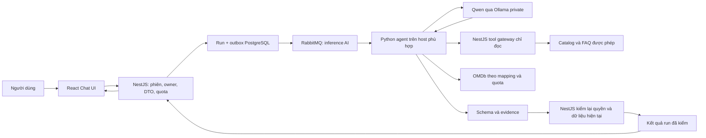

# Các bước xây chatbot đọc dữ liệu pj-Flim

Ngày: 14/11/2026 — Asia/Saigon. Phiên bản: 1.0. Trạng thái: **KẾ HOẠCH TÍCH HỢP WEBSITE — chưa code trong lượt này**.

Liên quan: [plan agent](movie-ai-agent-plan.md), [plan chính](movie-streaming-platform-plan.md), [PoC Colab/OMDb](../../apps/agent/README.md). Đây là các bước triển khai tiếp từ PoC, không xác nhận chatbot đã hoạt động trên website.

## 1. Kết quả cần đạt và hiện trạng

Chatbot trả lời tiếng Việt bằng dữ liệu của pj-Flim: tìm phim, nội dung/thể loại/diễn viên có sẵn, phim tương tự, tập/mùa đang xem được, FAQ sử dụng website. Khi có cấu hình và quyền phù hợp, trả điểm IMDb/Metascore qua OMDb. Câu trả lời có cards/link nội bộ và nguồn; thiếu dữ liệu thì hỏi rõ hoặc nêu chưa có.

Ví dụ: “Có phim khoa học viễn tưởng nào?”, “Phim này có những tập nào?”, “Cách đổi chất lượng video?”, “Điểm IMDb của phim đó?”. Các thuộc tính như độ dài/năm/quốc gia chỉ dùng khi schema và dữ liệu thật có; không suy diễn từ model.

| Thành phần | Hiện đã có | Cần làm tiếp |
| --- | --- | --- |
| Website | React/Vite, catalog/detail/player/help | Giao diện chat, trạng thái run, nguồn, follow-up |
| Backend | NestJS, auth/RBAC, public catalog, thư viện cá nhân, content-v1 | DTO/controller/service assistant, ownership/quota/run state và gateway tool |
| Python | Bounded tool loop, snapshot, E5/FAISS, evidence, OMDb adapter | Adapter đọc backend live, internal service/consumer và lifecycle |
| Model | Thiết kế Qwen2.5:7b/Ollama, notebook bootstrap/smoke | Chưa nghiệm thu model/embedding thật và host phục vụ website |
| Dữ liệu ngoài | OMDb lookup PoC qua mapping verified | Key/coverage live, policy, mapping/cache/quota dùng chung phía server |
| Hàng đợi | RabbitMQ cho media đã có | Queue/consumer/indexing AI riêng; chưa được nối |
| Kiểm thử | 74 Python contracts với fixtures, static notebook đã kiểm ở lượt trước | Backend/UI/model thật, nguồn live, lỗi/quyền/load và vận hành |

Không dùng số kiểm tra PoC làm bằng chứng E2E website. Redis hiện chưa tích hợp; không thiết kế MVP phụ thuộc Redis sẵn có.

## 2. Kiến trúc chọn cho website

- NestJS sở hữu phiên đăng nhập, quyền, dữ liệu hiện tại, run và kết quả cuối. Python chỉ nhận run ID/capability nội bộ có scope/hạn; không nhận JWT browser hoặc DB password.
- LLM chọn công cụ, còn backend thực hiện truy vấn bằng tham số và quy tắc cố định. Không cấp tool SQL/shell/browser tùy ý cho model.
- Dùng RAG để lấy đoạn phù hợp tại thời điểm hỏi; structured facts/catalog đi qua tool, FAQ được phép đi qua retrieval. Không cần fine-tune model để cập nhật danh sách phim.
- MVP dùng POST trả202 và GET polling; SSE/progress bổ sung sau. Thao tác phát video vẫn qua playback API hiện có, không đưa signed URL vào prompt.
- Colab dùng thử nghiệm tương tác/snapshot/benchmark. Dịch vụ website đặt trên host có tài nguyên và kết nối ổn định được chọn sau benchmark; không dùng Colab free làm API/queue worker thường trực. [Colab FAQ](https://research.google.com/colaboratory/faq.html).

## 3. Ranh giới dữ liệu chatbot được đọc

| Dữ liệu | Nguồn và cách đọc | Scope |
| --- | --- | --- |
| Tên/năm/loại/nội dung/genres/credits | PublicCatalogService và DTO đã whitelist | Chỉ phim hiện public/playable; không trả toàn bộ row |
| Mùa/tập/thời lượng có thật | Public catalog services | Kiểm lại publication và asset theo nghiệp vụ hiện hành |
| FAQ/hướng dẫn player/tài khoản | Tài liệu public được biên tập, version theo bản ứng dụng | Chỉ đoạn cho người xem; không lấy tài liệu nội bộ/admin |
| Điểm IMDb/Metascore | OMDb adapter qua verified mapping | Có nguồn/thang điểm/fetchedAt; thiếu→null; không suy điểm TMDB |
| Watchlist/gợi ý cá nhân | Library/Recommendations service của owner | Giai đoạn sau, có opt-in; backend lấy owner từ phiên |
| User/admin/audit/token/credential | Không đưa vào tool catalog hoặc index public | Không gửi sang model hoặc Colab |
| Giá/gói/ưu đãi/lịch chiếu chưa có nghiệp vụ | Chưa có nguồn dữ liệu được xác minh | Trả chưa có dữ liệu, không tự bịa tính năng |

“Đọc dữ liệu web” là lấy dữ liệu mà backend cho phép. Tái sử dụng nghiệp vụ public trong [viewer.controllers.ts](../../apps/api/src/controllers/viewer.controllers.ts) và [public-catalog.service.ts](../../apps/api/src/services/public-catalog.service.ts); không tự query bảng admin hoặc crawl toàn bộ HTML website.

## 4. Trình tự triển khai

| Bước | Làm cụ thể | Đầu ra để kiểm | Ticket liên quan |
| --- | --- | --- | --- |
| 1 | Chốt câu hỏi, scope đăng nhập, dữ liệu public/private và bộ đánh giá | Bộ câu hỏi có expected IDs/facts/nguồn và cases thiếu dữ liệu | AG01 |
| 2 | Nghiệm thu Qwen/E5 trên Colab, sau đó chọn host inference website | Report model digest/GPU/VRAM/tool/JSON, cold-warm timing, cấu hình vừa tài nguyên | AG02/AG15 |
| 3 | Xây data contract và gateway đọc dữ liệu hiện tại | DTO search/detail/episodes/help whitelist, chỉ đọc và có version | AG03/AG04/AG06 |
| 4 | Thêm run state/outbox/lease/quota và service identity | Migration/grants đã review, transaction/idempotency, queue inference riêng | AG03/AG06 |
| 5 | Làm index catalog/FAQ và đồng bộ khi dữ liệu đổi | Hybrid search, manifest/generation/content hash/tombstone, rebuild/purge | AG04/AG13/AG16 |
| 6 | Chuyển tools snapshot sang adapter backend live | Bộ tool allowlist, bounded parameters, freshness/permission cho từng call | AG05/AG06 |
| 7 | Làm luồng trả lời tiếng Việt có evidence | Schema result, cards/link, NEEDS_INPUT/EMPTY, renderer từ facts | AG05/AG12 |
| 8 | Viết REST API assistant và Swagger | Create/list/read/cancel run, DTO/controller/service tách riêng, safe errors | AG06 |
| 9 | Viết React Chat UI và nối backend | Gửi/chờ/đọc kết quả/hủy/lỗi, cards/nguồn, keyboard/mobile | AG09 |
| 10 | Thêm hội thoại ngắn và ngữ cảnh trang đang mở | parentRunId owner-bound, memory hữu hạn, refetch dữ liệu mỗi lượt | AG05/AG06/AG09 |
| 11 | Nối OMDb và cá nhân hóa có opt-in | Source cache/quota/mapping phía server; context cá nhân đúng owner | AG07/AG08/AG13 |
| 12 | Chạy E2E/model thật, failure/security/load rồi mở dần | Report phạm vi đạt, kill switch/rollback/runbook, không ảnh hưởng playback | AG11/AG14 |

Các bước là kế hoạch; không thêm ticket DONE chỉ vì viết tài liệu. Có thể chuẩn bị contract/test cases ở bước1/3 trong khi chờ tài nguyên bước2; chỉ nghiệm thu inference khi model thật đạt. Bước11 là mở rộng sau chatbot catalog/FAQ, không chặn MVP vì thiếu key OMDb.

### Bước 1–2: phạm vi và baseline model

- MVP cho tài khoản ACTIVE đã đăng nhập, dùng auth hiện hành. Khách chưa đăng nhập tiếp tục tìm catalog public; guest chat là giai đoạn sau, stateless/public-only và quota riêng.
- Bắt đầu bộ khoảng50câu hỏi do người kiểm gán nhãn: tên Việt/gốc/không dấu, mô tả ý định, filter, tên mơ hồ, FAQ, thông tin thiếu, phim đã gỡ, prompt injection, follow-up.
- Chạy notebook đến smoke tiếng Việt/tool calling/JSON, E5 retrieval và checkpoint; ghi digest/version/tài nguyên thật. Chưa đạt thì sửa cấu hình trước khi tích hợp UI.
- Host website phải giữ model/index riêng, health/readiness và giới hạn concurrency. Không hứa7B luôn vừa GPU hoặc trả dưới2giây.
- Giữ LangChain/ChatOllama và bounded loop hiện có; không đổi framework chỉ để có tên “agent”. [ChatOllama](https://docs.langchain.com/oss/python/integrations/chat/ollama).

### Bước 3–4: data contract, run và hàng đợi

Data contract search nhận q/filter/topK đã validate, trả titleId/name/year/kind/genres/synopsis excerpt/evidence refs. Detail nhận titleId; season/episode nhận entity ID và limit. Help nhận query/lang/topic allowlist.

Mỗi evidence có sourceType/sourceId/entityId hoặc documentId, version/contentHash, retrievedAt và field/chunk đã trả. Không trả account, raw database row, asset ref, credential hoặc signed delivery URL.

NestJS dùng lại eligibility trong public catalog, bổ sung internal gateway xác thực service ở private route/network. Tool request chỉ mang runId/generation/tool/args; NestJS đọc owner và allowed scopes từ run, không tin userId/role từ model/Python. Kiểm session/revocation khi create, claim, tool call và trước trả kết quả.

Migration dự kiến giữ assistant_runs/assistant_run_steps/ai_index_snapshots/ai_index_documents theo plan agent. Trước code đối chiếu schema50bảng hiện có, tránh dùng baseline47 như database thực tế. Ghi run+outbox cùng transaction, cursor/list theo owner, input/result có retention. Query service chỉ cần grants cho nghiệp vụ, không cấp quyền DB rộng cho Python.

Tạo queue AI inference/indexing/source riêng với media; message chỉ mang refs/version, không prompt/secret. Claim lease + generation, ACK sau ghi bền, retry lỗi tạm có backoff/jitter, DLQ và giới hạn queue. Local concurrency khởi đầu1 để đo; không coi broker local là HA.

### Bước 5: index và đồng bộ dữ liệu

- Catalog: một document/phim chứa metadata tối thiểu, có ID và version. Keyword phục vụ tên/alias/credits; E5 multilingual phục vụ ý định.
- FAQ: đoạn theo mục/ngữ nghĩa, điểm xuất phát khoảng300–500token và overlap nhỏ; lưu docId/heading/version/URL nội bộ. Đo và điều chỉnh theo corpus/tokenizer; không cắt bừa HTML hoặc index secret trong tài liệu dev.
- FAISS CPU cho lần đầu; L2 normalization và prefix query:/passage: theo PoC. RRF kết hợp keyword/semantic, topK nhỏ. Không đổi sang Chroma/pgvector khi chưa có nhu cầu vận hành và migration.
- Backend xác định eligible IDs **trước top-K**; FAISS chỉ tìm trên subset hợp lệ. Không truy toàn index rồi lấy5phim và mới bỏ draft sau cùng.
- Publish/update/unpublish tạo event qua outbox; indexing worker cập nhật contentHash/generation. Gỡ phim tạo tombstone/suppression ngay, tiến trình rebuild không được khôi phục nội dung đã bị gỡ.
- Index là dữ liệu dẫn xuất. Trước tool output và trước final render vẫn kiểm nguồn hiện tại; stale index không tự cấp quyền đọc.
- Chuẩn bị baseline keyword-only và hybrid trên cùng bộ câu hỏi; lưu recall@K/nDCG bằng expected IDs. Không tự tuyên bố95% chính xác.

RAG bổ sung dữ liệu tìm được tại thời điểm hỏi vào ngữ cảnh model; database có sẵn có thể cung cấp qua tool mà không cần sao chép toàn bộ thành vector. [LangChain retrieval](https://docs.langchain.com/oss/python/deepagents/retrieval).

### Bước 6–7: tools và thuật toán trả lời

| Tool website dự kiến | Đầu vào | Bảo đảm phía backend |
| --- | --- | --- |
| search_catalog | q, kind/genre/year/country, limit | Filter/type/range hợp lệ, public/playable, min fields |
| get_title_details | titleId | Recheck eligibility/version, không raw row |
| get_published_episodes | titleId/seasonId, limit | Mùa/tập public, thứ tự/metadata thật |
| search_help | q/topic/lang, limit | Chỉ tài liệu public được biên tập |
| get_imdb_metacritic_ratings | titleId | Mapping verified/quota/policy/nullable/source; nguồn server |
| get_personalized_candidates | Không nhận ownerId | Chỉ sau opt-in; owner từ run/session |

Hai tool cuối mở ở bước11. Bộ tool snapshot hiện chưa có episodes/help/live adapters; phải triển khai và test riêng. LLM không nhận fetch URL, raw SQL hoặc quyền gọi admin endpoints.

Luồng một câu hỏi:

1. Validate input, xác định ngữ cảnh trang/follow-up được phép và scope của owner.
2. Chọn nhánh catalog/facts/episodes/help/ratings. Câu hỏi mơ hồ thì NEEDS_INPUT với options có ID/nguồn; không chọn bừa phim trùng tên.
3. Retrieve/topK đã lọc; gọi tool cần thiết, lấy evidence vào registry của lượt.
4. Qwen chọn phim/facts/source refs theo schema; dữ liệu nguồn là untrusted data, không được đổi system prompt/tool list.
5. Validator kiểm ID, evidence cùng entity, scope, kiểu/số/thang điểm và version. Không có thông tin thì EMPTY hoặc nêu chưa có.
6. Backend kiểm lại quyền/publication/generation; nguồn vừa đổi thì loại bỏ/tạo lại run theo AGENT_CONTEXT_CHANGED. Không trả prose cũ còn nhắc phim bị gỡ.
7. Dựng câu tiếng Việt từ facts bằng template cho MVP, kèm cards/nguồn và link nội bộ từ ID đã kiểm. Với FAQ, hiển thị đoạn trích ngắn/heading có dẫn nguồn.
8. Ghi kết quả bền và kết thúc run; client đọc kết quả đã kiểm.

Giữ budget bắt đầu từ PoC: tối đa4model calls/6tool calls/lượt,1schema repair, provider calls hữu hạn; deadline120s là cấu hình thử cần đo trên host thật. Cancellation phối hợp ở boundary từng bước và fencing kết quả; client read timeout không tự dừng inference hoặc hoàn tác lời gọi đã gửi.

PoC hiện không cho model prose tự do. Sau khi MVP facts/FAQ được nghiệm thu mới thử câu diễn giải do model sinh, có schema claims/evidence, bộ test hallucination và fallback template. Không giả có thể kiểm đầy đủ tính đúng đắn của văn bản chỉ bằng regex.

### Bước 8: REST API và Swagger

Tái sử dụng namespace assistant/runs ở plan agent; không tạo route chatbot song song cho cùng một nghiệp vụ.

| API dự kiến | Vai trò |
| --- | --- |
| POST /api/v1/assistant/runs | Tạo run,202+Location, Idempotency-Key bắt buộc |
| GET /api/v1/assistant/runs | Danh sách của owner, cursor ràng buộc scope |
| GET /api/v1/assistant/runs/:id | Trạng thái/kết quả của owner |
| DELETE /api/v1/assistant/runs/:id | Hủy run có tính idempotent; không đồng nghĩa xóa lịch sử |

Input gồm message, filters/limit, avoidSpoilers, optional contextTitleId/parentRunId; backend kiểm lại mọi ID. Không nhận userId/role/model/key/SQL/history roles từ browser. Bổ sung DTO trong dto/, controller trong controllers/, service/transaction trong services/; không trộn Python tool với HTTP controller.

Result gồm status/answer/cards/sourceRefs/warnings và safe version metadata; thêm loại FAQ/NEEDS_INPUT trong contract, không ép mọi câu trả lời thành danh sách phim. Dùng GlobalExceptionFilter, Problem Details, requestId/retryable và mã hiện có đúng nghĩa; chỉ đăng ký mã agent mới khi code thật.

Sau202, lỗi xử lý nằm trong run FAILED/TIMED_OUT với safe error, GET run vẫn200; không trả HTTP504 như thể request create còn mở. API auth/validation/quota thất bại ngay dùng401/403/422/429 tương ứng. Swagger có DTO/auth/headers/success/error examples khi triển khai; local Swagger mở không làm endpoint agent thành public.

### Bước 9–10: Chat UI và memory hội thoại

- Component chat riêng: nút mở, danh sách tin nhắn, ô nhập, ví dụ câu hỏi, gửi/dừng và kết quả. Có focus/keyboard/IME, loading, empty/need-input/error, mobile và text wrap.
- Tạo run rồi poll có backoff/jitter/timeout tối đa; dùng AbortController và request generation, dừng polling khi terminal/unmount/logout. Abort fetch không thay API cancel, nút Dừng phải gửi cancel.
- Hiển thị câu trả lời, cards, source và thời điểm; nút Xem mở route hợp lệ. Link/source/model text qua allowlist/plain text; không dangerouslySetInnerHTML.
- Nhận contextTitleId từ trang detail/watch để hiểu “phim này”; backend kiểm ID và chỉ dùng metadata public. Không gửi URL video/token hay trạng thái player riêng tư tự động.
- Parent run chỉ từ owner, chưa hết retention và thuộc scope hiện tại. Lưu tối đa khoảng5lượt liên quan làm điểm xuất phát, có token budget; lưu entity IDs/intent, refetch facts mỗi lượt. Server không tin history từ client.
- Xóa/đóng phiên/đổi tài khoản không hiển thị conversation cũ; late response bị bỏ theo generation. Query/cache private không dùng chung owner.
- Retention thô gợi ý7ngày và context hoạt động24giờ, cấu hình và thông báo trước phát hành; tài liệu/source có policy ngắn hơn thì áp hạn ngắn hơn. Xóa lịch sử cần API/hành vi purge riêng sau thiết kế, không dùng DELETE cancel để quảng bá đã xóa.
- SSE chỉ thêm sau baseline polling; stream progress an toàn, không phát raw tool data/chưa validate. Với bearer token hiện tại cần client fetch stream/transport phù hợp, không đưa JWT vào query URL. [MDN SSE](https://developer.mozilla.org/en-US/docs/Web/API/Server-sent_events/Using_server-sent_events).

### Bước 11: OMDb và cá nhân hóa

Port adapter OMDb đã có sang service/server gateway có policy và receipt/cache/quota dùng chung. Cache1giờ/900requests của một client notebook không phải bộ đếm toàn tài khoản/ngày; server nhiều replica phải phối hợp quota bền (DB trước vì chưa Redis), xử lý429/Retry-After và cap số lần thử.

Mapping IMDb ID phải được đối chiếu; giữ IMDb/10 khác Metascore critic/100, N/A/null. Key trong secret store phía server; chặn log URL query có apikey, không gửi vào prompt/browser. Nguồn không có dữ liệu thì catalog vẫn trả bình thường.

Cá nhân hóa chỉ sau opt-in; tái sử dụng owned candidates và content-v1 hiện hành qua Recommendations service, không gọi thuật toán đó là LLM đã học. Cung cấp thể loại/sở thích tổng hợp tối thiểu; kiểm owner/revocation và tắt opt-in giữa run. Không gửi raw lịch sử xem lên Colab hoặc search engine.

### Bước 12: nghiệm thu và vận hành

| Nhóm kiểm | Trường hợp bắt buộc |
| --- | --- |
| Catalog/facts | Tên Việt/không dấu/alias, filter/năm, phim trùng tên, metadata thiếu, không khớp thì EMPTY/NEEDS_INPUT |
| Freshness | Gỡ phim/đổi asset/đổi FAQ khi run đang chạy, index cũ/rebuild/suppression |
| Auth/ownership | Owner khác, revoked/logout/đổi role giữa run, private context/opt-in, direct internal endpoint |
| Model/tools | Model thật tool/JSON, invalid arguments, prompt injection, bogus ID/evidence, loop/budget/timeout/cancel |
| Providers | Thiếu key, mapping sai, N/A/invalid score, quota429/schema thay đổi, cache/key redaction |
| UI/E2E | Gửi→202→poll→answer, NEEDS_INPUT/follow-up, mobile/keyboard, mạng chậm/abort/late response và stop |
| Operations | Broker/worker/model down, outbox replay, lease/fencing, duplicate jobs, queue bound, cleanup/retention |
| Quality/load | Retrieval metric theo nhãn, grounded facts, p50/p95/cold-warm/concurrency trên cấu hình thật, tác động playback |

Đặt ngưỡng chất lượng/latency sau baseline, trước rollout. Các deny-case và không bịa ID/điểm/nguồn phải đạt; không dùng mock pass thay model thật. Mở feature flag nội bộ→nhóm thử nhỏ→mở rộng, có kill switch, readiness, dashboard/log safe runId/requestId/tool/status/version/timing. Log không prompt/raw review/credential mặc định; không chain-of-thought.

## 5. Mốc bàn giao và thứ tự code

1. **Mốc A — truy vấn dữ liệu web:** bước1/3/4/5/6/7/8 + baseline model bước2. Đầu ra kiểm qua API; chưa phụ thuộc Chat UI.
2. **Mốc B — chatbot catalog/FAQ:** bước9/10 và các gate bước12. Có thể hỏi từ web, trả lời facts/FAQ và follow-up ngắn có nguồn.
3. **Mốc C — nguồn ngoài/cá nhân hóa:** bước11, test và rollout theo quyền nguồn/owner; không chặn Mốc B vì chưa có OMDb key.

Khi được yêu cầu bắt đầu code, ưu tiên data contract/gateway và run migration/DTO/service trước UI. Tái sử dụng PoC agent, không coi snapshot24giờ là dữ liệu live của website. Mỗi mốc chỉ DONE khi code và bằng chứng đúng phạm vi đạt; phiên lập kế hoạch này không đổi trạng thái AG/EXT/REC/ENC/ST.

## 6. Tài liệu đối chiếu

- [Plan agent, API/DB/queue và AG01–AG16](movie-ai-agent-plan.md).
- [PoC Colab/OMDb và giới hạn nghiệm thu](../../apps/agent/README.md).
- [Public catalog service](../../apps/api/src/services/public-catalog.service.ts), [viewer controllers](../../apps/api/src/controllers/viewer.controllers.ts), [recommendations service](../../apps/api/src/services/recommendations.service.ts).
- [LangChain retrieval](https://docs.langchain.com/oss/python/deepagents/retrieval): dùng kiến thức có sẵn qua truy vấn/tool và context; không phải quyết định đổi sang Deep Agents.
- [LangChain agents](https://docs.langchain.com/oss/python/langchain/agents): vòng lặp model/tool và harness.
- [ChatOllama](https://docs.langchain.com/oss/python/integrations/chat/ollama), [FastAPI deployment](https://fastapi.tiangolo.com/deployment/): thành phần để thử và đóng gói, không chứng minh model/service đã chạy.
- [Colab FAQ](https://research.google.com/colaboratory/faq.html), [SSE](https://developer.mozilla.org/en-US/docs/Web/API/Server-sent_events/Using_server-sent_events): giới hạn vận hành và transport khi thêm streaming.
