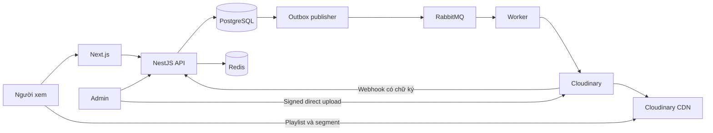

# Kế hoạch hoàn chỉnh: Web xem phim với Node.js và Cloudinary

Ngày lập: 08/11/2026, múi giờ Asia/Saigon. Phiên bản: 1.0.

Đây là kế hoạch triển khai sản phẩm mới, tổng hợp các quyết định và phương án khắc phục đã thống nhất trong trao đổi. Những biện pháp dưới đây là yêu cầu thiết kế và nghiệm thu; chưa phải báo cáo đã sửa hoặc kiểm thử ứng dụng. Tài liệu được lưu trong workspace DocPrep hiện tại để tham khảo khi xây dự án web phim riêng.

## 1. Mục tiêu và phạm vi

Xây web xem phim theo yêu cầu (VOD) có trải nghiệm quen thuộc: trang chủ nền tối, poster, banner, danh mục, tìm kiếm, chi tiết phim, chọn tập, phát HD và xem tiếp. Hỗ trợ phim lẻ và phim bộ, responsive trên điện thoại và máy tính. Nội dung sử dụng nguồn được phép phân phối.

Quyết định sản phẩm:

- MVP cho khách duyệt, tìm kiếm và xem nội dung miễn phí đã xuất bản; tài khoản dùng để đồng bộ lịch sử, yêu thích và đánh giá.
- Admin quản lý phim, mùa/tập, video, phụ đề, banner và trạng thái xuất bản.
- Cloudinary lưu video, poster, trailer; xử lý các bản phát và phân phối bằng CDN.
- Backend Node.js/NestJS quản lý nghiệp vụ; RabbitMQ điều phối tác vụ nền; Redis phục vụ cache và giới hạn request.
- Phim chính phát HLS nhiều chất lượng đến tối đa 1080p khi nguồn và gói Cloudinary đáp ứng. Player mặc định Auto, có chọn chất lượng thủ công.
- Bổ sung VIP, thanh toán, nhiều hồ sơ và gợi ý hành vi sau MVP. Không cần microservices, 4K, live stream hoặc DRM cho phiên bản đầu.
- Giao diện tham khảo cách bố trí quen thuộc của các nền tảng xem phim; thiết kế thương hiệu và tài sản giao diện riêng.

Luồng sản phẩm phải hoàn chỉnh: tạo tập → upload → xử lý → xem thử → xuất bản → tìm phim → xem → tiếp tục xem.

## 2. Công nghệ và trách nhiệm

| Thành phần     | Lựa chọn                                    | Trách nhiệm                                                         |
| -------------- | ------------------------------------------- | ------------------------------------------------------------------- |
| Frontend       | Next.js App Router, React, TypeScript       | Trang công khai render phía server; player và tương tác phía client |
| Giao diện      | Tailwind CSS, shadcn/ui                     | Responsive, dark mode, bàn phím và trạng thái loading/error         |
| Dữ liệu client | TanStack Query                              | Cache dữ liệu tương tác, mutation, hủy request cũ                   |
| Backend        | Node.js bản LTS còn hỗ trợ, NestJS          | REST API, quyền truy cập, upload intent, phiên phát                 |
| Database       | PostgreSQL, Prisma                          | Nguồn dữ liệu chính, migration, transaction và index                |
| Tìm kiếm       | PostgreSQL pg_trgm, tên chuẩn hóa           | Tìm tên gần đúng và không dấu cho MVP                               |
| Cache          | Redis                                       | Cache danh mục, rate limit, lease phiên phát nếu cần                |
| Hàng đợi       | RabbitMQ, Node client hỗ trợ confirms       | Tác vụ media, tìm kiếm, thông báo và đối soát                       |
| Media          | Cloudinary Node.js SDK và CDN               | Upload, eager processing, HLS, poster, trailer                      |
| Player         | HTML5 video, hls.js; HLS native khi phù hợp | ABR, buffer, tua, phụ đề, sự kiện chất lượng phát                   |
| Quan sát       | Log JSON, OpenTelemetry, hệ thống thu lỗi   | Theo dõi API, job, webhook và phiên phát                            |
| Kiểm thử       | Jest, Supertest, Playwright, Postman CLI    | Nghiệp vụ, hợp đồng API, hồi quy và end-to-end                      |
| Triển khai     | Docker, reverse proxy, GitHub Actions       | Build, CI, HTTPS, triển khai và rollback                            |

Khóa phiên bản thực tế trong lockfile sau khi thử tương thích. Tách Next.js, API và worker thành tiến trình có thể tăng số bản chạy độc lập. Redis có thể bị xóa cache mà không làm mất lịch sử, trạng thái xử lý hoặc công việc cần thực hiện.

Next.js hỗ trợ Server/Client Components cho cách chia trên. [Tài liệu Next.js](https://nextjs.org/docs/app/getting-started/server-and-client-components)

## 3. Kiến trúc



Backend chia module: Auth, Users, Catalog, Episodes, Media, Playback, Search, History, Watchlist, Ratings, Admin, Jobs, Observability. Dùng modular monolith cho nghiệp vụ và worker riêng cho công việc nền.

Video đi từ Cloudinary CDN đến trình duyệt. API chỉ trả metadata, kiểm tra quyền và quản lý phiên phát. RabbitMQ nhận thông điệp nhỏ chứa định danh và phiên bản; dữ liệu nhị phân video được lưu ở Cloudinary.

Cloudinary hỗ trợ tạo và phân phối adaptive streaming từ video nguồn. [Tài liệu HLS/DASH](https://cloudinary.com/documentation/adaptive_bitrate_streaming)

## 4. Tính năng và giao diện

| Màn hình      | Yêu cầu MVP                                             | Nghiệm thu                                                          |
| ------------- | ------------------------------------------------------- | ------------------------------------------------------------------- |
| Trang chủ     | Banner, phim mới, nổi bật, thể loại, tiếp tục xem       | Không lẫn nội dung chưa xuất bản; poster tải theo vùng nhìn         |
| Danh mục      | Phim lẻ/bộ; lọc thể loại, quốc gia, năm; sắp xếp        | Bộ lọc nằm trong URL, quay lại giữ trạng thái                       |
| Tìm kiếm      | Tên Việt/Anh/tên khác, không dấu, gần đúng              | Có loading, không kết quả, hủy kết quả request cũ                   |
| Chi tiết      | Poster, mô tả, trailer, diễn viên, mùa/tập              | Nút xem trỏ đến tập hợp lệ; trailer chỉ tải khi cần                 |
| Player        | Auto/thủ công, phụ đề, fullscreen, tốc độ, tua          | Đổi chất lượng không reset vị trí; điều khiển dùng được trên mobile |
| Danh sách tập | Tập hiện tại, trước/sau, tự chuyển                      | Đếm ngược có hủy; bỏ qua tập chưa xuất bản                          |
| Tài khoản     | Đăng ký, đăng nhập, xác minh/đặt lại mật khẩu           | Thông báo rõ, token dùng một lần, phiên có thể thu hồi              |
| Cá nhân       | Yêu thích, lịch sử, tiếp tục xem, đánh giá              | Unique theo tài khoản/hồ sơ; không lẫn dữ liệu người khác           |
| Admin         | CRUD phim/tập, upload, tiến độ xử lý, xem thử, xuất bản | Chỉ xuất bản khi asset sẵn sàng; thao tác có audit log              |
| Báo lỗi       | Báo video/phụ đề lỗi kèm tập và mã phiên                | Người dùng không cần cung cấp URL có token                          |

Đường dẫn: `/`, `/movies`, `/series`, `/genres/[slug]`, `/search`, `/titles/[slug]`, `/watch/[episodeId]`, `/my-list`, `/history`, `/account`, `/admin`.

Ảnh có kích thước đúng bố cục, placeholder và lazy loading; không autoplay hàng loạt trailer. Player có focus rõ, nhãn nút, phím tắt không chiếm phím khi đang nhập và phụ đề đọc được trên màn hình nhỏ.

## 5. Upload và xử lý Cloudinary

### 5.1. Upload intent và ràng buộc tài nguyên

1. Admin gọi API tạo upload intent cho tập, ghi owner, asset ID nội bộ, attempt và phiên bản dự kiến.
2. Backend kiểm tra quyền; tự chọn public ID duy nhất, preset, delivery type và tham số được phép; không cho client tự ký transformation tùy ý.
3. Trình duyệt upload trực tiếp bằng signed upload và cơ chế chunked được Cloudinary hỗ trợ. Hiển thị tiến độ, hủy và thử lại; không hứa khôi phục sau khi tải lại trang nếu SDK chưa hỗ trợ và chưa thử nghiệm.
4. API nhận thông báo hoàn tất nhưng kiểm tra tài nguyên phía provider trước khi gắn vào tập: định danh, resource type, intent, phiên bản, dung lượng và thời lượng thực tế.
5. Giới hạn file bằng preset/cấu hình provider phù hợp; kiểm tra lại metadata sau upload. Chữ ký không thay thế kiểm tra dung lượng và sở hữu tài nguyên.
6. Không tin URL hoặc MIME do trình duyệt gửi. Backend không tải tùy ý URL đầu vào. Từ chối tài nguyên không thuộc intent; đưa upload lỗi vào danh sách dọn có thời gian chờ.

Cloudinary hỗ trợ upload trực tiếp có chữ ký và chunked upload cho video lớn. [Tài liệu Node.js upload](https://cloudinary.com/documentation/node_image_and_video_upload)

### 5.2. Trạng thái và chuyển mã

```text
Asset: PENDING_UPLOAD → UPLOADING → UPLOADED → PROCESSING → READY
                              └→ FAILED          └→ FAILED
Lifecycle: ACTIVE → DELETING → DELETED
Publication: DRAFT → PUBLISHED → UNPUBLISHED → ARCHIVED
```

- Trạng thái upload phía UI mang tính tiến độ; backend xác nhận nguồn dữ liệu đáng tin trước khi chuyển `UPLOADED`.
- Ghi thay đổi asset và sự kiện `media.processing.requested` vào cùng transaction PostgreSQL/outbox.
- Worker yêu cầu profile HLS xác định trước, dùng eager asynchronous processing và URL webhook. Lưu cấu hình, request/attempt và danh tính đầu ra; không tạo lại vì người dùng bấm Play.
- Webhook upload thành công không được coi là webhook chuyển mã thành công. Chỉ đặt `READY` khi các đầu ra bắt buộc đã thành công và được kiểm tra khả năng truy cập theo chính sách phát.
- Đầu ra của attempt cũ hoặc asset đang xóa không được ghi đè attempt hiện tại. Thay trạng thái bằng điều kiện phiên bản trong transaction.
- Không tự công khai khi nhận webhook; admin xem thử rồi xuất bản. Có tác vụ phát hiện video xử lý lâu và kiểm tra lại provider.

Cloudinary hỗ trợ eager transformations chạy bất đồng bộ và thông báo khi đầu ra hoàn tất. [Tài liệu eager processing](https://cloudinary.com/documentation/eager_and_incoming_transformations)

### 5.3. Webhook bền vững

- Endpoint HTTPS giữ raw body để xác minh chữ ký bằng SDK, kiểm tra timestamp theo cửa sổ cấu hình và yêu cầu chống replay.
- Lưu event vào inbox bền vững trước khi trả `200`. Nếu chưa lưu được thì trả lỗi để provider có thể retry.
- Dùng ID sự kiện nếu có; nếu không, tạo khóa dedup từ thông báo đã xác minh, định danh asset/attempt và loại/kết quả sự kiện. Consumer kiểm tra trạng thái nghiệp vụ để chống xử lý trùng cả khi timestamp thay đổi.
- Inbox và outbox cho phép nhận webhook khi RabbitMQ tạm ngừng. Job xử lý inbox chỉ cập nhật đúng attempt hiện hành.
- Mỗi 5 phút quét attempt đang chờ quá lâu, giới hạn tốc độ gọi Admin API và tăng khoảng chờ khi provider báo giới hạn. Quá ngưỡng SLA xử lý đã đo cho kích thước tương ứng thì cảnh báo admin.
- Webhook lỗi nghiệp vụ được giữ để xử lý lại; không yêu cầu provider retry vô hạn cho payload đã lưu.

Cloudinary ký webhook và retry hữu hạn; job đối soát xử lý trường hợp thông báo không được nhận. [Tài liệu notifications](https://cloudinary.com/documentation/notifications)

## 6. Phát video, HD và giảm dữ liệu truyền

### 6.1. Luồng phát

1. Player gọi `POST /episodes/:id/playback-sessions`.
2. Backend kiểm tra trạng thái xuất bản, asset `READY`, tài khoản/quyền nếu nội dung yêu cầu và giới hạn phiên nếu được bật.
3. Trả phiên phát, manifest đúng phiên bản, cách xác thực và thời hạn nếu áp dụng; response cấp quyền dùng `Cache-Control: no-store`.
4. Player lấy master playlist, media playlist rồi segment trực tiếp từ Cloudinary CDN.
5. Trình duyệt giải mã; player tải trước trong giới hạn buffer, chọn chất lượng và ghi sự kiện chất lượng phát.
6. Khi tua, tải segment của mốc cần xem; khi đổi tập, hủy request cũ và giải phóng player. Lưu tiến độ riêng qua API.

### 6.2. Cấu hình HD ban đầu

| Mức   | Bitrate video tham khảo cho H.264 | Quy tắc                       |
| ----- | --------------------------------- | ----------------------------- |
| 360p  | 0,6–0,9 Mbps                      | Mạng yếu                      |
| 480p  | 1–1,5 Mbps                        | Mức dự phòng                  |
| 720p  | 2–3 Mbps                          | HD phổ biến                   |
| 1080p | 4–6 Mbps                          | Khi nguồn và thiết bị phù hợp |

Đây là giá trị thử nghiệm, không phải bitrate cố định cho mọi phim hoặc cấu hình mặc định của Cloudinary. Bổ sung audio phù hợp, thường bắt đầu thử AAC stereo 128 kbps. Không nâng FPS hoặc upscale chỉ để có nhãn chất lượng cao.

- Bắt đầu H.264/AAC và profile HLS được tạo trước; kiểm tra manifest thực tế có đúng mức mong muốn.
- Với profile cho phép điều chỉnh, thử segment 4–6 giây và căn keyframe; xác minh khả năng cấu hình của Cloudinary thay vì coi mọi tham số FFmpeg đều có sẵn.
- Auto là mặc định. Ước lượng tốc độ tải có làm mượt; chọn bitrate với dư địa an toàn, hạ nhanh khi buffer thấp và tăng khi ổn định. Dùng ABR sẵn có của player, đo trước khi chỉnh thuật toán.
- Buffer phía trước thử 30 giây, back buffer 30 giây; kiểm soát cả dung lượng và giới hạn thiết bị. Đây là mục tiêu tải trước, không phải thời gian phải đợi để bắt đầu.
- Khi người xem khóa 1080p mà mạng không đủ, hiển thị gợi ý chuyển Auto; không âm thầm báo 1080p trong khi phát mức khác.
- Tua/đổi chất lượng giữ timeline; không tái tạo player cho mọi thay đổi giao diện. Retry có giới hạn, tránh vòng lặp reload toàn bộ video.

HLS có thể dùng native hoặc hls.js theo khả năng trình duyệt. [Tài liệu hls.js](https://github.com/video-dev/hls.js)

### 6.3. Tối ưu dung lượng

- Tạo bản mã hóa theo độ phức tạp từng phim trong khả năng profile provider; kiểm tra cảnh tối, chuyển động, grain và khuôn mặt. Không hứa giữ nguyên chất lượng ở mọi mức giảm bitrate.
- Dùng bộ mẫu và VMAF khi pipeline đo hỗ trợ; kết hợp xem bằng mắt. Các chỉ số chất lượng cần được so sánh trên cùng nguồn và cấu hình hiển thị.
- AV1/HEVC là bước sau: thử hỗ trợ thực tế của tài khoản Cloudinary, player và hardware decode; có H.264 dự phòng. Không bật codec mới toàn bộ catalog chỉ dựa vào khả năng parse codec của trình duyệt.
- Trailer MP4 có thể dùng `q_auto`/`f_auto` phù hợp. HLS dùng profile đã nghiệm thu; không ghép tham số tối ưu tùy tiện nếu chưa xác nhận provider hỗ trợ.
- Chỉ tải audio được chọn và phụ đề cần dùng; phụ đề WebVTT UTF-8, không tạo video riêng cho mỗi ngôn ngữ khi không cần.
- Tắt tải video ngoài màn hình, hạn chế prefetch tập tiếp theo và hủy tải khi rời trang.
- Brotli/gzip cho JS, CSS, JSON và playlist văn bản khi hệ thống phân phối hỗ trợ; không trông đợi nén HTTP thêm cho segment video đã nén.

`q_auto` và chọn kích thước phù hợp là các công cụ tối ưu Cloudinary cung cấp. [Tài liệu tối ưu video](https://cloudinary.com/documentation/video_optimization)

### 6.4. Chính sách lỗi player

| Loại lỗi             | Hành động                                                                      |
| -------------------- | ------------------------------------------------------------------------------ |
| Mất mạng/timeout     | Giữ vị trí, retry backoff có giới hạn; khi mạng trở lại cho tiếp tục           |
| 401/403 do hết hạn   | Gia hạn một lần theo phiên, kiểm tra lại quyền; giữ vị trí, không retry vô hạn |
| 404 manifest/segment | Báo lỗi nội dung, gửi chẩn đoán; không tự chọn asset cũ khác phiên bản         |
| Codec/giải mã        | Thử nguồn tương thích đã cấu hình hoặc thông báo thiết bị chưa hỗ trợ          |
| Buffer cạn liên tục  | Auto hạ chất lượng; chế độ khóa chất lượng hiển thị gợi ý                      |
| Autoplay bị chặn     | Bắt lỗi `play()`, hiện nút Phát/Phát tiếp                                      |

Trình duyệt có chính sách chặn autoplay có âm thanh; thao tác tự chuyển tập phải có phương án nút phát. [Tài liệu autoplay](https://developer.mozilla.org/en-US/docs/Web/Media/Guides/Autoplay)

## 7. Quyền xem và bảo mật

### 7.1. Chính sách media

| Loại nội dung              | Chính sách                                                                                                        |
| -------------------------- | ----------------------------------------------------------------------------------------------------------------- |
| Poster/trailer công khai   | Delivery công khai, transformation được kiểm soát                                                                 |
| Video tập chưa xuất bản    | Dùng phương thức hạn chế truy cập đã thử nghiệm; chỉ cấp cho admin                                                |
| Video miễn phí đã xuất bản | API chỉ cấp thông tin phát cho bản đã xuất bản; chấp nhận khả năng chia sẻ link đã được cấp theo mô hình miễn phí |
| VIP sau MVP                | Token/cookie có hạn, phạm vi đúng tài nguyên, bảo vệ original/manifest/segment                                    |

- Thiết kế thử `authenticated` cho video tập từ khi upload và eager outputs tương ứng; kiểm chứng đầy đủ việc phát HLS trên các trình duyệt trước khi chốt cấu hình production.
- Signed upload xác thực thao tác upload; signed delivery URL xác thực URL; token/cookie có thời hạn giải quyết giới hạn thời gian. Không coi ba cơ chế là một.
- `private` có thể để bản biến đổi công khai; signed URL thông thường có thể được chia sẻ. Token/cookie phụ thuộc gói và cấu hình tài khoản Cloudinary. [Tài liệu access control](https://cloudinary.com/documentation/control_access_to_media)
- Khi triển khai quyền có hạn: cấu hình TTL ban đầu 15 phút và gia hạn trước khoảng 2 phút, thêm jitter và xử lý lệch đồng hồ; tất cả là tham số cần kiểm thử. Cơ chế token phải đi tới cả segment, không chỉ URL manifest.
- Native HLS có hạn chế tùy biến request khác player JS; spike phải chứng minh URL/token/cookie hoạt động trên Safari, CORS và miền phân phối thực tế. Nếu gói chưa đáp ứng, chưa mở VIP.
- Gỡ xuất bản chặn phiên mới ngay; người đã có link/token có thể còn xem đến khi quyền/cache hết hiệu lực. Ghi rõ độ trễ thu hồi; trường hợp cần chặn gấp dùng cơ chế provider phù hợp và kiểm tra lại từ CDN.
- Token hết hạn không xóa dữ liệu đã buffer. Không cam kết ngăn ghi màn hình hoặc sao chép tuyệt đối; DRM là dự án riêng khi có yêu cầu.

### 7.2. Tài khoản và API

- Hash mật khẩu bằng Argon2id; admin bật MFA trước production. Session/refresh token có xoay vòng, thu hồi và phát hiện dùng lại theo thiết kế xác thực.
- Cookie dùng HttpOnly/Secure, SameSite và chống CSRF phù hợp; xác định allowlist CORS cụ thể. Không để API secret, khóa ký token hoặc URL có token trong log client.
- Kiểm tra role và quyền trên tài nguyên ở backend, gồm admin preview, sửa tập, xóa media và đọc lịch sử.
- Rate limit theo loại endpoint và tài khoản/IP; trả `429` rõ ràng. Không rate limit request segment bằng cơ chế API làm cản phát.
- Nội dung bình luận nếu bổ sung phải sanitize, có report/moderation. MVP có thể dùng đánh giá và báo lỗi để giảm phạm vi.
- Log và analytics dùng định danh tối thiểu, có thời hạn lưu; hỗ trợ xóa tài khoản/lịch sử theo chính sách sản phẩm.

## 8. RabbitMQ, outbox và khôi phục lỗi

- Topic exchange `media.events.v1`; các queue riêng cho lệnh media, xử lý kết quả, cập nhật tìm kiếm và thông báo. Mỗi nhóm subscriber độc lập có queue riêng; worker cùng queue chia nhau công việc.
- Thông điệp gồm `eventId`, `schemaVersion`, `assetId`, `attemptId`, `occurredAt`, `traceId`; không chứa file hoặc secret.
- Dùng durable queue, persistent message, publisher confirms và xử lý unroutable message. Production cần chịu lỗi broker dùng quorum queues trên số node phù hợp, thông thường ba node; một node dev không có khả năng HA.
- Outbox publisher đọc event đã commit, gửi broker và chỉ đánh dấu sau confirm. Crash có thể gửi lặp nên consumer dùng inbox/idempotency key cùng transaction ghi kết quả.
- Consumer ACK sau khi lưu bền kết quả bước hiện tại. Với chuyển mã Cloudinary: ACK khi yêu cầu đã được tiếp nhận và ghi trạng thái, hoàn tất dựa vào webhook/đối soát; không giữ delivery chờ chuyển mã hàng giờ.
- Timeout khi gọi provider có thể là kết quả chưa biết: tra cứu asset/attempt/cấu hình trước khi gửi lại, tránh tạo transformation lặp hoặc gắn sai kết quả.
- Retry hữu hạn theo lớp lỗi: mạng/5xx theo lịch 30 giây, 2 phút, 10 phút; 429 theo hướng dẫn provider; sai file/quyền/cấu hình đưa vào failed/DLQ. Lịch là giá trị ban đầu để đo lại.
- Tránh `nack(requeue=true)` lặp nóng. Đưa tác vụ đến hạn vào outbox bằng lịch lưu trong PostgreSQL, rồi publish lại; trạng thái retry không chỉ nằm trong RAM.
- DLQ có màn hình lý do lỗi, thao tác retry có audit và bảo toàn idempotency. Giới hạn concurrency theo API quota và công việc thực tế.
- Chạy reconciler định kỳ để phục hồi outbox/inbox bị kẹt và processing không có kết quả.

RabbitMQ phân biệt publisher confirms và consumer ACK; mất kết nối có thể làm thông điệp được giao lại. [Tài liệu RabbitMQ](https://www.rabbitmq.com/docs/confirms)

## 9. Thuật toán nghiệp vụ

### 9.1. Tìm kiếm tiếng Việt

- Lưu title gốc, title Việt và aliases; trường chuẩn hóa chữ thường, bỏ dấu, `đ` thành `d`, gom khoảng trắng.
- Ưu tiên exact match → prefix → khớp từ → trigram → diễn viên/mô tả. Không áp ngưỡng fuzzy quá thấp cho từ khóa rất ngắn.
- PostgreSQL pg_trgm với GIN/GiST phù hợp truy vấn; unique slug, index trạng thái và filter phổ biến. Dùng EXPLAIN trên dữ liệu kiểm thử.
- Debounce 300 ms, hủy request cũ và bỏ kết quả cũ; phân trang ổn định. Chỉ trả nội dung được phép hiển thị, gồm facets và số đếm.
- Cache từ khóa phổ biến, có TTL và version catalog. Nâng sang search engine riêng khi số đo cho thấy cần.

pg_trgm hỗ trợ độ tương tự chuỗi và index tìm gần đúng. [Tài liệu PostgreSQL](https://www.postgresql.org/docs/current/pgtrgm.html)

### 9.2. Phim tương tự và gợi ý

- Vector nội dung từ thể loại, quốc gia, diễn viên, đạo diễn và từ khóa; cosine similarity giữa các vector khác zero. Thiếu metadata dùng fallback biên tập/phổ biến.
- Tính trước top ứng viên khi metadata thay đổi hoặc qua job; lọc lại trạng thái xuất bản/quyền khi trả về.
- Gợi ý theo title, không liệt kê nhiều tập của cùng bộ. Giới hạn lặp thể loại và trộn nội dung mới.
- Sau khi có dữ liệu: `userVector = tổng(weight × movieVector)`; trọng số từ thời gian thực xem, thích và đánh giá. Không tính tua đến cuối thành hoàn tất.
- Thử score `0.65 × phù hợp + 0.20 × phổ biến + 0.15 × mới`, các thành phần chuẩn hóa cùng thang. Đây là cấu hình khởi đầu, cần đo và điều chỉnh.
- Cold start dùng nội dung biên tập, phổ biến và tùy chọn thể loại. Collaborative filtering để sau khi có dữ liệu đủ chất lượng.

### 9.3. Trending và lượt xem

`trending = tổng(eventWeight × exp(-ln(2) × ageHours / halfLifeHours))`.

- Thử half-life 48 giờ. Lượt xem hợp lệ cần thời gian thực xem tối thiểu, ví dụ 120 giây cho nội dung dài; trailer dùng quy tắc riêng.
- Khử lặp theo viewer/title/cửa sổ thời gian; không đếm lại khi refresh. Khách dùng ID phiên ẩn danh theo chính sách privacy, không coi IP là danh tính duy nhất.
- Giới hạn ảnh hưởng bất thường và tách admin preview/test khỏi thống kê. Counter Redis chỉ là tạm; tổng hợp bền từ event có dedup.

### 9.4. Tiến độ và nhiều thiết bị

- Client gửi heartbeat khoảng 15 giây, pause, đổi tập và sự kiện kết thúc; `sendBeacon`/keepalive chỉ là bổ sung, không đảm bảo thông báo lúc đóng tab luôn đến.
- Payload có `sessionId`, `sequence`, `episodeId`, `assetVersion`, `positionSeconds`, `watchedDelta` và các khoảng đã phát kể từ heartbeat trước; timestamp server là mốc tin cậy. Tách khoảng tại sự kiện tua, không nối vị trí trước/sau tua thành thời gian đã xem. Giới hạn số khoảng và kích thước mỗi request.
- Unique `(sessionId, sequence)`; bỏ sequence cũ, kiểm tra vị trí/thời lượng hữu hạn và giới hạn watchedDelta theo thời gian thực có thể xảy ra. Analytics chỉ mang tính ước lượng, không dùng làm bằng chứng thanh toán.
- Mỗi lần bắt đầu xem cấp generation tăng dần cho tài khoản/hồ sơ và tập. Phiên mới nhận quyền cập nhật resume; heartbeat phiên cũ chỉ được lưu lịch sử phiên và không ghi đè resume của phiên mới.
- Trong cùng phiên cho phép vị trí giảm khi tua về. Không dùng MAX(position) và không dùng thời điểm request đến để chấp nhận heartbeat phiên cũ.
- Vị trí cuối và cờ hoàn tất tách riêng; hoàn tất thử khi có ended hợp lệ và hợp các khoảng thực xem đạt 90%, có xử lý timeline credits theo metadata. Server gộp các khoảng giao nhau và kiểm tra tiến độ phù hợp thời gian thực/tốc độ phát; không cộng trùng đoạn xem lại để vượt ngưỡng. Dữ liệu từ client không phải bằng chứng chống gian lận tuyệt đối.
- Khách lưu resume cục bộ; đăng nhập merge theo phiên bản/thời gian ghi đáng tin với quy tắc rõ. Media thay phiên bản thì đánh dấu progress cần xử lý, không áp vị trí cũ nếu timeline đã thay đổi.

### 9.5. Tập tiếp theo

Sắp theo season/episode number có unique constraint; lấy tập kế tiếp đã xuất bản và phát được. Đếm ngược thử 10 giây, có hủy. Không nhảy sang tập khác do retry; nếu autoplay bị chặn thì hiện nút phát. Bỏ qua intro/credits chỉ khi admin cung cấp mốc đã kiểm tra.

## 10. Dữ liệu và API

### 10.1. Bảng chính

| Nhóm         | Bảng                                                                |
| ------------ | ------------------------------------------------------------------- |
| Danh tính    | users, auth_sessions, password_reset_tokens                         |
| Danh mục     | titles, title_aliases, genres, title_genres, people, credits        |
| Phim bộ      | seasons, episodes                                                   |
| Media        | video_assets, media_attempts, subtitle_tracks, upload_intents       |
| Phát/cá nhân | playback_sessions, watch_progress, watch_events, watchlist, ratings |
| Độ tin cậy   | outbox_events, inbox_events, job_runs, audit_logs, content_reports  |
| Sau MVP      | profiles, plans, subscriptions, payments, entitlements              |

`video_assets` lưu provider, asset_id nội bộ/provider, public_id, version, delivery_type, resource_type, duration, width/height, bytes, profile_version, status, attempt và lỗi gần nhất. Phân biệt phiên bản nội bộ với version Cloudinary, không lấy URL làm khóa chính.

- Episode có `active_asset_id`; phim lẻ dùng một episode trong season kỹ thuật được ẩn khỏi UI. Phim bộ có mùa/tập hiện rõ.
- Unique email chuẩn hóa, slug, số mùa/tập, watchlist, rating và progress theo user/episode; chỉ một asset active cho mỗi episode.
- Index khóa ngoại, publication/date, watch progress theo user/updated_at, outbox theo trạng thái/next_attempt_at; phân vùng watch_events khi dữ liệu đo được yêu cầu.
- Thay asset: tạo bản mới → kiểm tra → đổi active pointer bằng transaction → vô hiệu cache → giữ bản cũ trong thời gian rollback. Không overwrite cùng định danh rồi hy vọng cache cập nhật ngay.
- Xóa dùng tombstone và outbox, đối soát provider; không xóa dữ liệu DB trước rồi mất dấu file. Giữ bản gốc/backup ngoài provider theo chính sách khôi phục được kiểm thử.

### 10.2. API v1

| API                                               | Hành vi                                    |
| ------------------------------------------------- | ------------------------------------------ |
| POST /auth/register, /login, /refresh, /logout    | Xác thực, xoay/thu hồi phiên               |
| POST /auth/password-reset/request, /confirm       | Token một lần, tránh lộ tài khoản tồn tại  |
| GET /titles, /titles/:slug, /genres               | Danh mục công khai, phân trang/filter      |
| GET /search?q=..., /titles/:id/recommendations    | Tìm/gợi ý theo quyền                       |
| POST /episodes/:id/playback-sessions              | Tạo phiên, trả manifest và quyền cần thiết |
| POST /playback-sessions/:id/refresh               | Gia hạn sau khi kiểm tra lại quyền         |
| PUT /me/watch-progress/:episodeId                 | Cập nhật idempotent theo session/sequence  |
| GET /me/continue-watching, /me/history            | Dữ liệu tài khoản hiện tại                 |
| POST /me/watchlist; DELETE /me/watchlist/:titleId | Thêm/xóa idempotent                        |
| PUT /me/ratings/:titleId                          | Một đánh giá trên mỗi tài khoản            |
| POST /reports                                     | Báo lỗi có rate limit và mã phiên          |
| POST/PATCH /admin/titles, /admin/episodes         | CRUD có role/version check                 |
| POST /admin/episodes/:id/upload-intents           | Tạo intent và signed upload parameters     |
| POST /admin/upload-intents/:id/complete           | Xác minh provider trước khi gắn tài nguyên |
| POST /admin/episodes/:id/preview                  | Cấp phiên preview cho admin                |
| POST /admin/titles/:id/publish, /unpublish        | Kiểm tra đầu ra và vô hiệu cache           |
| POST /admin/media-attempts/:id/retry              | Retry có idempotency và audit              |
| POST /webhooks/cloudinary                         | Xác minh raw body, ghi inbox               |

Tiền tố `/api/v1`. Dùng UUID nội bộ, lỗi có code/requestId, input validation, giới hạn page size. Danh sách có sort ổn định kèm ID; cache metadata công khai có TTL thử 60 giây và invalidation theo catalog version. Endpoint cá nhân/cấp quyền không được cache chung. Idempotency-Key cho các thao tác tạo intent/phiên và retry khi cần, có phạm vi owner và thời hạn lưu.

## 11. Ma trận lỗi, biện pháp và nghiệm thu

P0: bắt buộc trước mở công khai. P1: hoàn thành trước phát hành MVP đầy đủ. P2: mở rộng theo dữ liệu.

| ID  | Mức    | Lỗi/tình huống                            | Biện pháp bắt buộc                                               | Kiểm tra đạt                                                                                              |
| --- | ------ | ----------------------------------------- | ---------------------------------------------------------------- | --------------------------------------------------------------------------------------------------------- |
| F01 | P0     | Upload xong, HLS chưa có                  | Tách upload/processing/READY và publication                      | Không xuất bản được asset đang processing/failed                                                          |
| F02 | P0     | Upload gián đoạn hoặc file vượt giới hạn  | Chunked upload, giới hạn provider, intent/metadata verification  | Ngắt mạng, retry không gắn hai asset active; file quá giới hạn bị từ chối                                 |
| F03 | P0     | Webhook mất, lặp hoặc đến sai thứ tự      | Inbox, chữ ký, dedup, attempt/version guard, reconciler          | Gửi lặp/out-of-order không lùi trạng thái; mất webhook vẫn đối soát được                                  |
| F04 | P0     | RabbitMQ/API provider tạm ngừng           | Outbox, confirms, retry hữu hạn, xử lý kết quả chưa biết         | Khởi động lại không mất việc; không tạo hai active outputs                                                |
| F05 | P0     | Codec lỗi trên điện thoại                 | H.264/AAC dự phòng; native HLS/MSE kiểm tra thật                 | Chrome/Android và Safari/iPhone phát, tua, phụ đề, đổi tập đạt                                            |
| F06 | P0     | Lộ draft hoặc bypass quyền                | Delivery hạn chế, role check, kiểm tra original/manifest/segment | Link chưa được cấp bị chặn theo chính sách; client thường không preview được                              |
| F07 | P0/VIP | Token hết giữa phim                       | Gia hạn trước hạn, kiểm tra quyền, phục hồi vị trí               | Token thử ngắn vẫn xem hết tập; thu hồi không cấp lại quyền                                               |
| F08 | P0     | Mạng yếu làm đứng hình/retry vô hạn       | ABR, bounded retry, UI offline và Resume                         | Throttle/disconnect phục hồi đúng vị trí, không vòng lặp request                                          |
| F09 | P1     | Phụ đề sai mã/lệch/timeline               | WebVTT UTF-8, chọn ngôn ngữ, offset UI giới hạn                  | Dấu tiếng Việt đúng, tua/chuyển quality vẫn đồng bộ                                                       |
| F10 | P1     | Lịch sử bị heartbeat cũ ghi đè            | Sequence và generation theo phiên                                | Request trễ từ thiết bị cũ không thay resume phiên mới                                                    |
| F11 | P0     | Đổi tập còn tiếng, tăng RAM               | Destroy player/listener, abort request, back buffer giới hạn     | Chuyển 20 tập/tua 50 lần không phát chồng; bộ nhớ không tăng vô hạn                                       |
| F12 | P1     | Autoplay bị chặn                          | Bắt promise play, nút phát tiếp                                  | iPhone và trình duyệt chặn autoplay vẫn xem tiếp được                                                     |
| F13 | P1     | Trang chủ nặng                            | Ảnh đúng kích thước, lazy load, trailer theo yêu cầu             | Kiểm tra waterfall không tải mọi video/ảnh gốc ngay                                                       |
| F14 | P1     | Tìm không dấu/tên khác thất bại           | Aliases, normalization, trigram/index                            | Bộ query chuẩn gồm typo/không dấu trả đúng, không lộ draft                                                |
| F15 | P0     | Cache phát bản cũ sau khi thay video      | Asset/version mới, active pointer, invalidation                  | Phiên mới lấy bản mới; rollback lấy bản được chọn                                                         |
| F16 | P0     | DB và Cloudinary lệch/file mồ côi         | Tombstone, outbox delete, inventory reconcile                    | Mô phỏng lỗi xóa và gắn file; dọn đúng, không xóa file đang dùng                                          |
| F17 | P0     | Chi phí tăng do lạm dụng/prefetch         | Transformation allowlist, rate limit, quota alerts               | Không tạo biến thể tùy ý; thấy cảnh báo trước ngưỡng ngân sách                                            |
| F18 | P0     | Không chẩn đoán được lỗi xem              | Playback ID, lỗi phân lớp, log có che token                      | Báo lỗi truy được API/provider/player và không lộ secret                                                  |
| F19 | P1     | View/trending bị refresh hoặc tua làm sai | Watch interval validation, dedup, lọc preview                    | Refresh/gửi lại event không tăng view; tua cuối không tính xem đủ                                         |
| F20 | P0     | Deploy/migration làm hỏng dữ liệu         | Expand-contract, backup, rollback và restore drill               | Rollback ứng dụng chạy với schema tương thích, restore mẫu thành công                                     |
| F21 | P1     | Provider gặp sự cố                        | Timeout, retry có ngân sách, thông báo và đối soát               | API catalog vẫn dùng được; player có trạng thái lỗi rõ; không promise failover khi chưa có nguồn dự phòng |
| F22 | P0     | Hai admin sửa/xóa cùng tập                | Optimistic locking, audit, transaction pointer                   | Ghi cũ bị 409; job đến muộn không hồi sinh tài nguyên đã xóa                                              |

## 12. Hiệu năng, quan sát và chi phí

### 12.1. Mục tiêu nghiệm thu có điều kiện

Mục tiêu dưới đây là tiêu chí cần đo, không phải cam kết đã đạt. Cố định dataset, cấu hình máy, vùng Cloudinary, codec và mạng trong báo cáo.

| Chỉ số                        | Mục tiêu thử nghiệm                                                      |
| ----------------------------- | ------------------------------------------------------------------------ |
| API đọc danh mục phổ biến     | p95 < 300 ms, 100 request/giây trên dataset 10.000 title/100.000 episode |
| Tạo phiên phát                | p95 < 500 ms, tách đo với tác vụ cấp token/provider                      |
| Click Play đến khung hình đầu | p95 < 3 giây trên máy thử và mạng 20 Mbps/RTT 50 ms, đầu ra đã sẵn sàng  |
| Tua ngoài buffer              | p95 < 2 giây trên cùng mạng thử; ghi riêng cold/warm CDN                 |
| Rebuffer ratio                | < 1% thời gian trong test mạng ổn định; báo riêng test mất mạng          |
| Playback start success        | ≥ 99% trên bộ test hỗ trợ, ghi mẫu và khoảng đo                          |
| Giữ HD                        | Báo tỷ lệ thời gian ≥720p; tránh đạt ít đứng hình bằng cách luôn hạ 360p |
| LCP trang chủ                 | Mục tiêu ≤2,5 giây tại p75 theo thiết bị/mạng đã công bố                 |

Thử mạng 2/5/20 Mbps, RTT 50/150 ms, mất mạng 10–30 giây; máy cấu hình thấp và iPhone/Android thật. Đo cold/warm cache riêng, không làm ấm mọi tài nguyên rồi gọi đó là trải nghiệm chung.

### 12.2. Dashboard và cảnh báo

- Player: startup, seek latency, rebuffer, quality switches, dropped frames, fatal errors theo thiết bị/ISP khi dữ liệu cho phép; tránh gắn user ID vào nhãn metric gây cardinality cao.
- Backend: latency/error rate, DB pool/slow query, cache hit, lỗi cấp quyền và rate limit.
- Jobs: tuổi job cũ nhất, pending outbox/inbox, DLQ, processing age theo kích thước, lỗi webhook/provider.
- Cloudinary: lưu trữ, transformation usage, bandwidth và GB/giờ xem. Đặt cảnh báo ví dụ ở 50/75/90% ngân sách được cấu hình, không tự tắt phim giữa chừng khi chạm ngưỡng mềm.
- Redact token, cookie, chữ ký và dữ liệu nhạy cảm khỏi log. Dùng traceId/playbackSessionId để nối chẩn đoán; hạn chế quyền dashboard.

### 12.3. Công thức dự toán

`GB truyền ≈ giờ xem × bitrate tổng trung bình (Mbps) × 0,45` theo GB thập phân, chưa tính overhead/tải thừa.

Ví dụ 10.000 giờ xem ở tổng bitrate trung bình 3 Mbps ≈13.500 GB. 1.000 phiên cùng phát ở 5 Mbps ≈5 Gbps đến người xem; CDN phân phối lưu lượng này, chi phí vẫn cần dự toán.

Tổng chi phí gồm lưu nguồn/đầu ra, transformation, băng thông, API/DB/cache/broker, backup và giám sát. Dùng số usage và giá/gói thực tế trong Console khi chốt ngân sách; không mặc định free tier đủ cho phim dài hoặc lưu lượng production.

## 13. Kiểm thử và quy trình phát hành

### 13.1. Bộ kiểm thử bắt buộc

- Unit cho quyền xuất bản, state machine/attempt guard, resume conflict, view dedup và xếp hạng tìm kiếm.
- Integration với PostgreSQL/RabbitMQ cho transaction outbox/inbox, crash/restart và delivery lặp; không chỉ mock queue rồi kết luận bền vững.
- Postman collection và Postman CLI trong CI: auth, catalog, upload intent, replay webhook, playback, progress, phân quyền. Dùng environment thử, không ghi token thật vào repository.
- Sandbox Cloudinary: upload video mẫu, eager completion, mất/lặp webhook, manifest/segment authorization, thay version, xóa và đối soát; theo dõi quota phát sinh.
- Playwright cho luồng admin/người xem và lỗi UI; bổ sung thiết bị thật cho codec, HLS native, fullscreen và autoplay. Browser giả lập không thay thế giải mã trên thiết bị thật.
- Video mẫu gồm phim lẻ, phim bộ nhiều mùa, 24/30 FPS, audio khác nhau, phụ đề tiếng Việt, cảnh tối/chuyển động, file hỏng và nguồn thấp hơn 1080p.
- Kiểm thử tải API độc lập với CDN; test delivery/video có ngân sách và dataset rõ, không đánh tải vô hạn lên provider.
- Bài xem liên tục ít nhất một nội dung 90–120 phút và thử 20 lần chuyển tập/50 lần tua. Với VIP dùng TTL ngắn để buộc xảy ra nhiều vòng gia hạn.

### 13.2. CI/CD và vận hành

Pipeline: lint/typecheck → unit/integration/API → build → staging → E2E/media smoke → production có rollback.

- Dev/staging/production dùng cấu hình và tài nguyên Cloudinary riêng theo khả năng tài khoản; không dùng cùng asset ID/credentials cho test xóa và production.
- Cấp secret qua hệ thống quản lý môi trường. Webhook staging có endpoint HTTPS truy cập được, được xác minh như production.
- Migration expand-contract, triển khai backward-compatible với phiên bản đang chạy; rollback code không mặc định rollback migration phá dữ liệu.
- Worker shutdown ngừng nhận việc mới, xử lý ACK đúng trạng thái; outbox/inbox tiếp tục được sau restart.
- PostgreSQL có backup/PITR nếu hạ tầng hỗ trợ; mục tiêu RPO ≤15 phút, RTO ≤4 giờ cần diễn tập. Media có chính sách giữ nguồn và kiểm thử phục hồi riêng.
- Runbook cho: provider lỗi, webhook kẹt, DLQ tăng, phát 403, chi phí tăng, thay video, gỡ phim và khôi phục dữ liệu.

## 14. Lộ trình và backlog

Ước lượng MVP 8–10 tuần cho hai lập trình viên có kinh nghiệm, thiết kế/QA hỗ trợ bán thời gian và nội dung mẫu sẵn có. Khả năng tài khoản Cloudinary và mức quyền truy cập có thể thay đổi thời gian; đo ở giai đoạn đầu để cập nhật.

| Giai đoạn             | Thời gian | Công việc và đầu ra                                                                        | Điều kiện hoàn tất                                                                 |
| --------------------- | --------- | ------------------------------------------------------------------------------------------ | ---------------------------------------------------------------------------------- |
| G0: thử kiến trúc     | Tuần 1    | Wireframe, schema, Cloudinary upload phim dài, HLS 1080p, access control, quota/cost sheet | Phát được trên iPhone/Android; draft được bảo vệ; xác định gói và giới hạn thực tế |
| G1: nền tảng          | Tuần 2–3  | Monorepo mới, auth/admin, catalog, season/episode, search baseline, OpenAPI                | CRUD và phân quyền đạt API tests, trang công khai dùng dữ liệu thật                |
| G2: pipeline media    | Tuần 4–5  | Intent, direct upload, eager processing, webhook inbox, RabbitMQ/outbox, retry/reconcile   | F01–F06 và F22 đạt; admin preview/publish hoàn chỉnh                               |
| G3: trải nghiệm xem   | Tuần 6–7  | Player ABR, phụ đề, lịch sử, yêu thích, đánh giá, tiếp tập, gợi ý nội dung                 | Luồng end-to-end và F08–F14/F19 đạt                                                |
| G4: ổn định/phát hành | Tuần 8–10 | Tối ưu HD, dashboard, quota alerts, tải/thiết bị thật, backup/restore, runbooks            | Mọi P0 và P1 trong phạm vi MVP đạt; có báo cáo và rollback                         |

Các đầu việc có thể làm đồng thời sau khi hợp đồng API được chốt; vẫn cần gate trước khi phụ thuộc pipeline media. Phân công theo vai trò:

- Backend/media: schema, auth, upload, webhook, queue, playback authorization, đối soát.
- Frontend/player: giao diện, tìm kiếm, player lifecycle, resume và telemetry.
- QA/thiết kế hỗ trợ: wireframe, thiết bị thật, dữ liệu mẫu, kiểm tra chéo acceptance.
- Cả hai kỹ sư: review hợp đồng API, fault injection, runbook và nghiệm thu.

Backlog sau MVP, theo ưu tiên:

1. VIP/thanh toán: entitlement server-side, webhook thanh toán có chữ ký/idempotency, hết hạn/gia hạn, giới hạn xem đồng thời, kiểm thử TTL và quyền tới segment.
2. Tối ưu AV1/HEVC và profile theo nội dung sau benchmark; phân tích chi phí mã hóa so với lưu lượng tiết kiệm.
3. Nhiều hồ sơ, hồ sơ trẻ em, cài đặt ngôn ngữ/audio.
4. Gợi ý hành vi, đánh giá offline và A/B test khi đủ dữ liệu.
5. Casting, nguồn media dự phòng hoặc DRM nếu nhu cầu đo được yêu cầu.

## 15. Các quyết định cần xác minh bằng thử nghiệm

Các mặc định sản phẩm đã được đặt để tiếp tục thiết kế. Những điểm dưới đây là đầu việc xác minh, không phải yêu cầu dừng để xin lại quyết định:

- Gói Cloudinary thực tế: dung lượng mỗi video, giới hạn xử lý phim dài, profile 1080p, quota Admin API, storage/bandwidth và khả năng codec bổ sung.
- Cách bảo vệ HLS hoạt động xuyên suốt trên player JS/native và các URL con. VIP chỉ phát hành sau khi kiểm thử hết hạn/gia hạn/thu hồi đạt.
- Custom domain/cookie/token nếu cần và chi phí tương ứng; MVP miễn phí dùng mô hình truy cập công khai sau xuất bản đã mô tả.
- Bitrate/profile, segment và buffer phù hợp các mạng người dùng mục tiêu. Các ngưỡng trong tài liệu là điểm khởi đầu, phải ghi kết quả benchmark.
- Chính sách giữ bản gốc, xóa asset, thu hồi link, lưu lịch sử và ngân sách hàng tháng; dùng cấu hình thay vì hard-code.

## 16. Điều kiện bàn giao bản MVP

- Có source, migration, OpenAPI/Postman collection, hướng dẫn môi trường và pipeline CI/CD của dự án web phim.
- Admin đưa được phim dài lên Cloudinary, thấy lỗi/tiến độ, xem thử, xuất bản, thay video và gỡ phim.
- Khách tìm/xem được phim; người dùng đăng nhập lưu lịch sử/yêu thích/đánh giá chính xác.
- HD hoạt động trên ma trận thiết bị; báo cáo có startup, rebuffer, thời gian giữ HD và GB/giờ xem.
- Có bằng chứng kiểm tra ma trận F01–F22; F07 bắt buộc khi đưa quyền có hạn/VIP vào phạm vi phát hành.
- Có dashboard, cảnh báo chi phí, đối soát, DLQ, backup/restore và runbook vận hành.
- Ghi rõ các giới hạn còn lại: codec/thiết bị, độ trễ thu hồi, phụ thuộc provider, ngưỡng tải đã đo. Tài liệu thiết kế không được dùng thay báo cáo kiểm thử thực tế.
